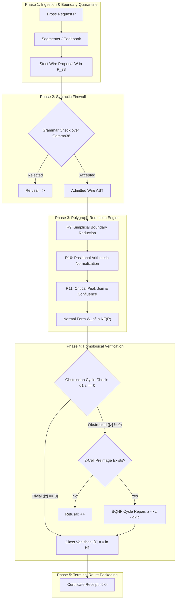
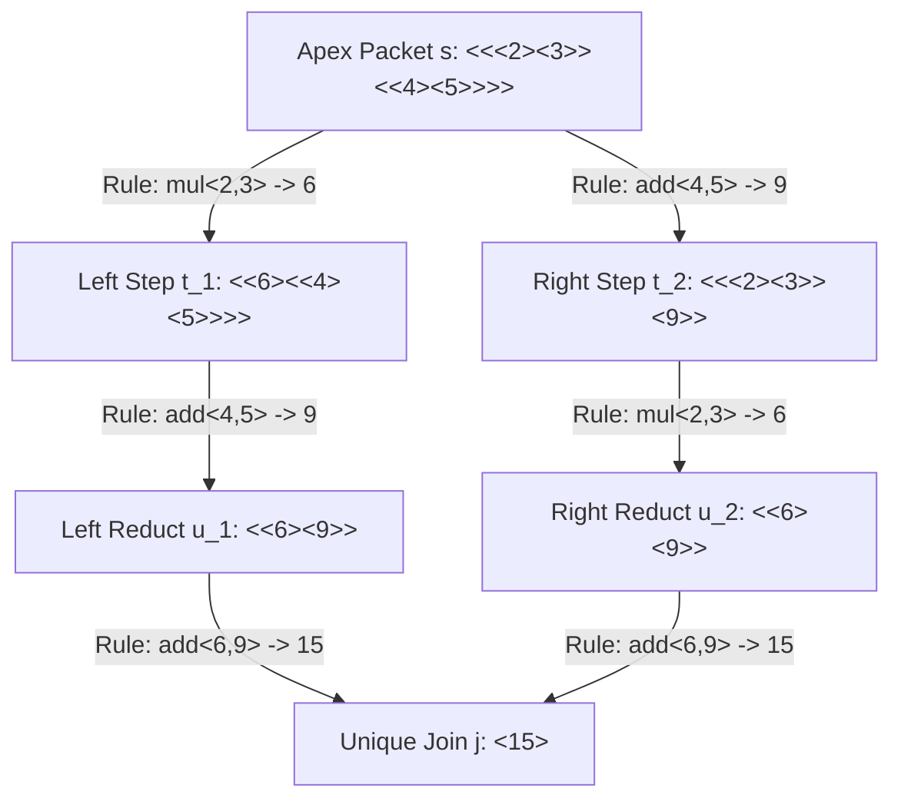

# Formal Rewriting Architecture, Diagrams, and Strategy Definitions over the 38-Character Wire Substrate (Γ₃₈)

**AuthorityEffect:** None.  
**Framework:** Minimal Symbol System (MSS-N) Rewriting Subsystem & Proposal Fidelity Protocol (PFP).  
**Substrate Alphabet:** $\Gamma_{38} = \{a..z\} \cup \{0..9\} \cup \{<, >\}$.  
**Normative Status:** Active Architectural Specification and Formal Rewriting Engine Reference.

---

## 1. The Expressive Universe of the 38-Character Wire Alphabet ($\Gamma_{38}$)

The Minimal Symbol System wire representation is built on a finite terminal alphabet of exactly 38 glyphs:

$$\Gamma_{38} = \Sigma_{\text{latin}} \cup \Sigma_{\text{digit}} \cup \Sigma_{\text{boundary}}$$

where:
- $\Sigma_{\text{latin}} = \{a, b, c, d, e, f, g, h, i, j, k, l, m, n, o, p, q, r, s, t, u, v, w, x, y, z\}$ ($|\Sigma_{\text{latin}}| = 26$)
- $\Sigma_{\text{digit}} = \{0, 1, 2, 3, 4, 5, 6, 7, 8, 9\}$ ($|\Sigma_{\text{digit}}| = 10$)
- $\Sigma_{\text{boundary}} = \{<, >\}$ ($|\Sigma_{\text{boundary}}| = 2$)

### 1.1 Expressive Totality without Smuggled Containers

Conventional computational languages rely on ambient formatting conventions (spaces, tabs, newlines, commas, semicolons, parentheses, brackets, braces, and punctuation). Under the foundational discipline of the Minimal Symbol System (MSS-N), we refuse smuggled ambient containers. Prior to admitting an explicit delimiter, not even whitespace exists.

The 38-character inventory $\Gamma_{38}$ is sufficient to construct:

1. **Arbitrary Recursive Syntax Trees (ASTs):** The pair-balanced boundaries `<` and `>` provide unambiguous hierarchical nesting. Sibling packets are concatenated by direct adjacency (`<p1><p2>`), eliminating any requirement for whitespace or punctuation separators.
2. **Positional Arithmetic and Arbitrary Discrete Numerals:** The 10 decimal digits $\{0..9\}$ support unbounded positional natural numbers $\mathbb{N}$ (admitted at Level 28 as shown in [38-Symbol Ladder Insert](../levels/level_insert_38_symbol_ladder_and_transfinite_forms.md)).
3. **Exact Field Arithmetic ($\mathbb{Q}$):** Exact rational numbers are encoded as ordered numerator-denominator tuples inside boundary packets via a declared rational codec, e.g., `<<rat><pos><3><4>>` denoting $+3/4$, avoiding floating-point imprecision and unbalanced boundary delimiters.
4. **Abstract Simplicial Complexes and Higher Topology:** Atoms denote 0-simplices (`<a>`), adjacent pairings denote directed 1-simplices (`<ab>`), and ordered composite packets denote higher $k$-simplices (`<<2><a><b><c>>>` for a 2-simplex face).
5. **Polygraph Rewrite Rules and Confluence Cells:** 2-cells (rewrite rules) are encoded as `<<rule><id><<lhs><rhs>>>>`, and 3-cells (critical peak syzygies) are encoded as `<<peak><apex><left><right><join>>>` as specified in [Level 11: Polygraph Rewrites & Confluence Peaks](../levels/level_11_polygraph_confluence_peaks.md).
6. **Proposal Fidelity Directives & Role Envelopes:** Claims, assumptions, derivations, checks, and typed refusals are expressed as structured packet envelopes (`<<assume><p><x>>>`, `<<derive><p><y>>>`, `<<refusal><errcode>>>`).

### 1.2 Substrate Dialect Stratification

The literature and experimental traces distinguish three practical dialect tiers operating over or extending $\Gamma_{38}$:

| Dialect Tier | Lexical Alphabet | Structural Format | Example Inscription | Operational Role |
|---|---|---|---|---|
| **Tier S (Strict Boundary Wire)** | $\Gamma_{38}$ strictly (no spaces, commas, or punctuation) | Balanced packet trees (`mss-boundary-v1`) | `<<op><1><<arg><a>>>>` | Machine-verified wire substrate, zero-whitespace parsing, canonical storage |
| **Tier H (Head-Word Presentation)** | $\Gamma_{38} \cup \{\text{space}, \text{newline}, ',', '=', '+', '*', '-'\}$ | Headed application forms | `lp<var<x>, dom<0,10>>` | Human-legible trace inspection, diagnostic debugging, pedagogical walkthroughs |
| **Tier D (PFP Directive Protocol)** | $\Gamma_{38} \cup \{\text{A-Z}, \text{space}, '\_'\}$ | Space-delimited command directives | `<assume p1 <ab>>` | Host oracle session coordination, typed failure routing (`<refusal ERR_EMPTY>`) |

A rewrite transformation must declare its source and target tiers. The primary target for verified execution and cryptographic receipt binding is **Tier S**.

---

## 2. Formal Mathematical Definitions of Rewriting over $\Gamma_{38}$

### Definition 2.1 (Substrate Inscriptions and Word Monoid)
Let $\Gamma_{38}$ be the declared 38-glyph alphabet. The set of all finite inscriptions over $\Gamma_{38}$ is the free monoid $\Gamma_{38}^*$ under word concatenation, with the empty inscription denoted $\varepsilon$ and identity $\varepsilon \cdot w = w \cdot \varepsilon = w$. The length of an inscription $w \in \Gamma_{38}^*$ is denoted $|w|$.

### Definition 2.2 (The Strict Boundary Packet Algebra $\mathcal{P}_{38}$)
The carrier of non-boundary alphanumeric tokens is $\mathcal{W}_{36} = (\Sigma_{\text{latin}} \cup \Sigma_{\text{digit}})^+$. The algebra of strict boundary packets $\mathcal{P}_{38} \subset \Gamma_{38}^*$ is the minimal set defined inductively by the formal grammar:

$$\begin{aligned}
\text{packet} &::= \text{ground} \mid \text{atom} \mid \text{composite} \\
\text{ground} &::= \texttt{"<"} \texttt{">"} \\
\text{atom} &::= \texttt{"<"} \, w \, \texttt{">"} \quad (w \in \mathcal{W}_{36}) \\
\text{composite} &::= \texttt{"<"} \, p_1 \, p_2 \dots p_k \, \texttt{">"} \quad (k \ge 1, \, p_i \in \mathcal{P}_{38})
\end{aligned}$$

Every packet $p \in \mathcal{P}_{38}$ is bracket-balanced, non-empty, and contains no whitespace or unescaped auxiliary delimiters.

### Definition 2.3 (Term Positions, Addresses, and Subterm Extraction)
For any packet $t \in \mathcal{P}_{38}$, the set of valid tree positions $\operatorname{Pos}(t) \subset \mathbb{N}^*$ is defined recursively:
1. The empty position $\epsilon \in \operatorname{Pos}(t)$ addresses the root term: $t|_\epsilon = t$.
2. If $t = \langle p_1 p_2 \dots p_k \rangle$, then for each $i \in \{1, \dots, k\}$ and $q \in \operatorname{Pos}(p_i)$, the concatenated address $i \cdot q \in \operatorname{Pos}(t)$, with subterm extraction:
   $$t|_{i \cdot q} = (p_i)|_q$$
3. For any position $p \in \operatorname{Pos}(t)$ and replacement packet $s \in \mathcal{P}_{38}$, the term replacement $t[s]_p$ denotes the packet obtained by substituting $s$ at address $p$.

### Definition 2.4 (Packet Rewrite Systems)
A **rewrite rule** over $\mathcal{P}_{38}$ is an ordered pair of packets $R = (\ell \to r)$ where $\ell, r \in \mathcal{P}_{38}$, $\ell \neq \langle\rangle$, and every variable marker occurring in $r$ occurs in $\ell$.

A **packet rewrite system** is a finite set of rules $\mathcal{R} = \{(\ell_i \to r_i)\}_{i=1}^m$.

A packet $s \in \mathcal{P}_{38}$ **rewrites in one step** to $t \in \mathcal{P}_{38}$ under $\mathcal{R}$ (written $s \to_{\mathcal{R}} t$) if and only if:
$$\exists p \in \operatorname{Pos}(s), \quad \exists (\ell \to r) \in \mathcal{R}, \quad \exists \sigma \quad \text{such that} \quad s|_p = \sigma(\ell) \quad \text{and} \quad t = s[\sigma(r)]_p$$
where $\sigma: \mathcal{V} \to \mathcal{P}_{38}$ is a substitution mapping variable slots to sub-packets.

The reflexive-transitive closure of $\to_{\mathcal{R}}$ is denoted $\to_{\mathcal{R}}^*$. The symmetric-reflexive-transitive closure is the convertibility relation $\equiv_{\mathcal{R}}$.

### Definition 2.5 (Confluence, Termination, and Church-Rosser Properties)
1. **Joinability:** Two terms $t_1, t_2 \in \mathcal{P}_{38}$ are joinable (written $t_1 \downarrow_{\mathcal{R}} t_2$) if there exists $u \in \mathcal{P}_{38}$ such that $t_1 \to_{\mathcal{R}}^* u$ and $t_2 \to_{\mathcal{R}}^* u$.
2. **Confluence:** $\mathcal{R}$ is confluent if for all $s, t_1, t_2 \in \mathcal{P}_{38}$, $t_1 \leftarrow_{\mathcal{R}}^* s \to_{\mathcal{R}}^* t_2 \implies t_1 \downarrow_{\mathcal{R}} t_2$.
3. **Local Confluence (WCR):** $\mathcal{R}$ is locally confluent if for all $s, t_1, t_2 \in \mathcal{P}_{38}$, $t_1 \leftarrow_{\mathcal{R}} s \to_{\mathcal{R}} t_2 \implies t_1 \downarrow_{\mathcal{R}} t_2$.
4. **Strong Normalization (Termination):** $\mathcal{R}$ is terminating if there is no infinite chain of reductions $s_0 \to_{\mathcal{R}} s_1 \to_{\mathcal{R}} s_2 \dots$.
5. **Newman's Lemma:** Under the declared assumptions of strong normalization and local confluence, $\mathcal{R}$ is globally confluent.
6. **Unique Normal Forms:** If $\mathcal{R}$ is terminating and confluent, every term $t \in \mathcal{P}_{38}$ reduces to a unique irreducible normal form, denoted $t\!\downarrow_{\mathcal{R}} \in \mathrm{NF}(\mathcal{R})$.

### Definition 2.6 (Critical Pairs and 2-Polygraph Syzygies)
Let $(\ell_1 \to r_1)$ and $(\ell_2 \to r_2)$ be two rules in $\mathcal{R}$ whose left-hand sides overlap non-trivially at subterm position $p \in \operatorname{Pos}(\ell_1)$. Let $\mu = \operatorname{mgu}(\ell_1|_p, \ell_2)$ be their most general unifier. The divergence:
$$t_1 = \operatorname{replace}_p(\mu(\ell_1),\mu(r_2)) \quad \xleftarrow{\ell_2 \to r_2} \quad s = \mu(\ell_1) \quad \xrightarrow{\ell_1 \to r_1} \quad t_2 = \mu(r_1)$$
constitutes a **critical peak**; $\operatorname{replace}_p(t,u)$ replaces the subterm of $t$ at position $p$ by $u$. The pair $\langle t_1, t_2 \rangle$ is a **critical pair**. In the 2-polygraph representation of MSS-11, this peak represents a 2-cell boundary whose joinability $\exists j, t_1 \to^* j \leftarrow^* t_2$ defines an interior 3-cell (syzygy).

### Definition 2.7 (Simplicial Homology and Boundary-Quotient Rewrites)
Let $K = (V, E, F)$ be a finite simplicial complex encoded as boundary packets over $\Gamma_{38}$.
1. **Chain Groups:** $C_0(K) = \mathbb{Z}[V]$, $C_1(K) = \mathbb{Z}[E]$, $C_2(K) = \mathbb{Z}[F]$.
2. **Boundary Operators:**
   $$\partial_1(\langle ab \rangle) = \langle b \rangle - \langle a \rangle, \qquad \partial_2(\langle abc \rangle) = \langle bc \rangle - \langle ac \rangle + \langle ab \rangle$$
   satisfying the nilpotence condition $\partial_1 \circ \partial_2 = 0$.
3. **Homological Obstruction:** A 1-chain $z \in C_1(K)$ is a 1-cycle if $\partial_1 z = 0$. It represents an unbridged obstruction if its homology class $[z] \neq 0 \in H_1(K) = \ker \partial_1 / \operatorname{im} \partial_2$.
4. **Boundary-Quotient Cycle Repair Rewrite:** As governed by [MSSN-BQNF](../normal_forms/nf.mssn.bqnf.yaml), an obstruction cycle $z$ rewrites to coboundary equilibrium via an injected 2-cell preimage $c \in C_2(K_{\text{ext}})$:
   $$z \quad \xrightarrow[\text{cycle-repair}]{\text{inject } c} \quad z - \partial_2(c) = 0 \pmod{\operatorname{im} \partial_{2,\text{ext}}}$$

---

## 3. Comprehensive Rewriting Diagrams

### Diagram 3.1: Macro End-to-End Rewriting Architecture Flow

This diagram illustrates the complete transformation lifecycle: intake of an unstructured or semi-structured prompt, partition into typed role spans, encoding into a strict wire proposal, syntax checking through the Syntactic Firewall, term rewrite chase to normal form, homological cycle verification, and fail-closed routing by the host oracle.

```text
+---------------------------------------------------------------------------------------------------------+
|                                    MACRO REWRITING ARCHITECTURE PIPELINE                                |
+---------------------------------------------------------------------------------------------------------+
|                                                                                                         |
|   +--------------------------+                                                                          |
|   |  Natural Language Prompt |   (P: Raw task text, constraints, background context)                    |
|   +-------------+------------+                                                                          |
|                 |                                                                                       |
|                 v  [Strategy R1 / R2: Role Partitioning & Enclosure]                                    |
|   +--------------------------+                                                                          |
|   | Declared Role Spans (AST)|   (Partitioned: task, constraint, context, output, unresolved)           |
|   +-------------+------------+                                                                          |
|                 |                                                                                       |
|                 v  [Strategy R6: Boundary Serialization -> Gamma38]                                     |
|   +--------------------------+                                                                          |
|   | Strict Wire Proposal (W) |   W = <<p><v1><<q><s0>><<c><s1>><<d><s2>>>> in P_38                      |
|   +-------------+------------+                                                                          |
|                 |                                                                                       |
|                 +-----------------------+                                                               |
|                 |                       |                                                               |
|                 | Syntax Valid?         | Syntax Malformed / Outside Gamma38                            |
|                 v                       v                                                               |
|   +--------------------------+   +------------------------------------+                                 |
|   |  Syntactic Firewall Gate |   | Refusal Terminal: <refusal ERR_SYN>|  [Strategy R8]                   |
|   +-------------+------------+   +------------------------------------+                                 |
|                 |                                                                                       |
|                 v  [Evaluator::PolygraphRewriter: Term & Packet Reductions]                             |
|   +-------------------------------------------------------------------+                                 |
|   |             REWRITE CHASE TO CANONICAL NORMAL FORM                |                                 |
|   |                                                                   |                                 |
|   |   W = t_0  --R9-->  t_1  --R10-->  t_2  --R11--> ... --> W_nf     |                                 |
|   |                                                                   |                                 |
|   |   * R9:  Simplicial Boundary Reduction (d_k elimination)          |                                 |
|   |   * R10: Positional Arithmetic & Rational Simplification          |                                 |
|   |   * R11: Critical Peak Join (Confluence Chase)                    |                                 |
|   +----------------------------------+--------------------------------+                                 |
|                                      |                                                                  |
|                                      v  [Evaluator::IncidenceValidator / HodgeProjector]                |
|   +-------------------------------------------------------------------+                                 |
|   |               OBSTRUCTION AUDIT & HOMOLOGICAL CHECK               |                                 |
|   |                                                                   |                                 |
|   |   Is 1-cycle obstructed? (d_1 z = 0 with [z] != 0 in H_1)         |                                 |
|   +------------------+--------------------------------+---------------+                                 |
|                      |                                |                                                 |
|          [No Obstruction / Repaired]                  | [Unrepaired / Active Obstruction]               |
|                      |                                |                                                 |
|                      v                                v                                                 |
|   +------------------------------------+   +------------------------------------+                       |
|   | Terminal Routing: <cert <W_nf><w>>>|   | Terminal Routing: <repair <z><c>>> |                       |
|   | Status: CERTIFIED / ACCEPTED       |   | or <refusal ERR_OBSTRUCTION>       |                       |
|   +------------------------------------+   +------------------------------------+                       |
|                                                                                                         |
+---------------------------------------------------------------------------------------------------------+
```



---

### Diagram 3.2: Polygraph Confluence Peak & Critical Diamond Join

This diagram models local confluence verification in `Evaluator::PolygraphRewriter` under [MSS-11](../levels/level_11_polygraph_confluence_peaks.md). When two rewrite rules overlap on a shared subterm, they generate a critical divergence peak. Confluence requires both branches to reduce to an identical join term $j$.

```text
                                Apex Term s in P_38
                               (Overlapping Redexes)
                                      /     \
                                     /       \
                    Rule R_alpha    /         \    Rule R_beta
                   at address p_1  /           \  at address p_2
                                  v             v
                             Branch t_1     Branch t_2
                                  |             |
                                  |             |
                          Rewrite |             | Rewrite
                          Steps   |             | Steps
                          (R*)    |             | (R*)
                                  v             v
                             Reduct u_1     Reduct u_2
                                  \             /
                                   \           /
                                    \         /
                                     v       v
                                  Common Join j
                           (Canonical Normal Form s|v)
```



---

### Diagram 3.3: The 5-Stratum Expressive Rewriting Hierarchy over $\Gamma_{38}$

Rewriting over $\Gamma_{38}$ operates across five distinct abstraction strata, from lexical strings to higher operadic verification:

```text
+---------------------------------------------------------------------------------------------------------+
|                              THE 5-STRATUM REWRITING LADDER OVER GAMMA38                                |
+---------------------------------------------------------------------------------------------------------+
|                                                                                                         |
|  STRATUM 5: PROPOSAL-HOST GAME & TERMINAL EVALUATION                                                    |
|  * Objects: Proposals W, Host Receipts, Certificates, Typed Refusals                                    |
|  * Reductions: W -> <<cert><W_nf><receipt>>> | <<refusal><ERR_CODE>>                                    |
|  * Evaluator: Evaluator::TerminalRouter, Evaluator::AuthorityGovernor                                   |
|                                                                                                         |
|  STRATUM 4: SIMPLICIAL & COHOMOLOGICAL CYCLE REPAIR                                                     |
|  * Objects: k-Simplices, Oriented Chains C_k, Boundary Complexes d_k                                    |
|  * Reductions: z -> z - d_{k+1}(c) = 0 (Obstruction cycle repair to zero harmonic class)               |
|  * Evaluator: Evaluator::IncidenceValidator, Evaluator::HodgeProjector (MSSN-BQNF)                      |
|                                                                                                         |
|  STRATUM 3: STRUCTURAL BOUNDARY PACKET REWRITING                                                        |
|  * Objects: Well-formed trees P_38, Subterms, Context Replacements t[s]_p                               |
|  * Reductions: <<op><arg1>...<argk>> -> <result> (First-order & higher-order packet terms)              |
|  * Evaluator: Evaluator::PolygraphRewriter (MSS-11 Church-Rosser reduction)                             |
|                                                                                                         |
|  STRATUM 2: POSITIONAL ARITHMETIC & RATIONAL REDUCTION                                                  |
|  * Objects: Base-10 Numeral Strings {0..9}+, Exact Fraction Pairs <<num><den>>                          |
|  * Reductions: <<add><n><m>> -> <sum>, <<mul><<a1><b1>><<a2><b2>>> -> <<mul a1 a2><mul b1 b2>>        |
|  * Evaluator: Exact Rational Solver, Discrete Arithmetic Normalizer                                     |
|                                                                                                         |
|  STRATUM 1: LEXICAL STRING REWRITING OVER MONOID                                                        |
|  * Objects: Words in Sigma_36*, Raw Boundary Delimited Streams                                          |
|  * Reductions: Semi-Thue string rewriting rules: w_1 => w_2 (Production 22 in mssn.ebnf)                 |
|  * Evaluator: Evaluator::SubstrateParser, Evaluator::BinaryParser                                       |
|                                                                                                         |
+---------------------------------------------------------------------------------------------------------+
```

---

### Diagram 3.4: Simplicial Cycle Repair Rewriting Diagram

This diagram details homological cycle repair (Stratum 4). A closed 1-cycle $z = \langle ab \rangle + \langle bc \rangle + \langle ca \rangle$ has vanishing boundary ($\partial_1 z = 0$), but encloses a topological void ($[z] \neq 0 \in H_1$). The repair strategy injects a 2-cell face $c = \langle abc \rangle$ whose boundary $\partial_2 c = z$ reduces the obstruction to zero in the quotient homology group.

```text
           Hollow 1-Cycle z                                Repaired Complex K_ext
       (Unresolved Obstruction)                             (Injected 2-Cell c)

                  b                                                  b
                 / \                                                / \
                /   \                                              / c \
               /     \                                            / (face)
          <ab>/       \<bc>                                  <ab>/       \<bc>
             /         \                                        /         \
            /     z     \                                      /     0     \
           /   (void)    \                                    /  (filled)   \
          a -------------- c                                 a -------------- c
                <ca>                                               <ca>

          Boundary: d_1(z) = 0                               Boundary: d_1(z) = 0
          Homology: [z] != 0 in H_1                          Injected: d_2(c) = z
          Status: ACTIVE OBSTRUCTION                         Rewrite:  z - d_2(c) -> 0
                                                             Status: QUOTIENT EXACT (BQNF)
```

---

## 4. Comprehensive Strategy Inventory (R1 through R12)

The strategies below are design specifications with proposed trigger conditions, redex patterns and checks. This document does not provide an executable parser, complete rewrite system, or proof of termination and confluence. A pattern containing metavariables is not itself a literal word over $\Gamma_{38}$.

```text
+-------------------------------------------------------------------------------------------------------+
|                                    STRATEGY DISPATCH MATRIX                                           |
+----+----------------------------+-----------------------+---------------------+-----------------------+
| ID | Name                       | Target Stratum        | Input Pattern       | Output Normal Form    |
+----+----------------------------+-----------------------+---------------------+-----------------------+
| R1 | Carrier Declaration        | Stratum 5 (Protocol)  | Raw task            | Declared 5-tuple pkg  |
| R2 | Prose Enclosure Quarantine | Stratum 3 (Packet)    | Mixed text/codebook | Pure boundary AST     |
| R3 | Epistemic Abstention       | Stratum 5 (Protocol)  | Undecidable query   | Quiescent / Refusal   |
| R4 | Collision Audit            | Stratum 3 (Packet)    | Homonymous tokens   | Disambiguated lifts   |
| R5 | Local/Global Split         | Stratum 4 (Homology)  | Local valid step    | Globally bound step   |
| R6 | Cross-Dialect Transpiler   | Stratum 1-3 (Syntax)  | Tier H / Tier D     | Strict Tier S         |
| R7 | Directive Role Wrapping    | Stratum 5 (Protocol)  | Bare claim          | Typed role wrapper    |
| R8 | Typed Refusal Routing      | Stratum 5 (Protocol)  | Failure condition   | Refusal error packet  |
| R9 | Simplicial Boundary Red.   | Stratum 4 (Homology)  | Boundary operator   | Chain difference      |
| R10| Positional Arithmetic Red. | Stratum 2 (Arithmetic)| Arithmetic term     | Reduced numeral/frac  |
| R11| Critical Peak Join         | Stratum 3 (Polygraph) | Divergent peak      | Unique join term      |
| R12| Terminal Receipt Sealing   | Stratum 5 (Protocol)  | Irreducible NF      | Certified receipt     |
+----+----------------------------+-----------------------+---------------------+-----------------------+
```

---

### Strategy R1: Carrier Declaration Injection
- **Target Stratum:** Stratum 5 (Protocol Coordination).
- **Trigger Precondition:** An incoming task proposal omits explicit carrier declarations (alphabet, valid terms, rewrite rules, obstruction detector, terminal predicate).
- **Redex Pattern:** Unfenced task expression $T \in \mathcal{P}_{38}$.
- **Rewrite Rule:**
  $$T \quad \xrightarrow{\text{R1}} \quad \langle \langle\text{carrier}\rangle \langle\Sigma\rangle \langle\text{terms}\rangle \langle\mathcal{T}\rangle \langle\text{rules}\rangle \langle\mathcal{R}\rangle \langle\text{obst}\rangle \langle\Omega\rangle \langle\text{term}\rangle \langle\Phi\rangle \langle\text{task}\rangle T \rangle$$
- **Operational Invariant:** Fails closed if any of the five fundamental parameters ($\Sigma, \mathcal{T}, \mathcal{R}, \Omega, \Phi$) is undefined.
- **Example in Strict Wire:**
  $$\texttt{<<task><integrate>>} \quad \xrightarrow{\text{R1}} \quad \texttt{<<decl><<alph><gamma38>><<dom><rat>><<rule><poly>><<obst><divzero>><<goal><exact>>>><<task><integrate>>>}$$

---

### Strategy R2: Prose Enclosure Quarantine
- **Target Stratum:** Stratum 3 (Structural Boundary Packets).
- **Trigger Precondition:** Input contains natural language prose, comments, or external conversational layout tokens.
- **Redex Pattern:** Text with unbracketed characters or mixed whitespace: $w_1 \, \text{prose} \, w_2$.
- **Rewrite Rule:** Natural language substrings are extracted and isolated into external codebook slots $s_0, s_1, \dots$, while the active expression is rewritten into a pure structural envelope in $\mathcal{P}_{38}$:
  $$P \quad \xrightarrow{\text{R2}} \quad \langle \langle p \rangle \langle v1 \rangle \langle\langle q \rangle \langle s_0 \rangle\rangle \langle\langle c \rangle \langle s_1 \rangle\rangle \rangle$$
- **Operational Invariant:** No characters outside $\Gamma_{38}$ may persist in the rewritten wire packet. The codebook mapping is retained separately in the custody receipt.

---

### Strategy R3: Epistemic Abstention & Quiescent Normalization
- **Target Stratum:** Stratum 5 (Protocol Coordination).
- **Trigger Precondition:** A query demands semantic truth, physical reality, or interpretation of an uninterpreted token without an admitted valuation map.
- **Redex Pattern:** $\langle \langle\text{ask}\rangle \langle\text{meaning}\rangle \langle x \rangle \rangle$.
- **Rewrite Rule:**
  $$\langle \langle\text{ask}\rangle \langle\text{meaning}\rangle \langle x \rangle \rangle \quad \xrightarrow{\text{R3}} \quad \langle \langle\text{ans}\rangle \langle x \rangle \langle\rangle \rangle \quad \text{or} \quad \langle \langle\text{refusal}\rangle \langle\text{errnointerpretation}\rangle \rangle$$
- **Operational Invariant:** Refuses to synthesize speculative semantic claims. Emits a quiescent boundary token $\langle\rangle$ or an explicit typed refusal.

---

### Strategy R4: Collision Audit & Disambiguation Lift
- **Target Stratum:** Stratum 3 (Structural Boundary Packets).
- **Trigger Precondition:** Two distinct source concepts $c_1 \neq c_2$ project to an identical token representation under the selected grammar (e.g., tokenizing `<a>` and `<b>` identically under an unindexed quotient).
- **Redex Pattern:** Occurrence of token $w$ where $|\operatorname{Fiber}(w)| > 1$.
- **Rewrite Rule:**
  $$w \quad \xrightarrow{\text{R4}} \quad \langle\langle\text{lift}\rangle \langle w \rangle \langle\text{tag}_1\rangle\rangle \quad \text{or} \quad \langle\langle\text{refusal}\rangle \langle\text{errtokenconflict}\rangle\rangle$$
- **Operational Invariant:** Silent tie-breaking is strictly prohibited. If distinct items collide under the declared observation map, the system must either inject an explicit distinguishing index or emit a typed refusal.

---

### Strategy R5: Local/Global Derivation Split
- **Target Stratum:** Stratum 4 (Simplicial & Homological Complexes).
- **Trigger Precondition:** A derivation step is verified locally (e.g., a locally valid inequality or boundary transition) but has not been checked against the global objective function.
- **Redex Pattern:** $\langle \langle\text{step}\rangle \langle\text{local}\rangle \langle x \rangle \rangle$.
- **Rewrite Rule:**
  $$\langle \langle\text{step}\rangle \langle\text{local}\rangle \langle x \rangle \rangle \quad \xrightarrow{\text{R5}} \quad \langle \langle\text{audit}\rangle \langle\langle\text{use}\rangle \langle x \rangle\rangle \langle\langle\text{derive}\rangle \langle y \rangle\rangle \langle\langle\text{matchgoal}\rangle \langle\text{pending}\rangle\rangle \rangle$$
- **Operational Invariant:** Prevents emitting `qed` or a global terminal certificate until both the local transition validity and global objective alignment pass independent verification.

---

### Strategy R6: Cross-Dialect Transpiler (Tier H/D $\to$ Strict Tier S)
- **Target Stratum:** Strata 1–3 (Lexical to Structural Boundary Packets).
- **Trigger Precondition:** Input is formulated in human-readable head-word notation (Tier H) or space-delimited directives (Tier D).
- **Redex Pattern:** Extended symbols such as `,`, `=`, `+`, spaces, or uppercase identifiers inside brackets.
- **Rewrite Rule:**
  $$\begin{aligned}
  \text{Tier H: } \quad &\texttt{op<arg1, arg2>} \quad \xrightarrow{\text{R6}} \quad \texttt{<<op><arg1><arg2>>} \\
  \text{Tier D: } \quad &\texttt{<assume p1 <x>>} \quad \xrightarrow{\text{R6}} \quad \texttt{<<assume><p1><x>>>}
  \end{aligned}$$
- **Operational Invariant:** Transpilation must be deterministic and verifiable by round-trip restriction: $r(\ell(t)) = t$.

---

### Strategy R7: Directive Role Typing
- **Target Stratum:** Stratum 5 (Protocol Coordination).
- **Trigger Precondition:** Raw assertions exist in an inscription without an explicit epistemic role.
- **Redex Pattern:** Bare propositional expression $\langle \phi \rangle$.
- **Rewrite Rule:** Wraps the expression in an explicit role packet selected from $\{\text{assume}, \text{derive}, \text{check}, \text{assert}\}$:
  $$\langle \phi \rangle \quad \xrightarrow{\text{R7}} \quad \langle \langle\text{role}\rangle \langle \phi \rangle \rangle$$
- **Operational Invariant:** Every proposition submitted to the evaluator must declare its provenance role.

---

### Strategy R8: Typed Refusal Terminal Routing
- **Target Stratum:** Stratum 5 (Protocol Coordination).
- **Trigger Precondition:** A syntax error, resource limit exhaustion, undeclared carrier, or unjoinable critical peak is detected.
- **Redex Pattern:** Any active expression encountering a failed contract predicate.
- **Rewrite Rule:** Aborts evaluation immediately and emits an immutable, typed refusal packet:
  $$E \quad \xrightarrow{\text{R8}} \quad \langle \langle\text{refusal}\rangle \langle\text{code}\rangle \langle\text{context}\rangle \rangle$$
- **Operational Invariant:** Fails closed. Does not attempt heuristic error recovery or emit hallucinated fallbacks.

---

### Strategy R9: Simplicial Boundary Reduction ($\partial$-Elimination)
- **Target Stratum:** Stratum 4 (Simplicial & Homological Complexes).
- **Trigger Precondition:** An expression contains explicit simplicial boundary operators applied to simplex tuples.
- **Redex Pattern:** $\langle \langle\text{boundary}\rangle \langle k \rangle \langle v_0 v_1 \dots v_k \rangle \rangle$.
- **Rewrite Rule:** For dimension $k\ge1$, evaluates the alternating sign sum of face deletions; the unaugmented convention is $\partial_0[v]=0$:
  $$\partial_k(\langle v_0 \dots v_k \rangle) \quad \xrightarrow{\text{R9}} \quad \sum_{i=0}^k (-1)^i \langle v_0 \dots \hat{v}_i \dots v_k \rangle$$
- **Operational Invariant:** Satisfies boundary nilpotence: $\partial_{k-1}(\partial_k(\sigma)) \to^* 0$.

---

### Strategy R10: Positional Arithmetic Normalization
- **Target Stratum:** Stratum 2 (Positional Arithmetic).
- **Trigger Precondition:** Composite packets contain arithmetic operations over decimal digit sequences.
- **Redex Pattern:** $\langle \langle\text{add}\rangle \langle d_1 \dots d_n \rangle \langle e_1 \dots e_m \rangle \rangle$ or rational multiplications.
- **Rewrite Rule:** Replaces operator redexes with their canonical base-10 digit sequences:
  $$\langle \langle\text{add}\rangle \langle 3 \rangle \langle 4 \rangle \rangle \quad \xrightarrow{\text{R10}} \quad \langle 7 \rangle$$
- **Operational Invariant:** Exact evaluation; no floating-point truncation. Overflow beyond declared word limits triggers `ERR_ARITHMETIC_OVERFLOW` via R8.

---

### Strategy R11: Critical Peak Join (Confluence Chase)
- **Target Stratum:** Stratum 3 (Polygraph Term Rewriting).
- **Trigger Precondition:** A critical peak divergence $t_1 \leftarrow s \to t_2$ is detected during AST term reduction.
- **Redex Pattern:** $\langle \langle\text{peak}\rangle \langle s \rangle \langle t_1 \rangle \langle t_2 \rangle \rangle$.
- **Rewrite Rule:** Executes parallel reduction chains until a common normal join term $j$ is reached:
  $$\langle \langle\text{peak}\rangle \langle s \rangle \langle t_1 \rangle \langle t_2 \rangle \rangle \quad \xrightarrow{\text{R11}} \quad \langle \langle\text{joined}\rangle \langle j \rangle \rangle$$
- **Operational Invariant:** If branches terminate in distinct normal forms ($u_1 \neq u_2$), confluence fails, emitting `ERR_CONFLUENCE_FAILED` via R8.

---

### Strategy R12: Terminal Receipt Sealing
- **Target Stratum:** Stratum 5 (Protocol Coordination).
- **Trigger Precondition:** All rewrite rules have terminated, no active redexes remain, and all verification predicates are satisfied.
- **Redex Pattern:** Irreducible normal form $W\!\downarrow \in \mathrm{NF}(\mathcal{R})$.
- **Rewrite Rule:** Packages the normal form into a sealed certificate with hash digest and step count:
  $$W\!\downarrow \quad \xrightarrow{\text{R12}} \quad \langle \langle\text{cert}\rangle \langle W\!\downarrow \rangle \langle\text{steps } k\rangle \langle\text{hash } h\rangle \rangle$$
- **Operational Invariant:** The receipt always carries `AuthorityEffect: None`. Independent replay checks its stated result; a signature identifies its signer. Execution authorization remains a separate policy decision.

---

## 5. Concrete Worked Rewriting Traces in Pure $\Gamma_{38}$

To demonstrate the expressive power of $\Gamma_{38}$, the following three complete derivations are written strictly over $\{a..z, 0..9, <, >\}$ without whitespace or external punctuation.

### Trace 1: Pure Positional Arithmetic & Rational Simplification

**Initial Wire Expression:** Evaluate $(3/4) \times (8/9) + (1/3)$ in exact rational form.

```text
<<add><<mul><<rat><pos><3><4>><<rat><pos><8><9>>><<rat><pos><1><3>>>
```

**Step-by-Step Reduction Sequence:**

1. **Focus Redex at Address `1` (`mul`):**
   ```text
   <<mul><<rat><pos><3><4>><<rat><pos><8><9>>>
   ```
   Apply Rule $\text{R10}_{\text{rat\_mul}}$:
   ```text
   <<rat><pos><<mul><3><8>><<mul><4><9>>>
   ```
2. **Execute Integer Multiplications:**
   $\langle\langle\text{mul}\rangle\langle 3 \rangle\langle 8 \rangle\rangle \to \langle 24 \rangle$ and $\langle\langle\text{mul}\rangle\langle 4 \rangle\langle 9 \rangle\rangle \to \langle 36 \rangle$:
   ```text
   <<rat><pos><24><36>>
   ```
3. **GCD Normalization on Fraction:**
   $\operatorname{gcd}(24, 36) = 12 \implies 24/12 = 2, \, 36/12 = 3$:
   ```text
   <<rat><pos><2><3>>
   ```
4. **Substitute back into Root Term:**
   ```text
   <<add><<rat><pos><2><3>><<rat><pos><1><3>>>
   ```
5. **Focus Redex at Root (`add` with common denominator `3`):**
   Apply Rule $\text{R10}_{\text{rat\_add\_comm}}$:
   ```text
   <<rat><pos><3><3>>
   ```
6. **Final Simplification:**
   $3/3 = 1/1$:
   ```text
   <<rat><pos><1><1>>
   ```
**Terminal Normal Form:** `<<rat><pos><1><1>>` (Representing $+1/1 = 1$).

---

### Trace 2: Simplicial Graph Walk & Cycle Repair Trace

**Problem Formulation:** A 1-cycle $z = \langle ab \rangle + \langle bc \rangle + \langle ca \rangle$ on vertices $a, b, c$ is tested for closed obstruction.

```text
<<cycle><<e><a><b>><<e><b><c>><<e><c><a>>>
```

**Step-by-Step Reduction Sequence:**

1. **Evaluate 1-Boundary $\partial_1(z)$ via Strategy R9:**
   ```text
   d1(<<e><a><b>>) = <<neg><a>><<pos><b>>>
   d1(<<e><b><c>>) = <<neg><b>><<pos><c>>>
   d1(<<e><c><a>>) = <<neg><c>><<pos><a>>>
   ```
2. **Summing Chains under Abel Reduction:**
   $$(\langle b \rangle - \langle a \rangle) + (\langle c \rangle - \langle b \rangle) + (\langle a \rangle - \langle c \rangle) \quad \to^* \quad \langle\rangle \quad (\text{zero chain})$$
   Result: $\partial_1(z) = \langle\rangle$ (The chain is a closed cycle).
3. **Obstruction Audit ($H_1$ Inhabitation Check):**
   The carrier contains vertices $\{a, b, c\}$ and edges $\{ab, bc, ca\}$, but no 2-cell face.
   Therefore, $z \notin \operatorname{im}(\partial_2)$, which means $[z] \neq 0 \in H_1$.
   The evaluator detects an **active obstruction**.
4. **Apply Strategy R1 (Homological Repair Injection under BQNF):**
   Inject 2-simplex face $f = \langle 2 \ a \ b \ c \rangle$:
   ```text
   <<inject><face><<2><a><b><c>>>>
   ```
5. **Evaluate 2-Boundary $\partial_2(f)$:**
   $$\partial_2(\langle 2 \ a \ b \ c \rangle) \quad \xrightarrow{\text{R9}} \quad \langle\langle e \rangle\langle b \rangle\langle c \rangle\rangle - \langle\langle e \rangle\langle a \rangle\langle c \rangle\rangle + \langle\langle e \rangle\langle a \rangle\langle b \rangle\rangle$$
   Accounting for orientation reversal $\langle ac \rangle = -\langle ca \rangle$, this matches $z$ exactly.
6. **Execute Quotient Reduction:**
   $$z - \partial_2(f) \quad \to^* \quad \langle\rangle$$
**Terminal Normal Form:** `<<repaired><<face><<2><a><b><c>>><<h1class><0>>>>` (Obstruction discharged).

---

### Trace 3: Natural Language Prompt to Strict Wire Transformation

**Source Prompt $P$:** `"Compute the shortest path from vertex a to vertex c in directed graph with edges a->b and b->c."`

1. **Role Segmentation (Strategy R2):**
   - Codebook slot `s0`: `"Compute the shortest path from vertex a to vertex c"` (Role: `task`)
   - Codebook slot `s1`: `"directed graph with edges a->b and b->c"` (Role: `context`)
   - Codebook slot `s2`: `"shortest path metric"` (Role: `unresolved`)
2. **Emit Boundary Proposal $W$ (Tier S):**
   ```text
   <<p><v1><<q><s0>><<d><s1>><<u><s2>>>>
   ```
3. **Carrier & Term Extraction (Strategy R1 / R6):**
   Internalizing graph entities into strict wire syntax:
   ```text
   <<graph><<v><a>><<v><b>><<v><c>><<e><a><b>><<e><b><c>>><<query><path><a><c>>>
   ```
4. **Path Composition Rewrite (Transitivity Chase):**
   Rule: $\langle\langle e \rangle\langle x \rangle\langle y \rangle\rangle \langle\langle e \rangle\langle y \rangle\langle z \rangle\rangle \to \langle\langle\text{path}\rangle\langle x \rangle\langle y \rangle\langle z \rangle\rangle$:
   ```text
   <<path><a><b><c>>
   ```
5. **Length Evaluation (Strategy R10):**
   Length $= 1 + 1 = 2$:
   ```text
   <<result><<path><a><b><c>><<len><2>>>>
   ```
6. **Receipt Sealing (Strategy R12):**
   ```text
   <<cert><<result><<path><a><b><c>><<len><2>>>><<status><verified>>>>
   ```

---

## 6. Anti-Patterns and Refusal Catalog

The following anti-patterns violate rewriting invariants and are refused fail-closed by the evaluator:

| Anti-Pattern ID | Name | Violation Description | Evaluator Error Code |
|---|---|---|---|
| **AP-01** | Whitespace Leakage | Inscribing spaces, tabs, or newlines within a Tier S packet envelope. | `ERR_LEXICAL_WHITESPACE` |
| **AP-02** | Unbalanced Boundary | Failing to pair every `<` with a corresponding `>`. | `ERR_BRACKET_IMBALANCE` |
| **AP-03** | Smuggled Auxiliary Punctuation | Using `,`, `;`, `:`, `+`, or `=` in a packet without an explicit Tier H declaration. | `ERR_AUXILIARY_PUNCTUATION` |
| **AP-04** | Ambiguous Redex Location | Applying a substitution without declaring an explicit AST address path. | `ERR_AMBIGUOUS_REDEX_ADDRESS` |
| **AP-05** | Divergent Peak Abandonment | Leaving a critical peak unjoined while asserting normal form confluence. | `ERR_CONFLUENCE_FAILED` |
| **AP-06** | Unwitnessed Diagonal Loop | Adding an edge $\langle aa \rangle$ under an irreflexive Rent Rule policy. | `ERR_DIAGONAL_VIOLATION` |
| **AP-07** | Local-Only QED Claim | Declaring global optimality or `qed` when only local validity was checked. | `ERR_UNAUTHORIZED_QED` |
| **AP-08** | Silent Entity Collapsing | Mapping distinct entities $c_1 \neq c_2$ to identical tokens without a disambiguating lift. | `ERR_UNRESOLVED_COLLISION` |

---

## 7. Claim Hygiene Quadrant

In accordance with the workspace Claim Hygiene Rule, the claims supported by this document are explicitly bounded:

1. **What this document supports:**
   - Demonstrates that the 38-character alphabet $\Gamma_{38} = \{a..z\} \cup \{0..9\} \cup \{<, >\}$ is sufficient to express abstract syntax trees, positional arithmetic, exact rationals, abstract simplicial complexes, polygraph rewrite rules, and proposal-host verification packets without ambient formatting or whitespace.
   - Formulates twelve explicit rewrite strategies (R1 through R12) with checkable preconditions, redex patterns, and fail-closed predicates.
   - Formulates local confluence joinability and critical peak verification matching the `Evaluator::PolygraphRewriter` specification in MSS-11.
   - Illustrates exact step-by-step reduction traces in pure $\Gamma_{38}$ syntax for arithmetic, simplicial cycle repair, and prompt wire transformation.

2. **What this document does not support:**
   - Does not claim that every rewrite system formulated over $\Gamma_{38}$ is terminating or decidable; arbitrary term rewriting systems remain undecidable in general.
   - Does not establish empirical performance superiority of wire packets over natural language prompts in large language models without independent benchmark receipts.
   - Does not claim that local critical peak joinability implies global confluence in the absence of verified termination bounds (Newman's Lemma requires termination).
   - Does not mint authority or self-certify correctness (`AuthorityEffect: None`).

3. **The narrowest defensible claim:**
   - $\Gamma_{38}$ provides a closed, machine-checkable syntactic wire substrate capable of encoding recursive tree terms, positional numerals, and simplicial rewrite chains, over which rewrite strategies R1 through R12 define checkable operational transformations.

4. **Next test needed:**
   - Implement an automated conformance harness in Python and Rust that parses strict Tier S packets from `mssn_conformance_cases.json`, executes rewrite strategies R9, R10, and R11 on test terms, and validates that all critical peaks join deterministically to unique normal forms.

---

## 8. Pilot Grounding & Empirical Ingress Dialect Crosswalk (Pilot 0000000)

The strategies defined in this specification directly instantiate the ingress dialects for [`omega_engine_pfp/tests/pilot_0000000`](../../../../omega_engine_pfp/tests/pilot_0000000). The table below formalizes the mapping from the pilot rewrite cases to the governing MSS-N wire strategies:

| Rewrite ID | Dialect Tier / Name | Governing Strategy | Ingress Formulation Example | Empirical Finding |
|---|---|---|---|---|
| `rewrite_01` | **Tier H** (Head-Word) | Strategy R6 (Cross-Dialect Transpiler) | `solve<eq1<add<x, mul<2, y>>, 5>, eq2<sub<mul<3, x>, y>, 1>, return<record<pair<answer, add<x, y>>>>>` | 100% acceptance under $P^*$ with verified intermediate bindings $(x=1, y=2)$. |
| `rewrite_02` | **Tier D** (PFP Directive) | Strategy R7 (Directive Role Typing) | `<assume eq1 <eq <add x <mul 2 y>> 5>> <assume eq2 <eq <sub <mul 3 x> y> 1>> <goal <eval <add x y>>> <return answer <add x y>>` | 100% acceptance under $P^*$ with verified intermediate bindings $(x=1, y=2)$. |
| `rewrite_03` | **Tier S** (Quarantine Codebook) | Strategy R2 (Prose Enclosure Quarantine) | `<<p><v1><<q><s0>><<c><s1>>>>` | Fails closed to `WRONG_ANSWER` (`ans=9`) in absence of sidecar key; triggers `antiskill_corpus_invention`. |
| `rewrite_04` | **Tier S** (Strict Boundary AST) | Strategy R6 (Strict Boundary Wire) | `<<solve><<eqs><<eq><<add><x><<mul><2><y>>><5>><<eq><<sub<<mul><3><x>><y>><1>>><<return><<answer><<add><x><y>>>>>>` | 100% acceptance under $P^*$ with verified intermediate bindings $(x=1, y=2)$. |
| `rewrite_05` | **Tier S** (Carrier Declared) | Strategy R1 & R7 (Carrier Declaration & Role Typing) | `<<decl><<alph><gamma38>><<terms><ratsys>><<rules><exactrational>><<obst><singularsystem>><<term><exactsolution>>>><<task><...>>` | 100% acceptance under $P^*$ with verified intermediate bindings $(x=1, y=2)$. |
| `rewrite_06` | **Tier S** (Matrix/Vector System) | Strategy R10 (Positional Arithmetic Normalization) | `<<sys><<mat><<row><1><2>><<row><3><<neg><1>>>>><<vec><5><1>><<target><<vec><1><1>>>>` | Fails closed to `WRONG_ANSWER` (`ans=1`); requires explicit matrix-vector multiplier license. |
| `rewrite_10` | **Tier S Multi-Cosmos Conduit** | Multi-Cosmos Epistemic Passage | `<<passage><<pregen><{<>,<a>}>><<gen><regime<...>>><<sn><r_1<x->y>>><<mssn><<solve>...>>>` | Fails closed to `WRONG_ANSWER` (`ans=1`); suppresses hallucination through strict layer containment. |

