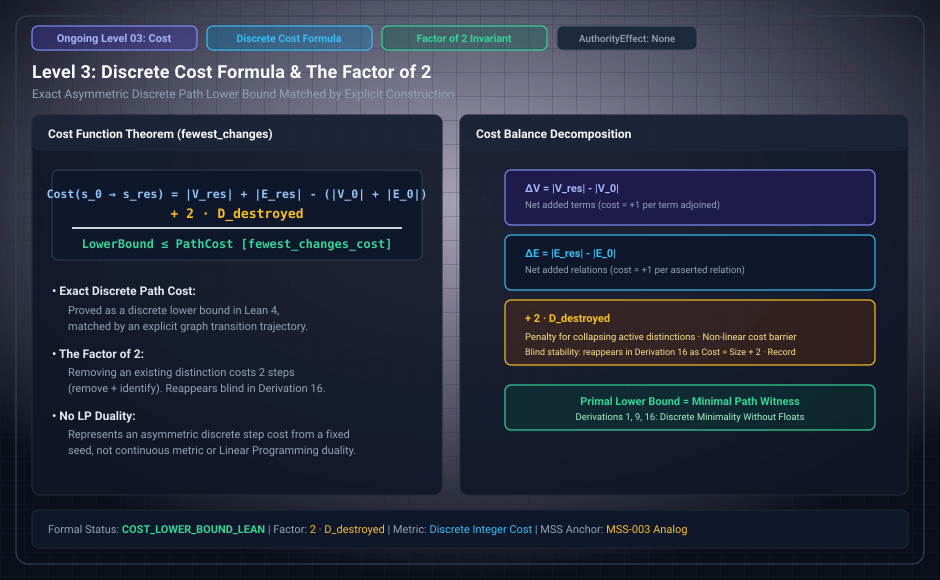

# Level 03: fewest changes, claim D8

**AuthorityEffect:** None.

**Pin:** `dbccpage/H3V7N5QF` at `5d9488324ce976817987bd83a28d901371cfc073`.

**Package:** [`001_genesis_ongoing_h3v7n5qf`](../../../../omega_engine_atlas/coda_atlas/F004_papers/001_finite_obstruction_calculus/001_genesis_ongoing_h3v7n5qf).

The drawing `genesis_ongoing_03_discrete_cost_factor2.svg` is an education schematic in this documentation tree. The sentences below are taken from the pinned package.

Claim ledger D8 states the fewest changes to a result: terms plus assertions, minus the size of what is given, plus two for each destroyed given. The ledger cites Lean `fewest_changes_lower_A`, `fewest_changes_lower_B`, `fewest_changes_A`, and `fewest_changes_B`.

`lean4/H3V7N5QF/Paths.lean` states `fewest_changes_A` for a legal well-formed state with `a = 0` and `b ∈ {0, 1}`: it is reached in exactly `costA g - 3` changes and no fewer. `fewest_changes_B` is the companion when `bra` is asserted to begin with, with `costB g - 4`.

The Python cost lives in `code/xry/cost.py`. The computed check named in D8 is `evidence/summary.json` field `round_equals_cost_formula_for_every_result`.

## Research Notes Context & Combinatorial Horizon

The research notes in `research/notes.md` (Note 3) and `research/third/reading_the_seed.md` provide mathematical context for this cost structure:

1. **Destroyed Given Factor of 2:** The $+2$ factor for each destroyed given arises from the necessity to spend one change removing the asserted given and a subsequent change constructing the replacement or navigating around the resulting vacancy.
2. **The 100-Round Cycle-Type Combinatorial Horizon:** While the grammar declares a 100-round exploration parameter, the research notes show that exploring $100$ rounds with just two terms spans approximately $10^{11}$ results, growing as $O(r^7)$ where $r$ is the round index. With three or more terms, the cycle-type partition space grows superexponentially, rendering unbounded exploration infeasible and necessitating certified finite truncation horizons.
3. **Interleaving Multiplicity Paths:** When two relations are present without destroyed givens (as seen in later derivations), shortest sequences consist of additions only, and the number of distinct shortest paths to a state with $p$ assertions in $r$ and $q$ in $s$ expands as the binomial coefficient $\binom{p+q}{p}$.

## Files

- [`paper/claim_ledger.md`](../../../../omega_engine_atlas/coda_atlas/F004_papers/001_finite_obstruction_calculus/001_genesis_ongoing_h3v7n5qf/paper/claim_ledger.md)
- [`lean4/H3V7N5QF/Paths.lean`](../../../../omega_engine_atlas/coda_atlas/F004_papers/001_finite_obstruction_calculus/001_genesis_ongoing_h3v7n5qf/lean4/H3V7N5QF/Paths.lean)
- [`code/xry/cost.py`](../../../../omega_engine_atlas/coda_atlas/F004_papers/001_finite_obstruction_calculus/001_genesis_ongoing_h3v7n5qf/code/xry/cost.py)
- [`research/notes.md`](../../../../omega_engine_atlas/coda_atlas/F004_papers/001_finite_obstruction_calculus/001_genesis_ongoing_h3v7n5qf/research/notes.md)
- [`research/third/reading_the_seed.md`](../../../../omega_engine_atlas/coda_atlas/F004_papers/001_finite_obstruction_calculus/001_genesis_ongoing_h3v7n5qf/research/third/reading_the_seed.md)

