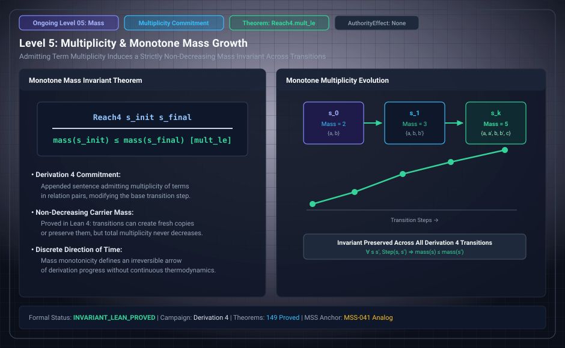

# Level 05: counted assertions do not decrease

**AuthorityEffect:** None.

**Pin:** `dbccpage/H3V7N5QF` at `5d9488324ce976817987bd83a28d901371cfc073`.

**Package:** [`001_genesis_ongoing_h3v7n5qf`](../../../../omega_engine_atlas/coda_atlas/F004_papers/001_finite_obstruction_calculus/001_genesis_ongoing_h3v7n5qf).

The drawing `genesis_ongoing_05_monotone_mass_growth.svg` is an education schematic in this documentation tree. The sentences below are taken from the pinned package.

Derivation 4 counts assertions. `lean4/Fourth/Contain.lean` states `theorem Reach4.mult_le`: along `Reach4 s t n`, `s.M p ≤ t.M p` for every pair `p`. The file header says multiplicity does not decrease.

`Reach4.arb_mult_le` is the same fact at the pair that writes `arb`. The axiom print is in `lean4/Fourth/Axioms.lean`.

The manuscript is `paper/fourth/paper.md`.

## Research Working Notes (`research/`)

The working notes for derivations 4 and 5 examine assertion arithmetic:

- **Multiplicity representation (`research/fourth/reading_the_seed.md`):** States track non-negative integer multiplicities $M(x, y)$ for each pair. An assertion is asserted when $M(x, y) > 0$.
- **Support vs. Indicator functors:** Connects counted states to uncounted states via the *support map* (keeping pairs with positive count) and the *indicator map* (setting every asserted pair count to 1).
- **Monotone mass growth:** Under Derivation 4 (where only term and assertion additions exist), multiplicities never decrease (`Reach4.mult_le`). Derivation 5 (`research/fifth/reading_the_seed.md`) restores removals and identifications, studying total mass conservation.

## Files

- [`paper/fourth/paper.md`](../../../../omega_engine_atlas/coda_atlas/F004_papers/001_finite_obstruction_calculus/001_genesis_ongoing_h3v7n5qf/paper/fourth/paper.md)
- [`research/fourth/reading_the_seed.md`](../../../../omega_engine_atlas/coda_atlas/F004_papers/001_finite_obstruction_calculus/001_genesis_ongoing_h3v7n5qf/research/fourth/reading_the_seed.md)
- [`research/fifth/reading_the_seed.md`](../../../../omega_engine_atlas/coda_atlas/F004_papers/001_finite_obstruction_calculus/001_genesis_ongoing_h3v7n5qf/research/fifth/reading_the_seed.md)
- [`lean4/Fourth/Contain.lean`](../../../../omega_engine_atlas/coda_atlas/F004_papers/001_finite_obstruction_calculus/001_genesis_ongoing_h3v7n5qf/lean4/Fourth/Contain.lean)
- [`lean4/Fourth/Axioms.lean`](../../../../omega_engine_atlas/coda_atlas/F004_papers/001_finite_obstruction_calculus/001_genesis_ongoing_h3v7n5qf/lean4/Fourth/Axioms.lean)
