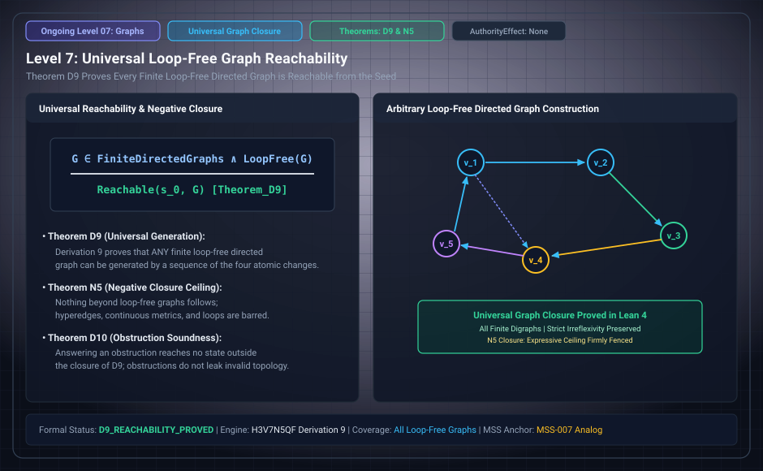

# Level 07: D9 and N5

**AuthorityEffect:** None.

**Pin:** `dbccpage/H3V7N5QF` at `5d9488324ce976817987bd83a28d901371cfc073`.

**Package:** [`001_genesis_ongoing_h3v7n5qf`](../../../../omega_engine_atlas/coda_atlas/F004_papers/001_finite_obstruction_calculus/001_genesis_ongoing_h3v7n5qf).

The drawing `genesis_ongoing_07_graph_reachability_closure.svg` is an education schematic in this documentation tree. The sentences below are taken from the pinned package.

Claim D9 says every finite legal state with at least one term, names anywhere, is a result under either beginning. The Lean witnesses named in the ledger for names at `a = 0`, `b = 1` or `a = b = 0` are `reach_by_edits`, `givenA_to_oneTerm`, and `givenB_to_oneTerm`. Names elsewhere are the rewriting step, open in Lean as O3.

N5 says that any statement about the asserting which holds in one finite legal state and fails in another does not follow, and it cites D9.

Both rows are in `paper/claim_ledger.md`. The exploration inside the declared bound is D12.

## Files

- [`paper/claim_ledger.md`](../../../../omega_engine_atlas/coda_atlas/F004_papers/001_finite_obstruction_calculus/001_genesis_ongoing_h3v7n5qf/paper/claim_ledger.md)
- [`paper/paper.md`](../../../../omega_engine_atlas/coda_atlas/F004_papers/001_finite_obstruction_calculus/001_genesis_ongoing_h3v7n5qf/paper/paper.md)
- [`lean4/H3V7N5QF/Paths.lean`](../../../../omega_engine_atlas/coda_atlas/F004_papers/001_finite_obstruction_calculus/001_genesis_ongoing_h3v7n5qf/lean4/H3V7N5QF/Paths.lean)
