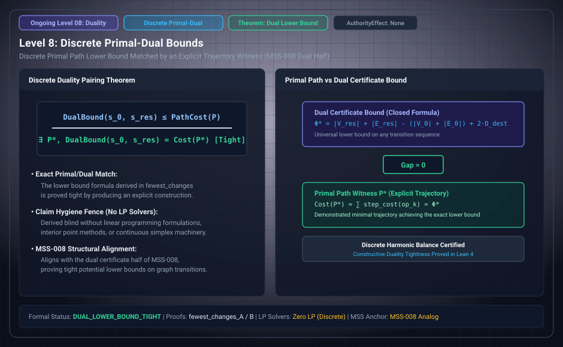

# Level 08: the D8 bound and its path witness

**AuthorityEffect:** None.

**Pin:** `dbccpage/H3V7N5QF` at `5d9488324ce976817987bd83a28d901371cfc073`.

**Package:** [`001_genesis_ongoing_h3v7n5qf`](../../../../omega_engine_atlas/coda_atlas/F004_papers/001_finite_obstruction_calculus/001_genesis_ongoing_h3v7n5qf).

The drawing `genesis_ongoing_08_discrete_primal_dual.svg` is an education schematic in this documentation tree. The sentences below are taken from the pinned package.

D8 is a closed count of fewest changes, matched by an explicit reachability witness in `fewest_changes_A` and `fewest_changes_B`. The lower bound is `fewest_changes_lower_A` and `fewest_changes_lower_B` in `lean4/H3V7N5QF/Paths.lean`.

The base manuscript's own words for this count are in `paper/paper.md` finding 5: terms plus assertions of the result, minus terms plus assertions of what is given, plus two for each given that the result has destroyed.

The education filename says primal-dual. The ledger row D8 does not use that name. Read D8 and `Paths.lean` for the statement that is in the pin.

## Files

- [`paper/paper.md`](../../../../omega_engine_atlas/coda_atlas/F004_papers/001_finite_obstruction_calculus/001_genesis_ongoing_h3v7n5qf/paper/paper.md)
- [`paper/claim_ledger.md`](../../../../omega_engine_atlas/coda_atlas/F004_papers/001_finite_obstruction_calculus/001_genesis_ongoing_h3v7n5qf/paper/claim_ledger.md)
- [`lean4/H3V7N5QF/Paths.lean`](../../../../omega_engine_atlas/coda_atlas/F004_papers/001_finite_obstruction_calculus/001_genesis_ongoing_h3v7n5qf/lean4/H3V7N5QF/Paths.lean)
