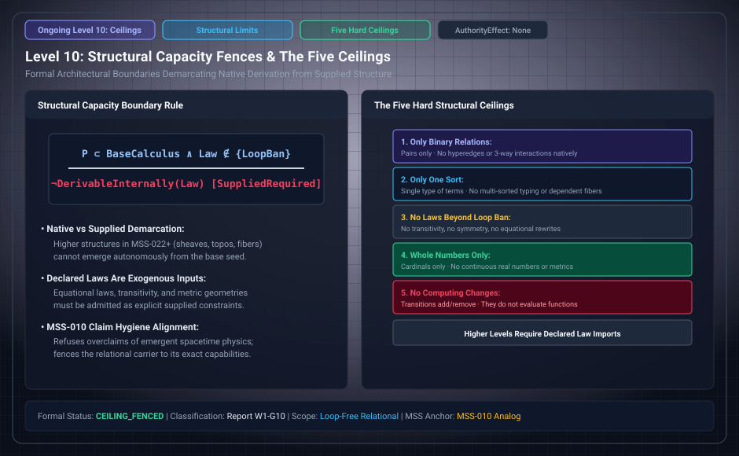

# Level 10: N5, the base expressive ceiling

**AuthorityEffect:** None.

**Pin:** `dbccpage/H3V7N5QF` at `5d9488324ce976817987bd83a28d901371cfc073`.

**Package:** [`001_genesis_ongoing_h3v7n5qf`](../../../../omega_engine_atlas/coda_atlas/F004_papers/001_finite_obstruction_calculus/001_genesis_ongoing_h3v7n5qf).

The drawing `genesis_ongoing_10_five_structural_ceilings.svg` is an education schematic in this documentation tree. The sentences below are taken from the pinned package.

The base claim ledger names the expressive ceiling as N5: a statement about the asserting that is true in one finite legal state and false in another does not follow. The witness is D9.

The education filename says five ceilings. The base ledger rows that fence the carrier are N1 through N7, with N5 as the general row. T2, P3, and F4 are not row identifiers in `paper/claim_ledger.md`.

The declared exploration bound is chosen row C8: at most 5 terms in the FREE reading and 4 terms in the ANCHORED reading.

## Files

- [`paper/claim_ledger.md`](../../../../omega_engine_atlas/coda_atlas/F004_papers/001_finite_obstruction_calculus/001_genesis_ongoing_h3v7n5qf/paper/claim_ledger.md)
