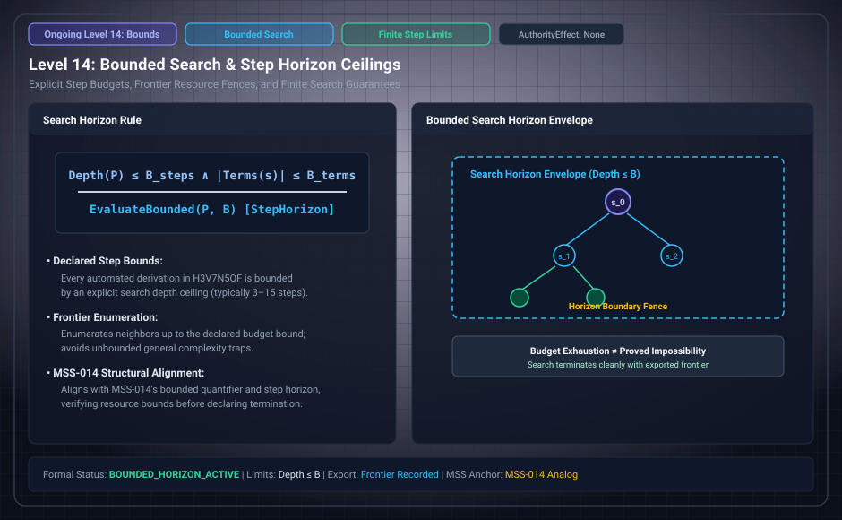

# Level 14: the declared bound and D12

**AuthorityEffect:** None.

**Pin:** `dbccpage/H3V7N5QF` at `5d9488324ce976817987bd83a28d901371cfc073`.

**Package:** [`001_genesis_ongoing_h3v7n5qf`](../../../../omega_engine_atlas/coda_atlas/F004_papers/001_finite_obstruction_calculus/001_genesis_ongoing_h3v7n5qf).

The drawing `genesis_ongoing_14_bounded_search_horizon.svg` is an education schematic in this documentation tree. The sentences below are taken from the pinned package.

Chosen row C8 sets the bound at most 5 terms for FREE sameness and 4 terms for ANCHORED sameness.

D12 says that within the bound the exploration is complete, rounds equal fewest changes without bound, and the frontier is exact. The ledger points at `evidence/summary.json`, `evidence/counts.csv`, and `evidence/frontier_*.csv`.

Open row O4 leaves results beyond the declared bound as listed only by the exported frontier. O2 leaves the number of new results in rounds 21 through 100 uncomputed.

## Files

- [`paper/claim_ledger.md`](../../../../omega_engine_atlas/coda_atlas/F004_papers/001_finite_obstruction_calculus/001_genesis_ongoing_h3v7n5qf/paper/claim_ledger.md)
- [`evidence/summary.json`](../../../../omega_engine_atlas/coda_atlas/F004_papers/001_finite_obstruction_calculus/001_genesis_ongoing_h3v7n5qf/evidence/summary.json)
