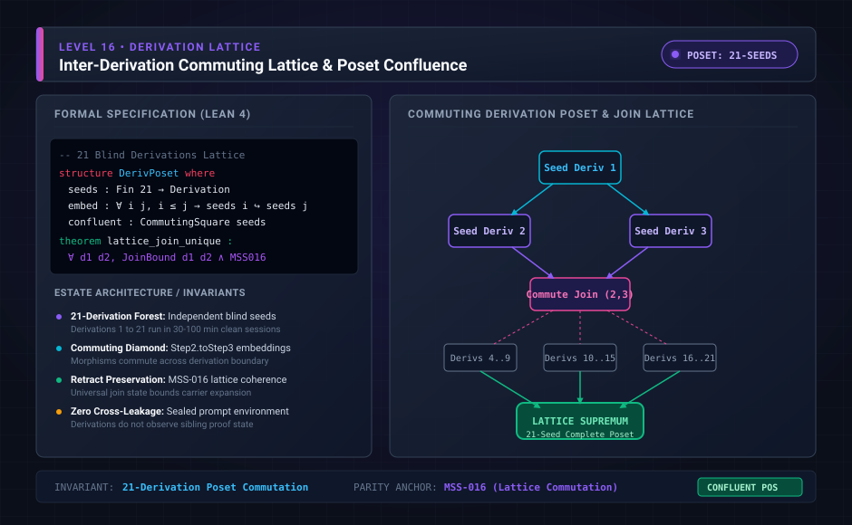

# Level 16: the 21-row review and the four later papers

**AuthorityEffect:** None.

**Pin:** `dbccpage/H3V7N5QF` at `5d9488324ce976817987bd83a28d901371cfc073`.

**Package:** [`001_genesis_ongoing_h3v7n5qf`](../../../../omega_engine_atlas/coda_atlas/F004_papers/001_finite_obstruction_calculus/001_genesis_ongoing_h3v7n5qf).

The drawing `genesis_ongoing_16_derivation_lattice.svg` is an education schematic in this documentation tree. The sentences below are taken from the pinned package.

`meta/review/derivation_review.md` is an audit of 21 local seeds: the base through the twenty-first. It says the table records semantic checks and the disposition of each seed edit. A blank finding means the review found no additional defect. It is not a claim that the derivation is complete beyond its stated finite bound.

The same file says `claim_audit.csv` indexes 782 ledger rows on the baseline meta branch.

This pin also contains `paper/twentysecond` through `paper/twentyfifth`. Those four manuscripts are later than the 21-row table. Their climbing scores are under `meta/climbing/`.

## Files

- [`meta/review/derivation_review.md`](../../../../omega_engine_atlas/coda_atlas/F004_papers/001_finite_obstruction_calculus/001_genesis_ongoing_h3v7n5qf/meta/review/derivation_review.md)
- [`paper/twentysecond/paper.md`](../../../../omega_engine_atlas/coda_atlas/F004_papers/001_finite_obstruction_calculus/001_genesis_ongoing_h3v7n5qf/paper/twentysecond/paper.md)
- [`paper/twentyfifth/paper.md`](../../../../omega_engine_atlas/coda_atlas/F004_papers/001_finite_obstruction_calculus/001_genesis_ongoing_h3v7n5qf/paper/twentyfifth/paper.md)
