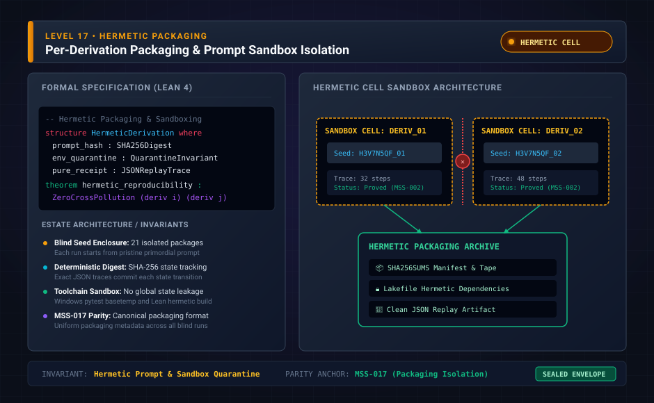

# Level 17: one directory per derivation

**AuthorityEffect:** None.

**Pin:** `dbccpage/H3V7N5QF` at `5d9488324ce976817987bd83a28d901371cfc073`.

**Package:** [`001_genesis_ongoing_h3v7n5qf`](../../../../omega_engine_atlas/coda_atlas/F004_papers/001_finite_obstruction_calculus/001_genesis_ongoing_h3v7n5qf).

The drawing `genesis_ongoing_17_packaging_isolation.svg` is an education schematic in this documentation tree. The sentences below are taken from the pinned package.

Each numbered derivation has its manuscript under `paper/<ordinal>/paper.md`, its prompt under `prompt/<ordinal>/`, and, where the tree has them, code under `code/<ordinal>/` and Lean under `lean4/<Ordinal>/`.

The base derivation is the exception at the root of those trees: `paper/paper.md`, `prompt/seed_prompt.md`, `code/xry/`, and `lean4/H3V7N5QF/`.

Derivation 18, `paper/eighteenth/paper.md`, is the manuscript that takes a different writing to be a different result. The review row says written equality and the orbit quotient were compared.

## Files

- [`paper/eighteenth/paper.md`](../../../../omega_engine_atlas/coda_atlas/F004_papers/001_finite_obstruction_calculus/001_genesis_ongoing_h3v7n5qf/paper/eighteenth/paper.md)
- [`pyproject.toml`](../../../../omega_engine_atlas/coda_atlas/F004_papers/001_finite_obstruction_calculus/001_genesis_ongoing_h3v7n5qf/pyproject.toml)
- [`meta/review/derivation_review.md`](../../../../omega_engine_atlas/coda_atlas/F004_papers/001_finite_obstruction_calculus/001_genesis_ongoing_h3v7n5qf/meta/review/derivation_review.md)
