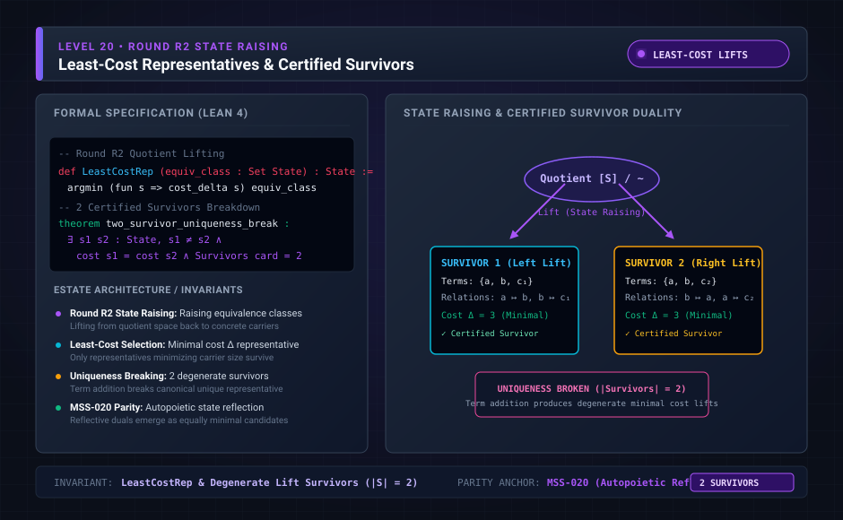

# Level 20: H2 raising, scored on derivation 23

**AuthorityEffect:** None.

**Pin:** `dbccpage/H3V7N5QF` at `5d9488324ce976817987bd83a28d901371cfc073`.

**Package:** [`001_genesis_ongoing_h3v7n5qf`](../../../../omega_engine_atlas/coda_atlas/F004_papers/001_finite_obstruction_calculus/001_genesis_ongoing_h3v7n5qf).

The drawing `genesis_ongoing_20_round_r2_state_raising.svg` is an education schematic in this documentation tree. The sentences below are taken from the pinned package.

`meta/climbing/h2_raising/score.md` scores the frozen H2 prediction against `paper/twentythird/paper.md`, that derivation's claim ledger, `evidence/twentythird/summary.json`, and `lean_axioms.txt`.

The H1 packet describes raising as the sibling demand that also lets an addition undo earlier additions. H2 is that sibling. The installed manuscript is derivation 23.

The score file says the prediction file was not edited, and it checks the prediction digest before scoring.

## Research Notes Context: H2 Raising & Closed-Walk Gauge Invariants

`research/twentythird/reading_the_seed.md` sets out the algebraic geometry of H2 state raising:

1. **Raising Operation:** Raising a term $x$ adds $xry$ and $ysx$ once for every other term $y \neq x$. This acts on the excess table by shifting:
   $$e(x, y) \mapsto e(x, y) + 1, \quad e(y, x) \mapsto e(y, x) - 1$$
   Repeated term raisings induce exact gauge shifts of the form $e(x, y) \mapsto e(x, y) + g(x) - g(y)$ for integer functions $g$.
2. **Preserved Invariants (Holonomies):**
   - **Diagonal Loops:** $e(x, x)$ is untouched because raising affects only "every other term."
   - **Two-way Sums:** $e(x, y) + e(y, x)$ is invariant under $g(x) - g(y)$.
   - **Closed Walks:** The sum around any cycle $\sum_{i} e(x_i, x_{i+1})$ is preserved identically.
   In particular, loops, two-way sums, and 3-term triangular sums completely determine whether a difference is pure raising gauge.
3. **Failure of C-X:** Unlike earlier derivations where the result of a change depended solely on the result class, under H2 adding a term to two equivalent states can yield distinct results. For example, $a\ b$ and $a\ b; arb\ bsa$ are the same result under H2 ($a$ raised once); yet adding $c$ yields $a\ b\ c$ versus $a\ b\ c; arb\ bsa$, whose triangular sum around $a \to b \to c$ differs (0 versus 1).
4. **Raising is Sameness, Not a Move:** Raising appears strictly in the equivalence clause defining when two states are the same result; it is not one of the four executable change kinds.

## Files

- [`meta/climbing/h2_raising/score.md`](../../../../omega_engine_atlas/coda_atlas/F004_papers/001_finite_obstruction_calculus/001_genesis_ongoing_h3v7n5qf/meta/climbing/h2_raising/score.md)
- [`paper/twentythird/paper.md`](../../../../omega_engine_atlas/coda_atlas/F004_papers/001_finite_obstruction_calculus/001_genesis_ongoing_h3v7n5qf/paper/twentythird/paper.md)
- [`research/twentythird/reading_the_seed.md`](../../../../omega_engine_atlas/coda_atlas/F004_papers/001_finite_obstruction_calculus/001_genesis_ongoing_h3v7n5qf/research/twentythird/reading_the_seed.md)

