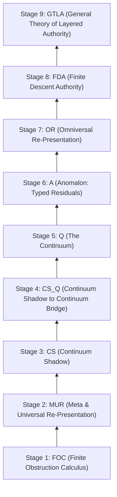
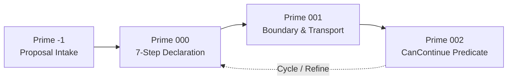

# CODA Foundations: Nine-Layer Stack, Dual Witness Certification & Halt Guards

**AuthorityEffect:** None. Mathematical architecture, dual certification contracts, and descent halting laws only; no authorization is conferred.

---

## 1. Overview & Architectural Role

The **Calculus of Obstruction, Descent, and Authority (CODA)** formalizes mathematical problem solving as a descent down an obstruction complex toward verified terminal authority. CODA establishes:
- What a declared representation can preserve;
- What admitted repairs can alter;
- What verifiable evidence supports a subsequent decision.

Its starting point is a witnessed irreflexive relation; observation, algebra, repair families, costs, and authorization are additional data.

---

## 2. The Nine Runtime Stages & Eight Components under GTLA

The core mathematical architecture of CODA comprises eight research components governed by one overarching authority architecture (GTLA), executed in nine dependency-ordered runtime stages:



| Stage | Short Name | Formal Component Title & Subtitle | Operational Invariant & Semantics |
| :---: | :--- | :--- | :--- |
| **Stage 1** | **FOC** | Finite Obstruction Calculus<br/>*Exact quotient diagnostics, dual witnesses, two-stage coherence, and transport* | Exact quotient diagnostics ($\Phi_1([h]) = \inf_{f \in R} \|h + d_0 f\|_{1,w}$), two-stage coherence ($d_1 \circ d_0 = 0$), next-defect norm ($\Gamma_2(h) = \|d_1 h\|_{1,w'}$), LP dual witness certificates ($y^* \in (C_1)^*, d_0^* y^* = 0, \|y^*\|_\infty \le 1$), and the 3-grade diagnostic trichotomy (`ExactRepair`, `CoherentResidual`, `NonclosedDefect`). |
| **Stage 2** | **MUR** | Meta & Universal Re-Presentation<br/>*A commuting square is not target standing* | Section overlap compatibility, coordinate loss, and representation transport across commuting squares ($q \circ F = \bar{F} \circ p$); collisions travel ($p(x) = p(y) \implies q(Fx) = q(Fy)$); collapsing maps lack left inverses. |
| **Stage 3** | **CS** | Continuum Shadow<br/>*Continuum Re-Presentations that Descend to the Finite Calculus* | Evaluates coarse vs. fine observation profiles ($p = \text{forget} \circ \text{fine}$), fiber constancy $\text{FiberConstant}(p, q)$, and non-injectivity projection defects (4 dots, 2 shadows); finite observations may fail to determine a query. |
| **Stage 4** | **CS_Q** | Continuum Shadow to Continuum Bridge<br/>*Image factors, decoder bounds, and missing-value obstructions* | Finite profile factorization, image factor extraction ($\bar{q}: p(X) \to Y$ exists iff constant on fibers), decoder $2\varepsilon$ bounds, section-vector collision detection, and minimum nonzero metric separation. |
| **Stage 5** | **Q** | The Continuum<br/>*Continuum Representations via Completion and Enclosure* | Rational interval order $[lo, hi]$, midpoint enclosure bounds ($|x - \text{mid}| \le \text{width}/2$), and Cauchy completion boundaries ($\widehat{\mathbb{Q}} \cong \mathbb{R}$); never "Quantum Enclosure"; returned midpoints are bounded approximations, not the enclosed point. |
| **Stage 6** | **A** | Anomalon<br/>*The Anomalon as a Typed Leftover* | Cokernel projections $x - Cx \in \ker C$, residue conservation, and persistent typed residual registers in $V / \text{im}(C)$ for `ClosedResidual` states ($\Phi_1 > 0, \Gamma_2 = 0$); strictly enforces that a leftover class is a vector, never a self-authorizing decision. |
| **Stage 7** | **OR** | Omniversal Re-Presentation<br/>*Re-Presentations Transport Rules* | Local-to-global obstruction gluing ($(a,b)$ and $(b',c)$ glue $\iff b = b'$); hard refusal sieve on empty candidate sieves, incompatible boundary overlaps, and non-closed defects; anti-consensus discipline forbidding averaging incompatible derivations. |
| **Stage 8** | **FDA** | Finite Descent Authority<br/>*A proposal is not a decision* | Five-field packets $(K, E, V, \tau, \Lambda)$, pipelines $\Pi^\sharp$, dependent pair standing $\mathsf{Standing}(p)$, and the seven evidence-derived halt guards ($g_1 \dots g_7$); strictly separates runner from authorizer; Authority Conservation Law. |
| **Stage 9** | **GTLA** | General Theory of Layered Authority<br/>*Layered Authority Architecture for CODA; Master Normal Form* | The overarching authority architecture; organizes the Master Normal Form pipeline and enforces the strictly disjoint 3-way terminal partition: Authorized ($T_{\text{auth}}$), Closed Residual Survivor ($T_{\text{res}}$), or Refused ($F_{\text{term}}$). Motto: *"A leftover class is not standing"*. |

---

## 3. Exact Rational Dual Witness Certification

When evaluating linear discrete boundary systems $D x = b$, the primal residual in the weighted $\ell^1$ norm is:

$$r = \|D x - b\|_1$$

The dual certificate is an exact rational vector $y^* \in \mathbb{Q}^m$ satisfying the dual constraints:

$$D^\top y^* = 0 \qquad \text{and} \qquad \|y^*\|_\infty \le 1$$

### Strong Duality & Impossibility Proofs
Under weak linear programming duality, for every candidate solution $x$:

$$\|D x - b\|_1 \ge \langle y^*, b \rangle$$

If $\langle y^*, b \rangle > 0$, the dual certificate $y^*$ provides an absolute mathematical certificate that no zero-residual solution exists in the chosen carrier space.

```python
from dataclasses import dataclass
from fractions import Fraction

@dataclass(frozen=True)
class DualWitnessCertificate:
    """Exact rational dual witness certificate."""

    primal_residual: Fraction
    dual_objective: Fraction
    duality_gap: Fraction
    dual_vector: tuple[Fraction, ...]
    is_certified_optimal: bool

    def is_exact_zero_gap(self) -> bool:
        """Returns True if duality gap is identically zero over Q."""
        return self.duality_gap == Fraction(0)
```

---

## 4. The Seven Evidence-Derived FDA Halt Guards

Descent algorithms across the CODA stack must terminate deterministically under the conjunction of the **Seven Evidence-Derived Halt Guards** ($g_1 \dots g_7$) from Definition FDA-D3 (`papers/fda/coda_fda.md`):

$$\mathsf{IsAuth}(t) :\iff g_1(t) \wedge g_2(t) \wedge g_3(t) \wedge g_4(t) \wedge g_5(t) \wedge g_6(t) \wedge g_7(t)$$

1. **$g_1$ `accepted`**: The pipeline execution actually accepted the run ($\Pi^\sharp = \mathsf{inl}(t)$).
2. **$g_2$ `deterministic`**: Replay of the exact same evidence record is strictly bit-for-bit identical.
3. **$g_3$ `zero_residual_mass`**: First-stage leftover mass is identically zero ($\Phi_1 = 0$) and next-defect mass is identically zero ($\Gamma_2 = 0$).
4. **$g_4$ `skeleton_preserving`**: Canonical snapshots of the declared skeleton projection agree at all measured stage boundaries.
5. **$g_5$ `exhaustive`**: All declared candidate identifiers in candidate family $E$ are verified, and at least one candidate was declared ($\text{checked\_count} = |E| \ge 1$).
6. **$g_6$ `no_pending_lift`**: The pending-lift count is identically 0 ($\text{pending\_lifts} = 0$).
7. **$g_7$ `no_refusal`**: No active refusal sits on the result ($\neg \text{RefusalActive}$).

> **Boundary Note:** In `omega_engine_coda`, seven local runtime firewall checks (role non-impersonation, exact rational arithmetic, dual witness validation, cocycle consistency, grant gap, nonterminal budget, and verification limits) guard the runtime boundary. As established in `coda_fda.md`, these runtime firewall checks are distinct from and must not be conflated with the evidence-derived mathematical guards $g_1 \dots g_7$ above.

---

## 5. Algorithm Prime Triad & Anti-Cheat Halting Laws

The Algorithm Prime Triad governs autonomous task progression and scale ascent:



1. **Prime -1 (Proposal Intake)**: Ingests external proposals, sanitizes inputs, and rejects untyped candidate carriers before tape admission (`enters_dda_trace: false`).
2. **Prime 000 (Declaration Sequence)**: Enforces the 7-step declaration sequence without step omission:
   $$\text{Frame} \longrightarrow \text{Carrier} \longrightarrow \text{Metric} \longrightarrow \text{Obstruction} \longrightarrow \text{Descent} \longrightarrow \text{Receipt} \longrightarrow \text{Authority}$$
3. **Prime 001 (Boundary & Transport Adapters)**: Validates input/output type matching across module handoffs and requires explicit loss ledgers $L_{\text{adapter}}$.
4. **Prime 002 ($\mathsf{CanContinue}_n$)**: Master continuation predicate determining whether ascent $C^n \to C^{n+1}$ is lawful:
   $$\mathsf{CanContinue}_n = (\Delta \Phi_1 < 0) \land (\Delta \Gamma_2 \le 0) \land (n < N_{\max}) \land \neg \text{CycleDetected}$$

### Six Anti-Cheat Halting Laws
- **No Self-Certification**: An agent or module generating a solution cannot certify its own receipt.
- **No Mock Bypasses**: Synthetic or test fixtures must never be used in production certification paths.
- **No Silent Skips**: Any skipped check in verification gates is treated as a hard failure.
- **No Float Comparisons**: All tolerance checks must use exact rational arithmetic ($\mathbb{Q}$).
- **No Unfenced Generalization**: A result demonstrated in dimension $N=4$ cannot claim generality for all $N$.
- **No Authority Escalation**: Autonomous loops cannot elevate `AuthorityEffect` above `None`.

---

## 6. Sovereign Rust Math & Homology Delegation

Python orchestrates workflow coordination, while exact combinatorial contractions, linear programming, and homology calculations are delegated to sovereign Rust crates under `omega_engine/crates_rs/`:

- **`omega_solvers`**: Exact rational Simplex and Interior Point LP solvers for dual witness certificate extraction.
- **`omega_homology`**: Boundary matrix reductions, Smith Normal Form, and discrete Hodge Laplacians.
- **`omega_linear_algebra`**: Shape-pure matrix operations with strict dimension checking over $\mathbb{Q}$.

---

## 7. Claim Hygiene Quadrant

1. **What this supports:**
   - Formal mathematical specification of the Nine-Layer CODA Stack (L0–L8).
   - Exact rational dual witness certification contracts over $\mathbb{Q}$.
   - The Seven Halt Guards and Six Anti-Cheat Halting Laws.
2. **What this does not support:**
   - Does not establish continuum physics, quantum mechanics, or universal convergence.
   - Does not confer operational authority from finite mathematical certification (`AuthorityEffect: None`).
3. **The narrowest defensible claim:**
   - CODA provides a formal, typed mathematical framework for certifying obstruction descent and enforcing halting boundaries over finite cochain complexes.
4. **Next test needed:**
   - Run the dual witness certification tests:
     `py -3.12 -m pytest omega_engine_atlas/coda_atlas/F004_papers/001_finite_obstruction_calculus/000_witnessed_difference_programme/docs/source_archive/discrete_deformation_calculus_package/code/tests/test_cochain.py --basetemp=scratch/pytest_tmp`
