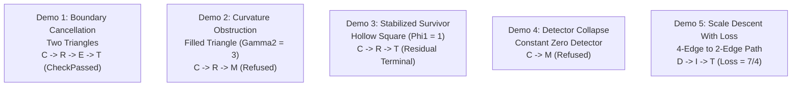

# 01: DDC Runtime Laws, Tape Theorems & Verification Demos

**AuthorityEffect:** None. Transition system laws, Lean 4 tape theorems, and minimal finite verification benchmarks only; no authorization is conferred.

---

## 1. The Eight Runtime Laws of DDC

Every valid DDC execution tape is governed by a finite-control transition system obeying eight formal laws:

1. **Law 1 (Trace Typing — OE010-03):**  
   Every letter carries its input class, output class, required witnesses, and refusal conditions. Every lawful step satisfies its letter's step law (`Ddc.well_typed_step`).
2. **Law 2 (Terminal Absorption — OE010-10):**  
   After `T` no letter is admitted. `T` is strictly the terminal element of a lawful tape (`Ddc.lawful_T_is_last`, `Ddc.terminal_absorbing`).
3. **Law 3 (Refusal Absorption — DDC-TAPE-01):**  
   Following refusal `M`, only `C` (change scope), `Λ` (licensed lift), or `T` (terminalize) may follow (`Ddc.refusal_absorbing`). Retrying unpriced operations is prohibited.
4. **Law 4 (Lift Trigger Law):**  
   Letter `Λ` requires both a valid discrete licence and an audited trigger: the pre-state must be a `ClosedResidual` or have an inadequate detector (`Ddc.L_needs_licence_and_trigger`).
5. **Law 5 (Integration Requires Receipt):**  
   Letter `I` requires an explicit, cryptographically verifiable step receipt (`Ddc.I_needs_receipt`).
6. **Law 6 (Descent Requires Loss Ledger):**  
   Letter `D` requires an explicit loss ledger $L_{\text{adapter}}$ accounting for all dropped coordinates and computed loss scalar $L(x)$ (`Ddc.D_needs_ledger`).
7. **Law 7 (Exact Repair Discharges):**  
   Letter `E` requires an exact pre-state ($\Phi_1 = 0, \Gamma_2 = 0$), preserves the carrier, and produces an all-zero defect vector and $\Phi_1 = \Gamma_2 = 0$. A gauge repair cannot cross classes (`Ddc.E_gauge_repair_discharges`).
8. **Law 8 (Context Exposure Is Not Repair):**  
   Letter `C` modifies the carrier and never decreases $\Phi_1$ or $\Gamma_2$ (`Ddc.C_changes_carrier`, `Ddc.C_is_not_repair`). Hiding an obstruction by window shrinking is prohibited as scope laundering.

### Refinement of Historical Comparison Laws (Theorem 7.1, DDC-TAPE-03)
Every step admitted by the canonical paper laws strictly refines the deposited historical comparison specifications (`engineLaw` in Lean, `engine_violations` in Python):
- Historical models permitted class-crossing edits under `E` and lacked the $\Gamma_2$ invariance fence under `R`.
- DDC paper laws enforce strict pre-condition checks and multi-axis invariants (`Ddc.paper_refines_engine`).

---

## 2. Tape Automaton & Formal Tape Theorems

**Definition 10.1 (Tape Automaton):** A tape runs from a control state in $\{\text{Open}, \text{Refused}, \text{Terminalized}\}$ over an abstract data state. `T` moves control to `Terminalized`; `M` moves control to `Refused`; `C` or `Λ` transitions `Refused` back to `Open`. Replay stops deterministically at the first unlawful step.

### Lean 4 Tape Theorems (Zero Axioms outside `propext`, `Quot.sound`)

| Claim ID | Theorem Name | Formal Lean 4 Declaration | Core Content & Meaning |
| :--- | :--- | :--- | :--- |
| **OE010-03** | Composition Law | `Ddc.run_append`<br>`Ddc.lawful_append`<br>`Ddc.lawful_nil` | Replaying $t_1 t_2$ equals replaying $t_2$ from the end of $t_1$. Lawful tapes form the morphisms of a category. |
| **OE010-10** | Terminal Absorption | `Ddc.terminal_absorbing`<br>`Ddc.lawful_T_is_last` | `Terminalized` control admits no further operations; `T` is the unique terminal letter. |
| **DDC-TAPE-01** | Refusal Absorption | `Ddc.refusal_absorbing` | After `M`, the tape admits only $\{C, \Lambda, T\}$. |
| **DDC-TAPE-02** | Well-Typed Steps | `Ddc.well_typed_step` | Every step in a lawful tape satisfies its letter law. |
| **OE010-04** | Sovereign Authority Invariant | `Ddc.authority_effect_none` | Every emitted step receipt unconditionally carries `AuthorityEffect: None`. |
| **OE010-17** | No Free Decrease | `Ddc.no_free_decrease` | If a lawful step decreases $\Phi_1$ or $\Gamma_2$, its letter is strictly `D` or `Λ`. |
| **DDC-TAPE-04** | Open Obstructions Need Priced Moves | `Ddc.open_needs_priced_move` | From $\Gamma_2 > 0$, any lawful tape without `D` and without `Λ` preserves $\Gamma_2 > 0$ and never seals. |
| **OE010-16** | Driver Soundness | `Ddc.driver_never_seals_open`<br>`Ddc.driver_repairs_only_exact`<br>`Ddc.driver_lift_trigger` | Algorithmic driver never proposes `T` on open/blind states, proposes `E` only on exact states, and requires Law 4 triggers for `Λ`. |

### The C·R·E·D·I·T Tape Theorems
The canonical sequence `C·R·E·D·I·T` is governed by four exact theorems:
1. **DDC-TAPE-05 (Equivalence):** CREDIT is lawful if and only if each of its six constituent steps satisfies its letter law (`Ddc.credit_lawful_iff`).
2. **DDC-TAPE-06 (Exact Start):** A lawful CREDIT tape must start from $\Phi_1 = 0, \Gamma_2 = 0$ (`Ddc.credit_starts_exact`).
3. **DDC-TAPE-07 (Mandatory Ledger):** Omitting the loss ledger at step `D` renders the entire CREDIT tape unlawful (`Ddc.credit_needs_ledger`).
4. **DDC-TAPE-08 (Realizability):** CREDIT is realizable on finite complexes (e.g. `demos.credit`, repairing an exact defect on a triangle and booking loss to one edge) (`Ddc.credit_realizable`).

---

## 3. The Five Minimal Finite Verification Demos

The DDC test suite pins runtime behavior across five minimal canonical complexes (`code/ddc/demos.py`, `test_fsm_and_demos.py`):



### Demo 1 — Boundary Cancellation (Two Triangles Sharing an Edge)
- **Carrier:** Two oriented triangles sharing an internal edge $e_{\text{shared}}$.
- **Lawful Path:** $C \longrightarrow R \longrightarrow E \longrightarrow T \implies$ routes to `CheckPassed` ($\Phi_1 = 0, \Gamma_2 = 0$).
- **Falsifier:** Supplying an edge flow with non-zero curl around one face ($\Gamma_2 = 1$) causes `E` to be rejected as `ExactRepairFromNonExactClass`, forcing the lawful tape $C \longrightarrow R \longrightarrow M$.

### Demo 2 — Local Green, Global Red (Filled Triangle)
- **Carrier:** A single 2-simplex with 1-cochain value $1$ on all three boundary edges.
- **Topology:** Each edge is locally consistent, yet $(d_1 x)(f) = 3$. Hence $\Gamma_2 = 3$ and $\Phi_1 = 3$.
- **Lawful Path:** $C \longrightarrow R \longrightarrow M$ with reason `REFUSED_NON_ZERO_CURL`.
- **Falsifier:** Attempting to append `T` is rejected as `TerminalizedOpenResidual`. A refusal does not license a terminal seal.

### Demo 3 — Stabilized Survivor (Hollow Square)
- **Carrier:** A 1-skeleton 4-cycle with no interior 2-cell, carrying a unit defect on one edge ($\Phi_1 = 1, \Gamma_2 = 0$).
- **Lawful Path:** $C \longrightarrow R \longrightarrow T \implies$ lawfully seals on `ResidualTerminal`.
- **Licensed Lift:** A licensed capacity lift away from the cycle, $C \longrightarrow R \longrightarrow \Lambda \longrightarrow T$, re-measures $\Phi_1 = 1$ and seals on `ResidualTerminal`.
- **Falsifiers:** An unlicensed lift is rejected (`UnlicensedLift`). Attaching a bounding 2-cell creates an open defect ($\Gamma_2 = 1$), blocking `T`.

### Demo 4 — Detector Collapse (Blind Detector)
- **Carrier:** Hollow square with unit survivor, evaluated by a defective detector that unconditionally reports zero.
- **Lawful Path:** $C \longrightarrow M$ with reason `REFUSED_DETECTOR_INADEQUATE`.
- **Falsifier:** Attempting to seal $C \longrightarrow M \longrightarrow T$ is rejected as `BlindDetector`. A licensed detector lift $C \longrightarrow \Lambda \longrightarrow T$ restores measurement and seals honestly.

### Demo 5 — Descent with Loss (Path Coarsening)
- **Carrier:** A 4-edge path carrying defect $(1, 2, 3/2, 1/4)$, projected to a 2-edge path.
- **Lawful Path:** $D \longrightarrow I \longrightarrow T$ with an audited loss ledger booking loss scalar $L(x) = 7/4$.
- **Falsifier:** Executing $D$ without a loss ledger is refused (`MissingLossLedger`), forcing the tape $M \longrightarrow T$ with reason `REFUSED_MISSING_LOSS_LEDGER`.

---

## 4. Deformation of the Window (Maurer–Cartan Invariant)

**Proposition 14.1 (OE010-05):** A deformation of the coboundary operators $d_0 \mapsto d_0 + \mu_0$ and $d_1 \mapsto d_1 + \mu_1$ preserves chain complex exactness ($(d_1 + \mu_1) \circ (d_0 + \mu_0) = 0$) if and only if the Maurer–Cartan perturbation condition is satisfied:

$$d_1 \mu_0 + \mu_1 d_0 + \mu_1 \mu_0 = 0$$

`cochain.deformation_obstruction` computes this obstruction tensor over $\mathbb{Q}$, verifying that arbitrary or untested operator shifts are rejected by the calculus.

---

## 5. Epistemic Scope & Nonclaims

```text
DDC runtime laws govern finite trace validity on declared complexes.
They do not prove that physical reality is discrete or continuous.
A lawful tape is replay evidence; it confers no authorization.
```
