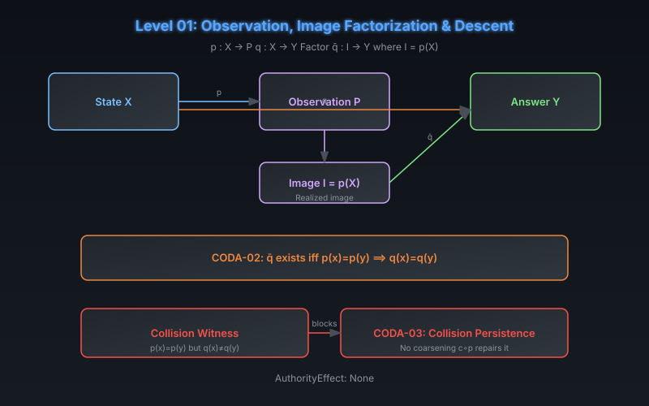

# CODA Level 01: Observation, Image Factorization & Descent

**AuthorityEffect:** None.  
**Level:** Level 01 (Observation)  
**CODA Reference:** §2.2–2.3  
**Claim IDs:** CODA-02, CODA-03

---

## 1. Schematic & Conceptual Architecture

Once a witnessed distinction exists (Level 00), CODA adds an **observation** $p : X \to P$ and a **query** $q : X \to Y$. The central question: can the query be computed from the observation alone?

---

## 2. Mathematical Presentation

1. **Image Factorization:**
   - Let $I = p(X)$ be the **realized image**. Query descent asks for $\bar{q} : I \to Y$ with $\bar{q}(p(x)) = q(x)$.

2. **CODA-02 (Descent on the Image):**
   - **Theorem:** A unique image factor $\bar{q}$ exists if and only if $p(x) = p(y) \implies q(x) = q(y)$.
   - **Proof:** A factor sends equal observations to equal answers. The converse constructs $\bar{q}(z) = q(x)$ for any $x$ with $p(x) = z$; fiber constancy makes this independent of representative.
   - **Evidential Grade:** Lean 4 mechanized with `Quot.sound`.

3. **CODA-03 (Collision Persistence):**
   - A **collision witness** is a pair $(x, y)$ with $p(x) = p(y)$ but $q(x) \neq q(y)$.
   - **Theorem:** A collision rules out a factor through $p$ and through every coarsening $c \circ p$. Any new observation through which the same query factors must separate that pair.
   - Separating one exhibited pair can leave another collision.

---

## 3. Connection to Genesis & S(n)

- Genesis Level 07 (Observational Context Profiles): distinct contextual profiles cannot be merged — presheaf descent.
- MSS-N Level 4 (Presheaves & Noncongruence): context categories and failure of syntactic quotient congruence.

---

## 4. What This Level Supports

- Exact necessary-and-sufficient condition for query descent through an observation.
- Collision persistence under coarsening (observation degradation cannot repair a collision).

## 5. What This Level Does Not Support

- A map on all of $P$ (only on the realized image $I$).
- Constructive inverse or surjectivity of observation.
- Any authority or repair capability.

## 6. Narrowest Defensible Claim

A query factors uniquely through the realized image of an observation if and only if it is constant on observation fibers.

## 7. Next Test Needed

Add repair families and exhaustion predicates to handle what happens when descent fails (Level 02).
