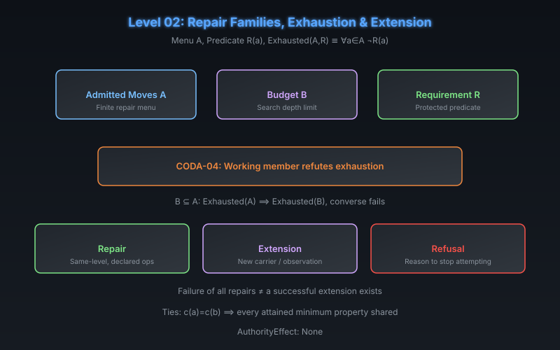

# CODA Level 02: Repair Families, Exhaustion & Extension

**AuthorityEffect:** None.  
**Level:** Level 02 (Repair)  
**CODA Reference:** §3  
**Claim ID:** CODA-04

---

## 1. Schematic & Conceptual Architecture

When observation descent fails (a collision exists), CODA introduces a **repair problem**: a set $A$ of admitted moves and a predicate $R(a)$ saying move $a$ meets the protected requirement.

---

## 2. Mathematical Presentation

1. **Exhaustion Predicate:**
   $$\operatorname{Exhausted}(A, R) \;:\Longleftrightarrow\; (\forall a \in A)\;\neg R(a)$$
   An obstruction is this scoped assertion or a proved criterion for it.

2. **CODA-04 (Exhaustion and Ties):**
   - A working member of $A$ refutes exhaustion.
   - $B \subseteq A$: exhaustion of $A$ implies exhaustion of $B$; converse fails.
   - If $c(a) = c(b)$, every attained minimum property of $a$ is shared by $b$.
   - **Evidential Grade:** Lean 4 mechanized.

3. **The Tripartite Action Split:**
   - **Repair:** Uses already declared operations (same-level, same carrier).
   - **Extension:** Changes the observation, carrier, operations, or requirements — creates a new problem.
   - **Refusal:** Records a reason to stop attempting (not a numerical residual).

---

## 3. Connection to Genesis & S(n)

- Genesis Level 13 (Primitive Passage Routing): misrouting repair into extension or extension into repair is refused — the Two-Rule Law.
- Genesis Level 14 (Search Exhaustion Gate): asserting impossibility before exhaustive certificate is refused.
- Symbol Game Tripartite Non-Conflation Law: $\text{repair} \neq \text{extend} \neq \text{promote}$.

---

## 4. What This Level Supports

- Scoped exhaustion over a finite menu with monotone subset implications.
- Clear separation of repair, extension, and refusal as three distinct actions.
- Tie-breaking on cost-equal candidates.

## 5. What This Level Does Not Support

- Existence of a successful repair from menu failure.
- Selection of a unique extension when repair fails.
- Minimum existence without finite + rational cost assumptions.

## 6. Narrowest Defensible Claim

A working member refutes scoped exhaustion; menu subset monotonicity holds; failure of all current repairs does not establish that a successful extension exists.

## 7. Next Test Needed

Introduce finite-dimensional vector spaces and the cochain complex to quantify repair residuals (Level 03).
