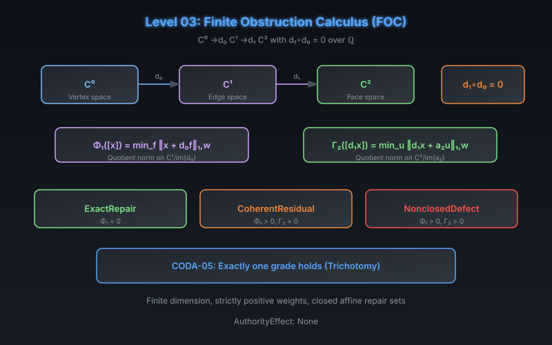

# CODA Level 03: Finite Obstruction Calculus (FOC)

**AuthorityEffect:** None.  
**Level:** Level 03 (FOC)  
**CODA Reference:** §4.1  
**Claim ID:** CODA-05

---

## 1. Schematic & Conceptual Architecture

FOC is the first algebraic extension in CODA: it adds finite-dimensional vector spaces and linear maps forming a cochain complex, enabling quantitative measurement of repair residuals.

---

## 2. Mathematical Presentation

1. **Cochain Complex:**
   $$C^0 \xrightarrow{d_0} C^1 \xrightarrow{d_1} C^2, \quad U^2 \xrightarrow{a_2} C^2, \quad d_1 d_0 = 0$$
   With strictly positive weights $w_i$ defining $\|v\|_{1,w} = \sum_i w_i |v_i|$.

2. **Quotient Diagnostics:**
   $$\Phi_1([x]) = \min_f \|x + d_0 f\|_{1,w_1}, \qquad \Gamma_2([d_1 x]) = \min_u \|d_1 x + a_2 u\|_{1,w_2}$$

3. **CODA-05 (Trichotomy Theorem):**
   Exactly one of three grades holds:

   | Grade | Condition | Meaning |
   |---|---|---|
   | `ExactRepair` | $\Phi_1 = 0$ | A declared stage-one repair removes the vector. |
   | `CoherentResidual` | $\Phi_1 > 0, \Gamma_2 = 0$ | First class remains; next defect is stage-two repairable. |
   | `NonclosedDefect` | $\Phi_1 > 0, \Gamma_2 > 0$ | Both quotients detect a remaining class. |

   - **Proof requires:** Finite dimension, strictly positive weights, closed affine repair sets.
   - **Evidential Grade:** Prose proof; companion code implements explicit packet.

---

## 3. Connection to Genesis & S(n)

- MSS-N Level 2 (Directed Graphs & Cochains): the same cochain complex $C^0 \xrightarrow{d_0} C^1 \xrightarrow{d_1} C^2$ with boundary condition $d_1 \circ d_0 = 0$.
- MSS-N Level 18 (Discrete Hodge Decomposition): orthogonal decomposition $C^1 = \operatorname{im}(d_0) \oplus \mathcal{H}^1 \oplus \operatorname{im}(d_1^*)$ over $\mathbb{Q}$.
- The Symbol Game's $\Phi_1$ and $\Gamma_2$ metrics originate from this FOC formulation.

---

## 4. What This Level Supports

- Quantitative three-way diagnostic over finite-dimensional rational vector spaces.
- Attained minima on closed affine repair sets.
- Disjoint, exhaustive classification of repair outcomes.

## 5. What This Level Does Not Support

- General optimizers or infinite-dimensional settings.
- Nonlinear, incompletely enumerated, or nonclosed repair sets.
- Authority from low defect values.

## 6. Narrowest Defensible Claim

Under finite dimension, positive weights, and closed affine repairs, the three FOC grades are disjoint and exhaustive, with minima attained.

## 7. Next Test Needed

Verify optimality via independent primal-dual certificate checking (Level 04).
