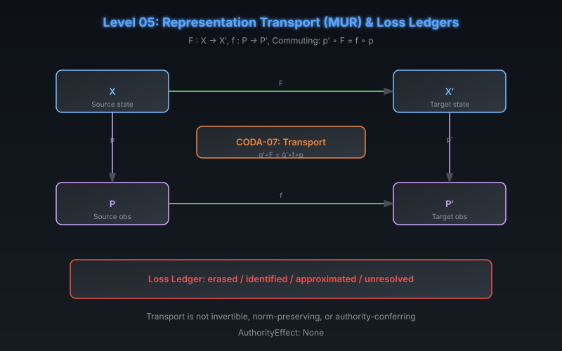

# CODA Level 05: Representation Transport (MUR) & Loss Ledgers

**AuthorityEffect:** None.  
**Level:** Level 05 (Transport)  
**CODA Reference:** §5.1  
**Claim ID:** CODA-07

---

## 1. Schematic & Conceptual Architecture

MUR (Meta-Unifying Re-Presentation) studies how representations can be transported between state spaces via commuting-square obligations, and what information is lost in the process.

---

## 2. Mathematical Presentation

1. **Transport Commuting Square:**
   $$p' \circ F = f \circ p$$
   where $F : X \to X'$, $f : P \to P'$, and $p, p'$ are observations.

2. **CODA-07 (Transported Query Factor):**
   - **Theorem:** If $q' = \bar{q}' \circ p'$, then $q' \circ F = \bar{q}' \circ f \circ p$.
   - **Proof:** Substitute the square identity into $q'(F(x)) = \bar{q}'(p'(F(x)))$.

3. **Loss Ledger:** MUR contributes a structured record of which protected distinctions were:
   - **Erased** (distinction lost by transport)
   - **Identified** (distinct elements mapped to the same target)
   - **Approximated** (preserved within a stated tolerance)
   - **Unresolved** (no determination made)

4. **Quantitative Transport:** For FOC packets, compatible linear transports satisfy $T_1 d_0 = d_0' T_0$, $T_2 d_1 = d_1' T_1$, and $T_2 a_2 = a_2' S_2$.

---

## 3. Connection to Genesis & S(n)

- Genesis Level 16 (Presentation Descent Coherence): round-trip retraction $d \circ u = \operatorname{id}$.
- MSS-N tower retraction law: $d_N(u_N(x)) = x$ for each stage transition.
- The MUR loss ledger parallels the Symbol Game's residual loss ledger.

---

## 4. What This Level Supports

- Transfer of a particular query via a commuting square.
- Structured loss accounting for transported representations.

## 5. What This Level Does Not Support

- Injectivity, invertibility, or norm preservation of transport.
- Preservation of every query (only the named one).
- Authority or grants from successful transport.

## 6. Narrowest Defensible Claim

A commuting transport square transfers a named query; the loss ledger records which distinctions survive.

## 7. Next Test Needed

Test whether multiple local solutions can be assembled into a global section (Level 06).
