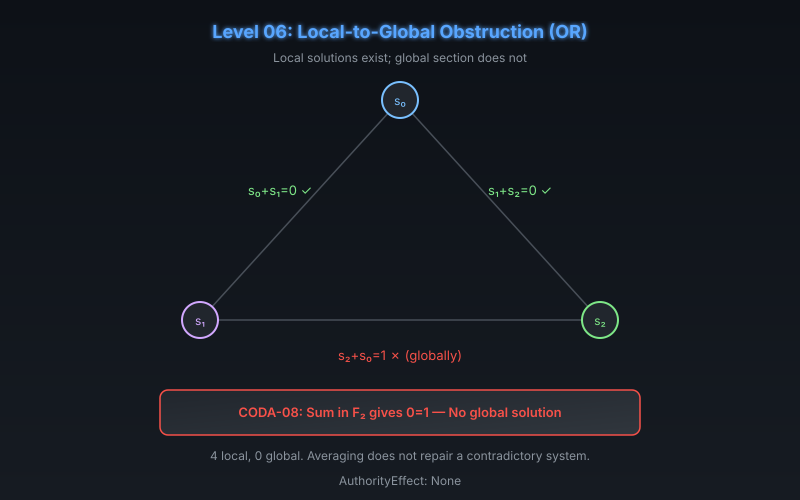

# CODA Level 06: Local-to-Global Obstruction (OR)

**AuthorityEffect:** None.  
**Level:** Level 06 (Gluing)  
**CODA Reference:** §5.2  
**Claim ID:** CODA-08

---

## 1. Schematic & Conceptual Architecture

OR (Omniversal Re-Presentation) demonstrates that **local solvability does not guarantee a global section**. This is the fundamental obstruction-theoretic insight: each edge constraint can be satisfied independently, but the system as a whole may be contradictory.

---

## 2. Mathematical Presentation

1. **CODA-08 (Explicit Gluing Obstruction):**
   - Three vertices carry values $s_0, s_1, s_2 \in \mathbb{F}_2$. Impose:
     $$s_0 + s_1 = 0, \quad s_1 + s_2 = 0, \quad s_2 + s_0 = 1$$
   - **Theorem:** Each edge equation has solutions, but the three equations have no common solution.
   - **Proof:** $s_0 = s_1 = s_2$ from the first two, contradicting the third. Summing in $\mathbb{F}_2$ gives $0 = 1$.
   - **Statistics:** 4 local assignments per edge, 0 global solutions.

2. **Consequences:**
   - Averaging the three edge verdicts does not repair the contradictory system.
   - One must change a constraint, extend the representation, or retain the obstruction.
   - Each such action changes the stated problem and belongs in the loss records.

---

## 3. Connection to Genesis & S(n)

- Genesis Level 23 (Presheaf Descent & Observer Gluing): Cech overlap mismatch without defect receipt is rejected.
- MSS-N Epoch I (MSS-23: Sheaf and Descent): site coverage with sieve matching enforcing local-to-global descent patching.
- The Symbol Game's context-extension calculus (CEC) requires the 12 extension audit conditions precisely because local success does not guarantee global coherence.

---

## 4. What This Level Supports

- An explicit finite counterexample to local-implies-global.
- The pattern generalizes: any cyclic system of constraints over $\mathbb{F}_2$ with odd parity sum fails globally.

## 5. What This Level Does Not Support

- Construction of a sheaf gluing axiom (this is a counterexample to naive assembly, not a sheaf theory).
- Repair of the contradiction by averaging or interpolation.

## 6. Narrowest Defensible Claim

Local solvability of edge constraints over $\mathbb{F}_2$ does not imply a common global solution when the parity sum is odd.

## 7. Next Test Needed

Test whether finite samples can determine continuum integrals (Level 07).
