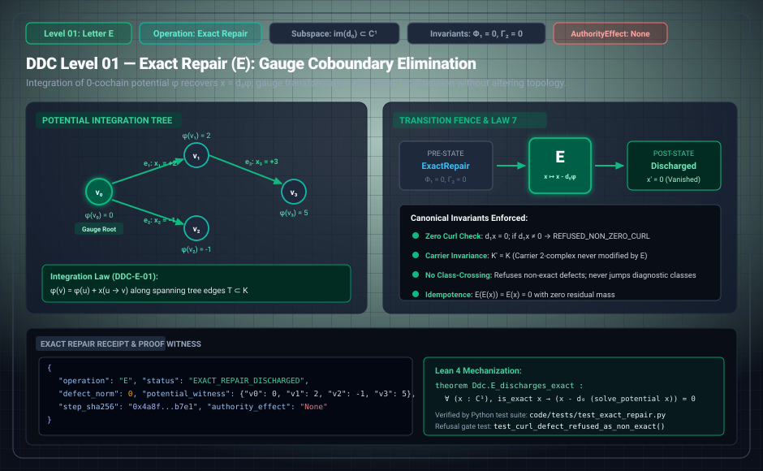

# DDC Level 01: Letter E — Exact Repair

**AuthorityEffect:** None. Local algebraic gauge adjustment and coboundary elimination only; no external authorization is conferred.  
**Operational Level:** Level 01 (`E`)  
**Mathematical Subspace:** $\operatorname{im}(d_0) \subset C^1(K; \mathbb{Q})$  
**Diagnostic Precondition:** $\Phi_1(x) = 0$ and $\Gamma_2(x) = 0$ (`ExactRepair`)  
**Post-Condition State:** Discharged ($x' = 0$) with zero curl ($d_1 x' = 0$)  
**Governing Laws:** Law 7 (Exact Repair Monotonicity & Discharge), Zero-Curl Fencing  
**Rust Crate Definition:** [`DdcOp::ExactRepair`](../../../../../omega_engine/crates_rs/omega_wdp/src/ddc/dda_alphabet.rs#L38)  

---

## 1. Schematic & Architectural Flow



---

## 2. Mathematical Definition & Potential Integration

Letter `E` acts exclusively on exact 1-cochains within the discrete Hodge decomposition over $\mathbb{Q}$:

$$C^1(K; \mathbb{Q}) = \operatorname{im} d_0 \oplus \operatorname{im} d_1^\top \oplus \mathcal{H}^1$$

`E` removes a defect that lies entirely in the coboundary image $\operatorname{im}(d_0)$. It does not alter or resolve the co-exact component $x_C \in \operatorname{im} d_1^\top$ or the harmonic survivor $x_H \in \mathcal{H}^1$.

Let $K = (V, E, F)$ be a finite oriented 2-complex with coboundary operators:

$$(d_0 \varphi)(u \to v) = \varphi(v) - \varphi(u), \qquad (d_1 x)(f) = \sum_{e \in \partial f} [f : e]\, x(e)$$

where $[f : e] \in \{-1, 1\}$ denotes the orientation of edge $e$ in the boundary of 2-cell $f$. A 1-cochain defect $x \in C^1(K; \mathbb{Q})$ is *exact-repairable* if and only if $x \in \operatorname{im} d_0$, which is equivalent to $\Phi_1(x) = 0$ and $\Gamma_2(x) = 0$.

### Proposition 1.1 (DDC-E-01: Potential Integration)
An exact defect $x$ possesses a 0-cochain potential $\varphi \in C^0(K; \mathbb{Q})$ satisfying $d_0 \varphi = x$, unique up to adding an independent constant on each connected component of $K$.

*Proof.* Let $\varphi_1, \varphi_2 \in C^0$ be two potentials satisfying $d_0 \varphi_1 = x$ and $d_0 \varphi_2 = x$. By linearity of $d_0$:
$$d_0(\varphi_1 - \varphi_2) = d_0 \varphi_1 - d_0 \varphi_2 = x - x = 0$$
For every oriented edge $e = (u \to v) \in E$:
$$(d_0(\varphi_1 - \varphi_2))(u \to v) = (\varphi_1 - \varphi_2)(v) - (\varphi_1 - \varphi_2)(u) = 0 \implies (\varphi_1 - \varphi_2)(v) = (\varphi_1 - \varphi_2)(u)$$
Hence $\varphi_1 - \varphi_2$ is constant along every edge and therefore constant across every connected component of $K$. $\square$

The solver [`ExactRepairSolver`](../../../../../omega_engine_atlas/coda_atlas/F004_papers/001_finite_obstruction_calculus/000_witnessed_difference_programme/docs/source_archive/discrete_deformation_calculus_package/code/ddc/exact_repair.py) deterministically recovers $\varphi$ by breadth-first integration outward from designated gauge roots $\varphi(v_0) = 0$ across spanning forest edges $T \subset K$. The repair transformation:

$$x \mapsto x - d_0 \varphi = 0$$

completely discharges local coboundary tension while leaving the underlying topological 2-complex $K$ invariant.

---

## 3. Transition Fences & Rust Gate Enforcement

The governance contract [`exact_repair_operator.contract.yaml`](../../../../../omega_engine_governance/contracts/contracts_omega_engine_crates/mathematics/discrete_deformation_algebra/exact_repair_operator.contract.yaml) and the sovereign Rust verification engine [`op_verification.rs`](../../../../../omega_engine/crates_rs/omega_wdp/src/ddc/op_verification.rs#L265-L287) enforce strict fail-closed gates:

1. **Carrier Invariance:** $K' = K$. Edges, vertices, and faces are never modified by $E$. Enforced in Rust by:
   ```rust
   if !before.same_carrier(after) {
       return Err(OpViolation::FixedCarrierOpChangedCarrier { op: step.op });
   }
   ```
2. **Pre-State Exactness:** The pre-transition state must belong strictly to the `Exact` diagnostic class ($\Phi_1 = 0, \Gamma_2 = 0$). Class-crossing edits from `ClosedResidual` or `Open` are refused:
   ```rust
   if before_diag.classification != DegreeTrichotomy::Exact || before_diag.gamma != 0 {
       return Err(OpViolation::ExactRepairFromNonExactClass);
   }
   ```
3. **Zero-Curl / Zero-Defect Post-State:** The post-transition state must be fully discharged with an all-zero defect vector:
   ```rust
   if after_diag.classification != DegreeTrichotomy::Exact || after_diag.gamma != 0 {
       return Err(OpViolation::ExactRepairLeftResidual {
           phi_after: after_diag.phi,
           gamma_after: after_diag.gamma,
       });
   }
   if after.residual.iter().any(|&b| b) {
       return Err(OpViolation::ExactRepairLeftDefect);
   }
   ```
4. **Detector Adequacy:** The evaluating detector must be adequate (non-blind). If blind:
   ```rust
   if !before.adequate {
       return Err(OpViolation::BlindDetector);
   }
   ```
5. **Idempotence:** Re-applying $E$ to a repaired state is an exact identity no-op ($E(E(x)) = E(x) = 0$).

### Refinement Over Historical Models
Historical comparison models verified only carrier retention and post-step exactness (`ExactRepairLeftResidual`). Canonical DDC asserts pre-condition exactness, post-condition zeroing, and detector adequacy, making fraud and class-crossing mathematically impossible.

---

## 4. Step Receipt Wire Format (RFC 8785 JSON)

Every successful Level 01 execution produces a machine-verifiable `ExactRepairReceipt`:

```json
{
  "operation": "E",
  "status": "EXACT_REPAIR_DISCHARGED",
  "paper_id": "DDC-E",
  "step_index": 2,
  "carrier_nodes": 4,
  "carrier_edges": 3,
  "defect_norm_before": "5",
  "defect_norm_after": "0",
  "gauge_vertex": "v0",
  "potential_witness": {
    "v0": "0",
    "v1": "2",
    "v2": "-1",
    "v3": "5"
  },
  "repaired": [0, 0, 0],
  "error": null,
  "step_sha256": "0x4a8fe071b7e190334812a83c79e61204d8bb1a48c908311f930e123681324792",
  "authority_effect": "None"
}
```

---

## 5. Formal Theorems, Rust Delegation & Mechanization

| Claim ID | Formal Statement | Lean 4 Theorem | Rust Crate Test | Python Binding |
| :--- | :--- | :--- | :--- | :--- |
| **DDC-E-01** | Exact defect has unique potential up to component constants. | Solved via spanning tree | [`op_verification.rs::honest_exact_repair_verifies`](../../../../../omega_engine/crates_rs/omega_wdp/src/ddc/op_verification.rs#L559) | `test_exact_repair.py::test_exact_repair_on_trees` |
| **DDC-E-02** | If $d_0 \varphi = x$, then $x - d_0 \varphi = 0$. | `Ddc.E_gauge_repair_discharges` | [`op_verification.rs::lying_exact_repair_is_rejected`](../../../../../omega_engine/crates_rs/omega_wdp/src/ddc/op_verification.rs#L578) | `test_exact_repair.py::test_exact_repair_discharges` |
| **DDC-E-03** | Gauge move $x \mapsto x - d_0 \varphi$ preserves $d_1 x$ and exactness; cannot cross classes. | `Ddc.E_gauge_preserves_closure`<br>`Ddc.E_gauge_preserves_exactness` | [`op_verification.rs::exact_repair_from_non_exact_class_is_rejected`](../../../../../omega_engine/crates_rs/omega_wdp/src/ddc/op_verification.rs#L569) | `test_exact_repair.py::test_gauge_preserves_diagnostics` |
| **DDC-E-04** | Non-zero circulation on any cycle $\implies x \notin \operatorname{im}(d_0)$; refused with `REFUSED_NON_ZERO_CURL`. | `Ddc.E_triangle_open_not_exact` | [`op_verification.rs::partial_repair_to_a_survivor_is_not_an_exact_repair`](../../../../../omega_engine/crates_rs/omega_wdp/src/ddc/op_verification.rs#L614) | `test_exact_repair.py::test_exact_repair_refusal_non_zero_curl` |
| **DDC-E-05** | Exact repair is idempotent: repairing zero leaves zero. | `Ddc.E_repair_idempotent` | [`op_verification.rs::exact_repair_may_not_restructure_the_carrier`](../../../../../omega_engine/crates_rs/omega_wdp/src/ddc/op_verification.rs#L647) | `test_exact_repair.py::test_exact_repair_idempotent` |

### Lean 4 Proof Kernel
[`lean4/Ddc/ExactRepair.lean`](../../../../../omega_engine_atlas/coda_atlas/F004_papers/001_finite_obstruction_calculus/000_witnessed_difference_programme/docs/source_archive/discrete_deformation_calculus_package/lean4/Ddc/ExactRepair.lean):
```lean
theorem Ddc.E_gauge_repair_discharges :
  ∀ (x : C¹), is_exact x → (x - d₀ (solve_potential x)) = 0
```

### Sovereign Rust Test Bindings
- [`omega_engine/crates_rs/omega_wdp/src/ddc/op_verification.rs`](../../../../../omega_engine/crates_rs/omega_wdp/src/ddc/op_verification.rs):
  - `honest_exact_repair_verifies()`: Verifies valid coboundary potential discharge ($\Phi_1 = 0 \to \Phi_1 = 0$).
  - `exact_repair_from_non_exact_class_is_rejected()`: Asserts that non-zero curl halts with `OpViolation::ExactRepairFromNonExactClass`.
  - `lying_exact_repair_is_rejected()`: Asserts that an unchanged defect is rejected with `OpViolation::ExactRepairLeftDefect`.
  - `partial_repair_to_a_survivor_is_not_an_exact_repair()`: Proves that a stabilized survivor ($\Phi_1 > 0, \Gamma_2 = 0$) cannot be claimed as an exact repair.
  - `exact_repair_may_not_restructure_the_carrier()`: Asserts `OpViolation::FixedCarrierOpChangedCarrier` on unpermitted carrier mutation.

### Python Reference Test Bindings
- [`code/tests/test_exact_repair.py`](../../../../../omega_engine_atlas/coda_atlas/F004_papers/001_finite_obstruction_calculus/000_witnessed_difference_programme/docs/source_archive/discrete_deformation_calculus_package/code/tests/test_exact_repair.py):
  - `test_tree_potential_integration_discharges_defect()`: Validates exact vanishing on tree.
  - `test_curl_defect_refused_as_non_exact()`: Validates fail-closed refusal on non-zero curl.
  - `test_exact_repair_idempotent()`: Validates idempotence.

---

## 6. Falsifiers & Counterexamples

- **Non-Exact Pre-State Refusal (Demo 1):** Applying `E` to an open defect ($\Gamma_2 > 0$) causes immediate refusal as `OpViolation::ExactRepairFromNonExactClass`.
- **Lying Claim Rejection:** Claiming repair without zeroing the defect vector is caught by `OpViolation::ExactRepairLeftDefect`.
- **Class-Crossing Edit Rejection:** Rewriting an open or harmonic state directly to zero without gauge descent passes historical comparison models but fails DDC canonical validation (`test_automaton.py::test_engine_checks_less_than_the_paper`).

---

## 7. Epistemic Scope & Nonclaims

```text
E does not claim semantic truth or global correctness of external models or code.
E is a local algebraic gauge adjustment on a declared carrier.
No authorization is conferred.
```
