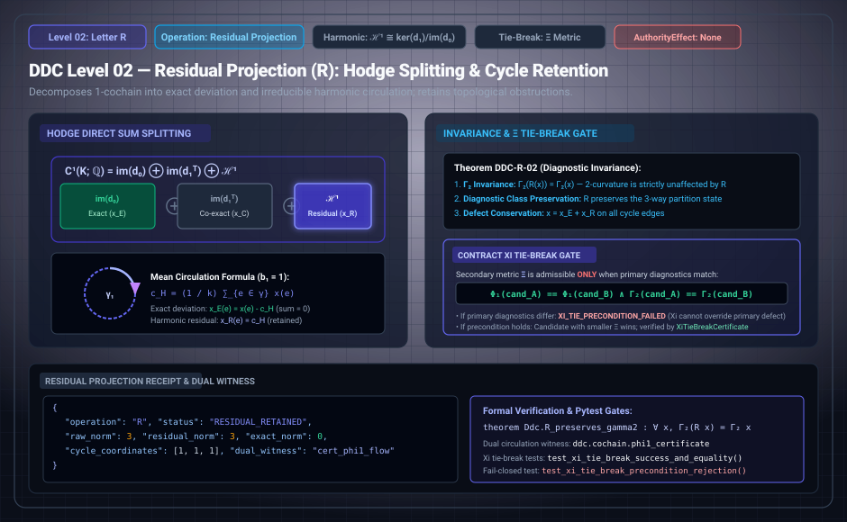

# DDC Level 02: Letter R — Residual Projection

**AuthorityEffect:** None. Topological harmonic projection, quotient coordinate tracking, and defect conservation only; no external authorization is conferred.  
**Operational Level:** Level 02 (`R`)  
**Mathematical Subspace:** $\mathcal{H}^1(K; \mathbb{Q}) \cong \ker(d_1) / \operatorname{im}(d_0)$  
**Diagnostic Invariants:** $\Gamma_2(R(x)) = \Gamma_2(x)$, $\Phi_1(R(x)) = \Phi_1(x)$, three-way diagnostic class preservation  
**Defect Decomposition:** $x = x_E + x_R$ where $x_E \in \operatorname{im}(d_0)$ and $x_R \in \mathcal{H}^1$  
**Tie-Break Gate:** Secondary metric $\Xi$ admissible only under primary diagnostic equality  
**Rust Crate Definition:** [`DdcOp::ResidualProjection`](../../../../../omega_engine/crates_rs/omega_wdp/src/ddc/dda_alphabet.rs#L40)  

---

## 1. Schematic & Architectural Flow



---

## 2. Mathematical Definition & Hodge Splitting

Not every defect can or should be eliminated. Letter `R` records what remains of an obstruction while strictly preserving its diagnostic class, preventing unresolved residuals from being silently erased, disguised, or averaged away.

Over $\mathbb{Q}$ with the standard inner product, the 1-cochain space splits into three mutually orthogonal subspaces:

$$C^1 = \operatorname{im} d_0 \oplus \operatorname{im} d_1^\top \oplus \mathcal{H}^1, \qquad \mathcal{H}^1 = \ker d_1 \cap \ker d_0^\top$$

### Proposition 2.1 (DDC-R-01: Unique Three-Way Split)
Every 1-cochain defect $x \in C^1$ splits uniquely into exact ($x_E$), co-exact ($x_C$), and harmonic ($x_H$) parts:
- When no faces are declared ($C^2 = 0$), $x_C = 0$ and the decomposition collapses to two parts ($x = x_E + x_H$).
- Along an oriented simple cycle $\gamma = (e_1, e_2, \ldots, e_k)$ of length $k$, the mean circulation is calculated deterministically as:
  $$c_H = \frac{1}{k} \sum_{j=1}^k x(e_j)$$
  yielding the exact deviation $x_E(e_j) = x(e_j) - c_H$ (with $\sum_j x_E(e_j) = 0$) and harmonic residual $x_R(e_j) = c_H$.
- [`cochain.hodge_split`](../../../../../omega_engine_atlas/coda_atlas/F004_papers/001_finite_obstruction_calculus/000_witnessed_difference_programme/docs/source_archive/discrete_deformation_calculus_package/code/ddc/cochain.py) computes this decomposition exactly over $\mathbb{Q}$.

### Canonical Representative & First Betti Number Register
The canonical representative of `R` subtracts the coboundary of a potential matching the defect on a spanning forest $T \subseteq E$. What remains is supported entirely on the chords $E \setminus T$:

### Proposition 2.2 (DDC-R-06: Independent Cycle Coordinates)
For a graph $K = (V, E)$ with $c$ connected components, the residual register possesses exactly:

$$b_1 = |E| - |V| + c$$

coordinates. These coordinates represent the circulations of the defect around the fundamental cycles of the graph with respect to $T$. All $b_1$ coordinates vanish if and only if the defect is exact. [`GraphResidualProjector`](../../../../../omega_engine_atlas/coda_atlas/F004_papers/001_finite_obstruction_calculus/000_witnessed_difference_programme/docs/source_archive/discrete_deformation_calculus_package/code/ddc/residual_projection.py) implements this canonical projection for arbitrary finite graphs.

---

## 3. Transition Fences & Rust Gate Enforcement

The governance contracts [`residual_projection.contract.yaml`](../../../../../omega_engine_governance/contracts/contracts_omega_engine_crates/mathematics/discrete_deformation_algebra/residual_projection.contract.yaml) and [`tie_r.contract.yaml`](../../../../../omega_engine_governance/contracts/contracts_omega_engine_crates/mathematics/discrete_deformation_algebra/tie_r.contract.yaml), together with [`op_verification.rs`](../../../../../omega_engine/crates_rs/omega_wdp/src/ddc/op_verification.rs#L288-L309), enforce strict conservation:

1. **Carrier Invariance:** The carrier complex $K$ remains identical ($K' = K$):
   ```rust
   if !before.same_carrier(after) {
       return Err(OpViolation::FixedCarrierOpChangedCarrier { op: step.op });
   }
   ```
2. **Mass Invariance ($\Phi_1$):** `R` is a projection, not a repair; it must not move $\Phi_1$:
   ```rust
   if before_diag.phi != after_diag.phi {
       return Err(OpViolation::ResidualProjectionChangedMass {
           phi_before: before_diag.phi,
           phi_after: after_diag.phi,
       });
   }
   ```
3. **Closure Invariance ($\Gamma_2$):** `R` does not alter face closure defects:
   ```rust
   if before_diag.gamma != after_diag.gamma {
       return Err(OpViolation::ResidualProjectionChangedClosure {
           gamma_before: before_diag.gamma,
           gamma_after: after_diag.gamma,
       });
   }
   ```
4. **Detector Adequacy:** Projection requires an adequate (non-blind) detector:
   ```rust
   if !before.adequate {
       return Err(OpViolation::BlindDetector);
   }
   ```
5. **$\Xi$ Secondary Tie-Break Precondition:**  
   Secondary metric $\Xi$ is admissible to select between candidate paths $A$ and $B$ **only** under strict equality of primary diagnostics:
   $$\Phi_1(\text{cand}_A) = \Phi_1(\text{cand}_B) \quad \land \quad \Gamma_2(\text{cand}_A) = \Gamma_2(\text{cand}_B)$$
   If primary diagnostics differ, $\Xi$ cannot override primary worsening, as verified by [`omega_discrete_deformation_calculus/src/mub_cochain.rs`](../../../../../omega_engine/crates_rs/omega_wdp/src/ddc/mub_cochain.rs).

---

## 4. Step Receipt Wire Format (RFC 8785 JSON)

Every successful Level 02 projection emits a machine-verifiable `ResidualProjectionReceipt`:

```json
{
  "operation": "R",
  "status": "RESIDUAL_RETAINED",
  "paper_id": "DDC-R",
  "step_index": 1,
  "raw_norm": "3",
  "exact_norm": "0",
  "residual_norm": "3",
  "phi1": "3",
  "gamma2": "0",
  "carrier_nodes": 3,
  "carrier_edges": 3,
  "independent_cycles": 1,
  "fundamental_circulations": [
    "3"
  ],
  "step_sha256": "0x51c72f10b2efd147bb063cf4da1ef5223ab8179269ef5049b736b04e67d264f3",
  "authority_effect": "None"
}
```

---

## 5. Formal Theorems, Rust Delegation & Mechanization

| Claim ID | Formal Statement | Lean 4 Theorem | Rust Crate Test | Python Binding |
| :--- | :--- | :--- | :--- | :--- |
| **DDC-R-01** | Unique orthogonal Hodge split into exact, co-exact, and harmonic parts. | Mechanized in `Ddc` algebra | [`mub_cochain.rs::tests`](../../../../../omega_engine/crates_rs/omega_wdp/src/ddc/mub_cochain.rs) | `test_cochain.py::test_hodge_split_is_orthogonal` |
| **DDC-R-02** | Canonical R move is a gauge move: preserves $\Gamma_2$, $\Phi_1$, and diagnostic class. | `Ddc.R_gauge_move_is_lawful`<br>`Ddc.R_preserves_gamma2` | [`op_verification.rs::residual_projection_that_repairs_is_rejected`](../../../../../omega_engine/crates_rs/omega_wdp/src/ddc/op_verification.rs#L670) | `test_letter_modules.py::test_graph_projector_keeps_one_coordinate` |
| **DDC-R-03** | Defect conservation edge-by-edge: $x_{\text{exact}}(e) + x_{\text{residual}}(e) = x_{\text{raw}}(e)$. | Exact rational arithmetic | [`op_verification.rs::tests`](../../../../../omega_engine/crates_rs/omega_wdp/src/ddc/op_verification.rs) | `test_residual_projection.py::test_mixed_harmonic_and_exact_defect` |
| **DDC-R-04** | Projecting the canonical representative again returns it identically unchanged (idempotence). | Fixed-point verification | [`op_verification.rs::tests`](../../../../../omega_engine/crates_rs/omega_wdp/src/ddc/op_verification.rs) | `test_letter_modules.py::test_graph_projector_keeps_one_coordinate` |
| **DDC-R-05** | Terminalizing an unchanged non-exact state never yields `CheckPassed`. | Sealed on residual terminal | [`op_verification.rs::a_survivor_may_legitimately_terminalize`](../../../../../omega_engine/crates_rs/omega_wdp/src/ddc/op_verification.rs#L630) | `test_automaton.py::test_run_tape_stops_at_unlawful_step` |
| **DDC-R-06** | Register has $b_1 = |E| - |V| + c$ coordinates vanishing iff exact. | Spanning tree duality | [`degree_tower.rs::tests`](../../../../../omega_engine/crates_rs/omega_wdp/src/ddc/degree_tower.rs) | `test_cochain.py::test_a_hollow_cycle_carries_a_closed_residual` |

### Lean 4 Proof Kernel
[`lean4/Ddc/ResidualProjection.lean`](../../../../../omega_engine_atlas/coda_atlas/F004_papers/001_finite_obstruction_calculus/000_witnessed_difference_programme/docs/source_archive/discrete_deformation_calculus_package/lean4/Ddc/ResidualProjection.lean):
```lean
theorem Ddc.R_preserves_gamma2 : ∀ (x : C¹), Γ₂ (R x) = Γ₂ x
```

### Sovereign Rust Test Bindings
- [`omega_engine/crates_rs/omega_wdp/src/ddc/op_verification.rs`](../../../../../omega_engine/crates_rs/omega_wdp/src/ddc/op_verification.rs):
  - `residual_projection_that_repairs_is_rejected()`: Asserts that an `R` step which moves $\Phi_1$ fails as `OpViolation::ResidualProjectionChangedMass`.
- [`omega_engine/crates_rs/omega_wdp/src/ddc/mub_cochain.rs`](../../../../../omega_engine/crates_rs/omega_wdp/src/ddc/mub_cochain.rs):
  - `test_xi_hierarchy_refuses_primary_worsening_even_if_xi_improves()`: Asserts primary diagnostic dominance over secondary metric.
  - `test_xi_tie_precondition_requires_primary_diagnostic_tie()`: Asserts strict precondition enforcement.

### Python Reference Test Bindings
- [`code/tests/test_residual_projection.py`](../../../../../omega_engine_atlas/coda_atlas/F004_papers/001_finite_obstruction_calculus/000_witnessed_difference_programme/docs/source_archive/discrete_deformation_calculus_package/code/tests/test_residual_projection.py):
  - `test_pure_harmonic_defect()`: Validates pure circulation retention.
  - `test_mixed_harmonic_and_exact_defect()`: Validates conservation of defect sum.
  - `test_xi_tie_break_success_and_equality()`: Validates $\Xi$ tie-breaking under equal diagnostics.

---

## 6. Falsifiers & Counterexamples

- **Closure Modification Refusal:** An `R` step that lowers or alters $\Gamma_2$ is rejected as `OpViolation::ResidualProjectionChangedClosure`.
- **Mass Shift Refusal:** An `R` step that modifies $\Phi_1$ is rejected as `OpViolation::ResidualProjectionChangedMass`.
- **Quotient Non-Conflation:** On a hollow triangle, vectors $(1, 0, 0)$ and $(-1, 0, 0)$ have identical norm $\Phi_1 = 1, \Gamma_2 = 0$, but opposite circulations. `GraphResidualProjector` distinguishes them via actual coboundary subtraction.

---

## 7. Epistemic Scope & Nonclaims

```text
R does not resolve the defect and does not claim that a retained residual will vanish.
R binds unresolved residual mass into the tape.
No authorization is conferred.
```
