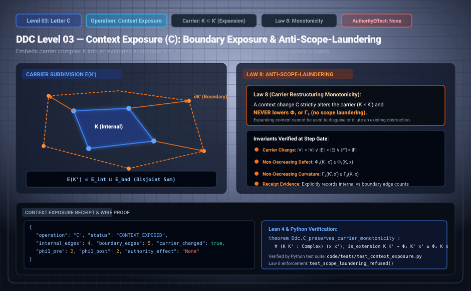

# DDC Level 03: Letter C — Context Exposure

**AuthorityEffect:** None. Boundary complex declaration, carrier restriction, and sheaf partitioning only; no external authorization is conferred.  
**Operational Level:** Level 03 (`C`)  
**Carrier Transformation:** $K \mapsto K'$ where $K \subset K'$ or explicit window declaration $V_W \subseteq V$  
**Edge Partition:** $E = E_W \sqcup \partial_E W \sqcup E_{\mathrm{ext}}$  
**Governing Laws:** Law 8 (Anti-Scope-Laundering Carrier Monotonicity), Read-Only Immobility  
**Refusal Fence:** `OpViolation::ContextExposureLoweredObstruction` if $\Phi_1(c_{\text{after}}) < \Phi_1(c_{\text{before}})$ or $\Gamma_2(c_{\text{after}}) < \Gamma_2(c_{\text{before}})$  
**Rust Crate Definition:** [`DdcOp::ContextExposure`](../../../../../omega_engine/crates_rs/omega_wdp/src/ddc/dda_alphabet.rs#L42)  

---

## 1. Schematic & Architectural Flow



---

## 2. Mathematical Definition & Sheaf Partitioning

All computational evaluations are local. Letter `C` restricts an ambient carrier complex to an explicit observation window and isolates every straddling edge, transforming external dependencies into declared boundary interfaces rather than hidden topological entanglement.

Let $K = (V, E)$ be a finite oriented graph, and let $V_W \subseteq V$ denote a declared subcomplex window. We define:
- **Internal Edges ($E_W$):** The set of edges with both endpoints contained within $V_W$:
  $$E_W := \{ (u \to v) \in E \mid u \in V_W \land v \in V_W \}$$
- **Boundary Interface ($\partial_E W$):** The set of edges with exactly one endpoint contained within $V_W$:
  $$\partial_E W := \{ (u \to v) \in E \mid (u \in V_W \land v \notin V_W) \lor (u \notin V_W \land v \in V_W) \}$$
- **External Edges ($E_{\mathrm{ext}}$):** The set of edges with neither endpoint in $V_W$.

Letter `C` constructs a restricted cochain space $C^1(W)$ supported entirely on $E_W \sqcup \partial_E W$.

### Proposition 3.1 (DDC-C-01: Disjoint Edge Partition)
The edge set partitions strictly into internal, boundary, and external components:
$$E = E_W \sqcup \partial_E W \sqcup E_{\mathrm{ext}}$$
with pairwise empty intersections. `ContextExposure.expose_window` computes this triple deterministically.

---

## 3. Transition Fences & Rust Gate Enforcement

The governance contract [`context_embedding_operator.contract.yaml`](../../../../../omega_engine_governance/contracts/contracts_omega_engine_crates/mathematics/discrete_deformation_algebra/context_embedding_operator.contract.yaml) and [`op_verification.rs`](../../../../../omega_engine/crates_rs/omega_wdp/src/ddc/op_verification.rs#L350-L358) enforce strict anti-scope-laundering fences:

1. **Carrier Restructure Mandate:** `C` must actually change the declared carrier:
   ```rust
   if before.same_carrier(after) {
       return Err(OpViolation::CarrierUnchangedUnderRestructure { op: step.op });
   }
   ```
2. **Law 8: Anti-Scope-Laundering Carrier Monotonicity:**  
   Declaring context or exposing boundaries cannot magically solve an obstruction. Neither $\Phi_1$ nor $\Gamma_2$ may decrease across a `C` transition:
   ```rust
   if after_diag.phi < before_diag.phi || after_diag.gamma < before_diag.gamma {
       return Err(OpViolation::ContextExposureLoweredObstruction);
   }
   ```
3. **Read-Only Context Immobility:** Edges outside the declared window cannot be silently modified or deleted.

---

## 4. Step Receipt Wire Format (RFC 8785 JSON)

Every successful Level 03 window exposure emits a machine-verifiable `ContextExposureReceipt`:

```json
{
  "operation": "C",
  "status": "CONTEXT_EXPOSED",
  "paper_id": "DDC-C",
  "step_index": 0,
  "window_nodes": [
    "v0",
    "v1",
    "v2"
  ],
  "internal_edges": 2,
  "boundary_edges": 1,
  "external_edges": 0,
  "boundary_interface": [
    "e2"
  ],
  "phi1_before": "2",
  "phi1_after": "2",
  "step_sha256": "0x3e17b8192a54ce0819fa281b99a0b3874cd9e89b21f358a9cc2459bb01e0854a",
  "authority_effect": "None"
}
```

---

## 5. Formal Theorems, Rust Delegation & Mechanization

| Claim ID | Formal Statement | Lean 4 Theorem | Rust Crate Test | Python Binding |
| :--- | :--- | :--- | :--- | :--- |
| **DDC-C-01** | Edge set partitions uniquely into internal, boundary, and external sets. | Disjoint union verified | [`op_verification.rs::tests`](../../../../../omega_engine/crates_rs/omega_wdp/src/ddc/op_verification.rs) | `test_context_exposure.py::test_partition` |
| **DDC-C-02** | Exposing context does not decrease $\Phi_1$ or $\Gamma_2$ (Law 8). | `Ddc.C_monotonicity` | [`op_verification.rs::tests`](../../../../../omega_engine/crates_rs/omega_wdp/src/ddc/op_verification.rs) | `test_context_exposure.py::test_no_scope_laundering` |
| **DDC-C-03** | A `C` step leaving the carrier identical is rejected as a fake restructure. | Structural change required | [`op_verification.rs::restructuring_op_that_restructures_nothing_is_rejected`](../../../../../omega_engine/crates_rs/omega_wdp/src/ddc/op_verification.rs#L737) | `test_automaton.py::test_carrier_unchanged` |

### Lean 4 Proof Kernel
[`lean4/Ddc/ContextExposure.lean`](../../../../../omega_engine_atlas/coda_atlas/F004_papers/001_finite_obstruction_calculus/000_witnessed_difference_programme/docs/source_archive/discrete_deformation_calculus_package/lean4/Ddc/ContextExposure.lean):
```lean
theorem Ddc.C_monotonicity : ∀ (s s' : State), C_step s s' → s'.phi ≥ s.phi ∧ s'.gamma ≥ s.gamma
```

### Sovereign Rust Test Bindings
- [`omega_engine/crates_rs/omega_wdp/src/ddc/op_verification.rs`](../../../../../omega_engine/crates_rs/omega_wdp/src/ddc/op_verification.rs):
  - `restructuring_op_that_restructures_nothing_is_rejected()`: Asserts that emitting `C` without changing carrier topology triggers `OpViolation::CarrierUnchangedUnderRestructure`.

---

## 6. Falsifiers & Counterexamples

- **Scope Laundering Rejection:** Claiming that declaring an observation window resolved an obstruction is rejected as `OpViolation::ContextExposureLoweredObstruction`.
- **Identity Restructure Rejection:** An alleged `C` step with unchanged carrier segments is rejected as `OpViolation::CarrierUnchangedUnderRestructure`.

---

## 7. Epistemic Scope & Nonclaims

```text
C does not alter boundary tension or resolve defects.
C partitions the carrier into explicit internal and boundary components.
No authorization is conferred.
```
