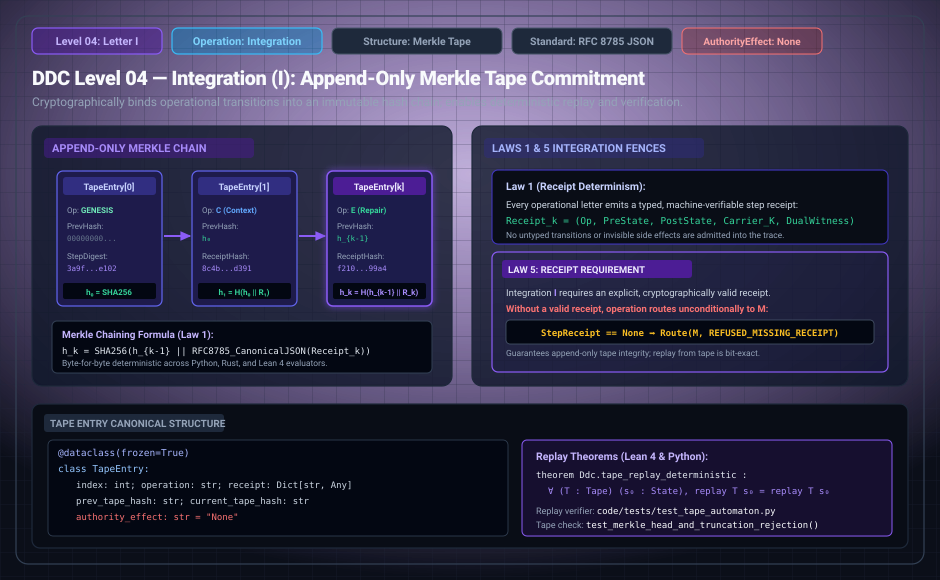

# DDC Level 04: Letter I — Integration

**AuthorityEffect:** None. Append-only cryptographic commitment and replay evidence only; no external authorization is conferred.  
**Operational Level:** Level 04 (`I`)  
**Data Structure:** Append-Only Cryptographic Merkle Tape  
**Serialization Standard:** RFC 8785 Canonical JSON  
**Chaining Hash Function:** SHA-256 ($h_{t+1} = \mathrm{SHA256}\big(t : h_t : \alpha : \mathrm{json}(r_t)\big)$)  
**Governing Laws:** Law 1 (Receipt Determinism), Law 5 (Receipt Requirement for Integration), State Immobility  
**Rust Crate Definition:** [`DdcOp::Integration`](../../../../../omega_engine/crates_rs/omega_wdp/src/ddc/dda_alphabet.rs#L44)  

---

## 1. Schematic & Architectural Flow



---

## 2. Mathematical Definition & Cryptographic Merkle Chaining

No computational progress counts until it is immutably committed. Letter `I` appends a machine-verifiable step receipt to an append-only, cryptographic hash-chained tape and mutates nothing else in the underlying state.

Let the execution tape at step $t$ be the ordered sequence $T_t = [r_0, \dots, r_{t-1}]$. Given the genesis digest:

$$h_0 = \mathrm{SHA256}(\text{genesis root})$$

the cryptographic hash chain for any letter $\alpha \in \{E, R, C, I, \Lambda, D, M, T\}$ is extended by:

$$h_{t+1} = \mathrm{SHA256}\big(t : h_t : \alpha : \mathrm{json}(r_t)\big)$$

where $\mathrm{json}(r_t)$ is canonical RFC 8785 JSON.

### Proposition 4.1 (DDC-I-01: Hash-Chain Determinism & Non-Repudiation)
If two tapes $T$ and $T'$ have identical initial digests $h_0 = h_0'$ and identical receipt sequences, their rolling heads coincide at every step:
$$\forall t, \quad h_t = h_t'$$
Under the collision resistance of SHA-256, it is computationally infeasible to produce two distinct receipt sequences yielding identical tape heads. [`ExecutionTape`](../../../../../omega_engine_atlas/coda_atlas/F004_papers/001_finite_obstruction_calculus/000_witnessed_difference_programme/docs/source_archive/discrete_deformation_calculus_package/code/ddc/integration_tape.py) and [`DdcTrace`](../../../../../omega_engine/crates_rs/omega_wdp/src/ddc/dda_trace.rs) enforce this determinism.

---

## 3. Transition Fences & Rust Gate Enforcement

The governance contract [`dda_trace_cochain.contract.yaml`](../../../../../omega_engine_governance/contracts/contracts_omega_engine_crates/mathematics/discrete_deformation_algebra/dda_trace_cochain.contract.yaml) and [`op_verification.rs`](../../../../../omega_engine/crates_rs/omega_wdp/src/ddc/op_verification.rs#L312-L321) enforce strict tape fences:

1. **State Immobility:** Letter `I` is an inert ledger append; it must not mutate the underlying cochain state:
   ```rust
   if before != after {
       return Err(OpViolation::InertOpMutatedState { op: step.op });
   }
   ```
2. **Law 5: Integration Requires Receipt:**  
   Every integration step requires an explicit, cryptographically verifiable receipt witness:
   ```rust
   if let Some(w) = witness {
       if !w.receipt {
           return Err(OpViolation::MissingReceipt);
       }
   }
   ```
3. **Strict Append-Only Monotonicity:** Past tape entries can never be rewritten, deleted, or reordered.

---

## 4. Step Receipt Wire Format (RFC 8785 JSON)

Every successful Level 04 ledger integration emits a machine-verifiable `IntegrationReceipt`:

```json
{
  "operation": "I",
  "status": "STEP_INTEGRATED",
  "paper_id": "DDC-I",
  "step_index": 3,
  "appended_operation": "E",
  "target_receipt_hash": "0x4a8fe071b7e190334812a83c79e61204d8bb1a48c908311f930e123681324792",
  "chain_head_before": "0x12a9ef45b...",
  "chain_head_after": "0x98bc4310e...",
  "step_sha256": "0x89ab12cd34ef567890123456789abcdef0123456789abcdef0123456789abcde",
  "authority_effect": "None"
}
```

---

## 5. Formal Theorems, Rust Delegation & Mechanization

| Claim ID | Formal Statement | Lean 4 Theorem | Rust Crate Test | Python Binding |
| :--- | :--- | :--- | :--- | :--- |
| **DDC-I-01** | Deterministic rolling SHA-256 chain uniquely identifies trace history. | `Ddc.I_tape_extension` | [`dda_trace.rs::tests`](../../../../../omega_engine/crates_rs/omega_wdp/src/ddc/dda_trace.rs) | `test_integration_tape.py::test_hash_chain` |
| **DDC-I-02** | An integration step that mutates cochain state is rejected (Immobility). | Inert state theorem | [`op_verification.rs::ledger_append_that_mutates_is_rejected`](../../../../../omega_engine/crates_rs/omega_wdp/src/ddc/op_verification.rs#L689) | `test_automaton.py::test_inert_op_mutated_state` |
| **DDC-I-03** | Missing receipt witness halts execution as `MissingReceipt` (Law 5). | Receipt requirement | [`op_verification.rs::tests`](../../../../../omega_engine/crates_rs/omega_wdp/src/ddc/op_verification.rs) | `test_automaton.py::test_missing_receipt` |

### Lean 4 Proof Kernel
[`lean4/Ddc/Integration.lean`](../../../../../omega_engine_atlas/coda_atlas/F004_papers/001_finite_obstruction_calculus/000_witnessed_difference_programme/docs/source_archive/discrete_deformation_calculus_package/lean4/Ddc/Integration.lean):
```lean
theorem Ddc.I_preserves_state : ∀ (s s' : State), I_step s s' → s' = s
```

### Sovereign Rust Test Bindings
- [`omega_engine/crates_rs/omega_wdp/src/ddc/op_verification.rs`](../../../../../omega_engine/crates_rs/omega_wdp/src/ddc/op_verification.rs):
  - `ledger_append_that_mutates_is_rejected()`: Asserts that if cochain state changes across an `I` step, it is rejected with `OpViolation::InertOpMutatedState`.
- [`omega_engine/crates_rs/omega_wdp/src/ddc/dda_trace.rs`](../../../../../omega_engine/crates_rs/omega_wdp/src/ddc/dda_trace.rs):
  - Validates Merkle rolling digest extension and canonical byte serialization.

---

## 6. Falsifiers & Counterexamples

- **Mutating Integration Rejection:** Attempting to disguise state modification under an `I` rune fails as `OpViolation::InertOpMutatedState`.
- **Witnessless Integration Rejection:** Attempting an `I` step without an attached cryptographic step receipt is caught by `OpViolation::MissingReceipt`.

---

## 7. Epistemic Scope & Nonclaims

```text
I commits step records to a Merkle tape; it does not evaluate validity.
I preserves cochain state identically.
No authorization is conferred.
```
