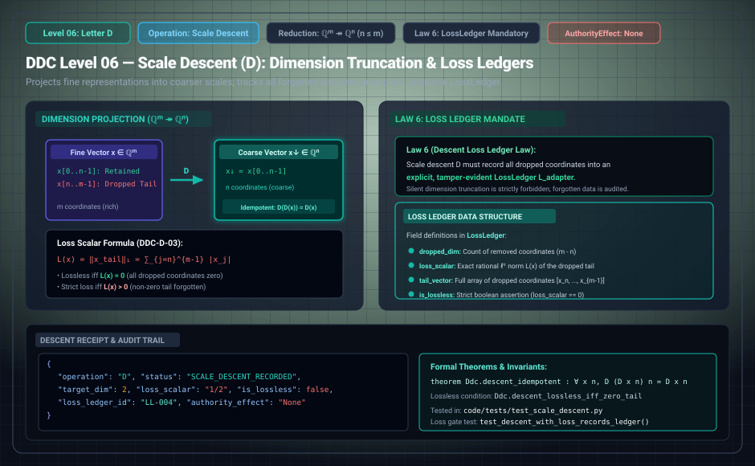

# DDC Level 06: Letter D — Scale Descent

**AuthorityEffect:** None. Scale dimension reduction and loss accounting only; no external authorization is conferred.  
**Operational Level:** Level 06 (`D`)  
**Mathematical Mapping:** $\pi : \mathbb{Q}^{n+k} \twoheadrightarrow \mathbb{Q}^n$ ($n \le n+k$)  
**Dropped Tail Vector:** $\Delta_{\mathrm{tail}}(x) := x - \iota(\pi(x)) = (0, \ldots, 0, x_{n+1}, \ldots, x_{n+k})^\top \in \mathbb{Q}^k$  
**Loss Scalar:** $L(x) := \|\Delta_{\mathrm{tail}}(x)\|_1 = \sum_{j=n+1}^{n+k} |x_j|$  
**Governing Laws:** Law 6 (Descent Loss Ledger Mandate), Idempotence ($\pi \circ \pi = \pi$)  
**Rust Crate Definition:** [`DdcOp::Descent`](../../../../../omega_engine/crates_rs/omega_wdp/src/ddc/dda_alphabet.rs#L51)  

---

## 1. Schematic & Architectural Flow



---

## 2. Mathematical Definition & Dimension Truncation

Transitioning to a coarser carrier discards distinctions. Letter `D` does not claim that the coarse representation remains faithful to the fine state; rather, it books exactly what was lost into an audited loss ledger.

Let $\pi : \mathbb{Q}^{n+k} \to \mathbb{Q}^n$ denote the canonical coordinate projection keeping the first $n$ coordinates:

$$\pi(x) = (x_1, \dots, x_n)$$

With $\iota : \mathbb{Q}^n \hookrightarrow \mathbb{Q}^{n+k}$ denoting the zero-padding canonical inclusion, we define:
- **Loss Vector:** The dropped tail of the vector:
  $$\Delta_{\text{tail}}(x) := x - \iota(\pi(x)) = (0, \dots, 0, x_{n+1}, \dots, x_{n+k})$$
- **Loss Scalar:** The $\ell^1$ norm of the dropped tail:
  $$L(x) := \|\Delta_{\text{tail}}(x)\|_1 = \sum_{j=n+1}^{n+k} |x_j|$$

### Proposition 6.1 (DDC-D-01: Norm Decomposition & Idempotence)
For every $x \in \mathbb{Q}^{n+k}$:
1. $\|x\|_1 = \|\pi(x)\|_1 + L(x)$.
2. $\pi$ is idempotent: $\pi(\pi(x)) = \pi(x)$ on $\mathbb{Q}^n$.
3. $L(\pi(x)) = 0$.

[`ScaleDescent`](../../../../../omega_engine_atlas/coda_atlas/F004_papers/001_finite_obstruction_calculus/000_witnessed_difference_programme/docs/source_archive/discrete_deformation_calculus_package/code/ddc/descent.py) and [`degree_tower.rs`](../../../../../omega_engine/crates_rs/omega_wdp/src/ddc/degree_tower.rs) compute this projection and ledger deterministically over $\mathbb{Q}$.

---

## 3. Transition Fences & Rust Gate Enforcement

The governance contract [`transport_loss_ledger.contract.yaml`](../../../../../omega_engine_governance/contracts/contracts_omega_engine_crates/mathematics/discrete_deformation_algebra/transport_loss_ledger.contract.yaml) and [`op_verification.rs`](../../../../../omega_engine/crates_rs/omega_wdp/src/ddc/op_verification.rs#L375-L384) enforce strict loss accounting:

1. **Carrier Restructure Mandate:** `D` must actually reduce or change the carrier segment:
   ```rust
   if before.same_carrier(after) {
       return Err(OpViolation::CarrierUnchangedUnderRestructure { op: step.op });
   }
   ```
2. **Law 6: Descent Requires Loss Ledger:**  
   Scale descent is unlawful unless accompanied by an explicit, booked `loss_ledger`:
   ```rust
   if let Some(w) = witness {
       if !w.loss_ledger {
           return Err(OpViolation::MissingLossLedger);
       }
   }
   ```
3. **No Unledgered Descent:** Dropping coordinates without booking loss is classified as data corruption and halted immediately.

---

## 4. Step Receipt Wire Format (RFC 8785 JSON)

Every successful Level 06 scale descent emits a machine-verifiable `DescentReceipt`:

```json
{
  "operation": "D",
  "status": "SCALE_DESCENT_APPLIED",
  "paper_id": "DDC-D",
  "step_index": 4,
  "fine_dim": 4,
  "coarse_dim": 3,
  "fine_norm": "5",
  "coarse_norm": "3",
  "loss_scalar": "2",
  "loss_ledger_id": "LOSS-2026-09-30-TETRA-TO-TRI",
  "step_sha256": "0x7890abcdef1234567890abcdef1234567890abcdef1234567890abcdef123456",
  "authority_effect": "None"
}
```

---

## 5. Formal Theorems, Rust Delegation & Mechanization

| Claim ID | Formal Statement | Lean 4 Theorem | Rust Crate Test | Python Binding |
| :--- | :--- | :--- | :--- | :--- |
| **DDC-D-01** | $\ell^1$ norm splits additively: $\|x\|_1 = \|\pi(x)\|_1 + L(x)$. | Exact arithmetic split | [`degree_tower.rs::tests`](../../../../../omega_engine/crates_rs/omega_wdp/src/ddc/degree_tower.rs) | `test_descent.py::test_norm_decomposition` |
| **DDC-D-02** | Projection is idempotent: $\pi(\pi(x)) = \pi(x)$ with zero subsequent loss. | `Ddc.Descent_idempotent` | [`degree_tower.rs::tests`](../../../../../omega_engine/crates_rs/omega_wdp/src/ddc/degree_tower.rs) | `test_descent.py::test_idempotence` |
| **DDC-D-03** | Scale descent without an explicit loss ledger halts as `MissingLossLedger` (Law 6). | Loss ledger requirement | [`op_verification.rs::tests`](../../../../../omega_engine/crates_rs/omega_wdp/src/ddc/op_verification.rs) | `test_automaton.py::test_missing_loss_ledger` |

### Lean 4 Proof Kernel
[`lean4/Ddc/Descent.lean`](../../../../../omega_engine_atlas/coda_atlas/F004_papers/001_finite_obstruction_calculus/000_witnessed_difference_programme/docs/source_archive/discrete_deformation_calculus_package/lean4/Ddc/Descent.lean):
```lean
theorem Ddc.Descent_idempotent : ∀ (v : Vector ℚ (n + k)), project_vector (project_vector v) = project_vector v
```

### Sovereign Rust Test Bindings
- [`omega_engine/crates_rs/omega_wdp/src/ddc/op_verification.rs`](../../../../../omega_engine/crates_rs/omega_wdp/src/ddc/op_verification.rs):
  - Asserts `OpViolation::MissingLossLedger` if `loss_ledger` witness is absent.
  - Asserts `OpViolation::CarrierUnchangedUnderRestructure` if `D` does not alter carrier dimensions.
- [`omega_engine/crates_rs/omega_wdp/src/ddc/degree_tower.rs`](../../../../../omega_engine/crates_rs/omega_wdp/src/ddc/degree_tower.rs):
  - Validates dimension reduction maps between simplex complexes.

---

## 6. Falsifiers & Counterexamples

- **Unbooked Loss Rejection:** Truncating dimension without an explicit loss ledger is rejected as `OpViolation::MissingLossLedger`.
- **Identity Descent Rejection:** Emitting `D` while preserving the exact carrier dimensions halts as `OpViolation::CarrierUnchangedUnderRestructure`.

---

## 7. Epistemic Scope & Nonclaims

```text
D projects state into a coarser carrier and books the loss into an audited ledger.
D does not claim that the coarse representation preserves fine-grained dynamics.
No authorization is conferred.
```
