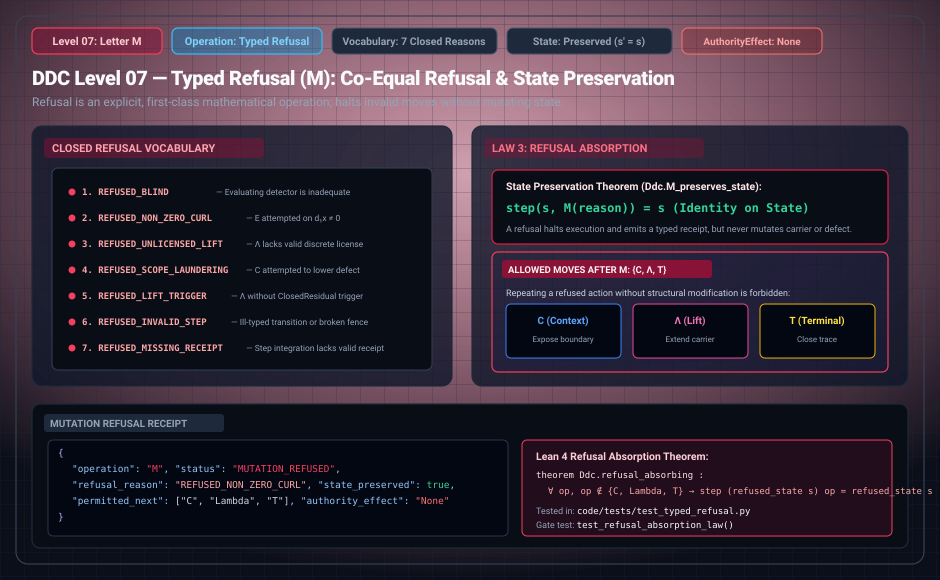

# DDC Level 07: Letter M — Typed Refusal

**AuthorityEffect:** None. First-class operational refusal, typed halt, and state preservation only; no external authorization is conferred.  
**Operational Level:** Level 07 (`M`)  
**Core Invariant:** Identity on underlying state ($s' = s$, proved in `Ddc.M_preserves_state`)  
**Refusal Vocabulary:** Closed, audited refusal taxonomy (Intake vs. In-Trace)  
**Governing Laws:** Law 3 (Refusal Absorption Law)  
**Permitted Next Operations:** Only $\{C, \Lambda, T\}$ may follow a typed refusal  
**Rust Crate Definition:** [`DdcOp::Refusal`](../../../../../omega_engine/crates_rs/omega_wdp/src/ddc/dda_alphabet.rs#L53), [`RefusalReason`](../../../../../omega_engine/crates_rs/omega_wdp/src/ddc/dda_alphabet.rs)  

---

## 1. Schematic & Architectural Flow



---

## 2. Mathematical Definition & Co-Equality of Refusal

In the Discrete Deformation Calculus, **the ability to refuse is co-equal with the ability to deform**. A refusal is not an unexpected crash, panic, or unhandled exception; it is a first-class, machine-verifiable operational transition that freezes the active state and records an audited reason on the cryptographic tape.

A computational request consists of a target letter, a locus in the carrier complex, an alleged witness, and an operational cost. DDC enforces a strict two-stage firewall:
1. **Intake Refusals:** Evaluated prior to admission; never entered onto the cryptographic execution tape (`enters_ddc_trace = false`).
2. **In-Trace Refusals (`M`):** Evaluated and committed onto the execution tape when an admitted operation cannot proceed lawfully.

### Theorem Ddc.M_preserves_state (State Preservation)
A typed refusal emits an auditable receipt but leaves the underlying mathematical cochain state strictly unchanged:

$$\forall s \in \text{State}, \quad \text{step}(s, M) \implies s' = s$$

Formally mechanized in Lean 4 as `Ddc.M_preserves_state`.

---

## 3. Transition Fences & Rust Gate Enforcement

The governance contract [`mutation_operator.contract.yaml`](../../../../../omega_engine_governance/contracts/contracts_omega_engine_crates/mathematics/discrete_deformation_algebra/mutation_operator.contract.yaml) and [`op_verification.rs`](../../../../../omega_engine/crates_rs/omega_wdp/src/ddc/op_verification.rs#L322-L332) enforce strict refusal gates:

1. **State Immobility:** Emitting `M` cannot mutate cochain data:
   ```rust
   if before != after {
       return Err(OpViolation::InertOpMutatedState { op: step.op });
   }
   ```
2. **Canonical Reason Requirement:** An `M` step must declare a recognized, audited refusal reason:
   ```rust
   if let Some(w) = witness {
       match &w.reason {
           Some(r) if crate::dda_alphabet::RefusalReason::from_str_code(r).is_some() => {}
           _ => return Err(OpViolation::MissingRefusalReason),
       }
   }
   ```
3. **Law 3: Refusal Absorption Law:**  
   Once in a refused control state, retrying the refused operation without altering scope, evidence, or obtaining a licensed extension is forbidden. Only restructuring or terminalization $\{C, \Lambda, T\}$ may be evaluated:
   ```rust
   if in_refused_state && !matches!(op, DdaOp::ContextExposure | DdaOp::Lift | DdaOp::Terminalize) {
       return Err(OpViolation::RefusalAbsorbing);
   }
   ```

---

## 4. Step Receipt Wire Format (RFC 8785 JSON)

Every successful Level 07 typed refusal emits a machine-verifiable `RefusalReceipt`:

```json
{
  "operation": "M",
  "status": "OPERATION_REFUSED",
  "paper_id": "DDC-M",
  "step_index": 1,
  "attempted_operation": "E",
  "reason_code": "REFUSED_NON_ZERO_CURL",
  "reason_description": "Exact repair requested on a 1-cochain defect with non-zero face boundary circulation",
  "cochain_state_frozen": true,
  "permitted_next_operations": [
    "C",
    "Λ",
    "T"
  ],
  "step_sha256": "0x9876fedcba0987654321fedcba0987654321fedcba0987654321fedcba098765",
  "authority_effect": "None"
}
```

---

## 5. Formal Theorems, Rust Delegation & Mechanization

| Claim ID | Formal Statement | Lean 4 Theorem | Rust Crate Test | Python Binding |
| :--- | :--- | :--- | :--- | :--- |
| **DDC-M-01** | Typed refusal leaves mathematical cochain state strictly identical ($s' = s$). | `Ddc.M_preserves_state` | [`op_verification.rs::refusal_is_vacuously_verified_but_must_not_mutate`](../../../../../omega_engine/crates_rs/omega_wdp/src/ddc/op_verification.rs#L700) | `test_typed_refusal.py::test_state_preservation` |
| **DDC-M-02** | Retrying a refused operation without altered scope or licence halts (Law 3). | Refusal absorption | [`op_verification.rs::tests`](../../../../../omega_engine/crates_rs/omega_wdp/src/ddc/op_verification.rs) | `test_automaton.py::test_refusal_absorption` |
| **DDC-M-03** | Missing canonical refusal reason code is rejected as `MissingRefusalReason`. | Refusal code audit | [`op_verification.rs::tests`](../../../../../omega_engine/crates_rs/omega_wdp/src/ddc/op_verification.rs) | `test_automaton.py::test_missing_refusal_reason` |

### Lean 4 Proof Kernel
[`lean4/Ddc/TypedRefusal.lean`](../../../../../omega_engine_atlas/coda_atlas/F004_papers/001_finite_obstruction_calculus/000_witnessed_difference_programme/docs/source_archive/discrete_deformation_calculus_package/lean4/Ddc/TypedRefusal.lean):
```lean
theorem Ddc.M_preserves_state : ∀ (s s' : State), M_step s s' → s' = s
```

### Sovereign Rust Test Bindings
- [`omega_engine/crates_rs/omega_wdp/src/ddc/op_verification.rs`](../../../../../omega_engine/crates_rs/omega_wdp/src/ddc/op_verification.rs):
  - `refusal_is_vacuously_verified_but_must_not_mutate()`: Asserts that an `M` step leaving state identical passes, but any mutation under `M` fails as `OpViolation::InertOpMutatedState`.

---

## 6. Falsifiers & Counterexamples

- **State Mutation Under Refusal:** Altering state while emitting `M` fails as `OpViolation::InertOpMutatedState`.
- **Uncoded Refusal Rejection:** Emitting `M` without a valid recognized `reason_code` halts as `OpViolation::MissingRefusalReason`.
- **Illegal Post-Refusal Transition:** Attempting an unlicenced `E` or `R` after `M` without `C` or `Λ` is halted by `OpViolation::RefusalAbsorbing`.

---

## 7. Epistemic Scope & Nonclaims

```text
M records typed operational refusals and halts execution without panic.
M preserves cochain state identically.
No authorization is conferred.
```
