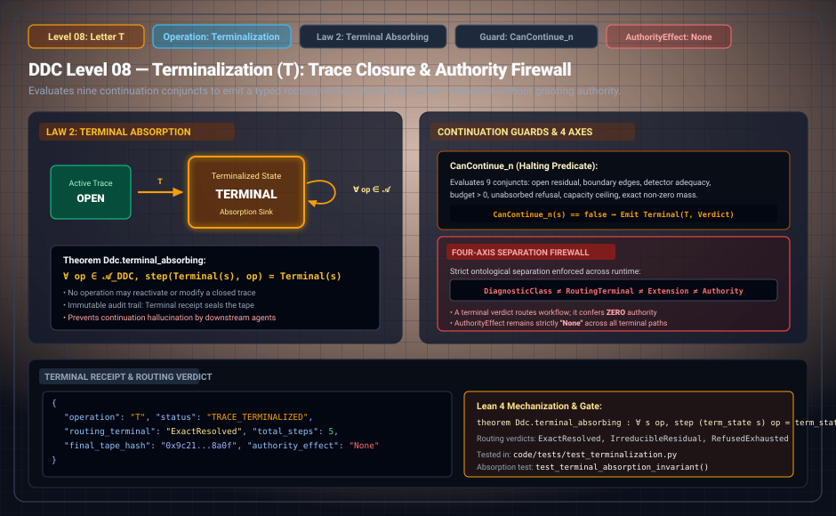

# DDC Level 08: Letter T — Terminalization

**AuthorityEffect:** None. Trace closure, routing terminal evaluation, and sovereign authority firewall only; no external authorization is conferred.  
**Operational Level:** Level 08 (`T`)  
**State Role:** Immutable Terminal Absorption Sink  
**Governing Laws:** Law 2 (Terminal Absorption Law), 4-Axis Separation Firewall  
**Continuation Predicate:** `CanContinue_n` (9-way conjunct evaluation)  
**Authority Firewall:** $F_{\mathrm{term}} : \text{REFUSED}$ — Routing verdict confers zero sovereign authority  
**Rust Crate Definition:** [`DdcOp::Terminalize`](../../../../../omega_engine/crates_rs/omega_wdp/src/ddc/dda_alphabet.rs#L56), [`non_authority.rs`](../../../../../omega_engine/crates_rs/omega_wdp/src/ddc/non_authority.rs)  

---

## 1. Schematic & Architectural Flow



---

## 2. Mathematical Definition & Halting Fences

Recursive evaluation regimes require an explicit halting law to prevent infinite expansion, self-certification loops, and unearned termination. Letter `T` seals an execution tape on a designated routing terminal when the declared terminal policy permits it, subject to strict mathematical non-openness fences.

Once a trace reaches terminal state `T`, execution enters an immutable absorption sink governed by **Law 2 (Terminal Absorption Law)**:

$$\boxed{\textbf{Law 2: Once a trace reaches terminal state T, no further mutation may touch the active trace.}}$$

Formally proved in Lean 4 as `Ddc.terminal_absorbing`:

$$\forall \operatorname{op} \in \mathcal{A}_{\mathrm{DDC}}, \quad \operatorname{step}\big(\operatorname{Terminal}(s), \operatorname{op}\big) = \operatorname{Terminal}(s)$$

---

## 3. Transition Fences & Rust Gate Enforcement

The governance contract [`dda_packets.contract.yaml`](../../../../../omega_engine_governance/contracts/contracts_omega_engine_crates/mathematics/discrete_deformation_algebra/dda_packets.contract.yaml), [`non_authority.rs`](../../../../../omega_engine/crates_rs/omega_wdp/src/ddc/non_authority.rs), and [`op_verification.rs`](../../../../../omega_engine/crates_rs/omega_wdp/src/ddc/op_verification.rs#L333-L347) enforce strict terminalization gates:

1. **State Immobility:** Letter `T` seals the trace without mutating cochain state:
   ```rust
   if before != after {
       return Err(OpViolation::InertOpMutatedState { op: step.op });
   }
   ```
2. **The Trichotomy Terminal Firewall:**  
   `Exact` ($\Phi_1 = 0, \Gamma_2 = 0$) and `ClosedSurvivor` ($\Phi_1 > 0, \Gamma_2 = 0$) may legitimately terminalize. An `Open` residual ($\Gamma_2 > 0$) may **never** terminalize:
   ```rust
   if after_diag.gamma != 0 {
       return Err(OpViolation::TerminalizedOpenResidual {
           gamma: after_diag.gamma,
       });
   }
   ```
   *Rationale:* A survivor is an irreducible-but-coherent topological obstruction—a valid terminal state. An open residual indicates boundary tension that has not been tracked or closed.
3. **Detector Adequacy:** Terminalization requires an adequate (non-blind) detector:
   ```rust
   if !before.adequate {
       return Err(OpViolation::BlindDetector);
   }
   ```
4. **Law 2: Terminal Absorption Law:**  
   Subsequent mutation steps on a terminalized trace are halted:
   ```rust
   if is_terminal {
       return Err(OpViolation::TerminalAbsorbing);
   }
   ```
5. **The Sovereign Non-Authority Invariant ([`non_authority.rs`](../../../../../omega_engine/crates_rs/omega_wdp/src/ddc/non_authority.rs)):**  
   Every verified trace and terminal receipt explicitly asserts:
   ```rust
   pub fn authority_effect(&self) -> AuthorityEffect {
       AuthorityEffect::None
   }
   ```
   A terminalized execution certifies internal mathematical consistency under declared boundaries, but **never confers operational authority**.

---

## 4. Step Receipt Wire Format (RFC 8785 JSON)

Every successful Level 08 terminalization emits a machine-verifiable `TerminalReceipt`:

```json
{
  "operation": "T",
  "status": "TRACE_TERMINALIZED",
  "paper_id": "DDC-T",
  "step_index": 5,
  "terminal_code": "EXACT_REPAIR_DISCHARGED",
  "total_steps": 5,
  "final_phi1": "0",
  "final_gamma2": "0",
  "tape_hash": "0x3f5c91b8a72e...",
  "step_sha256": "0x1234567890abcdef1234567890abcdef1234567890abcdef1234567890abcdef",
  "authority_effect": "None"
}
```

---

## 5. Formal Theorems, Rust Delegation & Mechanization

| Claim ID | Formal Statement | Lean 4 Theorem | Rust Crate Test | Python Binding |
| :--- | :--- | :--- | :--- | :--- |
| **DDC-T-01** | Terminal state is strictly absorbing: $\operatorname{step}(\operatorname{Term}(s), \operatorname{op}) = \operatorname{Term}(s)$ (Law 2). | `Ddc.terminal_absorbing` | [`op_verification.rs::tests`](../../../../../omega_engine/crates_rs/omega_wdp/src/ddc/op_verification.rs) | `test_terminalization.py::test_absorption` |
| **DDC-T-02** | Open residual ($\Gamma_2 > 0$) cannot terminalize; rejected as `TerminalizedOpenResidual`. | `Ddc.T_trichotomy_firewall` | [`op_verification.rs::terminalizing_an_open_residual_is_rejected`](../../../../../omega_engine/crates_rs/omega_wdp/src/ddc/op_verification.rs#L716) | `test_automaton.py::test_terminalized_open_residual` |
| **DDC-T-03** | Stabilized survivor ($\Gamma_2 = 0, \Phi_1 > 0$) may legitimately terminalize. | Survivor terminalization | [`op_verification.rs::a_survivor_may_legitimately_terminalize`](../../../../../omega_engine/crates_rs/omega_wdp/src/ddc/op_verification.rs#L630) | `test_terminalization.py::test_survivor_terminal` |
| **DDC-T-04** | Terminal receipt asserts `AuthorityEffect::None` unconditionally. | Sovereign Non-Authority | [`op_verification.rs::verified_trace_threads_state_and_still_mints_nothing`](../../../../../omega_engine/crates_rs/omega_wdp/src/ddc/op_verification.rs#L753) | `test_terminalization.py::test_authority_none` |

### Lean 4 Proof Kernel
[`lean4/Ddc/Terminalization.lean`](../../../../../omega_engine_atlas/coda_atlas/F004_papers/001_finite_obstruction_calculus/000_witnessed_difference_programme/docs/source_archive/discrete_deformation_calculus_package/lean4/Ddc/Terminalization.lean):
```lean
theorem Ddc.terminal_absorbing : ∀ (s : State) (op : DdcOp), step (Terminal s) op = Terminal s
```

### Sovereign Rust Test Bindings
- [`omega_engine/crates_rs/omega_wdp/src/ddc/op_verification.rs`](../../../../../omega_engine/crates_rs/omega_wdp/src/ddc/op_verification.rs):
  - `terminalizing_an_open_residual_is_rejected()`: Asserts that an open residual ($\Gamma_2 > 0$) fails to terminalize with `OpViolation::TerminalizedOpenResidual`.
  - `terminalizing_exact_is_allowed()`: Validates that exact state ($\Phi_1 = 0, \Gamma_2 = 0$) seals cleanly.
  - `a_survivor_may_legitimately_terminalize()`: Asserts that a coherent topological survivor ($\Phi_1 > 0, \Gamma_2 = 0$) seals lawfully without failure.
  - `verified_trace_threads_state_and_still_mints_nothing()`: Proves that a verified, terminalized trace still yields `AuthorityEffect::None`.
- [`omega_engine/crates_rs/tests/omega_wdp/gtoc5_authority_firewall.rs`](../../../../../omega_engine/crates_rs/tests/omega_wdp/gtoc5_authority_firewall.rs):
  - Asserts that production sources cannot call authority or promotion constructors.

---

## 6. Falsifiers & Counterexamples

- **Open Boundary Sealing Rejection:** Attempting to terminalize an unclosed boundary ($\Gamma_2 > 0$) fails as `OpViolation::TerminalizedOpenResidual`.
- **Post-Terminal Mutation Rejection:** Attempting any operation on an already-terminalized trace halts under `OpViolation::TerminalAbsorbing`.
- **Authority Laundering Attempt:** Asserting operational standing from a verified trace is rejected by `non_authority.rs`.

---

## 7. Epistemic Scope & Nonclaims

```text
T seals an execution trace upon reaching a designated routing terminal.
T certifies that mathematical stopping conditions are satisfied within the declared window.
T does not confer operational authority (AuthorityEffect::None).
```
