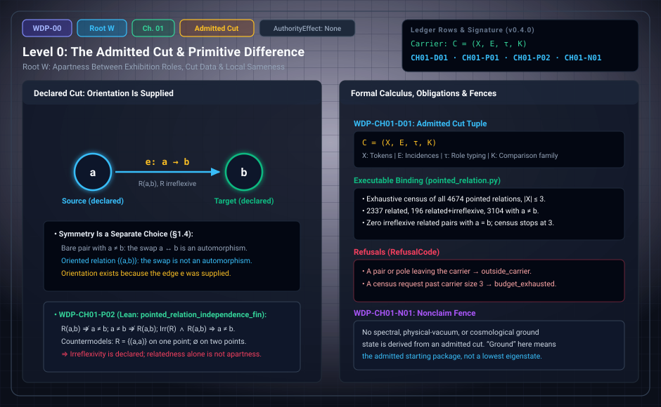

# WDP Level 00: The Admitted Cut

**AuthorityEffect:** None.\
**Level:** Level 00 (Chapter 1: The Admitted Cut)\
**Monograph Chapter:** Chapter 1, §1.1–§1.5 (*The Witnessed Difference Programme* v0.5.0)\
**Part:** Part I: Difference, Witness, and Finite Obstruction\
**Bound Evidence:** P; C; L:exact(pointed_relation_independence_fin)\
**Ledger Rows:** `WDP-CH01-D01`, `WDP-CH01-P01`, `WDP-CH01-P02`, `WDP-CH01-N01` (retaining canonical foundational nonclaims `WDP-CH00-N01`..`N03`)\
**Implementations:** [`ground.py`](../../../../omega_engine_atlas/coda_atlas/F004_papers/001_finite_obstruction_calculus/000_witnessed_difference_programme/code/witnessed_difference/ground.py), [`pointed_relation.py`](../../../../omega_engine_atlas/coda_atlas/F004_papers/001_finite_obstruction_calculus/000_witnessed_difference_programme/code/witnessed_difference/pointed_relation.py)\

---

## 1. Schematic & Conceptual Architecture

### 1.1 The Foundational Question & The Shape of the Answer

The programme asks one narrow question:

> How much mathematical structure can be made explicit when one begins with an
> exhibited difference and refuses to smuggle in an observer, a clock, a
> probability space, a quantum state, or an authority relation?

The monograph's answer is neither "everything follows from difference" nor
"nothing can be said." A finite calculus can be built, but every step has a
price that must be declared:

| Step | What is needed beyond the previous step | Level |
| :--- | :--- | :---: |
| An exhibited cut supports residuals | a declared comparison family and a repair map | 0–1 |
| Residuals can be retained | additional memory structure (retention is not free) | 2 |
| Residuals can be measured on a complex | a declared degree-1 window, norm, and repair map | 3 |
| Retained comparisons support succession | a declared immediate-succession relation | 5 |
| Succession supports duration | a declared additive valuation (positivity and units are further hypotheses) | 6 |
| Witness families support finite probability | a declared matching, additive weight, and normalization | 7–8 |
| An observer can be specified | a layered presentation, memory, evaluator, and policy | 9 |
| An observation can be recorded | interaction, registration, witness, re-access, and an accepting evaluator | 11 |
| A measurement can be reported | measurand, value carrier, value map, calibration, uncertainty, traceability when claimed, and provenance | 12 |
| Histories can be aggregated | a declared semiring and a finite path family | 16 |

At none of these steps does the next layer arrive because it would be
convenient. The optional quantum-capable branch (Level 4) and the quantum
reconstruction audit (Levels 17–18) sit beside this spine. They are declared
hosts and audits, not consequences of Primitive Difference.

---

### 1.2 What this level does

The programme does not start from a slogan. It starts from an admitted finite
package that contains two co-inputs: **Primitive Difference** (a way to tell
the relevant roles apart in the present exhibition) and **Structure** (a
carrier on which those roles can be compared, and a rule saying which
comparisons count as sameness or repair). "From difference" is shorthand for
"from an exhibited difference inside a declared finite structural package."

The overall framework is **CODA** (*Calculus of Obstruction, Descent, and
Authority*). The minimal finite-carrier setting used here is the **Finite
Obstruction Calculus** (**FOC**).

## 2. Definitions and Mathematical Results

> **`WDP-CH01-D01` — Definition (admitted cut).** An admitted cut is a tuple
> $\mathfrak C=(X,E,\tau,\mathcal K)$ where $X$ is a finite set of exhibited
> tokens, $E$ is a finite set of incidences or comparisons, $\tau$ assigns the
> roles needed to type those incidences, and $\mathcal K$ is the declared
> family of admissible comparisons. The tuple is data. No part of it is
> selected from equality on $X$ alone.

In the monograph's lexicon the admitted cut is **Root W**: the witnessed
irreflexive relation $K=(X,R,\operatorname{Irr}(R))$ with a witness
$d=(a,b,w:R(a,b))$. It is the admission kernel of distinction and orientation,
prior to any evaluation or repair quotient. It is never to be conflated with
**Root P**, the evaluation layer of [Level 01](level_01_witness_function.md). A graph is a
convenient representation (tokens as vertices, typed comparisons as oriented
edges), but a hypergraph, relation, or small category may fit better. The
representation must be named before a theorem depends on it.

**Difference and local sameness (§1.2).** Within a fixed comparison family, a
declared predicate $\operatorname{Same}_{\mathcal K}:P\times P\to\{0,1\}$ asks
whether two presentations agree. A failed comparison is a residual at the level
of predicates. Encoding the failure as $p-q$ is a stronger step: it presupposes
subtraction, scalars, and a zero.

> **`WDP-CH01-P01` — Finite proposition.** A failed declared sameness
> comparison exhibits that the two compared presentations are not
> interchangeable under that comparison.

The statement is local. It does not say the presentations differ under every
comparison, does not make the failure intrinsic to the tokens, and supplies no
order.

**Why Structure cannot be erased (§1.3).** On a bare finite set with $|X|\ge2$,
every permutation is an automorphism. A distinguished element, a direction, an
edge, a nontrivial proper subset, or an ordered pair is generally moved by some
permutation, so it cannot be chosen invariantly without extra data. Structure is
legitimate; it must be visible in the input ledger. [Level 02](level_02_residuals_obstructions.md) states
the finite proposition behind this (`WDP-CH03-P01`, mechanized in Lean).

> **`WDP-CH01-P02` — Finite proposition (pointed relations and apartness).**
> For a pointed relation $(X,R,a,b)$ on a finite carrier, $R(a,b)$ does not
> imply $a\ne b$; $a\ne b$ does not imply $R(a,b)$; and $R(a,b)$ together with
> irreflexivity of $R$ implies $a\ne b$.

*Proof sketch.* A one-point carrier with $R=\{(a,a)\}$ and $b=a$ has $R(a,b)$
and $a=b$. The empty relation on a two-point carrier has $a\ne b$ without
$R(a,b)$. If $R$ is irreflexive and $R(a,b)$, then $a=b$ would give $R(a,a)$.
$\square$

So irreflexivity is the declared ingredient that lets a related pair witness
apartness. It belongs to the admitted package and does not follow from
relatedness. A consequence: a carrier that hosts an irreflexive related pair
has at least two elements.

## 3. Worked Example: A Two-Pole Exhibition (§1.4)

Let $X=\{a,b\}$.

1. Declaring only $a\ne b$ exhibits apartness, but it does not choose which
   pole is source and which is target. The transposition $a\leftrightarrow b$
   preserves both equality and inequality.
2. Declaring an oriented edge $e:a\to b$ supplies an orientation. Orientation
   exists because $e$ was supplied.
3. Symmetry is a second, independent choice. The symmetric relation
   $\{(a,b),(b,a)\}$ admits the swap as an automorphism; the oriented relation
   $\{(a,b)\}$ does not. Keeping both options is nonselection (Level 2);
   choosing one is an entry in the injection ledger (§3.2 of the monograph).

Three conclusions must stay distinct: the poles are apart in the exhibition;
the edge orients them; an observer may later register that orientation. The
first does not imply the second, and neither implies the third.

**Census check.** The executable binding enumerates all pointed relations
$(R,a,b)$ on carriers $\{0,\dots,n-1\}$ for $1\le n\le3$: there are
$\sum_n n^2 2^{n^2}=4674$ of them. Of these, $2337$ have $R(a,b)$, $196$ have
$R(a,b)$ with $R$ irreflexive, and $3104$ have $a\ne b$. None has $R$
irreflexive, $R(a,b)$, and $a=b$. The census stops at size 3 and claims
nothing beyond it.

## 4. Evidence Bindings & Executable Verification

Paths are relative to the monograph package
[`000_witnessed_difference_programme/`](../../../../omega_engine_atlas/coda_atlas/F004_papers/001_finite_obstruction_calculus/000_witnessed_difference_programme/).

| Row | Status | Ledger evidence | Lean | Executable binding | Notebook |
| :--- | :--- | :--- | :--- | :--- | :--- |
| `WDP-CH01-D01` | Definition | P | none; `CLAIM_MAP.md` lists it among definition rows without an exact declaration | none | `000_primitive_difference.ipynb` (anchor) |
| `WDP-CH01-P01` | Finite proposition | P; C | none; prose-only | `code/witnessed_difference/ground.py`, tested by `code/unit_tests/test_exact_ground_outcomes.py` | `000_primitive_difference.ipynb` |
| `WDP-CH01-P02` | Finite proposition | P; C; L:exact | `WitnessedDifference.PointedRelation.pointed_relation_independence_fin` (countermodels on `Fin 1` and `Fin 2`; `pointed_relation_independence` states it over all types) | `code/witnessed_difference/pointed_relation.py`, tested by `test_pointed_relation.py`, `test_absorbed_finite_propositions.py`, `test_mutation_recovery.py` | none |
| `WDP-CH01-N01` | Nonclaim | P | none | none | none |

**What the executable bindings check.** `ground.py` computes the
same/different primitive on finite tokens and its xor parity.
`pointed_relation.py` builds pointed relations, refusing with
`RefusalCode.OUTSIDE_CARRIER` when a pair or pole leaves the carrier, runs the
exhaustive census above, and compares it with closed forms. Asking for a census
beyond size 3 is refused with `RefusalCode.BUDGET_EXHAUSTED`.

## 5. Misreadings the Chapter Rules Out

- **"Irreflexivity is forced by distinction."** It is declared.
  `WDP-CH01-P02` shows that relatedness alone does not give apartness.
- **"The cut orients itself."** A bare two-pole exhibition is symmetric under
  the swap. Orientation is supplied by a declared edge.
- **"A difference is already a vector."** Writing $b-a$ admits an abelian group
  or vector space. That is more structure than a failed sameness test.
- **"Ground means ground state."** "Ground" means the admitted starting
  package. A spectral ground state is a lowest-eigenvalue state of a declared
  operator on a declared inner-product space. It belongs to the optional
  carrier branch (Level 4), and the two should not share an unqualified name
  (§1.5).

## 6. Nonclaims

- **`WDP-CH01-N01`.** No spectral, physical-vacuum, or cosmological ground
  state is derived from an admitted cut.

## 7. Claim Discipline

1. **What this level supports:** the admitted-cut package as declared data,
   the local reading of a failed sameness test (`WDP-CH01-P01`), and the three
   pointed-relation implications of `WDP-CH01-P02`, mechanized in Lean.
2. **What it does not support:** that irreflexivity, orientation, or symmetry
   follow from difference; any physical space, matter, time, or ground state.
3. **Narrowest defensible claim:** irreflexivity of a declared relation suffices
   for a related pair to witness apartness, and the orientation of a cut is
   information that must be supplied.
4. **Next test needed:** extend the executable census past carrier size 3 with
   a declared budget, or formalize `WDP-CH01-D01` as an exact Lean structure.
   Both are suggested next steps, not ledger rows.

---

---

## 8. Architectural Context: Interfaces Kept Separate

The monograph's main contribution is to make interfaces visible. Each item
below is a separation that a later level depends on:

1. **Witness is not observer.** Seven typed witness roles, none of them an
   observer ([Level 01](level_01_witness_function.md)).
2. **Observer is not authority.** Acceptance by an evaluator does not
   authorize anything ([Level 09](level_09_behavioral_quotients_finite_states.md), [Level 14](level_14_traceability_provenance_receipts.md)).
3. **Observation is not measurement.** A measurement extends an observation
   with a measurand, value map, calibration, uncertainty, traceability when
   claimed, and provenance ([Level 11](level_11_linear_sensing_projection.md), [Level 12](level_12_context_interference_state_spaces.md)).
4. **Finite probability is not physical chance.** A normalized finite weight is
   a declared valuation ([Level 07](level_07_finite_probability_multiplicity.md), [Level 08](level_08_discrete_observer_layer.md)).
5. **A quantum-capable carrier is not quantum theory.** Complex carriers,
   phases, and inner products are declared imports ([Level 04](level_04_boundary_separation_contraction.md),
   [Level 17](level_17_semiring_coarse_graining.md), [Level 18](level_18_exact_rational_bounds.md)).
6. **A repository receipt is not a verdict on mathematics or reality.** Tests,
   proofs, dashboards, and status labels are evidence of their own kinds
   ([Level 20](level_20_finite_adequacy_continuum_limits.md)).

---

---

## 9. Navigation

- **Levels Index:** [README.md](README.md)
- **Previous System:** [MSS-N Levels](../../003_minimal_symbol_system_n_mssn/levels/README.md)
- **Next Level:** [Level 01: Residuals and the Typed Witness Taxonomy](level_01_witness_function.md)
- **WDP Monograph Master:** [level_00_admitted_cut.md](level_00_admitted_cut.md)
