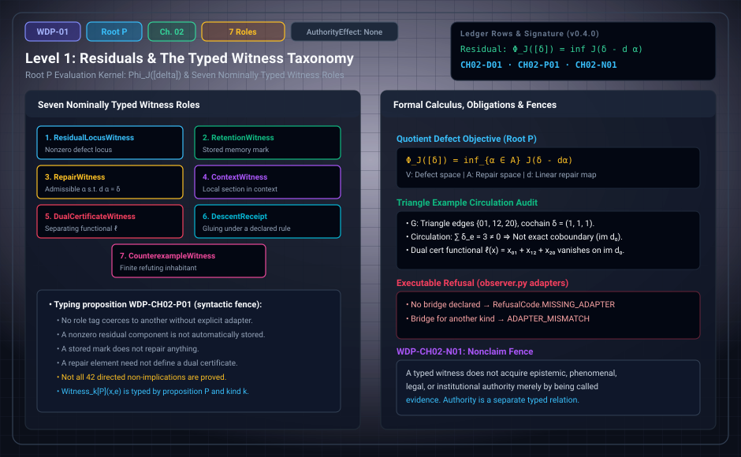

# WDP Level 01: Residuals and the Typed Witness Taxonomy

**AuthorityEffect:** None.  
**Level:** Level 01 (Chapter 2: Residuals and the Typed Witness Taxonomy)  
**Monograph Chapter:** Chapter 2, §2.1–§2.4 (Part I: Difference, witness, and finite obstruction), *The Witnessed Difference Programme* v0.4.0.  
**Part:** Part I: Difference, Witness, and Finite Obstruction  
**Ledger Rows:** `WDP-CH02-D01` (definition), `WDP-CH02-P01` (typing proposition), `WDP-CH02-N01` (nonclaim).  

---

## 1. What this level does

Earlier drafts of the programme used the single word *witness* for several
objects that are not interchangeable. The monograph's abstract lists a locus
where a residual is carried, a retained mark, an admissible repair, a dual
certificate, a local contextual section, a counterexample, and an observer's
self-report. Chapter 2 replaces that one word with seven typed roles.
It first says what a **residual** is (the part of a declared defect that no
admissible repair removes), and only then says what it means for something to
*witness* that residual, and in which role.

The chapter proves no deep theorem. Its contribution is a type discipline: each
witness carries the proposition it witnesses and its role as part of its type,
and nothing moves between roles without a declared adapter.

---

## 2. Definitions and results

### 2.1 Residual before witness (§2.1)

Let $V$ be a finite-dimensional real vector space of defects, $A$ a
finite-dimensional space of repairs, $d:A\to V$ a linear repair map, and
$\delta\in V$ an exhibited defect. For a declared seminorm or cost functional
$J:V\to[0,\infty)$, the **quotient defect** is

$$
\Phi_J([\delta])=\inf_{\alpha\in A}J(\delta-d\alpha),
$$

where $[\delta]$ is the coset of $\delta$ modulo $\operatorname{im}d$. The
expression is not primitive. It imports a linear carrier, a repair map, and a
cost, and each of these is declared rather than derived.

The monograph's lexicon calls this layer **Root P**: the evaluation kernel and
quotient-defect structure on cochains. Root P presupposes **Root W**, the
admitted cut of [Level 00](level_00_admitted_cut.md), as its carrier and never substitutes for
it.

> **`WDP-CH02-D01` — Definition (residual-locus witness).** A residual-locus
> witness is a typed locus $L$ together with evidence that the restriction or
> component of the residual at $L$ is nonzero according to the declared test.

The locus witnesses a proposition. It is not thereby a memory, an observer, an
agent, or a measurement apparatus.

### 2.2 The seven witness roles (§2.2)

| # | Role | What it witnesses |
| :---: | :--- | :--- |
| 1 | `ResidualLocusWitness[P]` | a locus at which the residual proposition $P$ is exhibited |
| 2 | `RetentionWitness[P]` | a mark or state component that enables later re-access to evidence for $P$ |
| 3 | `RepairWitness[P]` | an admissible $\alpha$ showing that $P$ can be repaired, often by $d\alpha=\delta$ |
| 4 | `ContextWitness[P]` | a local assignment or section witnessing $P$ inside a declared context |
| 5 | `DualCertificateWitness[P]` | a functional separating a defect from the repair image |
| 6 | `DescentReceipt[P]` | evidence that compatible local presentations glue or transport under a declared descent rule |
| 7 | `CounterexampleWitness[P]` | a finite inhabitant refuting a universally quantified $P$ |

The general form $$\operatorname{Witness}_{k}[P]\,(x,e)$$ reads: evidence $e$ makes
subject $x$ a witness of kind $k$ for proposition $P$. Both $P$ and $k$ are
part of the type.

> **`WDP-CH02-P01` — Typing proposition.** In the nominal typed interface, no
> one of the seven role tags coerces to another unless an explicit adapter and
> its hypotheses are declared.

**Scope of this row.** It is a syntactic fence. It does not prove all 42
directed semantic non-implications between the roles. Simple finite models do
separate several of them:

- a nonzero residual component need not be stored;
- a stored mark need not repair anything;
- a repair element need not define a separating functional;
- a local section need not glue;
- a counterexample need not be re-accessible.

Observer self-reports are not an eighth role. The abstract names them among the
earlier conflations, and they return in [Level 13](level_13_self_reference_gaps_fixed_points.md) as
self-presentations with their own limits. Conversely, `DescentReceipt` is a
role in the taxonomy although the abstract's list of conflations does not
name it.

---

## 3. Worked example: the oriented triangle (§2.3)

Take the oriented triangle with vertices $0,1,2$ and edges $01,12,20$, with
$C^0=C^1=\mathbb R^3$ and coboundary $(d_0f)_{ij}=f_j-f_i$.

1. Let $\delta=(1,1,1)$ in the edge order $(01,12,20)$.
2. Its circulation is $\delta_{01}+\delta_{12}+\delta_{20}=3$.
3. Every coboundary has circulation zero:
   $(f_1-f_0)+(f_2-f_1)+(f_0-f_2)=0$.
4. So the functional $\ell(x)=x_{01}+x_{12}+x_{20}$ vanishes on
   $\operatorname{im}d_0$ and gives $\ell(\delta)=3\neq0$. It is a
   `DualCertificateWitness` that $\delta$ is not an exact repair target.

Each edge is also a possible residual locus, if the local test reads its
nonzero component. No edge stores that result by being nonzero, and $\ell$ is
not an observer. One defect, several candidate roles (residual locus, dual
certificate, and an absent retention witness), and no role follows from
another.

---

## 4. Evidence bindings

Paths are relative to the monograph package
[`000_witnessed_difference_programme/`](../../../../omega_engine_atlas/coda_atlas/F004_papers/001_finite_obstruction_calculus/000_witnessed_difference_programme/).

| Row | Status | Ledger evidence | Lean | Executable binding | Notebook |
| :--- | :--- | :--- | :--- | :--- | :--- |
| `WDP-CH02-D01` | Definition | P | none; `CLAIM_MAP.md` lists it among definition rows without an exact declaration | none | none |
| `WDP-CH02-P01` | Typing proposition | P; C | none; prose-only in `CLAIM_MAP.md` | `code/witnessed_difference/observer.py`, tested by `code/unit_tests/test_witness_observer.py` | `020_retention_and_reaccess.ipynb` |
| `WDP-CH02-N01` | Nonclaim | P; C | none | `code/witnessed_difference/witness.py`: the evidence receipt has no authority output | `020_retention_and_reaccess.ipynb` |

**What the executable binding for `WDP-CH02-P01` checks.** It applies the same
non-coercion discipline to observer representations: `adapt_quotient` and
`adapt_operational` return `RefusalCode.MISSING_ADAPTER` when no bridge is
declared and `RefusalCode.ADAPTER_MISMATCH` when the bridge was declared for
another kind. It does not enumerate the seven role tags themselves.

---

## 5. Misreadings the chapter rules out

- **Calling a certificate an observer.** In §2.3 the functional $\ell$
  certifies non-exactness. It observes nothing, retains nothing, and decides
  nothing.
- **Treating a residual as stored.** A nonzero component is a residual locus.
  Storing it is a separate `RetentionWitness`, and [Level 02](level_02_residuals_obstructions.md) shows
  that retention costs additional structure.
- **Treating evidence as authority.** A proof term, a test record, and a
  residual each witness something different. Moving between them requires an
  adapter, such as a theorem linking an executable output to a mathematical
  predicate or a provenance receipt linking an artifact to its source (§2.4).

---

## 6. Nonclaims

- **`WDP-CH02-N01`.** A typed witness acquires no epistemic, phenomenal,
  legal, or institutional authority merely by being called evidence.

---

## 7. Claim discipline

1. **What this level supports:** a nominal type system with seven witness
   roles, and the typing proposition `WDP-CH02-P01` that no role coerces to
   another without a declared adapter.
2. **What it does not support:** the 42 directed semantic non-implications
   between roles, the repairability of any residual, or any claim that a
   witness is an observer, a memory, or an authority.
3. **Narrowest defensible claim:** once the residual is typed separately from
   every role that might witness it, a certificate, a stored mark, a repair,
   and a counterexample can be kept apart by declaration and checked by
   adapter refusal.
4. **Next test needed:** finite separating models for the directed role pairs
   that §2.2 leaves unseparated. This is a suggested next step, not a ledger
   row.

---

---

## Navigation

- **Previous:** [Level 00: The Admitted Cut](level_00_admitted_cut.md)
- **Next:** [Level 02: Symmetry, Nonselection, and the Price of Retention](level_02_residuals_obstructions.md)
- **Levels Index:** [README.md](README.md)
