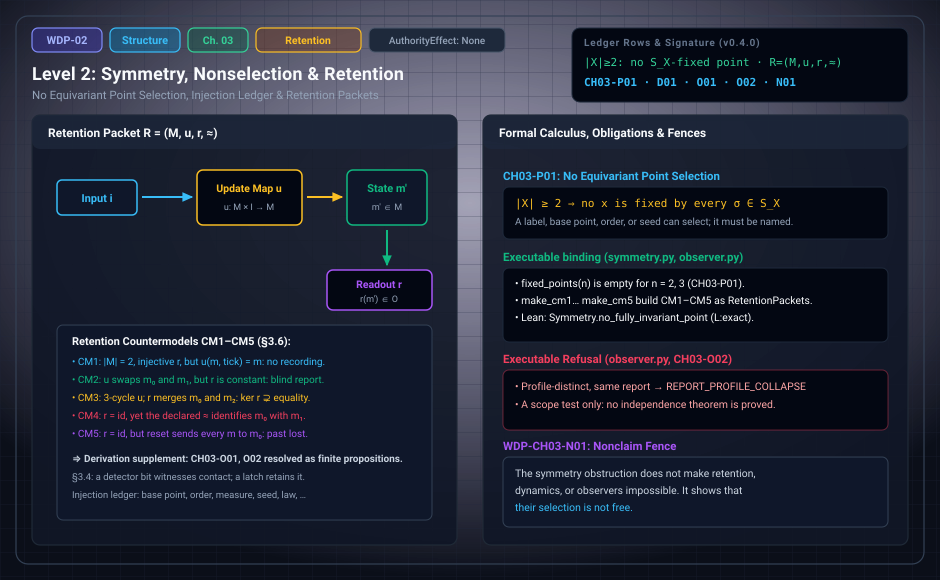

# WDP Level 02: Symmetry, Nonselection, and the Price of Retention

**AuthorityEffect:** None.  
**Level:** Level 02 (Chapter 3: Symmetry, Nonselection, and the Price of Retention)  
**Monograph Chapter:** Chapter 3, §3.1–§3.6 (Part I: Difference, witness, and finite obstruction), *The Witnessed Difference Programme* v0.5.0.  
**Part:** Part I: Difference, Witness, and Finite Obstruction  
**Ledger Rows:** `WDP-CH03-P01` (finite proposition), `WDP-CH03-D01` (definition), `WDP-CH03-O01` (finite proposition) and `WDP-CH03-O02` (finite supplement), `WDP-CH03-N01` (nonclaim).  

---

## 1. What this level does

Chapter 3 asks two questions about what a bare carrier can do on its own.

Can a finite set with no structure beyond equality pick out one of its
elements? No. Every point is moved by some permutation, so no rule that
respects all permutations can name a point. Whatever selects must bring in an
input that breaks the symmetry, recorded in an **injection ledger**.

Does a difference, once exhibited, stay available? Not by itself. Keeping it
needs a persisting carrier, an update rule, a report map, and a recognition
criterion: a **retention packet** $\mathcal R=(M,u,r,\approx)$, which the
chapter treats as a definition, not a derivation. Five finite countermodels
(CM1–CM5) show one component present while another does nothing. The
finite behavioral classification and the declared component choices are now proved in Appendices I and J.

---

## 2. Definitions and results

### 2.1 The finite symmetry obstruction (§3.1)

Let $X$ be a finite set with $|X|=n\ge2$ and no structure beyond equality. The
symmetric group $S_X$ acts transitively on $X$. A parameter-free choice of a
point would be an $S_X$-equivariant map from the one-point trivial $S_X$-set to
$X$. Such a map picks an $x$ fixed by every permutation. When $n\ge2$, the
transposition exchanging $x$ with any other point moves $x$, so there is no
such $x$.

> **`WDP-CH03-P01` — Finite proposition (no equivariant point selection).**
> There is no $S_X$-equivariant selection of a distinguished element of an
> unstructured finite set $X$ with $|X|\ge2$.

**Scope of this row.** The same argument applies to an oriented edge or a
nontrivial proper subset whenever the full symmetry group acts without a global
fixed target of the requested type. It is a nonselection result, not an
impossibility of choice. A label, base point, order, random seed, boundary
condition, prior state, or external input can select. The result only requires
that the source of the asymmetry be named.

The general form of this criterion is `WDP-CH03-P02` (fixed-target criterion:
for a finite group $H$ acting on a finite set $Y$, a parameter-free
$H$-equivariant point choice exists exactly when $Y$ has a global $H$-fixed
point). It carries a Chapter 3 identifier but its canonical location is the
technical note at the end of Chapter 5, so it belongs to
[Level 04](level_04_boundary_separation_contraction.md), not to this page's ledger rows.

### 2.2 Injection ledger (§3.2)

For any proposed selection, the ledger records the first input that breaks the
relevant symmetry. Typical entries are a named element or base point, an
orientation, an ordering or clock, a measure or weighting, a boundary
condition, a representation or coordinate system, an observer profile, a
stochastic device with its distribution, or a physical law not present in the
root package.

> **`WDP-CH03-D01` — Definition (asymmetry-price frontier).** Relative to a
> specified implementation class and dependency preorder, the asymmetry-price
> frontier is the family of inclusion-minimal declared input sets whose
> removal restores a symmetry that moves the output. A scalar "price"
> additionally requires a stated cost function; several frontier elements may
> tie or remain incomparable.

Minimality is relative to the declared implementation class and order. No
uniqueness or global-minimality theorem is claimed. The chapter's small search
shows why. Fix a declared grammar of responses that separate two data and price
each response by its item count. The minimal responses can fall into several
isomorphism classes. A declared lexicographic refinement can leave one class,
yet that class may consist of two responses exchanged by swapping the data. By
the fixed-target criterion no swap-equivariant rule picks one of them.
Choosing a representative is a further declared input, not an output of the
search.

### 2.3 Retention is additional structure (§3.3)

A difference at one exhibition does not by itself remain available at another.
A generic retention packet is

$$
\mathcal R=(M,u,r,\approx),
$$

where $M$ is a memory carrier, $u:M\times I\to M$ is an update under inputs
$I$, $r:M\to O$ is a report map, and $\approx$ is the declared comparison used
to recognize retained content. The packet is a definition, not a derivation.
Appendix I constructs the greatest behavioral congruence and minimal quotient
for the declared total deterministic packet, without a global chronology.
Appendix J identifies all typed choices as a Cartesian product and proves the declared compatibility and predicate classifications. Quotient descent needs its separate hypotheses.

> **`WDP-CH03-O01` — Finite proposition.** For a finite nonempty carrier with total labelled deterministic updates and exact readouts or a validated report equivalence, descending partition refinement computes the greatest report-respecting update congruence, its minimal quotient, and behavioral classification by quotient isomorphism, without a global chronology.
> See Appendix I and [the derivation guide](../derivation_review.md).

> **`WDP-CH03-O02` — Finite proposition (typed component independence).** For fixed finite nonempty carrier $M$, input alphabet $I$ and nonempty report alphabet $O$, all typed retention extensions form the Cartesian product $M^{I\times M}\times O^M\times\mathcal P(O\times O)$. Named compatibility laws may couple its factors. For arbitrary report comparison the all-word relation is the greatest report-respecting forward-compatible relation; quotient and literal-readout descent require their separate stated conditions. Appendix J proves this result and the complete declared predicate classifications.

### 2.4 Relation to automata (§3.5)

Myhill–Nerode equivalence quotients word histories by future
distinguishability, but words are already ordered. Bisimulation presupposes a
labelled transition system; channel theory presupposes classifications. The
chapter uses these only for comparison and imports no automaton-minimality
theorem: they clarify retention after their inputs are admitted, and do not
supply those inputs.

### 2.5 Retention countermodels CM1–CM5 (§3.6)

Section 3.6 gives five finite packets. In each, some components are
nontrivial while another is trivial, blind, coarse, or lossy. Where §3.6 leaves
a component unspecified, the executable fixture's choice is shown in
parentheses.

| Model | Carrier and inputs | Update $u$ | Report $r$ | Comparison $\approx$ | What it separates |
| :--- | :--- | :--- | :--- | :--- | :--- |
| CM1 | $M=\{m_0,m_1\}$, $I=\{\text{tick}\}$ | $u(m,\text{tick})=m$ | injective, $r(m_i)=r_i$ | diagonal | a nontrivial, observable carrier does not force recording dynamics |
| CM2 | $M=\{m_0,m_1\}$, $I=\{\text{toggle}\}$ | swaps $m_0,m_1$ | constant $o_0$ | (equality) | invertible, nontrivial updating does not make the report informative |
| CM3 | $M=\{m_0,m_1,m_2\}$, $I=\{\text{cycle}\}$ | $m_i\mapsto m_{(i+1)\bmod3}$ | $r(m_0)=r(m_2)=\text{even}$, $r(m_1)=\text{odd}$ | (equality) | report equivalence $\ker r$ is strictly coarser than state equality |
| CM4 | $M=\{m_0,m_1\}$, ($I=\{\text{step}\}$) | (swap) | $r=\operatorname{id}_M$ | contains $(m_0,m_1)$ | declared recognition can identify distinct reports; $\approx$ is not fixed by $(M,u,r)$ |
| CM5 | $M=\{m_0,m_1\}$, $I=\{\text{reset},\text{keep}\}$ | $u(m,\text{reset})=m_0$ (keep: identity) | $r=\operatorname{id}_M$ | (equality) | a faithful report of the current state does not retain past inputs |

**A bounded-depth behavioral relation.** Section 3.6 also gives a candidate
behavioral relation on branching computation trees rather than on words. Two
states $s\in M_1$, $s'\in M_2$ are
$0$-equivalent when $r_1(s)\approx r_2(s')$, and $k$-equivalent when in
addition, for every declared input $i\in I$, the states $u_1(s,i)$ and
$u_2(s',i)$ are $(k-1)$-equivalent. Each branch is still a finite sequence of
events, but no global total order or linear clock is postulated across
branches. The relation is an equivalence when $\approx$ is one; for a mere
tolerance, as CM4 allows, it need not be transitive.

**Status.** These countermodels separate components but do not settle
`WDP-CH03-O02`. Appendix I resolves `WDP-CH03-O01` for the explicitly
chosen finite deterministic behavioral equivalence; the native owner checks
refinement, minimal quotient and comparison receipts.

In CM3 a single report cannot tell $m_0$ from $m_2$, but the depth-1 relation
can: one more `cycle` input sends $m_0\mapsto m_1$ (`odd`) and
$m_2\mapsto m_0$ (`even`). On the fixture, `tree_behavior_equivalent` holds for
$(m_0,m_2)$ at depth 0 and fails at depth 1. So CM3 shows $\ker r$ coarser than
equality, not an unrecoverable state.

---

## 3. Worked example: witness without retention (§3.4)

### 3.1 The detector bit

At a single instant, let a detector bit be $1$ exactly while an input contact
is closed. The bit resets to $0$ when the contact opens, and no other state
persists.

| Step | Contact | Detector bit | Evidence of the earlier closure? |
| :---: | :--- | :---: | :--- |
| 1 | closed | 1 | the bit witnesses the *current* contact |
| 2 | open | 0 | none: no state records step 1 |

At step 1 the bit is a `ResidualLocusWitness` for current contact; at step 2
nothing carries evidence of step 1, so it is not a `RetentionWitness` for past
contact. Adding a latch creates retention. The latch is not contained in the
original event; it is a new mechanism.

As an illustration (not a formula from the monograph), the latch is the
packet $M=\{0,1\}$, $I=\{\text{close},\text{open}\}$, $u(m,\text{close})=1$,
$u(m,\text{open})=m$, $r=\operatorname{id}_M$, $\approx$ equality. All four
components had to be supplied. CM5 adds a reset input that erases the latch.

### 3.2 The symmetry obstruction on three labels

Take $X=\{0,1,2\}$. The group $S_3$ has $6$ permutations. For each point $x$
some transposition moves it, so no point is fixed by all six and no
$S_3$-equivariant rule can select one. The executable audit
`exhaustive_relation_audit(3)` goes further on the same carrier: of the
$2^9=512$ binary relations on three labels, exactly $4$ are invariant under all
permutations (empty, diagonal, off-diagonal, and all pairs), and none of them is
a strict total order. An order on the three labels, like a distinguished point,
has to be supplied.

---

## 4. Evidence bindings

Paths are relative to the monograph package
[`000_witnessed_difference_programme/`](../../../../omega_engine_atlas/coda_atlas/F004_papers/001_finite_obstruction_calculus/000_witnessed_difference_programme/).

| Row | Status | Ledger evidence | Lean | Executable binding | Notebook |
| :--- | :--- | :--- | :--- | :--- | :--- |
| `WDP-CH03-P01` | Finite proposition | P; C; L:exact | `WitnessedDifference.Symmetry.no_fully_invariant_point` — exact binding in `CLAIM_MAP.md`; axioms `propext`, `Classical.choice`, `Quot.sound` | `code/witnessed_difference/symmetry.py`, tested by `code/unit_tests/test_symmetry.py` and `code/integration_tests/test_foundation_to_receipt.py` | `000_primitive_difference.ipynb` |
| `WDP-CH03-D01` | Definition | P | none; listed among definition rows without an exact declaration | none | none |
| `WDP-CH03-O01` | Finite proposition | P; N; L:partial(BehavioralQuotient) | partial: BehavioralQuotient.lean; finite termination is prose/native | omega_category_theory::finite_moore; omega_wdp::retention | Appendix I; current supplement |
| `WDP-CH03-O02` | Finite proposition | P; C; N; L:partial (standalone supplement) | partial Lean coverage; see derivation guide | `code/witnessed_difference/retention_choices.py`; native owners in derivation guide | `020_retention_and_reaccess.ipynb` |
| `WDP-CH03-N01` | Nonclaim | P; C | none | `code/witnessed_difference/symmetry.py` (the audit reports an obstruction only), tested by `code/unit_tests/test_symmetry.py` | none |

`WDP-CH03-P01` is mechanized in Lean at the row's scope: the declaration states
that on a finite type with at least two elements no point is fixed by every
permutation.

**What the executable bindings check.** For `WDP-CH03-P01`, `fixed_points(n)`
is empty for $n=0,2,3$ and is the single point for $n=1$,
`fixed_oriented_edges(n)` is empty for $n\le3$, and
`exhaustive_relation_audit(3)` reports the counts in section 3.2 above. It raises
`ValueError` on malformed input and returns no `RefusalCode`. For
`WDP-CH03-O02` the ledger evidence is scope and refusal tests with no
independence theorem: `validate_report_profile_separation` returns
`RefusalCode.REPORT_PROFILE_COLLAPSE` when two profile-distinct states share
one report, and `RetentionPacket.step` and `.report` return
`RefusalCode.INVALID_INPUT` when undefined. The module also builds CM1–CM5
(`make_cm1_static_carrier` through `make_cm5_lossy_reset`), checked with
`is_observable` and `is_reversible`, and defines `tree_behavior_equivalent`;
`claim_code_map.json` does not bind that function to `WDP-CH03-O01`.

---

## 5. Misreadings the chapter rules out

- **"Nonselection means choice is impossible."** A label, base point, order,
  seed, boundary condition, prior state, or external input can select (§3.1).
  The result only forbids selection without a named source of asymmetry.
- **"The asymmetry-price frontier is a unique minimum."** It is a family of
  inclusion-minimal input sets relative to a declared implementation class and
  dependency preorder. A scalar price needs a stated cost, elements may tie or
  be incomparable, and a refined search can end in two swap-exchanged
  responses that no swap-equivariant rule separates (§3.2).
- **"A witness retains what it witnesses."** The detector bit of §3.4 witnesses
  current contact and keeps nothing. Retention is a separate mechanism with its
  own components.
- **"Automata theory supplies retention for free."** Its equivalences run on
  words, which are already ordered, or on labelled transition systems, which
  must be admitted first (§3.5).
- **"CM1–CM5 settle the structure of memory."** They are five finite
  countermodels. Appendix I supplies a minimal quotient for the admitted
  deterministic packet; Appendix J supplies the component-choice product and the complete declared predicate classifications.
  The ledger's source table also records an earlier conjecture that five
  notions exhaust retention (`WDP001-RA1-C18`) as not carried.

---

## 6. Nonclaims

- **`WDP-CH03-N01`.** The symmetry obstruction does not make retention,
  dynamics, or observers impossible, but it shows that their selection is not
  free.

**Current statuses.**

- **`WDP-CH03-O01`** (finite proposition): For a finite nonempty carrier with total labelled deterministic updates and exact readouts or a validated report equivalence, descending partition refinement computes the greatest report-respecting update congruence, its minimal quotient, and behavioral classification by quotient isomorphism, without a global chronology.
- **`WDP-CH03-O02`** (finite proposition): For fixed finite carriers, typed update, report and comparison choices form a Cartesian product. Named laws can couple these choices; arbitrary comparison yields a greatest report-respecting forward-compatible relation, with separate conditions for a quotient and literal-readout descent.

---

## 7. Claim discipline

1. **What this level supports:** the finite proposition `WDP-CH03-P01`,
   mechanized in Lean at the row's scope; the definition of the
   asymmetry-price frontier `WDP-CH03-D01`; the retention packet
   $\mathcal R=(M,u,r,\approx)$ as a declared definition; five finite countermodels; the greatest behavioral quotient; and the Cartesian-product classification of typed component choices with the stated compatibility conditions.
2. **What it does not support:** a derivation of retention from a bare set, a
   classification beyond the declared finite packet domains, independence after imposing arbitrary additional laws, a unique or globally minimal price of
   asymmetry, or any claim about memory in physical or mental systems.
3. **Narrowest defensible claim:** on an unstructured finite set with at least
   two elements, no parameter-free equivariant rule selects a point, so every
   selection must name the input that breaks the symmetry; and keeping a
   difference available requires a separately declared carrier, update,
   report, and comparison.
**Finite supplement.** These finite targets are answered under the explicit hypotheses in Appendix J. See [the current derivation guide](../derivation_review.md) for complete statements, counterexamples, native ownership and partial Lean coverage.

---

---

## Current finite derivation and Rust integration

For total labelled updates, repeatedly refine the report partition by successor classes. Stabilization gives the greatest behavioral congruence and a minimal quotient. The reusable owner is omega_category_theory::finite_moore; WDP validates the named packet and explicitly chooses exact readout or report-equivalence semantics. No global event chronology is required.

See Appendix I and [the derivation guide](../derivation_review.md) for exact
claim statuses, test results and the runnable Rust example.

## Expert derivation supplement (2026-10-01)

- **CH03-O02 — Finite proposition.** For fixed finite nonempty carrier $M$, input alphabet $I$ and nonempty report alphabet $O$, all typed retention extensions form the Cartesian product $M^{I\times M}\times O^M\times\mathcal P(O\times O)$. Named compatibility laws may couple its factors. For arbitrary report comparison the all-word relation is the greatest report-respecting forward-compatible relation; quotient and literal-readout descent require their separate stated conditions. Appendix J proves this result and the complete declared predicate classifications.

The original 154 identifiers are preserved. The historical Lean census is unchanged; new standalone proofs, native replay and source custody are described in [the derivation guide](../derivation_review.md). Physical interpretation, Born selection and authority remain separate assumptions.

---

## Navigation

- **Previous:** [Level 01: Residuals and the Typed Witness Taxonomy](level_01_witness_function.md)
- **Next:** [Level 03: Finite Cochains, Quotients, and Certificates](level_03_discrete_complex_cochains.md)
- **Levels Index:** [README.md](README.md)
