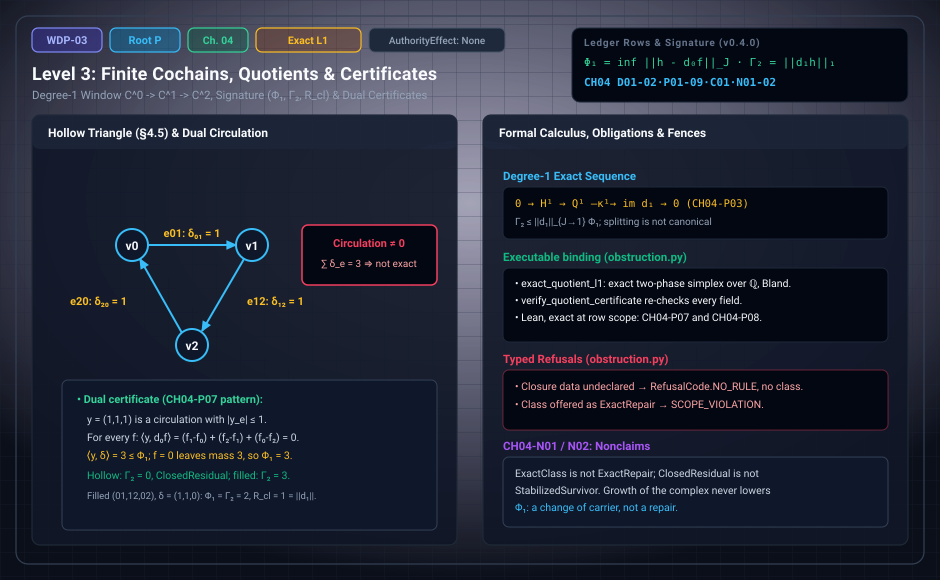

# WDP Level 03: Finite Cochains, Quotients, and Certificates

**AuthorityEffect:** None.  
**Level:** Level 03 (Chapter 4: Finite Cochains, Quotients, and Certificates)  
**Monograph Chapter:** Chapter 4, §4.1–§4.12 (Part I: Difference, witness, and finite obstruction), *The Witnessed Difference Programme* v0.4.0.  
**Part:** Part I: Difference, Witness, and Finite Obstruction  
**Ledger Rows:** `WDP-CH04-D01`, `WDP-CH04-D02` (definitions); `WDP-CH04-P01`, `WDP-CH04-P03`–`WDP-CH04-P09` (finite propositions); `WDP-CH04-P02`, `WDP-CH04-C01` (conditional results); `WDP-CH04-N01`, `WDP-CH04-N02` (nonclaims).  

---

## 1. What this level does

Chapter 4 builds the finite linear host on which residuals are measured.
Vertex potentials repair edge fields; the quotient $Q^1$ keeps what no repair
removes, measured by a declared norm as $\Phi_1$; a second map $d_1$ measures
failure to close around filled triangles as $\Gamma_2$. When $d_1d_0=0$ is
certified, these give the **obstruction signature** $(\Phi_1,\Gamma_2,R_{cl})$
and exactly one of three diagnostic classes. The chapter also certifies
$\Phi_1$ exactly for weighted $L^1$ over $\mathbb Q$ without importing strong
duality, and proves that growing the complex never lowers $\Phi_1$. Every
input is declared, and no output is a routing decision or a repair.

---

## 2. Definitions and results

### 2.1 The graph-cochain host (§4.1)

For a finite oriented graph $G=(V,E)$ and a normed coefficient space $A$, set
$C^0=A^V$, $C^1=A^E$, and $(d_0f)(u,v)=f(v)-f(u)$. An edge field $\delta$ is
**exact** when $\delta=d_0f$. The quotient
$Q^1=C^1/\operatorname{im}d_0$ records edge fields modulo vertex-potential
repair. It is not the first cohomology group unless a next differential $d_1$
is supplied with $d_1d_0=0$.

### 2.2 Quotient defect (§4.2)

For a norm $J$ on $C^1$, $\Phi_J([\delta])=\inf_{f\in C^0}J(\delta-d_0f)$.

> **`WDP-CH04-P01` — Finite proposition (well-defined quotient defect).**
> $\Phi_J$ is independent of the representative of $[\delta]$.

If $\delta'=\delta+d_0g$, the substitution $h=f-g$ is a bijection of $C^0$, so
both infima run over the same values.

> **`WDP-CH04-P02` — Conditional result (attainment).** If the repair space is
> finite-dimensional and $J$ is a norm, the infimum is attained after
> quotienting the kernel of $d_0$.

The hypotheses cannot be dropped silently for seminorms or infinite carriers.

### 2.3 Weighted $L^1$ geometry (§4.3)

With positive weights, $\|x\|_{1,w}=\sum_e w_e\|x_e\|_A$; disjoint positive
witness masses then add exactly. In the scalar case, convex duality gives

$$
\Phi_{1,w}([\delta])=\max\{\langle y,\delta\rangle:\ d_0^{*}y=0,\ |y_e|\le w_e\}.
$$

> **`WDP-CH04-C01` — Conditional result.** The displayed primal–dual identity
> is an imported finite-dimensional convex-duality result specialized to the
> declared weighted graph complex. It is not proved here for arbitrary
> coefficient spaces.

### 2.4 Closure requires another degree (§4.4)

Given $d_1:C^1\to C^2$, a closure diagnostic $\Gamma(\delta)=J_2(d_1\delta)$
descends to $Q^1$ only if $d_1d_0=0$ on the admissible repairs. Otherwise
$K=d_1d_0$ is itself a typed composition defect, and calling $Q^1$
"cohomology" while $K\ne0$ is an error.

### 2.5 Three small examples (§4.5–§4.6)

- **Exact path.** On $0\to1\to2$, $\delta=(2,3)=d_0(0,2,5)$, so $\Phi=0$.
- **Hollow triangle.** On cyclic edges $(01,12,20)$, every repaired residual
  of $\delta=(1,1,1)$ still sums to $3$, so its $L^1$ mass is at least $3$;
  $f=0$ attains it and $y=(1,1,1)$ certifies it. This is a quotient
  obstruction; contextuality would also need a measurement cover and an
  empirical model.
- **Vector three-cycle.** Every repair of $\delta=((1,0),(0,1),(0,0))$ sums to
  $(1,1)$, so the $L^1$ and $L^2$ masses are at least $2$ and $\sqrt2$;
  $\alpha=((0,0),(1,0),(1,1))$ leaves $((0,0),(0,0),(1,1))$ and attains both.

### 2.6 Evaluation preorders and the degree-1 window (§4.7)

A declared route from a comparison preorder through its nerve, normalized
chains, and dual cochains to a 2-truncation gives $C^0=\mathbb F^V$,
$C^1=\mathbb F^E$, $C^2=\mathbb F^{S_2}$ with simplicial coboundaries. Directed
cycles are admitted; the nerve is a simplicial set, not a cochain complex.

> **`WDP-CH04-D01` — Definition (evaluation preorder and degree-1 window).**
> The evaluation preorder of a declared finite direct-comparison relation $R$
> on $V$ is its reflexive–transitive closure $R^*$. A degree-1 diagnostic
> window is a declared tuple $\mathcal W=(C^0,C^1,C^2,d_0,d_1)$ of
> finite-dimensional coefficient spaces and linear maps together with a
> certificate that $d_1d_0=0$. The certificate is automatic on the simplicial
> route and must be verified for any hand-declared pair $(d_0,d_1)$.

**Orientation.** The simplicial route orders triangle edges as $(01,12,02)$.
Reversing $20$ to $02$ negates that component, so the cyclic field $(1,1,1)$ is
the simplicial field $(1,1,-1)$. All quantities below are invariant once the
cochain is transported with its edges.

### 2.7 Closure descent and the exact sequence (§4.8)

> **`WDP-CH04-D02` — Definition (quotient residual, closure charge, and
> signature).** In a window $\mathcal W$ with a declared norm $J$ on $C^1$:
> $Q^1=C^1/\operatorname{im}d_0$; $\kappa^1:Q^1\to C^2$,
> $\kappa^1([h])=d_1h$; the closed sector $H^1:=\ker\kappa^1$;
> $\Phi_1([h])=\Phi_J([h])$; $\Gamma_2([h])=\|d_1h\|_1$; and, when
> $\Phi_1([h])>0$, $R_{cl}([h])=\Gamma_2([h])/\Phi_1([h])$. The diagnostic class
> is `ExactClass` when $[h]=0$, `ClosedResidual` when $[h]\ne0$ and
> $\Gamma_2=0$, and `ActiveClosureFailure` when $\Gamma_2>0$. A window whose
> carrier, norm, closure data, or $d_1d_0$ certificate is missing or ill typed
> receives a typed refusal (`NoRule`), not a class.

With the certificate, closedness is representative independent, so $H^1$ is
the usual $Z^1/B^1$ of the window; the name "cohomology" is earned.

**Norm hypothesis.** Sections 4.9–4.11 take $\mathbb F=\mathbb R$ or
$\mathbb C$, or $\mathbb F=\mathbb Q$ with $J$ the restriction of a norm on
$C^1\otimes\mathbb R$ (for example weighted $L^1$ or $L^2$ with rational
weights). The restriction matters. $J(x)=|x_{01}+\sqrt2\,x_{12}+\sqrt3\,x_{02}|$
is a norm on $\mathbb Q^3$ because $1,\sqrt2,\sqrt3$ are linearly independent
over $\mathbb Q$, yet it is not the restriction of a norm on $\mathbb R^3$. On
the filled triangle with $\delta=(1,1,0)$ its values $J(\delta-d_0f)$
accumulate at $0$, so $\Phi_1([\delta])=0$ although $\Gamma_2([\delta])=2$.

> **`WDP-CH04-P03` — Finite proposition (closure descent and exactness).** In a
> window with $d_1d_0=0$, $\kappa^1$ is well defined on $Q^1$ and
> $0\to H^1\to Q^1\xrightarrow{\kappa^1}\operatorname{im}d_1\to0$ is exact.
> The sequence is an extension. In finite dimension it splits, but a splitting
> $Q^1\cong H^1\oplus\operatorname{im}d_1$ requires a chosen section and is not
> canonical.

Well-definedness is one line: $d_1(h+d_0\alpha)=d_1h+d_1d_0\alpha=d_1h$.

### 2.8 The obstruction signature (§4.9)

> **`WDP-CH04-P04` — Finite proposition (diagnostic trichotomy).** In a window
> with $d_1d_0=0$ and a norm $J$ on finite-dimensional $C^1$ satisfying the
> norm hypothesis, every class $[h]\in Q^1$ has exactly one diagnostic class,
> $\Phi_1([h])=0$ holds exactly for `ExactClass`, and every
> `ActiveClosureFailure` class has $\Phi_1([h])>0$.

The key step is faithfulness of the quotient seminorm, which is exactly what
the $\sqrt2,\sqrt3$ norm above lacks.

> **`WDP-CH04-P05` — Finite proposition (signature bounds).** Under the
> hypotheses of `WDP-CH04-P04`, with
> $\|d_1\|_{J\to1}=\sup\{\|d_1x\|_1:J(x)\le1\}$: (1) $\Phi_1,\Gamma_2\ge0$;
> (2) $\Phi_1([h])=0$ iff $[h]=0$; (3) $\Gamma_2([h])=0$ iff $[h]\in H^1$;
> (4) $\Gamma_2\le\|d_1\|_{J\to1}\Phi_1$; (5) if $H^1\ne0$, no constant $c>0$
> gives $\Gamma_2\ge c\,\Phi_1$ on all of $Q^1$; (6) on $Q^1/H^1$, $\Gamma_2$ is
> a norm equivalent to the quotient norm.

Item 4 holds because $d_1(h+d_0\alpha)=d_1h$ for every repair; take the
infimum. For unweighted $L^1$, $\|d_1\|_{1\to1}$ is the largest absolute
column sum of the matrix of $d_1$.

> **`WDP-CH04-P06` — Finite proposition (closure-ratio bound).** Under the
> hypotheses of `WDP-CH04-P04`, if $\Phi_1([h])>0$, then
> $0\le R_{cl}([h])\le\|d_1\|_{J\to1}$.

The normalized ratio $r_{cl}=R_{cl}/\|d_1\|_{J\to1}$ is undefined ($0/0$, not
zero) when $d_1=0$. Rescaling $J$ to $cJ$ and the closure norm by $\lambda$
multiplies $R_{cl}$ by $\lambda/c$ and leaves $r_{cl}$ unchanged. The window
supports one sharp falsifier: two implementations given the same declared
window, field, weights, and cochain must return the same signature (§4.12).

### 2.9 Dual certificates without importing strong duality (§4.10)

> **`WDP-CH04-P07` — Finite proposition (dual-certificate soundness).** Over
> $\mathbb F=\mathbb Q$, let $J=\|\cdot\|_{1,w}$ with positive rational weights
> $w_e$. If $y\in C^1$ satisfies $d_0^{*}y=0$ and $|y_e|\le w_e$ for every edge,
> then $\langle y,\delta\rangle\le\Phi_{1,w}([\delta])$. Consequently, a repair
> $f$ and such a $y$ with $\|\delta-d_0f\|_{1,w}=\langle y,\delta\rangle$
> certify $\Phi_{1,w}([\delta])=\langle y,\delta\rangle$ and show that $f$
> attains it.

For every $f$,
$\langle y,\delta\rangle=\langle y,\delta-d_0f\rangle\le\|\delta-d_0f\|_{1,w}$,
since $\langle d_0^{*}y,f\rangle=0$ ($d_0^{*}y$ is the net inflow, so $y$ is a
circulation). The argument uses the field's order: it holds over $\mathbb R$,
not over $\mathbb C$ or $\mathbb F_2$. Existence of a matching pair is
`WDP-CH04-C01` and stays imported. The package finds $(f,y)$ by exact simplex
with Bland's rule and refuses any pair that fails an independent check;
soundness rests on the check, not the solver.

### 2.10 Growth does not lower $\Phi_1$ (§4.11)

> **`WDP-CH04-P09` — Finite proposition (growth does not lower $\Phi_1$).** Let
> $K$ be a subcomplex of a finite complex $K'$, with weights on $K$ restricted
> from $K'$, and let $h$ be the restriction of an edge field $h'$ on $K'$. Then
> $\Phi_1(h)\le\Phi_1(h')$. Attaching 2-simplices leaves $\Phi_1$ unchanged and
> can raise $\Gamma_2$. Subdividing an edge through a new vertex of degree two,
> with the old value split into two summands and both new edges carrying the
> old weight, leaves $\Phi_1$ unchanged.

Restriction drops nonnegative terms from every repair cost; faces do not touch
$C^0$, $C^1$, or $d_0$; subdivision is the triangle inequality. Numbers from
§4.11: the hollow cyclic triangle has $\Phi_1=3$, $\Gamma_2=0$; filled, it has
$\Phi_1=3$, $\Gamma_2=3$; splitting an edge value as $(\tfrac12,\tfrac12)$ or
$(5,-4)$ with equal weights keeps $\Phi_1=3$. A decrease needs another kind of
change: deleting edge $20$ leaves a tree with $\Phi_1=0$, and subdividing edge
$01$ with weights $(\tfrac12,\tfrac12)$ gives $\Phi_1=\tfrac32$.

---

## 3. Worked example: a filled triangle with one non-closing edge field (§4.11)

> **`WDP-CH04-P08` — Finite proposition (filled-triangle signature).** Take
> vertices $\{0,1,2\}$, edges $(01,12,02)$, and one 2-simplex $(0,1,2)$, with
> $d_0f=(f_1-f_0,\ f_2-f_1,\ f_2-f_0)$ and $d_1x=x_{01}+x_{12}-x_{02}$. For
> $\delta=(1,1,0)$ over $\mathbb Q$ with unit weights: $d_1d_0=0$;
> $\Phi_1([\delta])=2$, attained at $f=(0,1,0)$ and certified by the
> circulation $y=(1,1,-1)$; $\Gamma_2([\delta])=2$; $\|d_1\|_{1\to1}=1$; and
> $R_{cl}([\delta])=1$, which saturates `WDP-CH04-P06`.

Every number below was re-checked with exact `fractions.Fraction` arithmetic.

| Quantity | Computation | Value |
| :--- | :--- | :--- |
| $d_1d_0f$ | $(f_1-f_0)+(f_2-f_1)-(f_2-f_0)$ | $0$ for every $f$ |
| repair $f=(0,1,0)$ | $d_0f=(1,-1,0)$; residual $\delta-d_0f=(0,2,0)$ | $L^1$ mass $2$ |
| circulation $y=(1,1,-1)$ | $\lvert y_e\rvert\le1$; net inflow $0-(1-1)=0$ at $0$, $1-1=0$ at $1$, $(1-1)-0=0$ at $2$ | $d_0^{*}y=0$ |
| pairing | $\langle y,\delta\rangle=1+1+0$ | $2$, so $\Phi_1=2$ by `WDP-CH04-P07` |
| closure mass | $\Gamma_2=\lvert1+1-0\rvert$ | $2$ |
| operator norm | $d_1$ is the row $(1,1,-1)$; largest absolute column sum | $1$ |
| closure ratio | $R_{cl}=2/2$ | $1$, equal to the bound |

Since $\Gamma_2>0$, the class is `ActiveClosureFailure`. The optimal repair is
not unique: $f=(1,0,1)$ gives $d_0f=(-1,1,0)$ and residual $(2,0,0)$, also of
mass $2$, and it is the repair the package's exact solver returns. The
certificate fixes the value $\Phi_1=2$, not a particular repair.

**Hollow comparison.** Without the 2-simplex, $C^2=0$ and every class is
closed. The cyclic field $(1,1,1)$ has $\Phi_1=3$ (certified by $y=(1,1,1)$) and
$\Gamma_2=0$: a `ClosedResidual` that witnesses item 5 of `WDP-CH04-P05`.
Filling the triangle converts that closed residual into closure charge
($\Gamma_2=3$) without changing $\Phi_1$.

**Projection is not repair (§4.12).** Projecting $\delta=(1,1,0)$ orthogonally
onto $\ker d_1$ subtracts $(\tfrac23,\tfrac23,-\tfrac23)\in\operatorname{im}d_1^{*}$
and returns the closed field $(\tfrac13,\tfrac13,\tfrac23)$. But
$\operatorname{im}d_0=\{(a,b,a+b)\}$ meets the line through $(1,1,-1)$ only at
$0$ ($t+t=-t$ forces $t=0$), so the subtracted vector is not a repair and
$\Phi_1$ of the original class is still $2$. The projection replaces the datum.

---

## 4. Evidence bindings

Paths are relative to the monograph package
[`000_witnessed_difference_programme/`](../../../../omega_engine_atlas/coda_atlas/F004_papers/001_finite_obstruction_calculus/000_witnessed_difference_programme/).
Modules are in `code/witnessed_difference/`; tests in `code/unit_tests/` (u),
`code/integration_tests/` (i), and `code/injection_tests/` (j); Lean names are
in the `WitnessedDifference` namespace.

| Row | Status | Ledger evidence | Lean | Executable binding | Notebook |
| :--- | :--- | :--- | :--- | :--- | :--- |
| `WDP-CH04-P01` | Finite proposition | P | none; prose-only in `CLAIM_MAP.md` | none | none |
| `WDP-CH04-P02` | Conditional result | P; C | none; prose-only | `cochains.py` (`finite_quotient_l1`); u `test_cochains.py`, u `test_vector_obstruction.py`, i `test_foundation_to_receipt.py` | `010_cochains_and_vector_obstruction.ipynb` |
| `WDP-CH04-C01` | Conditional result | P | none; prose-only | none | `010_cochains_and_vector_obstruction.ipynb` |
| `WDP-CH04-D01` | Definition | P; C | none; no exact declaration | `obstruction.py` (`evaluation_preorder`, `degree_one_window`); u `test_obstruction.py`, i `test_obstruction_pipeline.py` | none |
| `WDP-CH04-D02` | Definition | P; C | none exact; `Obstruction.Repair`, `Q1`, `kappa`, `H1` model the quotient and closure data only | `obstruction.py` (`obstruction_signature`, `classify_signature`); u `test_obstruction.py` | none |
| `WDP-CH04-P03` | Finite proposition | P | `Obstruction.kappa_exact_sequence` (with `kappa_mk`, `kappa_well_defined`) — narrower than the row | none | none |
| `WDP-CH04-P04` | Finite proposition | P; C | none; prose-only | `obstruction.py`; u `test_obstruction.py`, i `test_obstruction_pipeline.py`, j `test_mutation_recovery.py` | none |
| `WDP-CH04-P05` | Finite proposition | P; C | `Obstruction.closure_charge_le_opnorm_mul_phi`, item 4 only — narrower than the row | `obstruction.py`; u `test_obstruction.py` | none |
| `WDP-CH04-P06` | Finite proposition | P; C | `Obstruction.closure_ratio_signature`, $\mathbb Q$-valued costs only — narrower than the row | `obstruction.py`; u `test_obstruction.py` | none |
| `WDP-CH04-P07` | Finite proposition | P; C; L:exact | `Obstruction.dual_certificate_lower_bound` and `matching_certificate_is_optimal` — exact | `obstruction.py` (`exact_quotient_l1`, `verify_quotient_certificate`); u `test_obstruction.py`, j `test_mutation_recovery.py` | `010_cochains_and_vector_obstruction.ipynb` |
| `WDP-CH04-P08` | Finite proposition | P; C; L:exact | `Obstruction.filled_triangle_signature` — exact | `obstruction.py`; u `test_obstruction.py` | none |
| `WDP-CH04-P09` | Finite proposition | P; C | `ComplexGrowth.restriction_phi_le`, `subdivision_residual_eq`, `subdivision_phi_eq` — narrower than the row | `complex_growth.py`; u `test_complex_growth.py`, i `test_absorbed_finite_propositions.py` | none |
| `WDP-CH04-N01` | Nonclaim | P; C | none | `obstruction.py` (`promote_diagnostic`); u `test_obstruction.py`, i `test_obstruction_pipeline.py`, j `test_mutation_recovery.py` | none anchored |
| `WDP-CH04-N02` | Nonclaim | P; C | none | `complex_growth.py` (`claim_growth_repair`); u `test_complex_growth.py`, i `test_absorbed_finite_propositions.py`, j `test_mutation_recovery.py` | none |

**Lean scope.** Only `WDP-CH04-P07` (over a finite edge list with $\mathbb Q$
weights) and `WDP-CH04-P08` (over $\mathbb Q$) are mechanized in Lean at the
row's scope. The narrower declarations, per `lean4/CLAIM_MAP.md`: exactness is
set-level on the literal quotient by the repair relation, without additive
structure, additivity of $\kappa^1$, or the splitting remark; the ratio bound
covers $\mathbb Q$-valued costs only; the growth lemmas cover restriction and
one-edge subdivision, with the infimum halves as hypotheses. No infimum is
constructed. `kappa_exact_sequence`, `kappa_mk`, and `kappa_well_defined` use
no axioms; the other declarations in the table use `propext`,
`Classical.choice`, `Quot.sound` (`lean4/axiom_report.txt`).

**What the executable bindings check.** `evaluation_preorder` returns the
reflexive–transitive closure (refusal `RefusalCode.OUTSIDE_CARRIER` for a pair
off the carrier). `degree_one_window` multiplies the exact matrices of $d_1$
and $d_0$ and returns `RefusalCode.CERTIFICATE_MISMATCH` if the product is
nonzero. `exact_quotient_l1` solves the weighted $L^1$ programme over
`Fraction` and hands the pair to `verify_quotient_certificate`, which
recomputes residual, value, $|y_e|\le w_e$, $d_0^{*}y=0$, and
$\langle y,\delta\rangle$, refusing any mismatch with `CERTIFICATE_MISMATCH`.
`obstruction_signature` returns `RefusalCode.NO_RULE` when closure data are
undeclared. The trichotomy test is exhaustive over $\{-1,0,1\}^5$ on three
complexes built on a square with a diagonal: a finite check, not a proof.
`promote_diagnostic` and `claim_growth_repair` refuse every class, signature,
certificate, or growth receipt offered as a terminal or repair with
`RefusalCode.SCOPE_VIOLATION`. Notebook `010` calls `promote_diagnostic` but,
among this chapter's rows, anchors only P02, C01, and P07.

---

## 5. Misreadings the chapter rules out

- **Cohomology without the certificate.** $H^1$ is earned only when
  $d_1d_0=0$ is certified; the splitting $Q^1\cong H^1\oplus\operatorname{im}d_1$
  needs a chosen section; and over $\mathbb Q$ the norm hypothesis is needed.
- **Strong duality in the certificate.** `WDP-CH04-P07` is the weak direction;
  existence of a matching pair is the imported `WDP-CH04-C01`.
- **A unique repair or a verdict.** The certificate fixes the value, not the
  repair ($f=(0,1,0)$ and $f=(1,0,1)$ both attain $2$). "$R_{cl}$ near its
  bound" readings are interpretive, not theorems (§4.9).
- **Growth or projection as repair.** A source working paper claimed that an
  admissible extension strictly lowers the defect and read $\Phi_1$ from a
  filtration spectral sequence; the ledger's source table records both as
  refuted and not carried. Projection onto $\ker d_1$ changes the class.
- **Diagnosis as routing.** A source routing rule whose Hodge step misroutes an
  active class as exact is also not carried. The source's terminal
  enumerations, lift contracts, guarded repair policy (accept a step only when
  $\Phi_1$ falls and $R_{cl}$ stays bounded), and reflective completion are
  left to `WDP-CH04-O01`.

---

## 6. Nonclaims

- **`WDP-CH04-N01`.** A diagnostic class, signature value, or certificate is not
  a routing terminal, repair action, stabilization receipt, or authority. In
  particular, `ExactClass` is not `ExactRepair`, and `ClosedResidual` is not
  `StabilizedSurvivor`.
- **`WDP-CH04-N02`.** Growth of the complex does not repair a quotient
  residual: passing to a larger complex, face attachment, and equal-weight
  subdivision never lower $\Phi_1$; a decrease requires deleting cells,
  changing declared weights (including unequal subdivision weights), or
  changing existing edge values; and survival of a class to the limit page of a
  filtration spectral sequence records cohomology of the final complex rather
  than positivity of $\Phi_1$.

**Finite supplement.** These finite targets are answered under the explicit hypotheses in Appendix J. See [the current derivation guide](../derivation_review.md) for complete statements, counterexamples, native ownership and partial Lean coverage.

---

## 7. Claim discipline

1. **What this level supports:** on a declared finite window with certified
   $d_1d_0=0$, the finite propositions `WDP-CH04-P01`, `WDP-CH04-P03`–`P09`
   (exact sequence, trichotomy, signature and ratio bounds, growth
   monotonicity), with `WDP-CH04-P07` and `WDP-CH04-P08` mechanized in Lean at
   the row's scope.
2. **What it does not support:** strong duality for arbitrary coefficients
   (`WDP-CH04-C01` stays conditional), cohomology without the certificate, a
   unique optimal repair, any routing terminal, repair, stabilization, or
   authority, and any continuum, gauge-field, or contextuality claim.
3. **Narrowest defensible claim:** on a declared finite window with
   $d_1d_0=0$ and a norm satisfying the norm hypothesis, every edge-field class
   has exactly one diagnostic class and a signature with
   $\Gamma_2\le\|d_1\|_{J\to1}\Phi_1$; for weighted $L^1$ over $\mathbb Q$, a
   repair and a bounded circulation of equal value certify $\Phi_1$ exactly.
**Finite supplement.** These finite targets are answered under the explicit hypotheses in Appendix J. See [the current derivation guide](../derivation_review.md) for complete statements, counterexamples, native ownership and partial Lean coverage.

---

---

## Expert derivation supplement (2026-10-01)

- **CH04-O01 — Conditional result.** Under a declared terminal, lift and guarded-change policy, independently verified quotient/closure diagnostics feed checked finite routing receipts. Context-equivariant profile-preserving systems admit the least same-carrier congruent coarsening, initial in the specified comma category; a profile-reflecting completion of a noncongruent source is impossible. Appendix J supplies the construction and refutation. The diagnostic does not select its policy.

The original 154 identifiers are preserved. The historical Lean census is unchanged; new standalone proofs, native replay and source custody are described in [the derivation guide](../derivation_review.md). Physical interpretation, Born selection and authority remain separate assumptions.

---

## Navigation

- **Previous:** [Level 02: Symmetry, Nonselection, and the Price of Retention](level_02_residuals_obstructions.md)
- **Next:** [Level 04: Optional Quantum-Capable Carriers](level_04_boundary_separation_contraction.md)
- **Levels Index:** [README.md](README.md)
