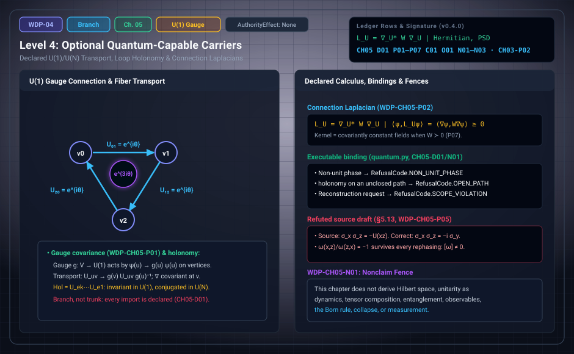

# WDP Level 04: Optional Quantum-Capable Carriers

**AuthorityEffect:** None.  
**Level:** Level 04 (Chapter 5: Optional Quantum-Capable Carriers)  
**Monograph Chapter:** Chapter 5, §5.1–§5.14, and the technical note for Chapters 1–5 (Part I: Difference, witness, and finite obstruction), *The Witnessed Difference Programme* v0.5.0.  
**Part:** Part I: Difference, Witness, and Finite Obstruction  
**Ledger Rows:** `WDP-CH05-D01` (definition); `WDP-CH05-P01`–`P07` and `WDP-CH03-P02` (finite propositions); `WDP-CH05-C01` (conditional result); `WDP-CH05-O01` (conditional result); `WDP-CH05-N01`–`N03` (nonclaims).  

---

## 1. What this level does

Chapter 5 starts a branch, not the trunk. It **declares** complex
coefficients, phases, inner products, and matrix representations, because the
quantum comparisons of later chapters need them. Nothing in Chapters 1–4
selects these structures, and Primitive Difference does not derive them. Each
one is an import, recorded as it is made.

"Quantum-capable" means only that familiar finite quantum structures *can be
represented* on the carrier. It does not mean that a physical quantum theory
has been derived. The first nonclaim, `WDP-CH05-N01`, says so directly: no
Hilbert space, dynamics, tensor composition, entanglement, observables, Born
rule, collapse, or measurement is derived here.

Inside the declared package, ordinary finite linear algebra holds: gauge
covariance, a Hermitian positive semidefinite connection Laplacian, and
gauge-invariant spectra. Sections 5.10–5.12 go beyond the degree-1 window of
[Level 03](level_03_discrete_complex_cochains.md) with real, rational, or mod-2 cochains; they sit in this
branch because they extend that window, not because they use complex numbers.
The chapter closes with a technical note on morphisms and receipts for all of
Part I, where the fixed-target criterion `WDP-CH03-P02` is stated.

---

## 2. Definitions and results

### 2.1 Branch declaration (§5.1)

> **`WDP-CH05-D01` — Definition (quantum-capable carrier package).** A finite
> quantum-capable carrier is $\mathfrak Q=(G,w,\mathbb C^N,U,\nabla,\langle-,-\rangle)$,
> where $G$ is a finite graph or cell complex, $w$ is a positive weighting,
> $\mathbb C^N$ is a declared complex fiber, $U$ assigns unitary transport to
> oriented edges, $\nabla$ is the associated covariant difference, and
> $\langle-,-\rangle$ is a declared Hermitian inner product.

All six components are supplied, not constructed.

### 2.2 $U(1)$ connection and holonomy (§5.2)

For a line fiber, assign $U_{uv}\in U(1)$ with $U_{vu}=U_{uv}^{-1}$, and set
$(\nabla_U\psi)_{uv}=\psi(v)-U_{uv}\psi(u)$ for $\psi:V\to\mathbb C$. A gauge
transformation $g:V\to U(1)$ acts by

$$
\psi(u)\mapsto g(u)\psi(u),\qquad U_{uv}\mapsto g(v)U_{uv}g(u)^{-1}.
$$

> **`WDP-CH05-P01` — Finite proposition (gauge covariance).** Under this
> action, $(\nabla_{U^g}\psi^g)_{uv}=g(v)(\nabla_U\psi)_{uv}$.

The proof is direct substitution, so any norm invariant under vertexwise phase
multiplication gives a gauge-invariant defect magnitude. For an oriented loop
$\gamma=e_1\cdots e_k$ the holonomy is
$\operatorname{Hol}_U(\gamma)=U_{e_k}\cdots U_{e_1}$. It is gauge invariant in
the abelian $U(1)$ case; in a nonabelian unitary group it transforms by
conjugation, so only trace, spectrum, and other class functions are invariant.

### 2.3 Connection Laplacian (§5.3)

With $W$ the positive diagonal edge-weight operator, the finite connection
Laplacian is $L_U=\nabla_U^{*}W\nabla_U$.

> **`WDP-CH05-P02` — Finite proposition.** $L_U$ is Hermitian and positive
> semidefinite.

Indeed $\langle\psi,L_U\psi\rangle=\langle\nabla_U\psi,W\nabla_U\psi\rangle\ge0$.

> **`WDP-CH05-P07` — Finite proposition (kernel of a weighted sum of forms).**
> For finitely many linear maps $A_a$ out of a finite-dimensional inner-product
> space over $\mathbb Q$, $\mathbb Q(i)$, $\mathbb R$, or $\mathbb C$, and
> positive-definite weights $W_a$, the operator $H=\sum_aA_a^{*}W_aA_a$ is
> Hermitian and positive semidefinite, and $H\psi=0$ exactly when $A_a\psi=0$
> for every $a$. The equivalence can fail when some $W_a$ is only positive
> semidefinite.

The failure case: $W=0$ and $A\ne0$ give $H=0$ while $A\psi\ne0$. For $L_U$
with definite weights, the kernel is exactly the covariantly constant fields.
Gauge-related connections give unitarily conjugate Laplacians and equal
spectra; the monograph calls this a representation result *inside* the
declared package, not a selection result *for* the package.

### 2.4 Real cochains and phases (§5.4)

Given a real edge cochain $a$ and a declared scale $\alpha\in\mathbb R$, set
$U_e=\exp(i\alpha a_e)$. Changing $a$ by a real coboundary $d_0f$ changes $U$
by the gauge transformation $g(v)=\exp(i\alpha f(v))$, so exponentiation
descends from real classes to gauge classes once $\alpha$ is fixed. The real
quotient does not select $\alpha$, and $2\pi$ periodicity lets distinct real
classes give the same phases. The map is structured and can lose information.

### 2.5 Matrix fibers and nonabelian transport (§5.5, §5.7)

A generalized Gell-Mann basis of traceless Hermitian $N\times N$ matrices is a
calculation aid that depends on a declared fiber and basis convention. It does
not derive $SU(N)$, and no such basis is privileged. With a declared
$\mathbb C^N$, transport can take values in $U(N)$ with the same covariant
difference and gauge action. A loop holonomy based at $v$ transforms as
$H_\gamma\mapsto g(v)H_\gamma g(v)^{-1}$: its conjugacy class, trace, and
spectrum are invariant, but a chosen matrix representative is not.

### 2.6 Density matrices are another import (§5.8)

A density operator $\rho\succeq0$ with $\operatorname{tr}\rho=1$, a positivity
cone, complete positivity, and tensor extension are each additional structure.
The monograph's import ladder:

| From | Declare | To |
| :--- | :--- | :--- |
| real graph cochains | phase scale and complex line fiber | $U(1)$ transport |
| $U(1)$ transport | $\mathbb C^N$ and a Hermitian product | $U(N)$ transport and connection Laplacian |
| $U(N)$ transport | state/effect cones and normalization | finite operational quantum carrier |
| finite operational quantum carrier | instruments, composition, dynamics | candidate quantum theory |

Each arrow is an interface. None is licensed by similarity of notation.

### 2.7 Stability under perturbation (§5.9)

Standard finite-matrix perturbation bounds can control how Laplacian
eigenvalues move when the connection moves, once the norm, weights, graph, and
comparison convention are declared. Gauge-equivalent connections need no
estimate: their Laplacians are exactly unitarily conjugate.

> **`WDP-CH05-O01` — Conditional result.** For two unweighted rational U(1) connection Laplacians on the same ordered finite carrier, the exact maximum absolute-real-plus-imaginary row sum of their difference bounds every ordered eigenvalue displacement; a separately valid gap bound greater than twice this value ensures gap survival.
> See Appendix I and [the derivation guide](../derivation_review.md).

### 2.8 Higher-degree windows on finite simplicial complexes (§5.10)

Let $K$ be a finite abstract simplicial complex on a totally ordered vertex
set, with $C^k(K;\mathbb F)=\mathbb F^{\Sigma_k}$ and the alternating
coboundary $\delta^k$.

> **`WDP-CH05-P03` — Finite proposition (degree-$k$ windows).** On a finite
> oriented simplicial complex, $\delta^{k+1}\delta^k=0$ for every $k$. Hence
> each triple $(C^{k-1},C^k,C^{k+1})$ with a norm $J$ on $C^k$ satisfying the
> norm hypothesis of §4.8 is a window: $\kappa^k([h])=\delta^kh$ is well
> defined on $Q^k=C^k/\operatorname{im}\delta^{k-1}$, the sequence
> $0\to H^k\to Q^k\to\operatorname{im}\delta^k\to0$ is exact, and
> $\Gamma_{k+1}\le\|\delta^k\|_{J\to1}\Phi_k$.

Each face of a $(k+2)$-simplex arises by deleting two vertices in either
order, with opposite signs; the rest is Level 3's CH04-P03 and CH04-P05 in
degree $k$. The extension says nothing about gluing evaluator defects, cup
products, or continuum differential forms.

### 2.9 Coefficients matter: a torsion witness (§5.11)

> **`WDP-CH05-P06` — Finite proposition (a rational solver misses 2-torsion).**
> For the six-vertex, ten-triangle triangulation $K$ of the real projective
> plane, $H^2(K;\mathbb Q)=0$ while $H^2(K;\mathbb F_2)\cong\mathbb F_2$.

$K$ has 6 vertices, 15 edges, and 10 triangles;
$\operatorname{rank}_{\mathbb Q}\delta^1=10$ and
$\operatorname{rank}_{\mathbb F_2}\delta^1=9$. Since $C^3=0$,
$\dim H^2=10-\operatorname{rank}\delta^1$, which is $0$ and $1$. The indicator
of one triangle represents the mod-2 class; over $\mathbb Q$ it is exact
($\Phi_2=0$), but every rational repair of it has non-integral values. Neither
answer is wrong: they answer different declared questions.

### 2.10 Balance identities on finite graphs (§5.12)

> **`WDP-CH05-P04` — Finite proposition (combinatorial balance and invariant
> pairings).**
> 1. On every finite oriented graph, $\sum_v(d_0^{*}x)(v)=0$ for every
>    $x\in C^1$, so $d_0^{*}x=\rho$ is solvable only if $\sum_v\rho(v)=0$.
> 2. A functional $F$ on $C^1$ with $F(A+d_0\lambda)=F(A)$ for every $\lambda$
>    descends uniquely to $Q^1$; in particular the pairing
>    $\langle A,\gamma\rangle$ with a 1-cycle $\gamma$ is invariant.
> 3. On a finite simplicial complex with 3-simplices, $\delta^2\delta^1=0$.

Item 1 holds because $d_0$ kills constants. It needs no closedness,
connectedness, or boundary condition, and the zero-sum condition is necessary,
not sufficient: each component must be neutral separately.

### 2.11 A projective phase obstruction (§5.13)

For declared unitaries with $U(g)U(h)=\omega(g,h)U(gh)$, associativity forces
the 2-cocycle identity, and rephasing $U'(g)=\lambda(g)U(g)$ changes $\omega$
by a coboundary, so only $[\omega]\in H^2(G;U(1))$ is invariant.

> **`WDP-CH05-P05` — Finite proposition (Klein-four Pauli obstruction).** Let
> $G=\mathbb Z_2\times\mathbb Z_2=\{e,x,z,xz\}$ with $U(e)=I$,
> $U(x)=\sigma_x$, $U(z)=\sigma_z$, $U(xz)=\sigma_y$. Then $U$ is a projective
> representation, its phase function satisfies the 2-cocycle identity, and the
> ratio $\omega(x,z)/\omega(z,x)=-1$ is unchanged by every rephasing. Hence
> $[\omega]\ne0$: no rephasing makes $U$ a linear representation.

Check: $\sigma_x\sigma_z=-i\sigma_y$ and $\sigma_z\sigma_x=i\sigma_y$, so the
ratio is $(-i)/i=-1$. Since $G$ is abelian, the rephasing factors at $(x,z)$
and $(z,x)$ coincide and cancel; a linear representation would give $1$.

### 2.12 Trace-norm certificates and channel contractivity (§5.14)

> **`WDP-CH05-C01` — Conditional result (imported standard).** On
> $M_d(\mathbb C)$ with the pairing $\operatorname{Re}\operatorname{tr}(W^\dagger X)$,
> for a subspace $V$ and an operator $L$,
> $\min_{X\in V}\|L-X\|_1=\max\{\operatorname{Re}\operatorname{tr}(W^\dagger L):W\in V^\perp,\ \|W\|_\infty\le1\}$,
> and every completely positive trace-preserving map $\mathcal E$ satisfies
> $\|\mathcal E(\rho)-\mathcal E(\sigma)\|_1\le\|\rho-\sigma\|_1$ for density
> operators $\rho,\sigma$.

Both are imported (REF-QM-020, REF-QM-021, REF-MATH-005) and used only inside
this branch. They are the operator analogues of Level 3's dual certificates
and of observer passivity (§10.5). Neither makes a channel an observer or
derives measurement.

### 2.13 Technical note for Chapters 1–5: morphisms and receipts

Constructions compose only after morphisms are fixed, and an observer-facing
morphism must preserve the proposition witnessed: a map that forgets the
relevant edge can destroy a residual witness. A minimal receipt lists the
finite carriers, the role and comparison declarations, the construction, the
proposition claimed, the verifier or proof with its assumptions, the morphisms
under which the proposition is invariant, the known countermodel class, and
what the receipt does not establish.

> **`WDP-CH03-P02` — Finite proposition (fixed-target criterion).** Let a
> finite group $H$ act on a finite set $Y$. A parameter-free $H$-equivariant
> choice of a point of $Y$ exists if and only if $Y^H$, the set of global fixed
> points, is nonempty.

The row carries a Chapter 3 identifier, but the ledger places it here; an
$H$-equivariant map from the one-point $H$-set to $Y$ is exactly a fixed point.
It gives an audit recipe: find the automorphism group of the admitted input,
its action on the proposed outputs, and the fixed locus. A target called
"forced" must have a fixed locus with the required uniqueness.
[Level 02](level_02_residuals_obstructions.md) applies it to the swap of two data.

The note also states three adapter obligations. Residual locus to retention
needs a write map, a persistence law, and a readback proof. Repair to dual
statement may not exist, since a repair certifies membership in an image and a
separating functional certifies non-membership. Data record to proposition
needs a semantics and a validity predicate. Finally, for a norm $J$ and two
defects in the same quotient problem,
$|\Phi_J([\delta])-\Phi_J([\delta'])|\le J(\delta-\delta')$; this estimate does
not compare different graphs, repair spaces, or gauges without transport data.

---

## 3. Worked example: phase around a triangle (§5.6)

Take the triangle with oriented edges $01,12,20$, give every edge the real
value $a_e=\theta$, and take $\alpha=1$, so $U_e=e^{i\theta}$.

1. The loop holonomy is $U_{20}U_{12}U_{01}=e^{3i\theta}$.
2. $\theta=2\pi/3$: $3\theta=2\pi$, so the holonomy is $1$, although each edge
   phase $e^{2\pi i/3}$ differs from $1$.
3. $\theta=\pi/3$: $3\theta=\pi$, so the holonomy is $-1$.

Local phase and global loop residue differ. The example establishes no
particle, amplitude rule, or experiment. It also shows the loss noted in
§5.4: at $\theta=2\pi/3$ the real cochain has circulation $2\pi\ne0$, so it is
not a real coboundary, yet its phases have the same loop holonomy as the zero
cochain.

**Follow-on check (added by this page, not in the monograph).** With $W=I$,
$L_U$ on this triangle has eigenvalues $2-2\cos(\theta+2\pi k/3)$, $k=0,1,2$:

| $\theta$ | holonomy | spectrum of $L_U$ | $\ker L_U$ |
| :---: | :---: | :---: | :--- |
| $2\pi/3$ | $1$ | $\{0,3,3\}$ | one-dimensional |
| $\pi/3$ | $-1$ | $\{1,1,4\}$ | zero |

As `WDP-CH05-P07` predicts, the kernel is the covariantly constant fields, and
on one cycle a nonzero one exists only when the holonomy is $1$. By
`WDP-CH05-N02`, that kernel vector is not a vacuum.

---

## 4. Evidence bindings

Paths are relative to the monograph package
[`000_witnessed_difference_programme/`](../../../../omega_engine_atlas/coda_atlas/F004_papers/001_finite_obstruction_calculus/000_witnessed_difference_programme/).
None of the fourteen rows has an exact Lean declaration in `lean4/CLAIM_MAP.md`.

| Row | Status | Ledger evidence | Lean | Executable binding | Notebook |
| :--- | :--- | :--- | :--- | :--- | :--- |
| `WDP-CH03-P02` | Finite proposition | P; C | none; prose-only | `code/witnessed_difference/symmetry.py`, tested by `code/unit_tests/test_symmetry.py` (full symmetric group only, narrower than the row) | none |
| `WDP-CH05-D01` | Definition | P; C | none; definition row | `code/witnessed_difference/quantum.py`, tested by `code/unit_tests/test_quantum_status_receipts.py` | `070_declared_u1_holonomy.ipynb` |
| `WDP-CH05-P01` | Finite proposition | P | none; prose-only | none | `070_declared_u1_holonomy.ipynb` (holonomy before and after a gauge change) |
| `WDP-CH05-P02` | Finite proposition | P | none; prose-only | none | none |
| `WDP-CH05-P03` | Finite proposition | P; C | none; prose-only | `code/witnessed_difference/simplicial.py`, tested by `code/unit_tests/test_simplicial_branch.py` | none |
| `WDP-CH05-P04` | Finite proposition | P; C | none; prose-only | `simplicial.py`, tested by `test_simplicial_branch.py` and `code/injection_tests/test_mutation_recovery.py` | none |
| `WDP-CH05-P05` | Finite proposition | P; C | none; prose-only | `code/witnessed_difference/projective.py`, tested by `code/unit_tests/test_projective.py` and `test_mutation_recovery.py` | none |
| `WDP-CH05-P06` | Finite proposition | P; C | none; prose-only | `simplicial.py` (`rp2_torsion_witness`), tested by `test_simplicial_branch.py` | none |
| `WDP-CH05-P07` | Finite proposition | P; C | none; prose-only | `code/witnessed_difference/truncation.py`, tested by `test_truncation.py`, `test_exact_linear.py`, `code/integration_tests/test_absorbed_finite_propositions.py`, `test_mutation_recovery.py` | none |
| `WDP-CH05-C01` | Conditional result (imported standard) | P; R | none; prose-only | none | none |
| `WDP-CH05-O01` | Conditional result | P; N | no full-row Lean proof | omega_wdp::connection; tests/quantum_geometry_exact.rs | Appendix I; current supplement |
| `WDP-CH05-N01` | Nonclaim | P; C | none | `quantum.py` (`supports_quantum_reconstruction`), tested by `test_quantum_status_receipts.py` and `code/integration_tests/test_duration_history_quantum_scope.py` | `070_declared_u1_holonomy.ipynb` |
| `WDP-CH05-N02` | Nonclaim | P | none | none | none |
| `WDP-CH05-N03` | Nonclaim | P | none | none | none |

**What the executable bindings check.**

- `quantum.py`. `make_connection` returns `RefusalCode.OUTSIDE_CARRIER` for an
  edge off the carrier and `RefusalCode.NON_UNIT_PHASE` for a non-unit phase or
  a reverse edge that is not the conjugate. `holonomy` returns
  `RefusalCode.OPEN_PATH` for an unclosed path and passes on
  `RefusalCode.MISSING_EDGE`. `gauge_transform` sends $U_{uv}$ to
  $\overline{g(u)}\,U_{uv}\,g(v)$, the §5.2 action for abelian $U(1)$.
  `supports_quantum_reconstruction` always returns
  `RefusalCode.SCOPE_VIOLATION`. Arithmetic is floating point with a declared
  tolerance of at most $10^{-6}$, so these are finite checks, not exact
  certificates. Notebook `070` gets holonomy $-1$ for phases $(i,i,1)$ on
  $a\to b$, $b\to c$, $a\to c$ around $a,b,c,a$, both before and after the
  gauge $(1,-1,i)$.
- `simplicial.py`. `verify_nilpotence` checks $\delta^{k+1}\delta^k=0$ exactly
  (`CERTIFICATE_MISMATCH` on failure). `degree_k_signature` computes $\Phi_k$,
  $\Gamma_{k+1}$, and $\|\delta^k\|_{1\to1}$ with an exact certificate, for the
  $L^1$ norm only, which is narrower than `WDP-CH05-P03`. `gauss_law_solvable`
  returns `INFEASIBLE` for a nonzero total or component charge;
  `cycle_pairing_gauge_invariant` returns `NOT_CLOSED` for a non-cycle.
  `rp2_torsion_witness` reproduces the counts $(6,15,10)$, the ranks $10$ and
  $9$, and the single-triangle class.
- `projective.py`. Exact Gaussian-rational arithmetic. `projective_cocycle`
  returns `NOT_PROJECTIVE` for a non-unitary matrix or a product that is not a
  phase times the target; `verify_cocycle_identity` returns
  `CERTIFICATE_MISMATCH` on failure; `rephase` returns `NON_UNIT_PHASE`. Tests
  check the ratio $-1$ under all $\mathbb Z_4$ and some rational unit
  rephasings; "every rephasing" rests on the prose proof.
- `truncation.py`. `weighted_form_operator` builds $H$ over $\mathbb Q(i)$ and
  returns `NOT_HERMITIAN` or `NOT_POSITIVE_SEMIDEFINITE` for a bad weight
  (semidefinite weights are admitted, so the failure case can be shown).
  `kernel_matches_components` returns a separating vector when $\ker H$ and
  the common kernel differ.
- `symmetry.py`. Only the full symmetric group is enumerated:
  `fixed_points(n)` is $(0)$ for $n=1$ and empty for $n=2,3$. General group
  actions are not enumerated.

---

## 5. Misreadings the chapter rules out

- **"Quantum-capable" as "quantum derived".** §5.1: the adjective means only
  that finite quantum structures can be represented once declared.
- **A matrix as "the holonomy".** §5.7: in $U(N)$ only the conjugacy class and
  class functions are gauge invariant.
- **Density matrices for free.** §5.8: every rung of the import ladder is a
  separate declaration.
- **Refuted draft: balance needs a closed complex.** §5.12: the source stated
  item 1 only "on a closed complex" and blamed a boundary leak on graphs with
  sinks. On a finite graph there is no such leak.
- **Refuted draft: $\sigma_x\sigma_z=-U(xz)$.** §5.13: the correct factor is
  $-i$; the conclusion survives because only the ratio is invariant.
- **Numerical agreement as a certificate.** §5.14: the source checked the
  trace-norm results with floating-point eigensolvers and a tolerance; the
  monograph imports them as theorems instead.
- **Certificates that migrate by filename.** Technical note: a cycle
  certificate on $G$ does not carry over to a quotient graph $G'$ until the
  functional descends, the cochain is transported, and the repair image maps
  into the new one.

---

## 6. Nonclaims

- **`WDP-CH05-N01`.** This chapter does not derive Hilbert space, unitarity as
  dynamics, tensor composition, entanglement, observables, the Born rule,
  collapse, or measurement.
- **`WDP-CH05-N02`.** The existence of a connection Laplacian does not
  identify its lowest eigenvector with a physical vacuum or foundational
  ground.
- **`WDP-CH05-N03`.** Reading $d_0^{*}$ as divergence, $d_1A$ as flux or
  curvature, item 1 of `WDP-CH05-P04` as charge conservation,
  $\delta^2\delta^1=0$ as a Bianchi identity or an absence of monopoles, or
  averaging over a finite symmetry group as a Noether law is interpretive
  vocabulary. No Maxwell equation, Lorentz structure, physical charge, monopole
  physics, or physical conservation law is derived.

**Current statuses.**

- **`WDP-CH05-O01`** (conditional result): For two unweighted rational U(1) connection Laplacians on the same ordered finite carrier, the exact maximum absolute-real-plus-imaginary row sum of their difference bounds every ordered eigenvalue displacement; a separately valid gap bound greater than twice this value ensures gap survival.

---

## 7. Claim discipline

1. **What this level supports:** once a complex fiber, unitary transport,
   positive weights, and a Hermitian product are declared, gauge covariance,
   a Hermitian positive semidefinite Laplacian with the expected kernel under
   definite weights, and equal spectra for gauge-related connections; also the
   degree-$k$ windows, the torsion witness, the balance identities, the
   Klein-four class, and the fixed-target criterion `WDP-CH03-P02`.
2. **What it does not support:** that any of these structures follows from
   Primitive Difference or Chapters 1–4; anything listed in `WDP-CH05-N01`; a
   vacuum reading of an eigenvector; any physical reading of the identities.
3. **Narrowest defensible claim:** inside a declared finite package, standard
   finite linear algebra gives gauge-invariant diagnostics, and none of it
   selects the package.
4. **Next exercise:** replay the declared finite result and its negative
   controls listed in [the derivation guide](../derivation_review.md), then change
   one hypothesis and identify which conclusion still follows.

---

---

## Current finite derivation and Rust integration

For actual U(1) Laplacians on the same ordered carrier, the maximum row sum of absolute real plus imaginary perturbation entries bounds eigenvalue displacement. A separately valid gap bound g > 2B certifies gap survival. Exact real-qubit squared trace distance and squared shadow slack avoid labeling an irrational square root as a rational exact value. See omega_wdp::connection and quantum_geometries.

See Appendix I and [the derivation guide](../derivation_review.md) for exact
claim statuses, test results and the runnable Rust example.

---

## Navigation

- **Previous:** [Level 03: Finite Cochains, Quotients, and Certificates](level_03_discrete_complex_cochains.md)
- **Next:** [Level 05: Recurrence, Succession, and Constitutive Order](level_05_retention_discrete_succession.md)
- **Levels Index:** [README.md](README.md)
