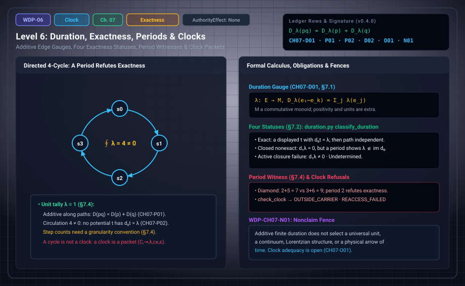

# WDP Level 06: Duration, Exactness, Periods, and Clocks

**AuthorityEffect:** None.  
**Level:** Level 06 (Chapter 7: Duration, Exactness, Periods, and Clocks)  
**Monograph Chapter:** Chapter 7, §7.1–§7.6 (Part II: Order, quantity, and finite probability), *The Witnessed Difference Programme* v0.5.0.  
**Part:** Part II: Order, Quantity, and Finite Probability  
**Ledger Rows:** `WDP-CH07-D01` (definition), `WDP-CH07-P01` and `WDP-CH07-P02` (finite propositions), `WDP-CH07-D02` (definition), `WDP-CH07-O01` (finite proposition), `WDP-CH07-N01` (nonclaim).  

---

## 1. What this level does

[Level 05](level_05_retention_discrete_succession.md) supplied order: it says which intervals compose. Chapter 7
adds magnitude: it says how much duration a path carries. The two stay
separate. The chapter also merges two earlier duration drafts into one account.

Duration is a declared additive valuation on edges, with values in a
commutative additive monoid. Positivity, units, and real values are not part of
the definition. When a result needs them, they are extra hypotheses. On that
base the chapter does three things:

- it proves that duration adds under path concatenation, the strongest
  unconditional duration result at this level;
- it separates four exactness statuses (exact, closed nonexact, active closure
  failure, exactness undetermined) and characterizes exactness by path
  independence on a connected finite graph provided every vertex is reachable
  by a directed path from a common base vertex with path-independent sums,
  or equivalently when every cycle period vanishes under signed walks;
- it defines a clock as a comparator packet between a target process and a
  repeatable reference process, not as a duration function.

Duration becomes a measurement quantity only when a clock packet is attached to
the measurement architecture of [Level 12](level_12_context_interference_state_spaces.md) (monograph Chapter 13).

---

## 2. Definitions and results

### 2.1 Edge valuation (§7.1)

Let $G=(S,E)$ be a finite directed acyclic graph or, more generally, a directed
graph on which a chosen path family is defined. A **duration gauge** is a map

$$
\lambda:E\longrightarrow M
$$

into a commutative additive monoid $(M,+,0)$. For a path $p=e_1\cdots e_k$,

$$
D_\lambda(p)=\sum_{j=1}^{k}\lambda(e_j).
$$

> **`WDP-CH07-D01` — Definition (finite duration gauge).** The pair of a path
> system and an additive edge valuation is a finite duration gauge.
> Positivity, Archimedean structure, units, or real values are additional
> hypotheses.

> **`WDP-CH07-P01` — Finite proposition (concatenation additivity).** Whenever
> path concatenation $pq$ is defined, $D_\lambda(pq)=D_\lambda(p)+D_\lambda(q)$.

The proof is reassociation of a finite sum. No positivity, unit, or order on
$M$ is used.

### 2.2 Four exactness statuses (§7.2)

When edge durations lie in an abelian group, ask whether $\lambda=d_0t$ for a
vertex potential $t$, where $(d_0t)(u\to v)=t(v)-t(u)$. The monograph names
four statuses and forbids collapsing them.

| # | Status | Condition |
| :---: | :--- | :--- |
| 1 | Exact | a displayed $t$ satisfies $d_0t=\lambda$ |
| 2 | Closed nonexact | a declared next differential gives $d_1\lambda=0$, while a period or dual certificate establishes $\lambda\notin\operatorname{im}d_0$ |
| 3 | Active closure failure | $d_1\lambda\neq0$ on an exhibited 2-cell |
| 4 | Exactness undetermined | the available structure or search did not decide the preceding cases |

"Closed nonexact" is unavailable when no valid $d_1$ exists. On a graph without
declared 2-cells, a loop period can still refute exactness, but the word
*closed* is used only relative to a named complex. The classification itself
carries no ledger row; §21.8 lists "merge and formalize the duration exactness
classification" as open programme work.

### 2.3 Path independence (§7.3)

> **`WDP-CH07-P02` — Finite proposition.** If $\lambda=d_0t$, then all directed
> paths from $a$ to $b$ have the same duration $t(b)-t(a)$.

*Proof.* The edge differences telescope along each path.

The converse is stated in the prose after the row. Exactness implies equality
of directed path sums unconditionally (`WDP-CH07-P02`). The converse requires
more than weak connectedness: on a general connected DAG, directed paths with
the same endpoints may agree trivially while no potential exists. For example,
in the connected DAG with edges $a\to b$, $a\to d$, $c\to b$, $c\to d$ and
durations $1, 1, 1, 2$, every directed path has at most one edge, so all directed
paths with the same endpoints agree; yet setting $t(a)=0$ forces $t(b)=t(d)=1$
and $t(c)=0$, yielding $t(d)-t(c)=1\neq 2$, because the signed cycle period
is $1 - 2 + 1 - 1 = -1 \neq 0$.

The converse construction succeeds under either of two precise hypotheses:
(1) a base vertex $o$ has a directed path to every vertex and all directed
paths from $o$ to any vertex agree in duration (setting $t(v) = D_\lambda(o \leadsto v)$
yields $d_0 t = \lambda$); or
(2) path independence holds for signed walks on the underlying connected
undirected graph (every closed cycle period vanishes under signed edge traversal).
The difference between the sums of two paths with the same endpoints is a
**period witness** around the cycle they form. A nonzero period refutes
exactness.

### 2.4 Clock packets (§7.5)

A clock is not merely a duration function. It compares a target process with a
repeatable reference process.

> **`WDP-CH07-D02` — Definition (finite clock packet).** A clock packet is
> $\mathfrak T=(C,\leadsto_C,\lambda_C,r_C,\kappa,\varepsilon)$, where $C$ is a
> reference-state carrier, $\leadsto_C$ its transition relation, $\lambda_C$
> its duration gauge, $r_C$ a readout, $\kappa$ a declared coupling or
> comparison with target intervals, and $\varepsilon$ an error or tolerance
> model.

A clock is **adequate for a target family** only relative to stated criteria:
coverage, stability, resolution, monotonicity, and error bounds. Ticking alone
does not make a clock adequate.

### 2.5 Calibration joins duration to measurement (§7.6)

Calibration relates an instrument readout to a reference quantity. The edge
valuation alone is a mathematical magnitude. A calibrated duration result also
needs a measurand, a procedure, a unit, and an uncertainty statement.

> **`WDP-CH07-O01` — Finite proposition.** For a positive calibrated finite occurrence chain whose edge residuals are bounded by nonnegative declared budgets, every interval residual is bounded by the sum of those budgets, and endpoint-preserving block-sum refinement preserves the bound.
> See Appendix I and [the derivation guide](../derivation_review.md).

### 2.6 A Chapter 7 row stated in Chapter 9

`WDP-CH07-P03` (interval accumulation) carries this chapter's prefix, but its
canonical location is §9.6. It is covered in [Level 08](level_08_discrete_observer_layer.md):
if each edge duration can be chosen independently from a declared interval
$[\ell_e,u_e]$, every path sum lies in $\left[\sum_e\ell_e,\sum_eu_e\right]$.

---

## 3. Worked examples (§7.4)

Every number below was re-checked by hand and with the package's exact
`Fraction` code.

**Chain.** On $a\to b\to c$ let $\lambda=(2,5)$.

1. Take $t(a)=0$, $t(b)=2$, $t(c)=7$.
2. Then $t(b)-t(a)=2$ and $t(c)-t(b)=5$, so $d_0t=\lambda$: exact.
3. $D(a\to b\to c)=2+5=7=t(c)-t(a)$.

**Diamond.** Upper route $a\to b\to d$ with weights $2,5$; lower route
$a\to c\to d$ with weights $3,4$.

1. Upper total $2+5=7$. Lower total $3+4=7$.
2. $t=(t(a),t(b),t(c),t(d))=(0,2,3,7)$ reproduces every edge:
   $2-0=2$, $7-2=5$, $3-0=3$, $7-3=4$. Exact.
3. Change the last lower edge $c\to d$ from $4$ to $6$. The lower total becomes
   $3+6=9$; the upper total is still $7$.
4. The discrepancy $9-7=2$ is a period witness around the undirected cycle.
   By `WDP-CH07-P02`, no potential exists, so the modified valuation is not
   exact. It is still additive along each route.

**Unit tally.** Give every edge the value $1$. Path duration becomes edge
count. This is a valid declared gauge and is additive under concatenation, but:

- two refinements of the same modeled process can change the count, so a unit
  tally needs a granularity convention;
- it is not exact on a graph with a directed cycle. A directed cycle of length
  $n\ge1$ has unit-tally circulation $n\neq0$, and $d_0t$ has circulation $0$
  on every cycle. The 4-cycle in the diagram has circulation $4$.

**Commuting square.** Two two-step routes join the same endpoints. One carries
$(1,1)$, total $2$; the other carries $(1,0)$, total $1$. The circulation
around the square is $2-1=1\neq0$, so the valuation is not exact. Counting
steps gives $2$ and $2$ and cannot tell the routes apart.

Concatenation additivity holds in all four examples. Exactness holds only for
the chain and the unmodified diamond.

---

## 4. Evidence bindings

Paths are relative to the monograph package
[`000_witnessed_difference_programme/`](../../../../omega_engine_atlas/coda_atlas/F004_papers/001_finite_obstruction_calculus/000_witnessed_difference_programme/).

| Row | Status | Ledger evidence | Lean | Executable binding | Notebook |
| :--- | :--- | :--- | :--- | :--- | :--- |
| `WDP-CH07-D01` | Definition | P; C; L:exact | exact definition binding: `WitnessedDifference.FinitePath` and `FinitePath.duration` in `lean4/WitnessedDifference/Succession.lean`; `CLAIM_MAP.md` calls it a definition binding, not a theorem promotion | `code/witnessed_difference/duration.py`, tested by `code/unit_tests/test_duration_probability_histories.py` | `050_duration_and_finite_probability.ipynb` |
| `WDP-CH07-P01` | Finite proposition | P; C; L:exact | mechanized in Lean: `WitnessedDifference.FinitePath.duration_append` (axiom report: `propext`) | `duration.py` (`duration_sum`), same test file | `050_duration_and_finite_probability.ipynb` |
| `WDP-CH07-P02` | Finite proposition | P; C; L:exact | mechanized in Lean: `WitnessedDifference.FinitePath.exact_duration_path_independent`, with telescoping lemma `duration_potential` (axiom report: no axioms) | `code/witnessed_difference/cochains.py` (`solve_potential`), tested by `code/unit_tests/test_cochains.py` and `test_duration_probability_histories.py` | `010_cochains_and_vector_obstruction.ipynb` |
| `WDP-CH07-D02` | Definition | P; C | none; listed among definition rows without an exact declaration | `duration.py` (`ClockProfile`, `check_clock`), same test file | none anchored; `050` calls `check_clock` |
| `WDP-CH07-O01` | Finite proposition | P; C; N | no full-row Lean proof | finite_adequacy.py; omega_measurement::finite_chain_clock; omega_wdp::clock_adequacy_adapter | Appendix I; current supplement |
| `WDP-CH07-N01` | Nonclaim | P; C | none | `duration.py`: scope limited to exact finite duration | none |

**What the executable bindings check.**

- `duration_sum` converts each weight to an exact rational and returns the
  sum. It returns `RefusalCode.INVALID_INPUT` for a non-rational weight and for
  any weight $\le0$. The executable instance is therefore narrower than
  `WDP-CH07-D01`: it fixes $M=\mathbb Q$ and imposes strict positivity, which
  the definition treats as an extra hypothesis. It sums one path; the
  concatenation law itself is the Lean theorem.
- `classify_duration` returns one of the four `DurationClass` values of §7.2.
  It reports `ACTIVE_CLOSURE_FAILURE` when $d_1\lambda\neq0$ on a declared
  face, `EXACTNESS_UNDETERMINED` when the exactness check is not admitted
  (`exactness_budget=False`), `EXACT` when `solve_potential` reconstructs a
  potential, and `CLOSED_NON_EXACT` otherwise. `solve_potential` builds $t$ by
  breadth-first search, following each edge in either orientation with sign,
  and returns `RefusalCode.NOT_EXACT` with a cycle-inconsistency counter-witness
  when two routes disagree. For the modified diamond it reports "expected 9,
  found 7". For a complex declared without 2-cells, closure holds vacuously, so
  "closed" in `CLOSED_NON_EXACT` is relative to that named complex.
- `check_clock` checks a `ClockProfile`: a nonempty unit, a positive integer
  denominator, covered and required occurrence sets, and a coupling flag. It
  returns `INVALID_INPUT` for malformed fields, `OUTSIDE_CARRIER` when a
  required occurrence is not covered, and `REACCESS_FAILED` when the coupling
  was not re-verified. This profile is smaller than the six-field packet
  $\mathfrak T$. It does not check stability, monotonicity, or an error model,
  and it does not discharge `WDP-CH07-O01`.

---

## 5. Misreadings the chapter rules out

- **Treating order as duration.** Succession says which intervals compose.
  Duration is a separate declared magnitude on those intervals.
- **Building positivity or units into duration.** `WDP-CH07-D01` excludes
  them. A result that uses them must declare them.
- **Treating step counts as duration.** A unit tally is a valid gauge, but it
  depends on granularity. The commuting square has two routes that a gauge
  separates and a step count does not.
- **Inferring exactness from additivity.** Every gauge is additive along
  concatenated paths. The modified diamond is additive and not exact. The
  falsifier list in §21.4 states it directly: exact duration fails when two
  paths with the same endpoints have unequal declared sums.
- **Reading the four statuses as dynamics.** They say whether $\lambda$ lies in
  $\operatorname{im}d_0$ and whether $d_1\lambda$ vanishes on a named complex.
  "Active closure failure" means $d_1\lambda\neq0$ on an exhibited 2-cell, not
  an erratic or diverging process. "Closed nonexact" is not a clock.
- **Calling a ticking cycle a clock.** A clock is a packet with a readout, a
  coupling to target intervals, and an error model. Adequacy holds only
  relative to stated criteria. Per §21.4, clock adequacy fails under an
  admitted target interval that has no comparable reference readout or that
  exceeds the stated error bound.
- **Treating an edge valuation as a measured time.** It becomes a measurement
  quantity only through a clock packet attached to the measurement
  architecture, with measurand, procedure, unit, and uncertainty.

---

## 6. Nonclaims

- **`WDP-CH07-N01`.** Additive finite duration does not select a universal
  unit, a continuum, Lorentzian structure, or a physical arrow of time.

Chapter 21's consolidated list (§21.7, item 4) also refuses the claim that
finite duration is physical or continuum time.

**Current statuses.**

- **`WDP-CH07-O01`** (finite proposition): For a positive calibrated finite occurrence chain whose edge residuals are bounded by nonnegative declared budgets, every interval residual is bounded by the sum of those budgets, and endpoint-preserving block-sum refinement preserves the bound.

---

## 7. Claim discipline

1. **What this level supports:** a finite duration gauge with values in a
   commutative monoid; concatenation additivity (`WDP-CH07-P01`) and path
   independence of exact valuations (`WDP-CH07-P02`), both mechanized in Lean;
   the converse on connected finite graphs under directed root-reachability or
   vanishing signed-walk cycle periods; four exactness statuses kept
   apart; and a six-field clock packet definition.
2. **What it does not support:** a unit, continuum time, Lorentzian structure,
   an arrow of time, an adequacy theorem for any class of clocks, or the
   reading of a periodic cycle as a clock.
3. **Narrowest defensible claim:** a declared additive edge valuation adds
   along concatenated paths; on a connected finite graph with a directed root
   reaching all vertices (or under signed cycle evaluation), path independence
   holds exactly when a vertex potential reproduces it; one displayed
   period refutes exactness.
4. **Next exercise:** replay the declared finite result and its negative
   controls listed in [the derivation guide](../derivation_review.md), then change
   one hypothesis and identify which conclusion still follows.

---

---

## Current finite derivation and Rust integration

For a positive calibrated occurrence chain, edge residual budgets add over every interval. Summing reference duration, readout duration and budget within an endpoint-preserving block partition preserves the adequacy bound. The reference and calibration remain declared data; code/witnessed_difference/finite_adequacy.py and omega_measurement::finite_chain_clock replay the exact rational instance. WDP binds actual clock packets, budgets, occurrences and selected block boundaries to independent receipt verification.

See Appendix I and [the derivation guide](../derivation_review.md) for exact
claim statuses, test results and the runnable Rust example.

---

## Navigation

- **Previous:** [Level 05: Recurrence, Succession, and Constitutive Order](level_05_retention_discrete_succession.md)
- **Next:** [Level 07: Multiplicity, Additive Weight, and Finite Probability](level_07_finite_probability_multiplicity.md)
- **Levels Index:** [README.md](README.md)
