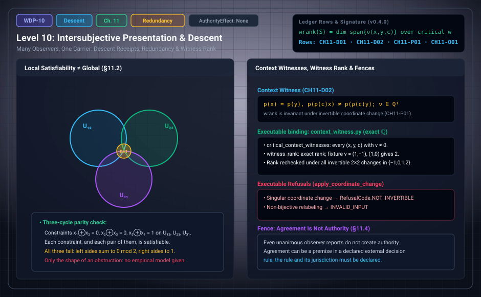

# WDP Level 10: Intersubjective Presentation, Descent, and Redundancy

**AuthorityEffect:** None.  
**Level:** Level 10 (Chapter 11: Intersubjective Presentation, Descent, and Redundancy)  
**Monograph Chapter:** Chapter 11, §11.1–§11.5 (Part III: Observer, observation, and measurement), *The Witnessed Difference Programme* v0.4.0.  
**Part:** Part III: Observer, Observation, and Measurement  
**Ledger Rows:** `WDP-CH11-D01` and `WDP-CH11-D02` (definitions), `WDP-CH11-P01` (finite proposition), `WDP-CH11-O01` (finite supplement).  

---

## 1. What this level does

[Level 09](level_09_behavioral_quotients_finite_states.md) built one observer. Chapter 11 asks what happens when
several observers present the same carrier. Their local reports may or may not
fit together, and the chapter keeps four questions apart:

1. **Descent.** Do compatible local reports come from one global report? The
   chapter defines a *descent receipt* that records the check. Appendix J constructs the finite inclusion site and report presheaf and proves the exact singleton-fiber criterion for sheaf descent.
2. **Local versus global.** Every proper part of a finite constraint family can
   be satisfiable while the whole family is not.
3. **Redundancy.** Several channels can make a report robust, but a redundancy
   theorem must name its channel model, failure family, decoder, and target.
4. **Agreement versus authority.** Even unanimous reports create no authority.

The chapter ends with a finite notion taken from the primitive-axiomatics
source: *contextual congruence*, *critical context witnesses*, and a *witness
rank* that does not depend on coordinates.

---

## 2. Definitions and results

### 2.1 Many observers, one carrier (§11.1)

Let observers $\mathcal O_i$ have presentation maps $q_i:X\to P_i$. A
comparison map $r_{ij}:P_i\rightharpoonup P_j$ may transport one presentation
into another. These maps are data, and they may be partial. For overlapping
contexts $U_i$, local reports $s_i$ are **compatible** when their restrictions
agree after declared transport on overlaps. A **descent problem** asks whether
some global report $s$ restricts to every $s_i$.

> **`WDP-CH11-D01` — Definition (observer descent receipt).** A descent receipt
> is a tuple containing the local reports, overlap maps, compatibility checks,
> a global candidate when one exists, and verification that its restrictions
> agree.

The definition resembles sheaf descent, but a sheaf is not obtained until a
site or cover, restriction maps, and gluing laws are supplied.

### 2.2 Local satisfiability is not global satisfiability (§11.2)

Every proper subfamily of a finite constraint family can be jointly
satisfiable while the whole family is inconsistent. The chapter's example is a
three-cycle of parity constraints, worked in Section 3 below.

**Scope of the example.** It is not a compatible family of fixed local
sections. If fixed sections agree on all overlaps, the ordinary gluing problem
has already been solved at the level of variable assignments. Constraint-cycle
examples motivate obstruction diagnostics, but contextuality in the
quantum-foundational sense also needs a measurement scenario and an empirical
model.

> **`WDP-CH11-O01` — Finite proposition (explicit observer descent).** On the finite inclusion site of intersection-closed contexts with union covers, checked report sets and coherent restriction maps form a presheaf. It is a sheaf exactly when every matching-family fiber contains one global report. Constrained assignment reports admit a glue exactly when their pointwise union is admitted; the equality-constraint countermodel refutes unrestricted local-to-global gluing. Appendix J defines the category and coverage and proves these criteria.

### 2.3 Redundancy (§11.3)

Suppose several conditionally independent channels carry presentations of one
source. A report recoverable from any $k$ of $n$ channels survives some channel
failures. A finite redundancy theorem must state the channel model, the failure
family, the decoder, and the target predicate. The chapter states no such
theorem as a ledger row.

Quantum Darwinism studies a related but stronger physical setting, with
environmental fragments, decoherence, and preferred observables
[REF-OBS-001; REF-OBS-002]. The monograph borrows only the structural question
(when do independent channels support stable agreement?), not the physical
mechanism or its conclusions.

### 2.4 Agreement and authority (§11.4)

Even unanimous observer reports do not create authority. Agreement can be a
premise in an external decision rule, but the rule and its jurisdiction must be
declared. Conversely, an authorized institution can issue a decision that is
not an observer-consensus theorem. Keeping the types apart stops a descent
result from turning into a governance claim.

### 2.5 Contextual congruence and witness rank (§11.5)

A **finite contextual system** $S$ has a finite state set $X$, a finite context
family $C$ acting by maps $\rho(c):X\to X$, and a profile map
$p:X\to Q^1$ into the quotient of a window (§4.8, [Level 03](level_03_discrete_complex_cochains.md)).

> **`WDP-CH11-D02` — Definition (contextual congruence and context witness).**
> Set $x\sim y$ when $p(x)=p(y)$. The relation $\sim$ is a contextual congruence
> when $x\sim y$ implies $\rho(c)x\sim\rho(c)y$ for every context $c$. A
> critical context witness is a triple $(x,y,c)$ with $p(x)=p(y)$ and
> $p(\rho(c)x)\ne p(\rho(c)y)$. Its exposed residual is
> $\nu(x,y,c)=p(\rho(c)x)-p(\rho(c)y)\in Q^1$. Such a triple is a
> `ContextWitness` in the sense of Chapter 2.

So $\sim$ is a contextual congruence exactly when there is no critical context
witness. The source's slogan, "obstruction alone does not force refinement;
context-visible non-congruence does", is a design principle for when to enlarge
a presentation. It is not a theorem about which enlargement to choose.

> **`WDP-CH11-P01` — Finite proposition (witness-rank invariance).** The
> witness rank $\operatorname{wrank}(S)=\dim\operatorname{span}\{\nu(w)\}$,
> taken over all critical context witnesses $w$, is invariant under invertible
> linear coordinate changes of $Q^1$ and under isomorphisms of contextual
> systems: bijections of states and contexts that intertwine the actions,
> composed with a linear isomorphism of profile spaces.

*Why.* A linear isomorphism preserves linear independence, hence the dimension
of a span. An isomorphism of systems carries critical witnesses bijectively to
critical witnesses and transforms their exposed residuals by the profile
isomorphism.

**Context paths.** For context paths $a,b$ with common endpoints that are
declared homotopic, the path defect $\Theta(x;a,b)=p(\rho(a)x)-p(\rho(b)x)$
lies in $Q^1$. It is closed and non-exact when $\Theta\in H^1\setminus\{0\}$,
and open when $\kappa^1(\Theta)\ne0$. Homotopy fillers are added only by
declaration; none arises from the nerve of the context family alone.

**Checked completion scope.** `WDP-CH04-O01` now proves the least congruent coarsening for profile-preserving, context-equivariant maps, initial in the specified comma category. Requiring profile reflection instead makes completion of a noncongruent source impossible. Appendix J distinguishes this reflector from the stronger historical proposal and checks finite routing under separately declared policies.

---

## 3. Worked example: the parity three-cycle (§11.2, §15.5)

Chapter 11 states the three-cycle in words; §15.5 writes it out. Take three
contexts $U_{12}=\{x_1,x_2\}$, $U_{23}=\{x_2,x_3\}$, $U_{31}=\{x_3,x_1\}$ with
Boolean values and the local parity constraints

$$
x_1\oplus x_2=0,\qquad x_2\oplus x_3=0,\qquad x_3\oplus x_1=1.
$$

Enumerating all $2^3=8$ global assignments $(x_1,x_2,x_3)$:

| Constraints imposed | Satisfying assignments | Count |
| :--- | :--- | :---: |
| any one constraint, e.g. $U_{12}$ | e.g. $x_1=x_2$ | 4 |
| $U_{12}$ and $U_{23}$ | $(0,0,0),(1,1,1)$ | 2 |
| $U_{12}$ and $U_{31}$ | $(0,0,1),(1,1,0)$ | 2 |
| $U_{23}$ and $U_{31}$ | $(1,0,0),(0,1,1)$ | 2 |
| all three | none | 0 |

Each constraint alone, and each pair, is satisfiable; the three together are
not. The certificate is one line: adding the left sides modulo 2 gives
$(x_1\oplus x_2)\oplus(x_2\oplus x_3)\oplus(x_3\oplus x_1)=0$, while the right
sides add to $0\oplus0\oplus1=1$. The summed parity is a finite
counterexample witness to global assignment.

**Why this is not a failed gluing of sections.** Try to pick one satisfying
local assignment per context and make them agree on overlaps. Choose
$(x_1,x_2)=(0,0)$ on $U_{12}$ and $(x_2,x_3)=(0,0)$ on $U_{23}$. On $U_{31}$
the choice must have $x_1=0$ to agree with $U_{12}$, so $(x_3,x_1)=(1,0)$, and
then $x_3=1$ disagrees with $U_{23}$. No choice of local sections is compatible
on all overlaps, because a compatible choice would already be a global
assignment, and the table shows there is none. The example has the *shape* of a contextual obstruction; calling it
an empirical contextuality model needs measurements, outcomes, and an empirical
model that the example does not supply.

**Executable fixture for witness rank (package fixture, not in the
monograph).** `code/unit_tests/test_context_witness.py` declares six states
$a,\dots,f$ with profiles in $\mathbb Q^2$ standing in for $Q^1$:
$p(a)=p(b)=(0,0)$, $p(c)=(1,0)$, $p(d)=(0,1)$, $p(e)=p(f)=(2,2)$, and two
contexts. Context $t$ sends $a\mapsto c$ and $b\mapsto d$ and fixes the rest;
context $u$ sends $e\mapsto c$ and $f\mapsto a$ and fixes the rest.

1. The classes of $\sim$ are $\{a,b\},\{c\},\{d\},\{e,f\}$.
2. $(a,b,t)$ is critical: $\nu=p(c)-p(d)=(1,-1)$ (and the reversed ordered triple $(b,a,t)$ is critical with $\nu=(-1,1)$).
3. $(e,f,u)$ is critical: $\nu=p(c)-p(a)=(1,0)$ (and the reversed ordered triple $(f,e,u)$ is critical with $\nu=(-1,0)$).
4. There are four ordered critical triples in total. The executable implementation filters to representative pairs where $x$ precedes $y$ in the declared state order, yielding the two canonical witnesses $(a,b,t)$ and $(e,f,u)$. Because $\operatorname{span}\{(1,-1),(-1,1),(1,0),(-1,0)\} = \operatorname{span}\{(1,-1),(1,0)\}$, the witness rank remains $\operatorname{wrank}(S)=2$, and $\sim$ is not a contextual congruence.
5. Under the invertible change $M=\begin{pmatrix}1&1\\0&1\end{pmatrix}$ the
   residuals become $(0,-1)$ and $(1,0)$; the rank is still $2$.
6. The singular matrix $\begin{pmatrix}1&1\\1&1\end{pmatrix}$ would send
   $p(c)$ and $p(d)$ both to $(1,1)$ and erase the witness $(a,b,t)$. The
   package refuses it with `RefusalCode.NOT_INVERTIBLE`, which is why the
   proposition asks for invertible changes.

The test `test_contextual_congruence_and_critical_witnesses` asserts steps
1–4; steps 5 and 6 fall inside the coordinate-change test described in
Section 4.

---

## 4. Evidence bindings

Paths are relative to the monograph package
[`000_witnessed_difference_programme/`](../../../../omega_engine_atlas/coda_atlas/F004_papers/001_finite_obstruction_calculus/000_witnessed_difference_programme/).

| Row | Status | Ledger evidence | Lean | Executable binding | Notebook |
| :--- | :--- | :--- | :--- | :--- | :--- |
| `WDP-CH11-D01` | Definition | P | none; `CLAIM_MAP.md` lists it among definition rows without an exact declaration | none | none |
| `WDP-CH11-O01` | Finite proposition | P; C; N; L:partial (standalone supplement) | partial Lean coverage; see derivation guide | `code/witnessed_difference/finite_observer_descent.py`; native owners in derivation guide | none |
| `WDP-CH11-D02` | Definition | P; C | none; definition row without an exact declaration | `code/witnessed_difference/context_witness.py`, tested by `code/unit_tests/test_context_witness.py` | none |
| `WDP-CH11-P01` | Finite proposition | P; C | none; prose-only in `CLAIM_MAP.md` | `context_witness.py`, tested by `test_context_witness.py` and `code/injection_tests/test_mutation_recovery.py` | none |

The historical chapter bindings remain narrow. Standalone `ObserverDescent.lean` now supplies partial Lean coverage for `WDP-CH11-O01`; the finite presheaf, matching-family fibers and countermodels also have native and Python replay.

**What the executable binding checks.** `ContextualSystem` validates that each
named context maps every state into the carrier and that profiles are exact
vectors of one dimension. `contextual_congruence` returns the classes of
$\sim$. `critical_context_witnesses` lists every $(x,y,c)$ with $x$ before $y$,
$p(x)=p(y)$, and $p(\rho(c)x)\ne p(\rho(c)y)$, with its exact exposed vector.
`witness_rank` computes the rank of those vectors by exact elimination over
$\mathbb Q$. `apply_coordinate_change` returns `RefusalCode.NOT_INVERTIBLE` for a
singular matrix, and `relabel` returns `RefusalCode.INVALID_INPUT` unless both
the state map and the context map are bijections. The tests check rank
invariance under every invertible $2\times2$ matrix with entries in
$\{-1,0,1,2\}$ and under one declared relabeling. That is a finite check of
`WDP-CH11-P01` on a fixture, not a proof; the proof is the two-line argument in
§11.5.

---

## 5. Misreadings the chapter rules out

- **Local consistency implies global consistency.** The parity three-cycle is
  the counterexample (§11.2).
- **A descent receipt is a sheaf, or a Čech class.** The receipt resembles
  sheaf descent, but a receipt alone does not provide a site or gluing laws. `WDP-CH11-O01` supplies these data on its declared finite inclusion site and proves the exact descent criterion. The
  chapter makes no cohomology claim about observer overlaps; by `WDP-CH16-N01`
  no cohomology, spectral sequence, or homotopy-coherent descent is available
  until its defining identities and data are supplied, and §21.6 adds that a
  contextuality or cohomology claim fails when only a non-coboundary, not a
  cocycle, has been shown.
- **The three-cycle is quantum contextuality.** It needs a measurement
  scenario and an empirical model (§11.2). `WDP-CH19-O01` now provides a conditional finite empirical adapter and exact repair certificates under declared sampling assumptions ([Level 18](level_18_exact_rational_bounds.md)); a parity contradiction alone supplies none of those assumptions.
- **Redundancy is proved here.** §11.3 lists what a redundancy theorem would
  have to state. None is stated, and the Quantum Darwinism analogy is borrowed
  only as a question.
- **Agreement creates authority.** Unanimous reports are at most a premise in a
  separately declared rule (§11.4).
- **Witness rank counts observers.** It is the dimension of the span of the
  exposed residuals of critical context witnesses in one contextual system
  (`WDP-CH11-P01`). It measures independent context-visible anomalies, not how
  many observers agree.
- **Non-congruence tells you how to refine.** The slogan says when to enlarge a
  presentation, not which enlargement to choose (§11.5).
- **Homotopy comes for free.** Fillers between context paths are declared; none
  arises from the nerve of the context family alone (§11.5).

---

## 6. Nonclaims

Chapter 11 has no nonclaim row of its own; the ledger has no `WDP-CH11-N` row.
Its prose fences are §11.4 (agreement is not authority), the scope sentences of
§11.2, and the refusal to absorb the reflective-completion conjecture. The
consolidated nonclaims of §21.7 that bear on this level:

- the monograph does not claim that observer acceptance confers authority
  (§21.7, item 8);
- it does not claim that a cochain obstruction alone is quantum contextuality
  (§21.7, item 11).

Two ledger nonclaims from other chapters apply directly: **`WDP-CH16-N01`**,
no cohomology, spectral sequence, or homotopy-coherent descent is available
until its defining identities and data are supplied; and **`WDP-CH00-N03`**, no
local proof, test, dashboard, archive, or status in the monograph confers
authority.

**Finite supplement.** These finite targets are answered under the explicit hypotheses in Appendix J. See [the current derivation guide](../derivation_review.md) for complete statements, counterexamples, native ownership and partial Lean coverage.

---

## 7. Claim discipline

1. **What this level supports:** the descent receipt as a record type
   (`WDP-CH11-D01`); the fact that local satisfiability does not imply global
   satisfiability, with a checkable three-cycle; the definition of critical
   context witnesses (`WDP-CH11-D02`); and the coordinate-free witness rank
   (`WDP-CH11-P01`).
2. **What it does not support:** a sheaf or Čech-cohomology model of observer
   agreement, a redundancy theorem, quantum contextuality, a rule for choosing
   refinements, or any authority from agreement.
3. **Narrowest defensible claim:** in a finite contextual system, the
   dimension of the span of exposed context residuals is fixed by the system up
   to linear coordinate change and isomorphism, and a finite constraint family
   can fail globally while every proper part succeeds.
**Finite supplement.** These finite targets are answered under the explicit hypotheses in Appendix J. See [the current derivation guide](../derivation_review.md) for complete statements, counterexamples, native ownership and partial Lean coverage.

---

---

## Expert derivation supplement (2026-10-01)

- **CH04-O01 — Conditional result.** Under a declared terminal, lift and guarded-change policy, independently verified quotient/closure diagnostics feed checked finite routing receipts. Context-equivariant profile-preserving systems admit the least same-carrier congruent coarsening, initial in the specified comma category; a profile-reflecting completion of a noncongruent source is impossible. Appendix J supplies the construction and refutation. The diagnostic does not select its policy.
- **CH11-O01 — Finite proposition.** On the finite inclusion site of intersection-closed contexts with union covers, checked report sets and coherent restriction maps form a presheaf. It is a sheaf exactly when every matching-family fiber contains one global report. Constrained assignment reports admit a glue exactly when their pointwise union is admitted; the equality-constraint countermodel refutes unrestricted local-to-global gluing. Appendix J defines the category and coverage and proves these criteria.
- **CH19-O01 — Conditional result.** For any declared finite cover and nonempty rational run tables, the minimax context $L^1$ distance to the compatible polytope is the optimum of the exact standard-form LP in Appendix J, with independently verified primal/dual certificates. Under declared within-context iid categorical trials and compatible population marginals, the trial counts give explicit finite-sample pair tolerances and a union-bound failure probability. The empirical image retains only the previously stated outcome information.

The original 154 identifiers are preserved. The historical Lean census is unchanged; new standalone proofs, native replay and source custody are described in [the derivation guide](../derivation_review.md). Physical interpretation, Born selection and authority remain separate assumptions.

---

## Navigation

- **Previous:** [Level 09: A Layered Observer Architecture](level_09_behavioral_quotients_finite_states.md)
- **Next:** [Level 11: The Observation Ladder](level_11_linear_sensing_projection.md)
- **Levels Index:** [README.md](README.md)
