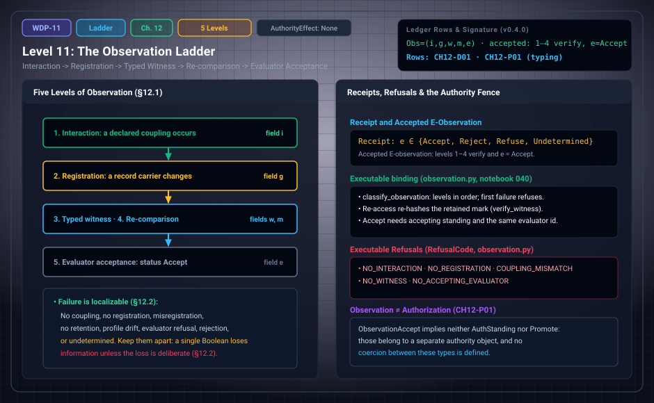

# WDP Level 11: The Observation Ladder

**AuthorityEffect:** None.  
**Level:** Level 11 (Chapter 12: The Observation Ladder)  
**Monograph Chapter:** Chapter 12, §12.1–§12.4 (Part III: Observer, observation, and measurement), *The Witnessed Difference Programme* v0.4.0.  
**Part:** Part III: Observer, Observation, and Measurement  
**Ledger Rows:** `WDP-CH12-D01` (definition), `WDP-CH12-P01` (typing proposition).  

---

## 1. What this level does

The word *observation* usually compresses several events into one. Chapter 12
separates five: an interaction, a registration, a typed witness, a
re-comparison, and an evaluator's acceptance. It then defines an observation
receipt that records all five, and a narrower type, the **accepted
E-observation**, that only a receipt with all four lower levels verified and
the evaluator result `Accept` can inhabit.

Two things follow. Failure becomes localizable: a receipt shows *where* an
attempt stopped, and the chapter lists eight distinct ways it can stop. And
acceptance stays in its own type: an accepted observation does not become an
authorization, because no coercion into the authority types is defined.

The chapter is short and proves no deep theorem. Its one proposition is a
typing proposition.

---

## 2. Definitions and results

### 2.1 Five levels (§12.1)

1. **Interaction.** A system and a target participate in a declared coupling.
2. **Registration.** The coupling changes a record carrier.
3. **Typed witness.** The record is linked by a declared evidence relation to a
   proposition about the interaction.
4. **Re-comparison.** The record can be accessed and compared under the same or
   a transported profile.
5. **Evaluator acceptance.** A declared evaluator returns an admissible status
   for the typed proposition.

> **`WDP-CH12-D01` — Definition (observation receipt and accepted
> E-observation).** An observation receipt is $\mathsf{Obs}=(i,g,w,m,e)$, whose
> fields record interaction $i$, registration $g$, typed witness $w$,
> memory/re-comparison $m$, and evaluator result $e$. An accepted E-observation
> is a well-typed observation receipt for which the first four level
> predicates verify and $e=\mathsf{Accept}$.

A receipt for a failed registration, an invalid witness, a missing re-access,
a refusal, a rejection, or an undetermined result still records an
observation *attempt*. It does not inhabit the accepted E-observation type.

The typed witness of level 3 is the witness of [Level 01](level_01_witness_function.md), and the
re-comparison of level 4 uses the retention packet of [Level 02](level_02_residuals_obstructions.md) and
the observer memory of [Level 09](level_09_behavioral_quotients_finite_states.md).

### 2.2 Failure modes (§12.2)

The ladder makes failure localizable. The chapter names eight failure modes.

| Failure mode | Meaning (§12.2) | Level where the attempt stops |
| :--- | :--- | :---: |
| No coupling | the proposed interaction did not occur under the model | 1 |
| No registration | coupling occurred but left no admissible record | 2 |
| Misregistration | the record does not satisfy the witness relation | 3 |
| No retention | the record existed but cannot be re-accessed | 4 |
| Profile drift | the later comparison uses an incompatible context | 4 |
| Evaluator refusal | the query is ill typed or outside the evaluator's domain | 5 |
| Evaluator rejection | a well-typed claim fails its declared criterion | 5 |
| Undetermined | the available evidence does not settle the criterion | 5 |

The last column is this page's reading of the descriptions; the chapter lists
the modes without numbering them. Its instruction is explicit: these statuses
should not be replaced by a single Boolean unless the loss of information is
deliberate. In particular, refusal, rejection, and undetermined are three
different outcomes at level 5.

### 2.3 Observation is not authorization (§12.3)

> **`WDP-CH12-P01` — Typing proposition.** `ObservationAccept` does not imply
> `AuthStanding` or `Promote` in the layered architecture, because those
> predicates belong to a separate authority object and no coercion between the
> types is defined.

The chapter calls this almost syntactic, and it is. What it repairs is a real
ambiguity in the measurement source. An evaluator may accept that a thermometer
read $20.1\,^{\circ}\mathrm C$ under its procedure. That does not authorize
opening a facility, publishing a medical conclusion, or changing a controlled
standard. Authority is the subject of Chapter 15 ([Level 14](level_14_traceability_provenance_receipts.md)).

---

## 3. Worked example: a switch and an ADC code (§12.4)

A finite switch closes and changes a voltage at a sensor. An analog-to-digital
converter stores the integer `813`. A calibration table associates the code
with a voltage interval. Memory stores the code, the calibration version, and a
time index. An evaluator checks the checksum, the range, and the calibration
validity.

| Level | In this example | Receipt field |
| :--- | :--- | :---: |
| 1. Interaction | the switch/sensor coupling | $i$ |
| 2. Registration | the stored code `813` | $g$ |
| 3. Typed witness | the code and the calibration receipt support a voltage proposition | $w$ |
| 4. Re-comparison | the stored record (code, calibration version, time index) can be checked later | $m$ |
| 5. Evaluator acceptance | checksum, range, and calibration-validity predicates pass | $e=\mathsf{Accept}$ |

This is already an accepted E-observation. It is **not yet a measurement**. It
becomes one only after Chapter 13 supplies the measurand specification and
result carrier, the value map, the unit, the calibration, the uncertainty or
error semantics, metrological-traceability evidence when traceability is
claimed, and provenance/re-access fields ([Level 12](level_12_context_interference_state_spaces.md)).

The example contains no arithmetic to re-check; `813` is a stored code, not a
voltage. Each failure mode of §12.2 corresponds to breaking one row of the
table. For instance, if the stored code cannot be read back, the attempt stops
at level 4 (no retention); if the range check fails on a well-typed query, it
stops at level 5 (evaluator rejection), and the receipt records a rejection
rather than a missing observation.

---

## 4. Evidence bindings

Paths are relative to the monograph package
[`000_witnessed_difference_programme/`](../../../../omega_engine_atlas/coda_atlas/F004_papers/001_finite_obstruction_calculus/000_witnessed_difference_programme/).

| Row | Status | Ledger evidence | Lean | Executable binding | Notebook |
| :--- | :--- | :--- | :--- | :--- | :--- |
| `WDP-CH12-D01` | Definition | P; C | none exact; `ObservationReceipt` and `AcceptedObservation` are narrower packet types | `code/witnessed_difference/observation.py`, tested by `code/unit_tests/test_observation_measurement.py`, `code/integration_tests/test_observer_measurement_pipeline.py`, and `code/injection_tests/test_mutation_recovery.py` | `040_observation_to_measurement.ipynb` |
| `WDP-CH12-P01` | Typing proposition | P; C | narrower than the row: `WitnessedDifference.AcceptedObservation.status_ne_refuse`, `.status_ne_reject`, and `WitnessedDifference.acceptance_does_not_entail_authority` | `observation.py`, tested by `test_observation_measurement.py` and `test_mutation_recovery.py` | `040_observation_to_measurement.ipynb` |

**Lean scope.** The Lean `ObservationReceipt` (in
`lean4/WitnessedDifference/Observer.lean`) holds an observer packet with
presentation, memory, and evaluator, a world, the report it presents, the
stored trace, and the evaluator status, with equations tying them together. It
has no separate interaction or typed-witness field. Its status type
`EvaluationStatus` has three values (`accept`, `refuse`, `reject`);
`CLAIM_MAP.md` records under `WDP-CH12-P01` that the `Undetermined` status of
§10.2 and §12.2 is not represented. `AcceptedObservation` adds a proof that the status is
`accept`, so refusal and rejection receipts cannot inhabit it.
`acceptance_does_not_entail_authority` is a countermodel: an evaluator that
accepts a report and an authority policy that does not authorize it. These are
narrower than `WDP-CH12-P01`, which asserts that no coercion is defined in the
whole architecture. In `lean4/axiom_report.txt` all three declarations depend
only on `propext`.

**What the executable binding checks.** `classify_observation` promotes an
`ObservationReceipt` to an `AcceptedObservation` only after checking the
ladder in order, and the first failed check is the refusal it returns. The
package's objects and codes do not match the eight failure modes one to one:

| Monograph level | Package object | Refusal when missing or weakened |
| :--- | :--- | :--- |
| 1. Interaction | `Interaction` with at least two named poles and `mark_capacity=True` | `NO_INTERACTION` |
| 2. Registration | `Registration` with `retained=True` on the carrier the interaction names | `NO_REGISTRATION`; `COUPLING_MISMATCH` if the interaction names another carrier |
| 3. Typed witness | `WitnessReceipt` bound to that registration | `NO_WITNESS`; `DIGEST_MISMATCH` if it binds another registration |
| 4. Re-comparison | the `ReaccessReceipt` inside the witness, re-checked by `verify_witness` | `DIGEST_MISMATCH` or `RECEIPT_MISMATCH` if the retained mark or receipt no longer matches |
| 5. Evaluator acceptance | `EvaluatorResult` with status, standing, and evaluator id | `NO_ACCEPTING_EVALUATOR` for a missing result or `Reject`, `Refuse`, `Undetermined`; `NON_ACCEPTING_STANDING`; `EVALUATOR_MISMATCH` if the witness and the result name different evaluators |

All codes are members of `RefusalCode` in `outcomes.py`. A witness is built by
`make_witness` in `witness.py`, which refuses an unretained registration with
`NOT_RETAINED` and a re-access that does not reproduce the mark with
`REACCESS_FAILED`. The three non-Accept statuses share one refusal code; the
`EvaluatorStatus` value stays on the receipt and is named in the refusal
detail, so the distinction of §12.2 is kept in the record. There is no
dedicated code for profile drift.

For `WDP-CH12-P01`, every receipt and accepted observation carries
`AuthorityEffect.NONE`; constructing one with any other value raises an error,
and a receipt whose authority field is altered after construction is refused
with `RefusalCode.CLAIM_STATUS_FIREWALL`. The test
`test_accepted_observation_has_no_authority_promotion` checks that an accepted
observation has no `authority_certificate` or `promote` attribute. Notebook
`040` builds an accepted observation from a registration with display value
`12`, then shows the refusals for a `Reject` status and for a wrong coupling.

---

## 5. Misreadings the chapter rules out

- **An attempt is an observation.** A receipt records attempts, including
  failed ones. Only a receipt with levels 1–4 verified and $e=\mathsf{Accept}$
  is an accepted E-observation (`WDP-CH12-D01`).
- **Observation is one event.** Interaction, registration, witness,
  re-comparison, and acceptance can each fail separately (§12.1–§12.2).
- **Refusal, rejection, and undetermined are the same "no".** They are three
  statuses with different meanings; collapsing them into one Boolean loses
  information and needs a deliberate choice (§12.2).
- **The ladder has an agreement rung.** The five levels end at evaluator
  acceptance. Agreement among observers is Chapter 11
  ([Level 10](level_10_observation_measurement_calibration.md)), and it is not authority either.
- **Acceptance authorizes action.** `WDP-CH12-P01`: acceptance has no
  coercion into `AuthStanding` or `Promote`. The thermometer example of §12.3
  and the falsifier of §21.5 ("any implication from evaluator acceptance to
  authority is ill typed unless an authority bridge is declared") make the
  point concrete.
- **An accepted observation is a measurement.** §12.4: the ADC example is an
  accepted E-observation and still lacks the measurand, value map, unit,
  calibration, uncertainty, and provenance fields of Chapter 13.
- **A record proves its proposition by existing.** Chapter 21 lists the
  falsifier: observation validity fails when a record cannot be connected to
  its target proposition (§21.5). That connection is the typed witness of
  level 3.

---

## 6. Nonclaims

Chapter 12 has no nonclaim row of its own; the ledger has no `WDP-CH12-N` row.
Its fences are `WDP-CH12-P01` itself and the measurement caveat of §12.4. The
consolidated nonclaims of §21.7 that bear on this level:

- the monograph does not claim that observer acceptance confers authority
  (§21.7, item 8);
- it does not claim that a measurement packet is observer-independent
  (§21.7, item 9).

Ledger nonclaims from other chapters that apply: **`WDP-CH00-N03`**, no local
proof, test, dashboard, archive, or status in the monograph confers authority;
and **`WDP-CH13-N01`**, measurement validity does not confer authority, causal
explanation, physical completeness, or observer independence.

**Finite supplement.** These finite targets are answered under the explicit hypotheses in Appendix J. See [the current derivation guide](../derivation_review.md) for complete statements, counterexamples, native ownership and partial Lean coverage.

---

## 7. Claim discipline

1. **What this level supports:** a five-level separation of observation; an
   observation receipt that records attempts; an accepted E-observation type
   that only a fully verified, `Accept`-status receipt inhabits
   (`WDP-CH12-D01`); eight localizable failure modes; and the typing
   proposition that acceptance does not coerce into authority
   (`WDP-CH12-P01`).
2. **What it does not support:** any authority, promotion, or institutional
   standing from acceptance; any claim that an accepted observation is a
   measurement; any claim that evaluator acceptance makes a proposition true
   outside the evaluator's declared criterion.
3. **Narrowest defensible claim:** an accepted E-observation is a receipt whose
   interaction, registration, typed witness, and re-comparison verify and whose
   evaluator returned `Accept`; nothing in that type is an authority grant.
4. **Next test needed:** formalize the observation ladder as a typed finite
   state machine, which §21.8 lists as item 4 of the priority open programme,
   and give `WDP-CH12-P01` an exact Lean binding that covers the full
   non-coercion assertion and a status type with an undetermined value. This is
   a suggested next step, not a ledger row.

---

---

## Expert derivation supplement (2026-10-01)

- **CH18-O01 — Conditional result.** Signed report weights have a classical state representation exactly when every observable block mass is nonnegative; signed instrument updates admit a classical report-instrument quotient exactly under the stated fiber-intertwining and stochastic-quotient conditions. The unrestricted witness/observer/measurement class admits accepted PR tables, refuting reconstruction that preserves their declared probabilities together with classical joint runs or bipartite local Hilbert measurement composition. Classical and quantum alternatives require the explicit additional packages in Appendix J; neither is forced by the original packets.
- **CH19-O04 — Finite proposition.** Grouped finite Gaussian-rational Kraus instruments preserve their declared probabilities, post-states and canonical dilation. On a common input/output carrier, outcome repeatability is equivalent to $K_{jb}K_{oa}=0$ for every $j\ne o,a,b$. Independent replay checks the complete registration, witness, accepted observation, indication, calibration enclosure and declared documentary hierarchy against actual inputs. Documentary traceability does not authenticate a physical standard or select the Born readout.

The original 154 identifiers are preserved. The historical Lean census is unchanged; new standalone proofs, native replay and source custody are described in [the derivation guide](../derivation_review.md). Physical interpretation, Born selection and authority remain separate assumptions.

---

## Navigation

- **Previous:** [Level 10: Intersubjective Presentation, Descent, and Redundancy](level_10_observation_measurement_calibration.md)
- **Next:** [Level 12: Measurement as a Typed Extension of Observation](level_12_context_interference_state_spaces.md)
- **Levels Index:** [README.md](README.md)
