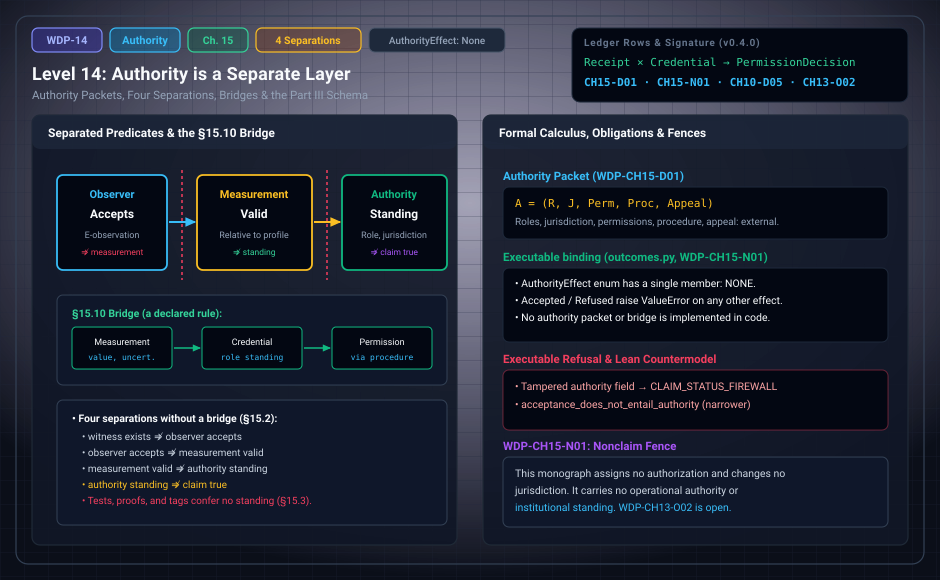

# WDP Level 14: Authority is a Separate Layer

**AuthorityEffect:** None.  
**Level:** Level 14 (Chapter 15: Authority is a Separate Layer)  
**Monograph Chapter:** Chapter 15, §15.1–§15.11 (Part III: Observer, observation, and measurement), *The Witnessed Difference Programme* v0.5.0.  
**Part:** Part III: Observer, Observation, and Measurement  
**Ledger Rows:** `WDP-CH15-D01` (definition), `WDP-CH15-N01` (nonclaim), `WDP-CH10-D05` (definition, stated in §15.4), `WDP-CH13-O02` (finite proposition, stated in §15.11). The related typing proposition `WDP-CH12-P01` lives in Chapter 12 ([Level 11](level_11_linear_sensing_projection.md)).  

---

## 1. What this level does

Levels 9–13 built observers, observations, and measurements. None of them says
who may act on a result. Chapter 15 puts that question in its own layer.
Authority concerns who or what is permitted to issue, accept, promote, or act
on a statement within a jurisdiction. It is not an observer component, and no
theorem of the obstruction calculus produces it. A bridge from a measurement
or a proof into an authority procedure is a policy choice in a jurisdiction.

The chapter also closes Part III. It defines observer morphisms, gives a
finite descent example, lists what an observation receipt must retain,
separates two kinds of uncertainty transport, distinguishes three meanings of
repeatability, repairs the self-model hierarchy, works an authority bridge,
and states the conditional theorem schema for the whole part.

---

## 2. Definitions and results

### 2.1 Typed authority (§15.1)

> **`WDP-CH15-D01` — Definition (authority packet).** An authority packet is
> $\mathfrak A=(R,J,\mathsf{Perm},\mathsf{Proc},\mathsf{Appeal})$, where $R$
> is a set of roles, $J$ a jurisdiction, $\mathsf{Perm}$ a typed permission
> relation, $\mathsf{Proc}$ a procedure for exercising permissions, and
> $\mathsf{Appeal}$ any review or revocation mechanism.

The packet is external to the layered observer.

### 2.2 Four separations (§15.2)

Without explicit bridge rules, each of these implications is invalid:

$$
\begin{aligned}
\text{witness exists} &\not\Rightarrow \text{observer accepts},\\
\text{observer accepts} &\not\Rightarrow \text{measurement valid},\\
\text{measurement valid} &\not\Rightarrow \text{authority standing},\\
\text{authority standing} &\not\Rightarrow \text{claim true}.
\end{aligned}
$$

The monograph gives one situation for each, in reverse order: an authorized
role can make an incorrect statement; a correct measurement can lie outside a
role's jurisdiction; an evaluator can accept an internally valid record that
lacks metrological fields; and a residual can exist without being registered.

These are four non-implications between five predicates. Each one stays
blocked until a bridge rule for that step is declared.

A related step, from evaluator acceptance directly to authority, is the typing
proposition `WDP-CH12-P01` ([Level 11](level_11_linear_sensing_projection.md)): `ObservationAccept`
implies neither `AuthStanding` nor `Promote`, because those outputs have separate types and no coercion is
provided. Its Lean support is narrower than the row.
`acceptance_does_not_entail_authority` exhibits one countermodel: an evaluator
on the one-point report type that accepts, and an authority policy that
authorizes nothing. `AcceptedObservation.status_ne_refuse` and
`.status_ne_reject` show only that an accepted observation's status is neither
refusal nor rejection. None of these mechanizes the full non-coercion
assertion.

### 2.3 Repository status (§15.3)

A green test run says that specified commands returned expected results in a
specified environment. A formal proof says that a term inhabits a proposition
under the proof assistant's logic and imports. A release tag identifies bytes.
None of these confers institutional, scientific, or moral authority. Each can
be an input to an authority process, but only through a declared rule. The
nonclaim `WDP-CH15-N01` (Section 6) applies this to the monograph itself.

### 2.4 Observer morphisms (§15.4)

Observers are compared through morphisms, not by comparing tuple lengths. A
morphism $F:\mathcal O\to\mathcal O'$ can contain maps
$F_X:X_{\mathcal O}\to X_{\mathcal O'}$,
$F_P:P_{\mathcal O}\to P_{\mathcal O'}$, and
$F_M:M_{\mathcal O}\to M_{\mathcal O'}$ that commute with selected
presentation, update, and report maps. Evaluator transport also needs a map on
defects and repairs that preserves the repair action and controls the cost:
exact equality of costs for a strong isometry, a one-sided bound for a
simulation.

No single morphism class fits every purpose. Reproducing another observer's
reports calls for behavioral simulation. Agreement of obstruction magnitudes
calls for gauge and cost preservation. Transfer of authority is not settled by
any observer morphism; an authority-packet morphism has to be defined
separately.

> **`WDP-CH10-D05` — Definition (report simulation).** Observer
> $\mathcal O'$ report-simulates $\mathcal O$ on an input family $D$ when an
> input adapter and a report decoder make the declared report diagram commute
> on $D$. This does not imply memory-state isomorphism or evaluator
> equivalence.

### 2.5 A finite descent example (§15.5)

Take contexts $U_{12}=\{x_1,x_2\}$, $U_{23}=\{x_2,x_3\}$,
$U_{31}=\{x_3,x_1\}$ with Boolean values and local parity constraints

$$
x_1\oplus x_2=0,\qquad x_2\oplus x_3=0,\qquad x_3\oplus x_1=1.
$$

Any two constraints can be satisfied together, but all three cannot: adding
the left sides modulo two gives $0$, and adding the right sides gives $1$.
Enumerating all eight assignments shows that each pair of constraints has
exactly two solutions (for example $(0,0,0)$ and $(1,1,1)$ for the first
two), and the three together have none. The summed parity is a finite counterexample
witness to a global assignment.

The example has the *shape* of a contextual obstruction. To call it an
empirical contextuality model one must also say what the measurements and
outcomes are, supply compatible distributions on contexts as required, and
connect the logical support to those distributions. The arithmetic
contradiction alone supplies no experiment.

### 2.6 Observation receipt invariants (§15.6)

If a raw record is re-encoded by a bijection $c:R\to R'$, the registration and
readback maps can be transported through $c$, and the witnessed proposition
stays the same if its semantics is transported too. A checksum over raw bytes
changes unless it is recomputed and provenance-linked. Semantic invariance and
byte identity are different predicates.

For each observation, a receipt should retain at least: the interaction
identifier and target role; the registration source and raw record digest;
the witness kind and proposition identifier; the context/profile identifier;
the memory/re-access pointer; the evaluator version, inputs, output, and any
certificate; the transformations applied to the raw record; and explicit
exclusions. This lets a later reviewer tell a changed evaluator from changed
data.

### 2.7 Measurement equations and uncertainty propagation (§15.7)

For a reported scalar $y=h(z,c)$ with indication $z$ and calibration
parameters $c$, the familiar first-order approximation around $(z_0,c_0)$ is

$$
\operatorname{Var}(y)\approx\nabla h^{\mathsf T}\Sigma\,\nabla h,
$$

with $\Sigma$ the joint covariance of indication and calibration inputs. It is
conditional on a probability model, differentiability, and valid local
linearization, and it is not part of the finite root. For bounded errors one
can use interval or Lipschitz transport instead: if $h$ is $L$-Lipschitz on
the admitted domain and $\|x-x_0\|\le\epsilon$, then
$|h(x)-h(x_0)|\le L\epsilon$. A measurement packet should declare which
semantics it uses. Mixing a worst-case bound with a standard deviation without
an adapter is a type error.

### 2.8 Repeated instruments and state change (§15.8)

Repeatability has at least three meanings: repeated readout returns the same
code; repeated measurement returns compatible value intervals; or the first
measurement prepares a state that, under declared assumptions, guarantees the
second result. The third belongs to an operational state-transition theory
and, in quantum models, to instrument structure. The finite packet supports
only the first two, and only when suitable stability predicates are provided.
Quantum-instrument results (Davies–Lewis, Ozawa) are comparisons, not part of
the general definition.

### 2.9 Self-model calibration (§15.9)

Let an observer emit a finite report $r\in R$ and a test procedure observe a
behavior $b\in B$. A calibration relation $K\subseteq R\times B$ records which
pairs count as agreement. Repeated tests can reveal systematic mismatches. The
result concerns $K$ and the sampled behavior family, not the total internal
state. The repaired hierarchy is:

- **self-presentation:** a report is generated from an encoded self-state;
- **self-retention:** the report is available later;
- **self-comparison:** a later procedure compares it with a typed target;
- **self-calibration:** the comparison satisfies a declared relation on a test
  family;
- **cross-context robustness:** the relation is preserved under named context
  transports.

No implication runs in reverse, and the forward implications need adapter
laws. A stable report can be consistently wrong, a calibrated report can cover
only a narrow test family, and a broad functional self-model still does not
settle phenomenology. This refines the independent predicates of §14.2
([Level 13](level_13_self_reference_gaps_fixed_points.md)).

### 2.10 Authority bridge example (§15.10)

Worked in Section 3.

### 2.11 Part III interface theorem schema (§15.11)

The theorem schema for Part III is compositional and conditional. Suppose:

1. an interaction-to-record map satisfies a declared fidelity relation;
2. the record-to-proposition semantics is valid on a stated domain;
3. memory preserves the required fields;
4. the evaluator is sound for its status predicates;
5. calibration and uncertainty transport are valid;
6. provenance links all transformations, and any metrological-traceability
   claim meets the documented calibration-chain and uncertainty requirements.

Then the final measurement result is valid **relative to that package**. Each
premise has its own falsifier. The conclusion includes neither authorization
nor truth outside the measurand/profile domain.

> **`WDP-CH13-O02` — Finite proposition.** The declared finite registration/witness/measurement instance replays the retained indication, composed affine map, correction and uncertainty enclosure against separate re-access data; altered records, understated uncertainty and rehashed false enclosures are rejected.
> See Appendix I and [the derivation guide](../derivation_review.md).

---

## 3. Worked example: an authority bridge (§15.10)

A laboratory procedure says: "A calibration-valid measurement below threshold
$\theta$, signed by role `Operator`, permits action $A$." Read as mathematics,
this rule is a bridge

$$
\mathsf{MeasurementReceipt}\times\mathsf{RoleCredential}\longrightarrow\mathsf{PermissionDecision}.
$$

1. **The measurement** supplies a value and an uncertainty. It is a
   [Level 12](level_12_context_interference_state_spaces.md) packet and carries no standing.
2. **The credential** supplies standing: the role `Operator` inside the
   authority packet's $R$, $J$, and $\mathsf{Perm}$.
3. **The procedure** $\mathsf{Proc}$ supplies the jurisdictional inference
   from the two inputs to a decision about action $A$.
4. **Missing input.** If either input is missing, the bridge refuses.
5. **Recalibration.** If a later calibration changes the value interval, the
   procedure, not the calculus, decides whether earlier decisions are reviewed
   (compare the recalibration step in Level 12, Section 3).

The obstruction calculus can audit the inputs and the rule. It does not create
the rule's legitimacy. This authority example is prose. The proved finite registration/measurement replay checks its declared measurement inputs; it does not establish the jurisdiction's legitimacy or fully mechanize this authority bridge.

---

## 4. Evidence bindings

Paths are relative to the monograph package
[`000_witnessed_difference_programme/`](../../../../omega_engine_atlas/coda_atlas/F004_papers/001_finite_obstruction_calculus/000_witnessed_difference_programme/).

| Row | Status | Ledger evidence | Lean | Executable binding | Notebook |
| :--- | :--- | :--- | :--- | :--- | :--- |
| `WDP-CH15-D01` | Definition | P | none; `CLAIM_MAP.md` lists it among definition rows without an exact declaration | none | none |
| `WDP-CH15-N01` | Nonclaim | P; C | none | `code/witnessed_difference/outcomes.py`, tested by `code/unit_tests/test_exact_ground_outcomes.py` and `code/injection_tests/test_mutation_recovery.py` | none |
| `WDP-CH10-D05` | Definition | P | none; `CLAIM_MAP.md` lists it among definition rows without an exact declaration | none | none |
| `WDP-CH13-O02` | Finite proposition | P; C | no full-row Lean proof | measurement_replay.py; test_measurement_replay.py | Appendix I; current supplement |

**Related row outside this chapter.** `WDP-CH12-P01` (typing proposition,
[Level 11](level_11_linear_sensing_projection.md)): Lean declarations `AcceptedObservation.status_ne_refuse`,
`.status_ne_reject`, and `acceptance_does_not_entail_authority` in
`lean4/WitnessedDifference/Observer.lean` are narrower than the row, as
`CLAIM_MAP.md` records; executable binding `code/witnessed_difference/observation.py`.

**What the executable bindings check.** In `outcomes.py`, the
`AuthorityEffect` enum has a single member, `NONE`, and the constructors of
`Accepted` and `Refused` raise `ValueError` for any other value; `Measurement`,
`ObservationReceipt`, and `AcceptedObservation` do the same. If a receipt's
authority field is tampered with after construction, `classify_observation`
returns `RefusalCode.CLAIM_STATUS_FIREWALL`, and `measure` passes that refusal
through. For `WDP-CH13-O02`, the pipeline test runs one finite chain:
registration, witness, accepted observation, measurement, and a verified
receipt. Appendix I adds a proved explicit finite instance with composed
calibration and uncertainty, independent re-access data and rehashed false
enclosure rejection. The finite instance is resolved; the unrestricted
physical theorem schema still requires its stated premises.
No module implements an authority packet, a permission relation, or a bridge.

---

## 5. Misreadings the chapter rules out

- **Collapsing the separations.** Each of the four non-implications needs its
  own bridge rule. §21.5 puts one of them as a falsifier: any implication from
  evaluator acceptance to authority is ill typed unless an authority bridge is
  declared.
- **Authority as truth.** An authorized role can make an incorrect statement
  (§15.2).
- **Repository status as standing.** A green test run, a formal proof, and a
  release tag confer no institutional, scientific, or moral authority (§15.3).
- **Observer morphisms as authority transfer.** No observer morphism is
  enough; an authority-packet morphism must be defined separately. Report
  simulation (`WDP-CH10-D05`) does not even give memory-state isomorphism or
  evaluator equivalence (§15.4).
- **A parity contradiction as an experiment.** The §15.5 example has the shape
  of a contextual obstruction, not the content of an empirical contextuality
  model.
- **Byte identity as semantic identity.** A re-encoded record keeps its
  witnessed proposition only if the semantics is transported; its raw-byte
  checksum changes (§15.6).
- **Mixing uncertainty semantics.** A worst-case bound and a standard
  deviation need an adapter; the first-order variance formula is conditional
  and not part of the finite root (§15.7).
- **A calibrated self-report as the whole self.** Self-calibration concerns a
  relation $K$ on a test family, not the total internal state or
  phenomenology (§15.9).
- **The calculus as a source of legitimacy.** It audits the inputs and the
  rule of an authority bridge; it does not make the rule legitimate (§15.10).
- **The theorem schema as authorization.** Its conclusion is validity relative
  to the package; it includes neither authorization nor truth outside the
  measurand/profile domain (§15.11).

---

## 6. Nonclaims

- **`WDP-CH15-N01`.** This monograph assigns no authorization and changes no
  jurisdiction. It carries no operational authority or institutional
  standing.

The consolidated list in §21.7 repeats two related points: the monograph does
not claim that observer acceptance confers authority (item 8), or that
repository tests, formal elaboration, or publication status decides the
interpretation of the mathematics (item 18).

**Current statuses.**

- **`WDP-CH13-O02`** (finite proposition): The declared finite registration/witness/measurement instance replays the retained indication, composed affine map, correction and uncertainty enclosure against separate re-access data; altered records, understated uncertainty and rehashed false enclosures are rejected.

---

## 7. Claim discipline

1. **What this level supports:** a typed authority packet
   $(R,J,\mathsf{Perm},\mathsf{Proc},\mathsf{Appeal})$ external to the
   observer; four non-implications that hold unless a bridge rule is
   declared; a definition of report simulation; and a conditional theorem
   schema whose conclusion is validity relative to a declared package.
2. **What it does not support:** the legitimacy of any rule; standing
   conferred by tests, proofs, tags, or this monograph; authority transferred
   by observer morphisms; an empirical contextuality model from a parity
   contradiction; or an unrestricted physical end-to-end measurement theorem.
   The declared finite measurement/replay instance is now proved.
3. **Narrowest defensible claim:** authority enters only through a declared
   bridge that takes a measurement receipt and a role credential and returns a
   permission decision under a jurisdiction's procedure; the calculus can
   audit that bridge's inputs and rule and cannot supply its legitimacy.
4. **Next exercise:** replay the declared finite result and its negative
   controls listed in [the derivation guide](../derivation_review.md), then change
   one hypothesis and identify which conclusion still follows.

---

---

## Current finite derivation and Rust integration

The explicit registration/witness/observation/measurement instance now replays separate re-access data, composed calibration, correction and uncertainty. It rejects altered records and rehashed false enclosures. This resolves the finite CH13-O02 instance; broader physical traceability remains an evidence requirement. See code/witnessed_difference/measurement_replay.py and its focused tests.

See Appendix I and [the derivation guide](../derivation_review.md) for exact
claim statuses, test results and the runnable Rust example.

---

## Navigation

- **Previous:** [Level 13: Self-Reference and the Awareness Boundary](level_13_self_reference_gaps_fixed_points.md)
- **Next:** [Level 15: Spatial/History Diagnostics and the Curved-Complex Fork](level_15_simplicial_branch.md)
- **Levels Index:** [README.md](README.md)
