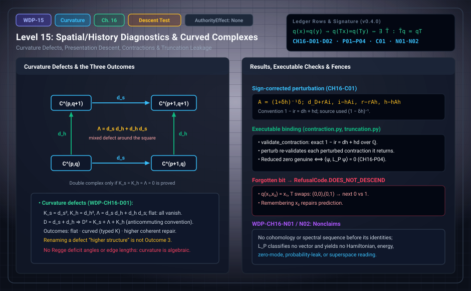

# WDP Level 15: Spatial/History Diagnostics and the Curved-Complex Fork

**AuthorityEffect:** None.  
**Level:** Level 15 (Chapter 16: Spatial/History Diagnostics and the Curved-Complex Fork)  
**Monograph Chapter:** Chapter 16, §16.1–§16.6 (Part IV: Histories and the quantum boundary), *The Witnessed Difference Programme* v0.4.0.  
**Part:** Part IV: Histories and the Quantum Boundary  
**Ledger Rows:** `WDP-CH16-D01`, `WDP-CH16-D02` (definitions), `WDP-CH16-P01`–`WDP-CH16-P04` (finite propositions), `WDP-CH16-C01` (conditional result, imported standard), `WDP-CH16-N01`, `WDP-CH16-N02` (nonclaims).  

---

## 1. What this level does

Chapter 16 is about presentation changes and what must be checked before
homological language may be used. It treats four cases.

1. **Two directions.** A spatial (or contextual) degree and a historical degree
   give two candidate differentials. Whether they form a double complex is a
   set of identities to prove, not a label; failures are typed *curvature
   defects*. The "fork" of the title is the choice among three honest outcomes:
   flat complex, curved system, or explicit higher coherent repair.
2. **Projection.** When an observer sees only $q(x)$, the full dynamics may not
   descend, and the next presentation can depend on what $q$ discarded. This is
   the chapter's precise sense of projection-induced memory.
3. **Chain contractions.** A smaller complex with explicit comparison maps. The
   chapter fixes the sign convention and corrects a sign error in its source.
4. **Truncation.** Restricting an operator to a subspace produces a leakage
   term, and the chapter says exactly when a truncated zero is genuine.

"Curvature" here means the algebraic defects $d_s^2$, $d_h^2$, and
$d_sd_h+d_hd_s$. The chapter contains no Regge calculus, deficit angles, edge
lengths, or spacetime geometry.

---

## 2. Definitions and results

### 2.1 Two directions (§16.1)

Let $C^{p,q}$ be a finite bigraded family, with spatial or contextual degree
$p$ and historical degree $q$, and candidate maps

$$
d_s:C^{p,q}\to C^{p+1,q},\qquad d_h:C^{p,q}\to C^{p,q+1}.
$$

A genuine anticommuting double complex requires $d_s^2=0$, $d_h^2=0$, and
$d_sd_h+d_hd_s=0$. Earlier drafts treated these identities as likely
constructions while also recording defects that can make them false. Here they
are gates.

> **`WDP-CH16-D01` — Definition (curvature defects).** $K_s=d_s^2$,
> $K_h=d_h^2$, and $\Lambda=d_sd_h+d_hd_s$. The flat locus is the subfamily on
> which all three vanish.

With this anticommuting convention the unsigned total operator $D=d_s+d_h$
satisfies $D^2=K_s+\Lambda+K_h$, so $D^2=0$ on the flat locus. The signed
convention $D=d_s+(-1)^pd_h$ instead pairs with commuting bidegree maps. The two
conventions must not be mixed.

Chapter 19 (§19.6, [Level 18](level_18_exact_rational_bounds.md)) gives a one-dimensional toy square in
which anticommutation is already the nontrivial scalar condition $db+ca=0$.

### 2.2 The three outcomes (§16.2)

1. **Flat complex.** Prove all square-zero and mixed identities on a declared
   domain. Cohomology and spectral-sequence language then becomes available
   [REF-HOM-001].
2. **Curved system.** Keep the nonzero defects as typed curvature and use a
   curved differential formalism whose axioms are checked separately
   [REF-HOM-002].
3. **Higher coherent repair.** Supply explicit homotopies or higher operations
   that satisfy the relevant coherence identities [REF-HOM-003; REF-HOM-004].

Renaming a defect "higher structure" is not Outcome 3. Higher cells are new
data, and their identities are new obligations.

### 2.3 Projection-induced memory (§16.3)

Let a full state evolve by $T:X\to X$ while an observer sees a surjective
presentation $q:X\to P$. If a section $i:P\to X$ is chosen, a reduced update
can be written $S=qTi$. Descent of the full dynamics through $q$ requires
instead

$$
q(x)=q(y)\Longrightarrow q(Tx)=q(Ty).
$$

> **`WDP-CH16-P01` — Finite proposition (descent criterion).** For a surjective
> $q:X\to P$, a function $\bar T:P\to P$ with $\bar Tq=qT$ exists exactly when
> $q(x)=q(y)$ implies $q(Tx)=q(Ty)$.

The proof is two lines: necessity by applying $\bar T$ to equal presentations,
sufficiency by setting $\bar T(p)=q(Tx)$ for any $x$ with $q(x)=p$. Without
descent, $S=qTi$ is still one reduced dynamics, but it depends on the section
and does not establish quotient dynamics. To keep a single-valued
deterministic update on the unchanged presentation carrier, one must add enough
state or history to separate the relevant fibers. The alternatives are to
refine $P$, or to use relation-valued, set-valued, or stochastic reduced
dynamics.

The same criterion governs any target $F$ on $X$. Call the pairs with equal
presentation and unequal target the **obstruction set** of $F$.

> **`WDP-CH16-P02` — Finite proposition (presentation descent and sections).**
> For a surjective presentation $q$ from $X$ onto $P$ and a target $F$ on $X$,
> the obstruction set is empty exactly when $F$ factors through $q$; the factor
> is then unique; and $F=F\circ i\circ q$ for one section $i$ of $q$ exactly
> when the obstruction set is empty, in which case the equality holds for every
> section.

**Scope.** Surjectivity is used. Without it the factor is not unique off the
image of $q$, and no section exists at all. The equality $F=F\circ i\circ q$
does not single out a section.

### 2.4 Chain contractions and perturbation (§16.5)

> **`WDP-CH16-D02` — Definition (chain contraction and retraction defect).** A
> contraction of a finite cochain complex $C$ onto $D$ over a declared field
> consists of chain maps $i:D\to C$ and $r:C\to D$ with $ri=1_D$, and a map $h$
> of degree $-1$ with $1_C-ir=dh+hd$. It is normalized when $hi=0$, $rh=0$, and
> $hh=0$. Its retraction defect is $\varepsilon=1-ir$.

> **`WDP-CH16-P03` — Finite proposition (retraction defect).** For chain maps
> $i$ and $r$ with $ri=1$ on a finite complex over a field: $ir$ is idempotent;
> $\varepsilon=1-ir$ commutes with $d$, so it is closed in the degree-zero
> window of the endomorphism complex; a homotopy $h$ with
> $\varepsilon=dh+hd$ exists exactly when the class of $\varepsilon$ vanishes,
> which holds exactly when $\ker r$ is acyclic; any such $h$ can be modified to
> satisfy the normalization conditions. The retraction class is therefore
> `ExactClass` or `ClosedResidual`, never `ActiveClosureFailure`.

The diagnostic classes are those of `WDP-CH04-D02` ([Level 03](level_03_discrete_complex_cochains.md)).
Over a field, $C=\operatorname{im}i\oplus\ker r$ as complexes and
$\varepsilon$ is the projection onto $\ker r$. The normalization step is
explicit: with $\pi=1-ir$, set $h'=\pi h\pi$ and then $h''=h'dh'$.

> **`WDP-CH16-C01` — Conditional result (perturbation lemma, imported
> standard).** With the convention $1-ir=dh+hd$: if $(i,r,h)$ is a normalized
> contraction, $\delta$ has degree one with $(d+\delta)^2=0$, and $1+\delta h$
> is invertible, then with $A=(1+\delta h)^{-1}\delta$ the maps $d_D+rAi$,
> $i-hAi$, $r-rAh$, and $h-hAh$ form a normalized contraction of $(C,d+\delta)$
> onto $D$ [REF-HOM-007].

**The sign correction.** The signs depend on the convention. The source that
proposed this layer used the $(1-\delta h)^{-1}$ formulas that belong to the
opposite convention $ir-1=dh+hd$. With its own convention they fail to give a
differential on $D$. The same source listed side conditions for a transfer step
that omitted the homotopy equation itself (section 3.1 of this page). The executable
package checks every perturbed contraction it produces instead of trusting the
formula.

### 2.5 Truncation leakage (§16.6)

Let $A$ act on a finite-dimensional inner-product space and let $P$ be an
orthogonal projector.

> **`WDP-CH16-P04` — Finite proposition (truncation leakage).** For a linear
> operator $A$ on a finite-dimensional inner-product space over $\mathbb Q$,
> $\mathbb Q(i)$, $\mathbb R$, or $\mathbb C$ and an orthogonal projector $P$:
> $PA^{*}AP=(PAP)^{*}(PAP)+L_P$ with $L_P=((1-P)AP)^{*}((1-P)AP)$ positive
> semidefinite; $L_P=0$ exactly when the range of $P$ is $A$-invariant; and a
> vector $\psi$ in the range of $P$ with $PAP\psi=0$ satisfies $A\psi=0$ exactly
> when $\langle\psi,L_P\psi\rangle=0$.

**Scope.** $L_P=0$ is sufficient but not necessary for a reduced zero to be
genuine. Leakage-free is also not descent through $P$: for nonsymmetric $A$,
$(1-P)AP=0$ does not force $PA(1-P)=0$.

---

## 3. Worked example: the forgotten bit (§16.4)

Let $X=\{0,1\}^2$, $q(x_1,x_2)=x_1$, and $T(x_1,x_2)=(x_2,x_1)$. The target
is $F=q\circ T$, which reads off $x_2$.

| state $x$ | $q(x)$ | $Tx$ | $q(Tx)$ |
| :---: | :---: | :---: | :---: |
| $(0,0)$ | 0 | $(0,0)$ | 0 |
| $(0,1)$ | 0 | $(1,0)$ | 1 |
| $(1,0)$ | 1 | $(0,1)$ | 0 |
| $(1,1)$ | 1 | $(1,1)$ | 1 |

1. $(0,0)$ and $(0,1)$ have the same presentation $0$ but next presentations
   $0$ and $1$. So $T$ does not descend through $q$ (`WDP-CH16-P01`).
2. The obstruction set of $F$ has four ordered pairs:
   $((0,0),(0,1))$, $((0,1),(0,0))$, $((1,0),(1,1))$, $((1,1),(1,0))$.
3. $q$ has $2\times2=4$ sections. For each, $S=qTi$ sends $p$ to the second
   coordinate of $i(p)$, so the four sections give all four maps
   $\{0,1\}\to\{0,1\}$. The reduced dynamics depends entirely on the section.
4. By `WDP-CH16-P02`, $F=F\circ i\circ q$ holds for no section. Directly, each
   section's defect $\{x:F(x)\ne F(i(q(x)))\}$ has exactly two states.
5. Remembering the discarded second bit repairs prediction: with the
   presentation $(x_1,x_2)$ every fiber is a single state, so the target
   descends.

The example gives a precise sense in which projection can induce memory. It is
not by itself a Mori–Zwanzig kernel theorem [REF-HOM-005].

### 3.1 Two further finite checks from the chapter

**Side conditions without the homotopy equation (§16.5).** Take
$C=\mathbb Q^2$ and $D=\mathbb Q$, both in one degree with $d=0$, $h=0$, $i$ the
first inclusion, and $r$ the first projection. Every listed side condition
holds (the package's test checks $ri=1$, $hi=0$, $rh=0$, and $hh=0$), but
$1-ir=\operatorname{diag}(0,1)\ne0=dh+hd$. The cohomology
dimensions are $2$ and $1$. Here $\ker r=\operatorname{span}(e_2)$ with zero
differential is not acyclic, so by `WDP-CH16-P03` the retraction class is
`ClosedResidual`.

**Genuine and spurious reduced zeros (§16.6).** On $\mathbb Q(i)^3$ take
$P=\operatorname{diag}(1,1,0)$ and $A=e_3e_2^{T}$.

- $PAP=0$ and $(1-P)AP=A$, so $L_P=A^{*}A=\operatorname{diag}(0,1,0)\ne0$.
- The identity reads $\operatorname{diag}(0,1,0)=0+\operatorname{diag}(0,1,0)$.
- $e_1$ is a reduced zero with $Ae_1=0$ and $\langle e_1,L_Pe_1\rangle=0$: it
  is genuine although $L_P\ne0$.
- $e_2$ is a reduced zero with $Ae_2=e_3\ne0$ and $\langle e_2,L_Pe_2\rangle=1$:
  it is not genuine.

For the last scope clause, the package's test instance is $A=e_1e_2^{T}$ on
$\mathbb Q(i)^2$ with $P=\operatorname{diag}(1,0)$: $(1-P)AP=0$ but
$PA(1-P)=A\ne0$.

---

## 4. Evidence bindings

Paths are relative to the monograph package
[`000_witnessed_difference_programme/`](../../../../omega_engine_atlas/coda_atlas/F004_papers/001_finite_obstruction_calculus/000_witnessed_difference_programme/).
Executable modules are under `code/witnessed_difference/`; tests are under
`code/unit_tests/`, `code/integration_tests/`, and `code/injection_tests/`.

| Row | Status | Ledger evidence | Lean | Executable binding | Notebook |
| :--- | :--- | :--- | :--- | :--- | :--- |
| `WDP-CH16-D01` | Definition | P | none; `CLAIM_MAP.md` lists it among definition rows without an exact declaration | none | none |
| `WDP-CH16-P01` | Finite proposition | P; L:exact | `WitnessedDifference.Descent.function_descends_iff_fiber_constant` (surjectivity explicit; applied with target $q\circ T$) | none listed in `manifests/claim_code_map.json`; the forgotten-bit test is filed under `WDP-CH16-P02` | none |
| `WDP-CH16-N01` | Nonclaim | P | none | none | none |
| `WDP-CH16-P02` | Finite proposition | P; C; L:exact | `WitnessedDifference.Descent.presentation_descent_signature`, bundling `obstruction_empty_iff_factors`, `factor_unique_of_surjective`, `section_factorization_iff`, `section_factorization_all_sections` | `presentation_descent.py`, tested by `test_presentation_descent.py`, `test_absorbed_finite_propositions.py`, `test_mutation_recovery.py` | none |
| `WDP-CH16-D02` | Definition | P; C | narrower than the row: `WitnessedDifference.Descent.retractionDefect` models only the defect map, not the contraction data | `contraction.py` (`validate_contraction`, `is_normalized`), tested by `test_contraction.py`, `test_absorbed_finite_propositions.py`, `test_mutation_recovery.py` | none |
| `WDP-CH16-P03` | Finite proposition | P; C | narrower than the row: `retraction_defect_commutes`, `retraction_defect_comp_eq`, and `ir_idempotent` prove only that $\varepsilon$ commutes with $d$ and that $ir$ is idempotent | `contraction.py` (`retraction_defect`, `normalize_homotopy`), tested by `test_contraction.py`, `test_absorbed_finite_propositions.py`; exact finite instances, no general proof | none |
| `WDP-CH16-C01` | Conditional result | P; C; R | none | `contraction.py` (`perturb`), tested by `test_contraction.py`, `test_absorbed_finite_propositions.py`, `test_mutation_recovery.py`; exact finite instances, no general proof; import `REF-HOM-007` | none |
| `WDP-CH16-P04` | Finite proposition | P; C | none; prose-only in `CLAIM_MAP.md` | `truncation.py` (`truncation_leakage`, `reduced_zero_is_genuine`), tested by `test_truncation.py`, `test_absorbed_finite_propositions.py`, `test_mutation_recovery.py` | none |
| `WDP-CH16-N02` | Nonclaim | P; C | none | `truncation.py` (`promote_truncation_zero`) | none |

**What the Lean bindings are.** The two exact bindings are in
`lean4/WitnessedDifference/Descent.lean`. `axiom_report.txt` records
`function_descends_iff_fiber_constant` as depending on `Classical.choice` only
(it picks a preimage for each presentation) and
`presentation_descent_signature` as depending on `propext`, `Classical.choice`,
and `Quot.sound`. The obstruction set is stated literally as the existence of a
pair with equal presentation and unequal target.

**What the executable bindings check.**

- `presentation_descent.py`: `obstruction_set` lists the ordered obstruction
  pairs. `factor_through` returns the unique factor, or refuses with
  `RefusalCode.DOES_NOT_DESCEND` (naming an obstruction pair) or
  `RefusalCode.NOT_SURJECTIVE`. `all_sections` and `section_test` refuse with
  `NOT_SURJECTIVE` when $q$ is not onto. The unit test runs every surjection of a
  four-point set onto two points against every three-valued target, and checks
  the forgotten bit.
- `contraction.py` works over $\mathbb Q$. `make_total_complex` refuses
  `NOT_A_DIFFERENTIAL`; `validate_contraction` refuses `NOT_CHAIN_MAP`,
  `NOT_A_RETRACTION`, or `HOMOTOPY_MISMATCH`. `retraction_defect` reports
  idempotence, commutation with $d$, the cohomology of $\ker r$, a solved
  homotopy when one exists, and the class of $\varepsilon$ from a verified
  exact quotient certificate. `perturb` refuses `SCOPE_VIOLATION` for a
  non-normalized contraction, `NOT_INVERTIBLE` when $1+\delta h$ is singular,
  and `CERTIFICATE_MISMATCH` when the produced maps fail re-validation. The
  tests show the source's $(1-\delta h)^{-1}$ formulas producing a
  non-differential on $D$ on one instance and a non-chain map on another, and
  refuse the side-condition counterexample of section 3.1 with
  `HOMOTOPY_MISMATCH`.
- `truncation.py` works over $\mathbb Q(i)$. `validate_projector` refuses
  `NOT_ORTHOGONAL_PROJECTOR`; `reduced_zero_is_genuine` refuses
  `OUTSIDE_CARRIER` when $\psi$ is not in the range of $P$ and
  `NOT_A_REDUCED_ZERO` when $PAP\psi\ne0$. Positivity of $L_P$ carries an exact
  congruence certificate. For `WDP-CH16-N02`, a test scales $A$ so that $L_P$
  has entry $10^{12}$ while $e_1$ stays a genuine zero, and
  `promote_truncation_zero` always refuses with `SCOPE_VIOLATION`.

---

## 5. Misreadings the chapter rules out

- **Calling a pair of maps a double complex.** $d_s^2=0$, $d_h^2=0$, and
  $\Lambda=0$ must be proved on a declared domain. Until then, no cohomology or
  spectral sequence is available (`WDP-CH16-N01`).
- **Mixing sign conventions.** The unsigned $D=d_s+d_h$ goes with
  anticommuting maps; the signed $D=d_s+(-1)^pd_h$ goes with commuting maps.
- **Calling a defect "higher structure".** Outcome 3 needs explicit homotopies
  or higher operations and their coherence identities, as new data.
- **Reading section-chosen dynamics as quotient dynamics.** In §3, the four
  sections give four different reduced maps; none is the quotient dynamics,
  because none exists.
- **Reading the forgotten bit as a memory-kernel theorem.** It shows only that
  descent fails and that extra state repairs prediction. The Mori–Zwanzig
  comparison [REF-HOM-005] is a comparison, not an import.
- **Trusting the perturbation formulas.** The source's signs belong to the
  opposite convention, and its transfer side conditions omitted the homotopy
  equation. The ledger's historical claim-occurrence crosswalk marks the
  source formula (`PO15-C13`) as not carried because of the sign error.
- **Requiring $L_P=0$ for a genuine reduced zero.** An absorbed source stated
  this (`C4` of `020_finite_hilbert_lift_adequacy`); the ledger marks its
  necessity and fake-zero criteria false. The correct test is
  $\langle\psi,L_P\psi\rangle=0$.
- **Reading this chapter as discrete geometry.** "Curvature" here means the
  algebraic defects $K_s$, $K_h$, and $\Lambda$, not Regge deficit angles or a
  Regge action; Chapter 16 mentions neither. The ledger's historical crosswalk
  lists a "Regge-Deficit" entry from an absorbed source as not carried,
  with its physics reading fenced by `WDP-CH05-N03` ([Level 04](level_04_boundary_separation_contraction.md)).

---

## 6. Nonclaims

- **`WDP-CH16-N01`.** No cohomology, spectral sequence, or homotopy-coherent
  descent is available until its defining identities and data are supplied.
  Even when a filtration spectral sequence is available, it is built from the
  filtered complex alone and does not see $\Phi_1$ (compare `WDP-CH04-N02`,
  [Level 03](level_03_discrete_complex_cochains.md)).
- **`WDP-CH16-N02`.** The leakage term does not classify vectors: a vector in
  the range of $P$ can satisfy $A\psi=0$ while $L_P$ has arbitrarily large
  norm, and no Hamiltonian, energy, zero-mode, probability-leak, or superspace
  interpretation is derived from the identity.

Chapter 16 has no open rows.

---

## 7. Claim discipline

1. **What this level supports:** typed curvature defects that act as gates
   before homological language; the descent criterion and the
   presentation-descent proposition, both mechanized in Lean at their stated
   finite scope; the retraction-defect proposition (Lean covers only a
   narrower part); the sign-corrected perturbation lemma as an imported
   conditional result, re-validated on exact finite instances; and the
   truncation-leakage identity with its exact genuine-zero test.
2. **What it does not support:** any cohomology, spectral sequence, or
   homotopy-coherent descent without its data; any geometric or
   gravitational curvature; a Mori–Zwanzig memory kernel; a general proof of
   the perturbation lemma inside the package; any physical reading of $L_P$.
3. **Narrowest defensible claim:** a surjective presentation predicts a target
   exactly when no two states with equal presentation have unequal targets.
   When this fails, a section still yields a reduced map, but that map depends
   on the section, and a deterministic update on the same presentation needs
   added state or history.
4. **Next test needed:** Chapter 16 has no open ledger row. A suggested next
   step, not a ledger row: mechanize the clauses of `WDP-CH16-P03` that
   `CLAIM_MAP.md` lists as not formalized (the endomorphism-complex reading,
   the criterion that $\ker r$ be acyclic, the normalization step, and the
   exclusion of `ActiveClosureFailure`).

---

---

## Navigation

- **Previous:** [Level 14: Authority is a Separate Layer](level_14_traceability_provenance_receipts.md)
- **Next:** [Level 16: Finite Weighted Histories](level_16_discrete_deformation_dynamics.md)
- **Levels Index:** [README.md](README.md)
