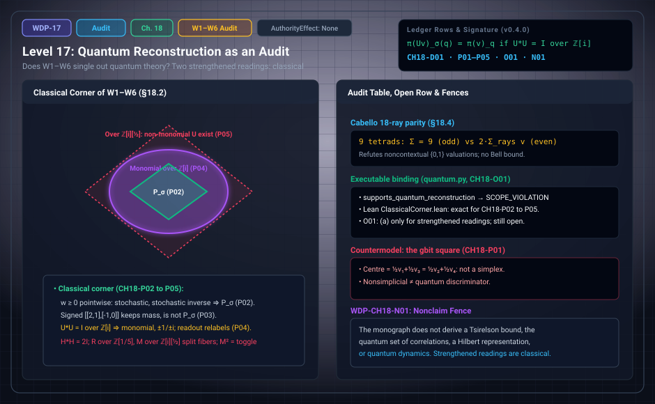

# WDP Level 17: Quantum Reconstruction as an Audit

**AuthorityEffect:** None.  
**Level:** Level 17 (Chapter 18: Quantum Reconstruction as an Audit)  
**Monograph Chapter:** Chapter 18, §18.1–§18.6 (Part IV: Histories and the quantum boundary), *The Witnessed Difference Programme* v0.4.0.  
**Part:** Part IV: Histories and the Quantum Boundary  
**Ledger Rows:** `WDP-CH18-D01` (definition), `WDP-CH18-P01` to `WDP-CH18-P05` (finite propositions), `WDP-CH18-O01` (finite supplement), `WDP-CH18-N01` (nonclaim).  

---

## 1. What this level does

Chapter 18 does not ask whether the notation of earlier chapters resembles
quantum mechanics. It asks whether a stated set of operational principles
singles out complex finite-dimensional quantum theory from a comparison class
that also contains classical and post-quantum models.

It writes down a candidate finite package W1–W6 for the system of Chapters
1–13, proves that two strengthened readings of this package are classical,
audits twelve candidate principles against classical, quantum, and
post-quantum models, and lists the eight external interfaces this route would
still have to import to reach $M_n(\mathbb C)$. For W1–W6 as stated, with
signed weights, Appendix J now proves that a classical report representation exists exactly when every observable block mass is nonnegative.

Version 0.4.0 added the *classical corner* (`WDP-CH18-P02` to `WDP-CH18-P05`),
narrowed the then-open target `WDP-CH18-O01`, corrected principle P3 of the audit table, and rewrote §18.6. Appendix J now resolves the target conditionally by classical representation criteria and reconstruction countermodels; quantum theory is not forced (`WDP-CH18-N01`).

---

## 2. Definitions and results

### 2.1 The candidate package W1–W6 (§18.1)

| Axiom | Content |
| :--- | :--- |
| W1 | Primitive difference carrier: an admitted finite irreflexive witness relation $K=(X,R,\operatorname{Irr}R)$ with witness $d=(a,b,w:R\,a\,b)$. |
| W2 | Presented report carrier $C=(X,Q,\operatorname{pres}:X\to Q)$; two points share a report iff $\operatorname{pres}(x)=\operatorname{pres}(y)$. |
| W3 | Integer or rational weights $w:Q\to\mathbb Z$ (or $\mathbb Q$) with total mass $W=\sum_q w(q)>0$. |
| W4 | Reversible discrete dynamics: updates are bijections $\sigma\in S_Q$ preserving total mass. |
| W5 | The free module $\operatorname{Vec}_K(Q)$ over $\mathbb Z[i]$ (or $\mathbb Z$) with $\langle u,v\rangle=\sum_q\bar u_q v_q$. |
| W6 | The phase-blind quadratic readout $\pi(v)_q=\lvert v_q\rvert^2$. |

W3 asks only that the *total* mass be positive. It does not ask that each weight
be nonnegative, and that gap matters in §2.4. The package is a candidate:
`WDP-CH18-O01` now classifies its signed report representation and shows why the unrestricted observer/measurement packets cannot all be reconstructed as classical joint runs or local Hilbert measurements.

### 2.2 Nonsimpliciality is not a quantum signature (§18.2)

Finite normalized weights mixed convexly form a simplex, and a simplex has
unique decompositions into extreme points. The full density-operator state space
of complex quantum theory is nonsimplicial in Hilbert dimension at least two.
The converse inference fails.

> **`WDP-CH18-P01` — Finite proposition (a finite non-simplex).** The convex set
> with extreme points $v_1=(1,0)$, $v_2=(0,1)$, $v_3=(-1,0)$, $v_4=(0,-1)$ is
> not a simplex: its centre equals both $\tfrac12v_1+\tfrac12v_3$ and
> $\tfrac12v_2+\tfrac12v_4$. A nonsimplicial finite state space therefore exists
> outside quantum theory, and nonsimpliciality alone is not a quantum
> discriminator.

The square with affine effects is the gbit of generalized probabilistic
theories [REF-QM-005], which is not a quantum state space. The centre has the
one-parameter family of decompositions $t(v_1+v_3)+(\tfrac12-t)(v_2+v_4)$,
$t\in[0,\tfrac12]$, while points on an edge still decompose uniquely.

### 2.3 The permutation-isometry representation (§18.2)

Under W1–W4 the monograph states an unnumbered representation theorem. It has
no ledger row of its own. For $\sigma\in S_Q$ define $P_\sigma e_q=e_{\sigma(q)}$.
Then $P_\sigma\in\operatorname{GL}_{|Q|}(\mathbb Z)$ preserves the standard form
$\langle u,v\rangle=u^Tv$, has inverse $P_{\sigma^{-1}}=P_\sigma^T$, and
preserves total mass: $\sum_q(P_\sigma w)_q=W$.

**Scope.** Because W3 admits signed weights such as $w=(2,-1)$ (total mass
$1$), this is a permutation-isometry representation over $\mathbb Z$. It is not
a stochastic realization; that needs pointwise nonnegativity $w(q)\ge0$.

### 2.4 The classical corner (§18.2)

The theorem above *assumes* W4. The next four rows derive W4 from different
premises, show which premise does the work, and locate where the package stops
being classical. All four are mechanized in Lean in
`lean4/WitnessedDifference/ClassicalCorner.lean`, the only module of the Lean
package that imports Mathlib directly.

> **`WDP-CH18-P02` — Finite proposition (nonnegative weights force
> permutations).** Let $Q$ be a finite report carrier and $W>0$ rational, and
> call $w:Q\to\mathbb Q$ a *state of mass $W$* when $w(q)\ge0$ for every $q$ and
> $\sum_q w(q)=W$. A linear update $T$ sends every state of mass $W$ to a state
> of mass $W$ if and only if $T$ is column-stochastic. It has an inverse $S$
> with the same property ($ST=I$) if and only if $T=P_\sigma$ for some
> $\sigma\in S_Q$. Once W3 carries pointwise nonnegativity, the content of W4 is
> a theorem for linear updates that are reversible within the states.

*Why.* $T(We_j)$ shows that column $j$ is nonnegative with sum $1$. If $ST=I$
with both column-stochastic, each off-diagonal entry of $ST$ is a sum of
nonnegative terms, so every term vanishes; since $T$ is square, $TS=I$ too, so
$Te_j$ is a single $e_k$, and $j\mapsto k$ is injective on a finite set.

> **`WDP-CH18-P03` — Finite proposition (signed weights do not force
> permutations).** With the signed weights that W3 admits, total mass and
> invertibility do not force a permutation. The matrices
> $T=\begin{pmatrix}2&1\\-1&0\end{pmatrix}$ and
> $T^{-1}=\begin{pmatrix}0&-1\\1&2\end{pmatrix}$ both preserve $\sum_q w(q)$,
> $T$ is not a permutation matrix, and $T$ sends $(1,0)$ to the signed weight
> $(2,-1)$.

So pointwise nonnegativity is the premise that forces permutations in
`WDP-CH18-P02`.

> **`WDP-CH18-P04` — Finite proposition (unitaries over $\mathbb Z[i]$ are
> monomial).** Let $U$ be a $Q\times Q$ matrix over the Gaussian integers with
> $U^*U=I$. Then there are $\sigma\in S_Q$ and units $u_q\in\{\pm1,\pm i\}$ with
> $Ue_q=u_qe_{\sigma(q)}$. The phase-blind readout of W6 moves by the same
> permutation, $\pi(Uv)_{\sigma(q)}=\pi(v)_q$, and no such $U$ separates two
> vectors with equal readout.

*Why.* The diagonal of $U^*U=I$ gives $\sum_k N(U_{kj})=1$ with
$N(a+bi)=a^2+b^2\in\mathbb Z_{\ge0}$, so each column has exactly one unit entry;
two columns cannot share a row, or an off-diagonal entry of $U^*U$ would be a
product of units.

Along any finite run of such updates the readout is the initial readout
relabelled by one permutation (Lean `gaussian_run_readout`; not a ledger row).
The package is therefore classical under either of **two strengthened
readings**: W3 with pointwise nonnegativity and linear updates reversible within
the states (`WDP-CH18-P02`), or dynamics that preserve the form of W5 over
$\mathbb Z[i]$, read through W6 (`WDP-CH18-P04`). Under either reading every
readout comes from a deterministic reversible model on $Q$, and the phase fiber
of principle P2 in §18.3 is never observed. For W3 as stated, with signed
weights, `WDP-CH18-P03` shows that the first route fails. Over $\mathbb Z$ the
same argument gives the signed permutation matrices (not mechanized).

> **`WDP-CH18-P05` — Finite proposition (where the classical corner ends).** The
> unnormalized Hadamard matrix $H=\begin{pmatrix}1&1\\1&-1\end{pmatrix}$ used for
> interference in §18.3 satisfies $H^*H=2I$. It separates the readout fiber of
> $(1,1)$ and $(1,-1)$, which `WDP-CH18-P04` shows no unitary over
> $\mathbb Z[i]$ can do, so it is not a unitary over $\mathbb Z[i]$. Unitaries
> that separate readout fibers exist over finite localizations of the scalars:
> $R=\tfrac15\begin{pmatrix}3&-4\\4&3\end{pmatrix}$ over $\mathbb Z[\tfrac15]$
> and $M=\tfrac12\begin{pmatrix}1+i&1-i\\1-i&1+i\end{pmatrix}$ over
> $\mathbb Z[i][\tfrac12]$, and $M^2$ is the toggle
> $\begin{pmatrix}0&1\\1&0\end{pmatrix}$. Extending the scalars extends the
> readout of W6 to rational values.

So unitary interference needs neither the continuum field (Import 1) nor the
circle group (Import 2). It needs a non-monomial unitary: none exists over $\mathbb Z[i]$
(`WDP-CH18-P04`), and a finite localization of $\mathbb Z$ or $\mathbb Z[i]$
already has one. The similitude $H$ leaves the classical corner by another
route, since it is not an isometry. The square root $M$ of the toggle also shows
that the missing half-step of principle P11 is missing only among report
permutations. The monograph adds at once that this does not reconstruct
quantum theory: `WDP-CH18-N01` and the eight interfaces of §18.5 stand.

> **`WDP-CH18-O01` — Conditional result (reconstruction classification and obstruction).** Signed report weights have a classical state representation exactly when every observable block mass is nonnegative; signed instrument updates admit a classical report-instrument quotient exactly under the stated fiber-intertwining and stochastic-quotient conditions. The unrestricted witness/observer/measurement class admits accepted PR tables, refuting reconstruction that preserves their declared probabilities together with classical joint runs or bipartite local Hilbert measurement composition. Classical and quantum alternatives require the explicit additional packages in Appendix J; neither is forced by the original packets.

**Status in v0.4.0.** Outcome (a) is proved for the two strengthened readings
of W1–W6 above: nonnegative weights (`WDP-CH18-P02`) and form-preserving
dynamics over $\mathbb Z[i]$ (`WDP-CH18-P04`). It is not proved for W1–W6 as
stated: `WDP-CH18-P03` shows that mass and invertibility alone do not force
permutations. The current conditional result adds the exact nonnegative-block criterion for signed reports and fiber-intertwining/stochastic-quotient criteria for instruments. Accepted PR tables refute the unrestricted reconstruction target. `WDP-CH18-P05` remains a separate finite example.

### 2.5 The reconstruction audit table (§18.3)

> **`WDP-CH18-D01` — Definition (reconstruction audit).** A reconstruction
> audit is a table whose rows are candidate principles and whose columns record
> the principle, its status in the Finite Obstruction Calculus (FOC), its
> formal statement and proved theorem or defect locator, classical models
> satisfying it, quantum models satisfying it, and post-quantum countermodels
> with a conclusion.

§18.3 fills the table for twelve principles across six discriminators: D1
nonclassical geometry, D2 contextuality, D3 composition, D4 probability rule, D5
continuity/reversibility, D6 purification/dilation. The labels P1–P12 and the
fixture names (`H006`, `H010`, `H021`, …) refer to exploratory fixtures in
`code/witnessed_difference/quantum.py` and
`lean4/WitnessedDifference/QuantumImports.lean`. **They are not ledger rows.**
The status column below is quoted from §18.3; the locator is condensed.

| Principle | Status in FOC (§18.3) | Locator, condensed |
| :--- | :--- | :--- |
| P1 Permutation invariance | DERIVED | form-preserving isometry with two-sided inverse; over $\mathbb Z[i]^n$ the isometry envelope is the monomial matrices with entries in $\{\pm1,\pm i\}$ (`WDP-CH18-P04` gives one inclusion; the other is immediate) |
| P2 Superposition fiber | DERIVED | the fiber of the quadratic readout over equal weights carries sign/phase freedom |
| P3 Interference non-descent | DERIVED (only with $H$ admitted) | Hadamard mixing separates equal-weight fiber states; $H^*H=2I$ puts $H$ outside W4; an isometric separator is impossible over $\mathbb Z[i]$ (`WDP-CH18-P04`) and exists over $\mathbb Z[\tfrac15]$ (`WDP-CH18-P05`) |
| P4 Phase group selection | REFUTED (derived); IMPORTED | the sign group $\{\pm1\}$ suffices for interference; $U(1)$ is an explicit import |
| P5 Quadratic Born scaling | DERIVED (discrete; uses $H$) | on $v=(1,1)$, $\lVert Hv\rVert_p^p/\lVert v\rVert_p^p=2^{p-1}$ equals $2$ iff $p=2$; $I_3\equiv0$ in the declared additive-amplitude/quadratic model |
| P6 Gleason uniqueness | REFUTED (host); IMPORTED ($n\ge3$) | a quartic valuation fails frame additivity ($1^4+1^4\ne2^2$, the instance `H013Contract` checks); Gleason's theorem needs the continuum sphere |
| P7 Algebraic non-factorable witness | DERIVED (algebraic) | $\Phi=(1,0,0,1)^T$ has coefficient matrix with determinant $1$, so tensor rank $\ge2$; physical entanglement stays unpaid (§19.2) |
| P8 Tensor uniqueness | REFUTED (forced); IMPORTED | a weaker combining interface admits `dumpRight` $\ne$ `tensorComb` |
| P9 Non-contextuality (KS) | REFUTED (classical); OBSTRUCTED | Cabello 18-ray parity contradiction (§2.6 below) |
| P10 Reversible dilation | DERIVED (census) | with a one-bit prepared ancilla, exactly $2\cdot2=4$ reversible permutations dilate collapse: the two prepared states go to the two states with system value $0$, the other two to the rest; quantum dilation needs imported CPTP structure |
| P11 Continuous dynamics | REFUTED (host); REFUSED | the toggle on $\mathrm{Bool}$ has no report square root (`import7_unforced`); that half-step is missing only among report permutations, since the unitary $M$ of `WDP-CH18-P05` squares to the toggle |
| P12 Finite matrix recovery | DERIVED ($\mathbb Z[i]$) | $\operatorname{End}(Q\to\mathbb Z[i])\cong M_n(\mathbb Z[i])$, a standard fact that the fixture `H017Fin` records as a constant; $M_n(\mathbb C)$ is not recovered |

**v0.4.0 corrections.** P3 used to read DERIVED. Its mixer is the unnormalized
Hadamard matrix, which W4 does not admit, so it now reads DERIVED (only with $H$
admitted), and P5, which uses the same $H$, says so. P1 and P11 were sharpened
as shown.

### 2.6 Contextuality in exact arithmetic (§18.4)

§18.4 cites three contextuality obstructions in exact arithmetic: the
Mermin–Peres square [REF-QM-015], the Peres 33-ray configuration in
$\mathbb Z[\zeta_8]^3$, and the Cabello 18-ray configuration in
$\{-1,0,1\}^4$ [REF-QM-014]. The Cabello argument is a parity count. The 18 rays
form 9 orthogonal tetrads, and each ray lies in exactly 2 of them. A
noncontextual $\{0,1\}$ valuation gives every tetrad sum $1$, so the tetrad sums
add to $9$, which is odd. Counting the same total by rays gives $2\sum v$, which
is even.

The section adds descriptive, unrowed remarks: the frame polytope of such
configurations has non-Bornian vertices, and Gleason's theorem [REF-QM-017]
needs the closed subspaces of a Hilbert space of dimension at least three.

§18.4 states no CHSH value and derives no Bell or Tsirelson bound. Its only
ledger row is the nonclaim `WDP-CH18-N01` (§6 below). The PR-box comparison,
which cites the classical and quantum CHSH bounds as imported references, is
in §19.11 ([Level 18](level_18_exact_rational_bounds.md)).

### 2.7 The eight external interfaces (§18.5)

To reach $M_n(\mathbb C)$, this route exposes eight external interfaces:

1. Import 1: the continuous field $\mathbb C$.
2. Import 2: the continuous circle group $U(1)$.
3. Import 3: the spectral theorem for self-adjoint operators.
4. Import 4: the continuum projection lattice / Gleason geometry ($n\ge3$).
5. Import 5: the unique Hilbert tensor product.
6. Import 6: CPTP channels and unitary Stinespring dilation.
7. Import 7: continuous one-parameter unitary groups / Stone's theorem.
8. Import 8: continuous dual cone completion.

The monograph calls them interfaces exposed by *this specific* constructive
route. It explicitly does not assert that all eight are logically independent
necessities for every axiomatic route. It also notes that the route has steps
outside these interfaces: by `WDP-CH18-P05`, a finite localization of the
scalars such as $\mathbb Z[\tfrac15]$ or $\mathbb Z[i][\tfrac12]$ already admits
unitaries that separate readout fibers. [Level 18](level_18_exact_rational_bounds.md) gives each
interface with its host note and follows the obligations into Chapter 19.

### 2.8 The audit verdict (§18.6)

The finite calculus derives an integer permutation-isometry envelope, a
phase-blind superposition fiber, interference non-descent once the similitude
$H$ is admitted, an algebraic non-factorable tensor-rank witness, and the matrix
algebra $M_n(\mathbb Z[i])$. For the circle group, Hilbert tensor uniqueness,
Gleason uniqueness, CPTP dilations, Lie algebras, and continuous unitary
dynamics it gives one small finite witness each of why the discrete host does
not supply them; reaching them uses the eight exposed interfaces. Under the two
strengthened readings of `WDP-CH18-P02` and `WDP-CH18-P04` the package is
classical, which is outcome (a) of `WDP-CH18-O01` for those readings.

§18.6 restates this in the four-tier ambition taxonomy of §22.4. Tiers 1–2
(syntactic and faithful operational representation) hold in the finite setting.
Tier 3 (reconstruction under explicit principles) requires declared additional packages. The finite classification and PR obstruction are now proved, while the audit does not prove independence or sufficiency of all eight historical imports; under the strengthened readings the package stays inside the classical
monomial $\mathbb Z[i]$ envelope, and the similitude $H$ and a finite
localization of the scalars each leave that envelope without being one of the
eight interfaces. Tier 4 (unique selection from the primitive kernel) is
explicitly refused: the monograph does not claim that textbook continuous
quantum mechanics $M_n(\mathbb C)$ is forced or uniquely selected by primitive
difference, and it proves no theorem that it cannot be (§18.5,
`WDP-CH19-N01`). The import witnesses in `QuantumImports.lean` are one small
finite witness each, not independence proofs.

---

## 3. Worked example: where the classical corner ends (§18.2)

Use the W6 readout $\pi(v)_q=\lvert v_q\rvert^2$. The vectors $(1,1)$ and
$(1,-1)$ share the readout $(1,1)$, and so do $(1,1)$ and $(1,i)$. A matrix
*separates* such a fiber when the two images have different readouts.

1. **Signed shear (`WDP-CH18-P03`).** The column sums of $T$ are $2+(-1)=1$ and
   $1+0=1$; those of $T^{-1}$ are $0+1=1$ and $-1+2=1$. So both preserve total
   mass. $T^{-1}T=I$, $T_{00}=2\notin\{0,1\}$, and $T(1,0)=(2,-1)$.
2. **Hadamard similitude (`WDP-CH18-P05`).** $H^*H$ has diagonal entries
   $1+1=2$ and off-diagonal entries $1-1=0$, so $H^*H=2I$. Then
   $H(1,1)=(2,0)$ with readout $(4,0)$, and $H(1,-1)=(0,2)$ with readout
   $(0,4)$. The fiber is separated, so by `WDP-CH18-P04` $H$ is not a unitary
   over $\mathbb Z[i]$.
3. **Rotation over $\mathbb Z[\tfrac15]$.** $R^TR=\tfrac1{25}\begin{pmatrix}9+16&-12+12\\-12+12&16+9\end{pmatrix}=I$.
   $R(1,1)=(-\tfrac15,\tfrac75)$ with readout $(\tfrac1{25},\tfrac{49}{25})$;
   $R(1,-1)=(\tfrac75,\tfrac15)$ with readout $(\tfrac{49}{25},\tfrac1{25})$.
4. **Mixer over $\mathbb Z[i][\tfrac12]$.** The columns of $M$ are
   $c_1=\tfrac12(1+i,1-i)$ and $c_2=\tfrac12(1-i,1+i)$. Then
   $\langle c_1,c_1\rangle=\tfrac14(2+2)=1$ and
   $\langle c_1,c_2\rangle=\tfrac14\big((1-i)^2+(1+i)^2\big)=\tfrac14(-2i+2i)=0$,
   so $M^*M=I$. $M(1,1)=(1,1)$ with readout $(1,1)$, and
   $M(1,i)=\tfrac12\big((1+i)+(1+i),\,(1-i)+(i-1)\big)=(1+i,0)$ with readout
   $(2,0)$. Finally $M^2$ has diagonal entries
   $\tfrac14\big((1+i)^2+(1-i)^2\big)=\tfrac14(2i-2i)=0$ and off-diagonal entries
   $\tfrac14\cdot2(1+i)(1-i)=1$, so $M^2$ is the toggle.

| Matrix | Scalars | $U^*U$ | Fiber | Readouts after |
| :--- | :--- | :--- | :--- | :--- |
| $H$ | $\mathbb Z$ | $2I$ | $(1,1)$, $(1,-1)$ | $(4,0)$, $(0,4)$ |
| $R$ | $\mathbb Z[\tfrac15]$ | $I$ | $(1,1)$, $(1,-1)$ | $(\tfrac1{25},\tfrac{49}{25})$, $(\tfrac{49}{25},\tfrac1{25})$ |
| $M$ | $\mathbb Z[i][\tfrac12]$ | $I$ | $(1,1)$, $(1,i)$ | $(1,1)$, $(2,0)$ |

The readouts of $R$ and $M$, $H^*H=2I$, and $M^2$ equal to the toggle are the
values stated in §18.2 and in `classical_corner_ends`; for $H$ the Lean
statement records only that the two readouts differ, and $(4,0)$, $(0,4)$ are
this page's arithmetic. Nothing here uses $\mathbb R$ or $\mathbb C$. Each
separating matrix is non-monomial: $H$ is a similitude, while $R$ and $M$ are
isometries once $\tfrac15$ or $\tfrac12$ is adjoined. Extending the scalars makes the W6 readout rational-valued, as the
readouts $\tfrac1{25}$ and $\tfrac{49}{25}$ from $R$ show.

---

## 4. Evidence bindings

Paths are relative to the monograph package
[`000_witnessed_difference_programme/`](../../../../omega_engine_atlas/coda_atlas/F004_papers/001_finite_obstruction_calculus/000_witnessed_difference_programme/).
Lean names are in the namespace `WitnessedDifference`.

| Row | Status | Ledger evidence | Lean | Executable binding | Notebook |
| :--- | :--- | :--- | :--- | :--- | :--- |
| `WDP-CH18-D01` | Definition | P; C | none; `CLAIM_MAP.md` lists it among definition rows without an exact declaration | `code/witnessed_difference/claims.py`, tested by `code/unit_tests/test_claims_figures_notebooks.py` and `code/e2e_tests/test_manifests_and_artifacts.py` | none |
| `WDP-CH18-P01` | Finite proposition | P; C; R | none; prose-only in `CLAIM_MAP.md` | `code/witnessed_difference/state_spaces.py`, tested by `code/unit_tests/test_state_spaces_interference.py`, `code/integration_tests/test_absorbed_finite_propositions.py`, and `code/injection_tests/test_mutation_recovery.py` | none |
| `WDP-CH18-P02` | Finite proposition | P; L:exact | `ClassicalCorner.nonnegative_weights_force_permutations` (exact), bundling `preservesStates_iff_stochastic` and `reversible_iff_permutation` (via `perm_of_stochastic_inverse`); Mathlib's `σ.permMatrix` is the prose's $P_{\sigma^{-1}}$, which does not affect the existential | none | none |
| `WDP-CH18-P03` | Finite proposition | P; L:exact | `ClassicalCorner.signed_weights_break_the_corner` (exact) | none | none |
| `WDP-CH18-P04` | Finite proposition | P; L:exact | `ClassicalCorner.unitary_package_is_classical` (exact), stating with one permutation $\sigma$ the monomial form with entries $1,-1,i,-i$ (`gaussian_unitary_is_monomial`, `gaussian_unit_cases`), the readout moving by that $\sigma$ (`readout_of_monomial`), and fibre preservation; the run statement `gaussian_run_readout` is not a ledger row; the signed-permutation remark over $\mathbb Z$ is prose only | none | none |
| `WDP-CH18-P05` | Finite proposition | P; L:exact | `ClassicalCorner.classical_corner_ends` (exact), bundling `hadamard_similitude`, `hadamard_separates_fibre`, `hadamard_not_unitary`, `pythagorean_rotation_separates_fibre` (over $\mathbb Q$, entries shown to lie in $\tfrac15\mathbb Z$), and `half_mixer_separates_fibre` (over $\mathbb Q(i)$, entries shown to lie in $\tfrac12\mathbb Z[i]$, square shown to be the toggle) | none | none |
| `WDP-CH18-O01` | Conditional result | P; C; N; L:partial (standalone supplement) | partial Lean coverage; see derivation guide | `code/witnessed_difference/reconstruction_classification.py`; native owners in derivation guide | none anchored |
| `WDP-CH18-N01` | Nonclaim | P; C | none | `code/witnessed_difference/quantum.py`, tested by `code/unit_tests/test_quantum_status_receipts.py` | none anchored |

`ClassicalCorner.lean` is the only module that imports Mathlib directly, pinned
at commit `0df444a360eaa60ab8c11dca51a86af692955474`; its axiom reports in
`lean4/axiom_report.txt` stay within `propext`, `Classical.choice`, and
`Quot.sound`. The preservation clauses of §2.3 on every finite carrier are
`ClassicalCorner.permutation_isometry_int`, which `CLAIM_MAP.md` records as a
separate statement mentioned in the prose. The older
`discrete_difference_supports_integer_permutation_isometry` in
`QuantumImports.lean` covers only $Q=\mathrm{Bool}$.

**What the executable bindings check.**

- `state_spaces.py` (`WDP-CH18-P01`): `decompositions_of` enumerates the exact
  decompositions of a point over $\mathbb Q$, and `is_simplex_decomposition_unique`
  reports simpliciality and uniqueness. On `square_state_space()` the tests find
  two disjoint decompositions of the centre and unique ones on edge points. It
  returns `RefusalCode.OUTSIDE_CARRIER` for a point outside the hull,
  `RefusalCode.INVALID_INPUT` for a non-extreme point, and
  `RefusalCode.BUDGET_EXHAUSTED` above ten points.
- `quantum.py` (`WDP-CH18-O01`, `WDP-CH18-N01`): `supports_quantum_reconstruction`
  returns `RefusalCode.SCOPE_VIOLATION` for every `QuantumEvidence` value
  (declared $U(1)$ calculation, classical shadow, finite contextuality witness).
  The module also holds the §18.3 fixtures. Some compute a small instance
  (`InterferenceObstruction.demonstrates_non_descent` checks $H(1,1)=(2,0)$ and
  $H(1,-1)=(0,2)$); `H015_collapse_no_isometry`, `H015CollapseDilations`,
  `H016_no_report_half_step`, and `H017Fin` return recorded constants, as
  Appendix D.2 states.
- `claims.py` (`WDP-CH18-D01`): `load_claim_map` and `validate_claim_map` check
  that the claim-to-code manifest names existing modules and tests. The
  manifest describes the module as a claim-map loader and validator for the
  claim-to-code bindings of the audit; it does not encode the P1–P12 table.
- `WDP-CH18-P02` to `WDP-CH18-P05` have no Python binding; their evidence is the
  Lean module. No notebook is anchored to a CH18 row;
  `070_declared_u1_holonomy.ipynb` calls `supports_quantum_reconstruction`, but
  its anchors are CH05 rows.

---

## 5. Misreadings the chapter rules out

- **"Nonsimpliciality means quantum."** The gbit square is nonsimplicial and is
  not a quantum state space (`WDP-CH18-P01`).
- **"Reversibility is what makes the package quantum-like."** With nonnegative
  weights, reversibility within the states of fixed mass forces a permutation
  (`WDP-CH18-P02`); over $\mathbb Z[i]$ the form-preserving updates are monomial
  (`WDP-CH18-P04`). Either way the readout is only relabelled.
- **"W1–W6 as stated is proved classical."** Only two strengthened readings
  are. Signed weights break the corner (`WDP-CH18-P03`), no classical
  representation is known for them, and the representation of §2.3 is then a
  statement over $\mathbb Z$, not a stochastic realization.
- **"The Hadamard interference of §18.3 happens inside W1–W6."** It does not.
  $H^*H=2I$, so $H$ is a similitude that W4 does not admit; P3 and P5 now say
  "only with $H$ admitted" and "uses $H$".
- **"Unitary interference needs $\mathbb C$ or $U(1)$."** It needs a
  non-monomial unitary, which a finite localization already has
  (`WDP-CH18-P05`). This locates a step; it does not reconstruct quantum theory.
- **"The toggle has no square root."** It has none among report permutations;
  the unitary $M$ over $\mathbb Z[i][\tfrac12]$ squares to it (§18.3, P11).
- **"A contextuality proof or a Bell-type violation identifies quantum
  theory."** §18.4 refutes classical noncontextual valuations on a finite ray
  set and derives no Bell or Tsirelson bound (`WDP-CH18-N01`). By the §21.6
  falsifier, a quantum characterization fails on any nonquantum generalized
  probabilistic theory satisfying its proposed discriminator set.
- **"The P1–P12 fixtures and the import witnesses are theorems of
  independence."** P1–P12 are exploratory fixtures, and §18.5 disclaims the
  independence of the eight imports.

---

## 6. Nonclaims

- **`WDP-CH18-N01`.** This monograph does not derive a Tsirelson bound, the
  quantum set of correlations, a Hilbert representation, or quantum dynamics.

The consolidated list of §21.7 ([Level 20](level_20_finite_adequacy_continuum_limits.md)) adds two related
nonclaims that are not CH18 rows: the monograph does not claim that
contextuality is sufficient for quantum theory (item 13), nor that the calculus
reconstructs quantum mechanics (item 14).

**Current conditional result.**

- **`WDP-CH18-O01`**: signed reports have a classical state representation exactly when their observable block masses are nonnegative. Instrument quotients need the declared fiber and stochastic conditions. Accepted PR tables obstruct unrestricted classical joint-run and local-Hilbert reconstructions; the original packets do not select a quantum package.

---

## 7. Claim discipline

1. **What this level supports:** the finite propositions `WDP-CH18-P01` to
   `WDP-CH18-P05`, of which P02–P05 are mechanized in Lean; outcome (a) of
   `WDP-CH18-O01` for two strengthened readings of W1–W6, the signed-block and instrument quotient classification, and the PR obstruction; and a definition of a
   reconstruction audit with a filled twelve-principle table whose statuses are
   recorded, not promoted.
2. **What it does not support:** any reconstruction of quantum theory, a
   Tsirelson bound, the quantum correlation set, a Hilbert-space
   representation, or dynamics (`WDP-CH18-N01`); a classical representation of
   arbitrary signed W1–W6 when some observable block mass is negative; completeness of a selected quantum package for
   Chapters 10–13; independence of the eight imports; or any claim that
   $\mathbb Z[\tfrac15]$ or $\mathbb Z[i][\tfrac12]$ carries quantum theory.
3. **Narrowest defensible claim:** on a finite report carrier, under either
   strengthened reading (nonnegative rational weights with updates reversible
   within the states, or updates preserving the standard form over
   $\mathbb Z[i]$), the reversible updates relabel the phase-blind readout by
   one permutation. A unitary that separates a readout fiber must be
   non-monomial; none exists over $\mathbb Z[i]$, the unnormalized Hadamard
   matrix separates a fiber only as a similitude, and $\mathbb Z[\tfrac15]$ or
   $\mathbb Z[i][\tfrac12]$ already supplies such a unitary.
**Finite supplement.** These finite targets are answered under the explicit hypotheses in Appendix J. See [the current derivation guide](../derivation_review.md) for complete statements, counterexamples, native ownership and partial Lean coverage.

---

---

## Expert derivation supplement (2026-10-01)

- **CH18-O01 — Conditional result.** Signed report weights have a classical state representation exactly when every observable block mass is nonnegative; signed instrument updates admit a classical report-instrument quotient exactly under the stated fiber-intertwining and stochastic-quotient conditions. The unrestricted witness/observer/measurement class admits accepted PR tables, refuting reconstruction that preserves their declared probabilities together with classical joint runs or bipartite local Hilbert measurement composition. Classical and quantum alternatives require the explicit additional packages in Appendix J; neither is forced by the original packets.

The original 154 identifiers are preserved. The historical Lean census is unchanged; new standalone proofs, native replay and source custody are described in [the derivation guide](../derivation_review.md). Physical interpretation, Born selection and authority remain separate assumptions.

---

## Navigation

- **Previous:** [Level 16: Finite Weighted Histories](level_16_discrete_deformation_dynamics.md)
- **Next:** [Level 18: The Unpaid Quantum Interfaces](level_18_exact_rational_bounds.md)
- **Levels Index:** [README.md](README.md)
