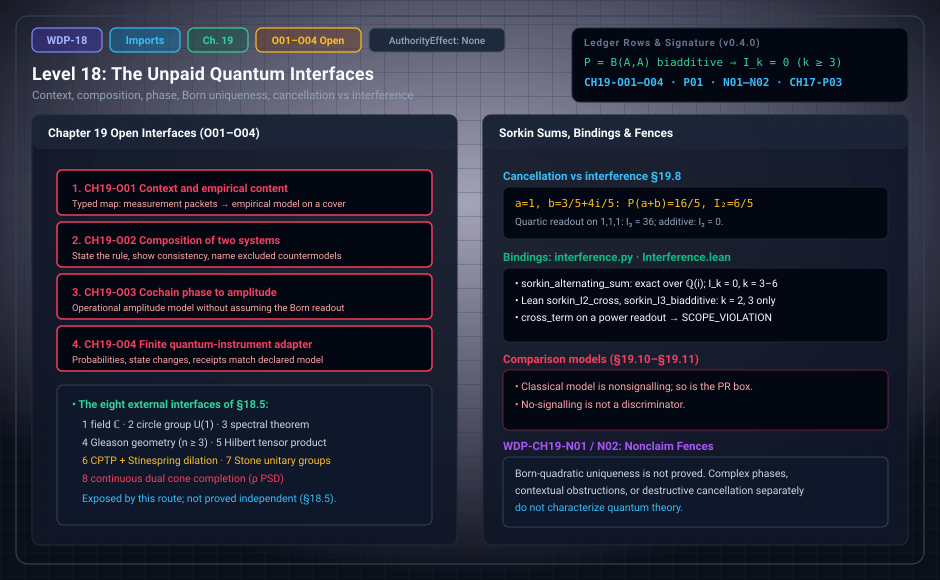

# WDP Level 18: The Unpaid Quantum Interfaces

**AuthorityEffect:** None.  
**Level:** Level 18 (Chapter 19: The Unpaid Quantum Interfaces)  
**Monograph Chapter:** Chapter 19, §19.1–§19.12 (Part IV: Histories and the quantum boundary), *The Witnessed Difference Programme* v0.5.0.  
**Part:** Part IV: Histories and the Quantum Boundary  
**Ledger Rows:** `WDP-CH19-O01` to `WDP-CH19-O03` (conditional results), `WDP-CH19-O04` (finite proposition), `WDP-CH19-P01` (finite proposition), `WDP-CH19-N01` and `WDP-CH19-N02` (nonclaims), and `WDP-CH17-P03` (finite proposition; its ID says Chapter 17, but its canonical location is §19.7).  

---

## 1. What this level does

[Level 17](level_17_semiring_coarse_graining.md) ended with a verdict: two strengthened readings of W1–W6
are classical, and the route to $M_n(\mathbb C)$ exposes eight external
interfaces.
Chapter 19 states what the remaining steps would have to supply, topic by
topic: empirical content, composition, continuity, phase, and Born uniqueness.
It adds a typing example, a coarse-graining rule, a vocabulary repair that
separates cancellation from interference, an audit matrix, comparison models,
and a specification for a quantum measurement adapter.

Nothing is paid here without declared hypotheses. The historical open interface
placeholders have been completed as three explicit conditional results
(`WDP-CH19-O01` to `O03`) and one finite proposition (`WDP-CH19-O04`),
accompanied by two nonclaims and two standalone finite propositions (`WDP-CH17-P03`
and `WDP-CH19-P01`). The Sorkin identity `WDP-CH19-P01` shows that a quantum-looking
property follows from a readout that was declared, not derived.

---

## 2. Definitions and results

### 2.1 The eight external interfaces (§18.5)

The monograph's term is *external interfaces*; §18.5 numbers them as imports,
and the title of Chapter 19 calls them unpaid. They are exposed by this
specific route. §18.5 explicitly does not assert that all eight are logically
independent necessities for every axiomatic route.

| # | Interface (§18.5) | What it supplies | Host note in §18.5 |
| :---: | :--- | :--- | :--- |
| 1 | The continuous field $\mathbb C$ | Cauchy completeness, archimedean topology, algebraic closure | refused on the discrete host, which uses $\mathbb Z[i]$ |
| 2 | The continuous circle group $U(1)$ | connected Lie group phase symmetries | refused; discrete interference selects only $\{\pm1\}$ |
| 3 | The spectral theorem for self-adjoint operators | orthonormal eigenbases | refused; Hermitian matrices over $\mathbb Z[i]$ need not have eigenvalues in $\mathbb Z[i]$ |
| 4 | The continuum projection lattice / Gleason geometry ($n\ge3$) | frame additivity over all orthonormal bases of $\mathbb C^n$ | Gleason's theorem [REF-QM-017] uses the continuum; on finite exact ray configurations non-Bornian vertices persist |
| 5 | The unique Hilbert tensor product | $\mathcal H_A\otimes\mathcal H_B$ and its universal bilinear property | injective composite tagging excludes `dumpRight` but does not force the Hilbert tensor product |
| 6 | CPTP channels and unitary Stinespring dilation | CPTP structure and complex unitary rotations on an enlarged system | finite channels admit finite ancillas, $r\le d_Ad_B$ [REF-QM-016]; the carrier gives only a finite permutation census |
| 7 | Continuous one-parameter unitary groups / Stone's theorem | time evolution $e^{-iHt}$, $t\in\mathbb R$ [REF-QM-019] | refused; discrete dynamics uses integer steps $\tau\in\mathbb Z$ |
| 8 | Continuous dual cone completion | restriction of state valuations to $\rho\succeq0$ | recorded as checked externally by exact rational linear programming |

§18.5 adds that the route also has steps outside these interfaces: a finite
localization of the scalars, such as $\mathbb Z[\tfrac15]$ or
$\mathbb Z[i][\tfrac12]$, already admits unitaries that separate readout fibers
(`WDP-CH18-P05`). Chapter 19 does not number its sections by import. Where a
section clearly takes up one interface, the subsections below say so.

### 2.2 Context and empirical content (§19.1)

The existence of cochains does not select a family of contexts. An empirical
contextuality model needs measurements, outcome sets, compatible probability
distributions, and a cover. Chapter 13 ([Level 12](level_12_context_interference_state_spaces.md)) supplies a
general finite measurement packet; a quantum scenario needs a specialized
adapter into effects and instruments.

> **`WDP-CH19-O01` — Conditional result (arbitrary-cover repair and sampling).** For any declared finite cover and nonempty rational run tables, the minimax context $L^1$ distance to the compatible polytope is the optimum of the exact standard-form LP in Appendix J, with independently verified primal/dual certificates. Under declared within-context iid categorical trials and compatible population marginals, the trial counts give explicit finite-sample pair tolerances and a union-bound failure probability. The empirical image retains only the previously stated outcome information.

### 2.3 Composition (§19.2)

Two systems need a rule for the states, effects, and transformations of the
composite. The Cartesian product, the tensor product, the minimal and maximal
ordered tensor products, and constrained subspaces give different theories.
Primitive difference does not choose among them. Compare Import 5; principle
P7 of the §18.3 audit points here for the composite structure that physical
entanglement would need.

> **`WDP-CH19-O02` — Conditional result (paid quantum composition).** Declaring positive finite Hilbert density states, local Hermitian dichotomic observables and trace pairing on the tensor composite gives the exact CHSH bound $S^2\le8$, excluding PR. Commuting complete local matrix units yield the tensor-factor representation up to a multiplicity space, removed by the stated dimension condition. The native instrument and observer adapters exhibit consistency with the finite architecture. These assumptions are inputs; CP alone does not supply them.

### 2.4 Continuity and reversible dynamics (§19.3)

A finite carrier supports continuous parameter groups only after a real or
complex topological vector space is declared; a finite set by itself carries
only the discrete topology. Continuous reversible transformations are therefore
substantial inputs, not consequences of having finitely many witness types
(compare Import 7). A related discrete point from §18.3 (P11): the toggle on
$\mathrm{Bool}$ has no square root among report permutations, but the unitary
$M$ of `WDP-CH18-P05` over $\mathbb Z[i][\tfrac12]$ squares to it. This section
has no ledger row.

### 2.5 Phase and interference (§19.4)

The complex semiring permits cancellation, and a $U(1)$ connection permits loop
phase. Neither supplies the operational rule that connects amplitude to
observed frequency. Conversely, positive finite probability does not supply
phase. A valid bridge must specify six things: the amplitude carrier; the
composition or addition of alternatives; the transformation law; the
measurement/effect pairing; the probability readout; and the empirical
interpretation.

> **`WDP-CH19-O03` — Conditional result (phase and operational readout bridge).** A declared continuous character $\chi_\theta(t)=e^{i\theta t}$ maps real cochains into complex path amplitudes and descends under gauge to phase-blind operational readouts; its cycle-period lattice and anchor dependence are explicit. An independent exact rational-turn/cyclotomic branch is implemented. Declared effect/instrument pairing supplies a conditional operational model, while normalized quadratic and quartic readouts prove nonselection by phase invariance. No Born rule or faithful real phase embedding is inferred.

Chapter 5 is [Level 04](level_04_boundary_separation_contraction.md). Compare Import 2.

### 2.6 Born uniqueness (§19.5)

Chapter 9 ([Level 08](level_08_discrete_observer_layer.md)) establishes only nonselection by
normalization. Gleason-type theorems [REF-PROB-002] begin with a Hilbert space
and noncontextual probability assignments of a specified kind; operational
reconstructions begin with other strong axioms. Both are legitimate routes when
their assumptions are visible. Neither can be described after the fact as a
consequence of finite witness mass. The section closes with the two nonclaims
`WDP-CH19-N01` and `WDP-CH19-N02` (§6 below).

### 2.7 A small curved-bicomplex example (§19.6)

Take $C^{0,0}=C^{1,0}=C^{0,1}=C^{1,1}=\mathbb R$ with scalar maps
$x\mapsto ax$ into $C^{1,0}$, $x\mapsto bx$ into $C^{0,1}$, and multiplication by
$c$ and by $d$ from those into $C^{1,1}$. With the chosen sign convention the
mixed defect is $\Lambda(x)=(db+ca)x$. Anticommutation $db+ca=0$ is a
nontrivial condition; if it fails, calling the square a double complex is
false. A homotopy $h$ needs a declared degree and an identity such as
$\Lambda=dh+hd$ in a surrounding complex (there $d$ is the differential, not the
scalar); the scalar $db+ca$ does not manufacture it. No ledger row.

### 2.8 Coarse-graining histories (§19.7)

Let $\pi:\Omega\to\bar\Omega$ group fine histories into coarse classes, with
coarse weight $\bar w(\bar p)=\bigoplus_{p:\pi(p)=\bar p}w(p)$. By associativity
and commutativity of $\oplus$ on finite fibers, this keeps the total aggregate.
It may fail to keep composition: two fine histories in one coarse class can
compose with a third history into different coarse classes. A compositional
coarse model needs $\pi$ to be a congruence for the path product, or needs the
coarse carrier to retain extra memory.

> **`WDP-CH17-P03` — Finite proposition (aggregate-preserving pushforward).**
> For a finite history family and a commutative additive operation,
> $\bigoplus_{\bar p\in\bar\Omega}\bar w(\bar p)=\bigoplus_{p\in\Omega}w(p)$.

The proof is a finite reindexing. It does not prove Markovianity, decoherence,
or consistent histories.

### 2.9 Destructive cancellation versus operational interference (§19.8)

Two complex-weighted paths contribute $z_1$ and $z_2$. Their aggregate
amplitude is $z_1+z_2$, and a *separately declared* quadratic readout gives

$$
\lvert z_1+z_2\rvert^2=\lvert z_1\rvert^2+\lvert z_2\rvert^2+2\operatorname{Re}(z_1\overline{z_2}).
$$

If each path is first converted to a positive weight and then added, the cross
term is absent. That is why positive witness mass and complex amplitude are
different layers. The identity does not say which alternatives are physically
coherent, which phases occur, or why the quadratic readout is a probability.

The chapter therefore fixes a vocabulary. **Cancellation** is an algebraic sum
that vanishes. **Interference** is reserved for a model that contains
alternatives, phase-sensitive addition, and an operational readout. This keeps
the zerosumfree theorem of Chapter 17 ([Level 16](level_16_discrete_deformation_dynamics.md)) from passing as a
quantum theorem.

For alternatives with amplitudes $a_j$ and a subset $S$, put
$A(S)=\sum_{j\in S}a_j$ and, for $\lvert S\rvert=k$,

$$
I_k(S)=\sum_{T\subseteq S}(-1)^{\lvert S\rvert-\lvert T\rvert}P(T).
$$

> **`WDP-CH19-P01` — Finite proposition (Sorkin sums under a quadratic
> readout).** If the amplitudes of finitely many alternatives add and the
> readout is $P(S)=B(A(S),A(S))$ for a declared biadditive $B$, then the
> alternating sum $I_k$ vanishes for every set of $k\ge3$ alternatives, while
> $I_2$ equals $B(a,b)+B(b,a)$ and can be nonzero. Vanishing higher-order
> interference is therefore a consequence of the declared quadratic readout and
> not a derivation of it.

*Why.* By biadditivity $P(T)=\sum_{i,j\in T}B(a_i,a_j)$. The coefficient of
$B(a_i,a_j)$ in $I_k(S)$ is $\sum_{\{i,j\}\subseteq T\subseteq S}(-1)^{\lvert S\rvert-\lvert T\rvert}$,
which is zero whenever $S\setminus\{i,j\}$ is nonempty, that is, whenever
$k\ge3$. For $k=2$ only the cross terms survive.

Two remarks from §19.8 fix the scope. Commutativity of the coefficients is not
used, so the identity also holds for matrix amplitudes with the
conjugate-transpose readout. And $I_3=0$ does not distinguish quantum from
classical models, because the additive readout satisfies it too [REF-QM-018].

### 2.10 Reconstruction audit matrix (§19.9)

"Declared" means the structure can be added consistently in an optional host.
It does not mean the root selects it.

| Feature | Root finite calculus | Optional carrier | Reconstruction obligation |
| :--- | :--- | :--- | :--- |
| finite state/evidence sets | available | available | specify operational interpretation |
| convex mixtures | not intrinsic | declarable | justify mixing and normalization |
| non-simplex state space | absent | declarable | prove from operational principles |
| effects/instruments | absent | declarable | connect to measurement packets |
| complex Hilbert space | absent | declared in Ch. 5 | show why real/classical alternatives fail |
| $U(1)$ phase | absent | declared | connect phase to operational alternatives |
| tensor composition | absent | not fixed | state product rule and locality axiom |
| contextual empirical model | absent | possible | supply cover, outcomes, distributions |
| continuous reversible dynamics | absent | possible | supply topology/group and derive relevance |
| purification | absent | possible | state exact axiom and countermodels |
| Born rule | absent | not selected | prove under named assumptions |
| Tsirelson bound | absent | conditional | exact CHSH bound $S^2\le8$ derived under tensor composite (`WDP-CH19-O02`) |

If every structure constructed before the optional branch has a faithful
simplex model, no quantum conclusion follows at that stage. The verdict is not
that quantum theory is false but that the current premises underdetermine it.
§19.9 also restates the four-tier taxonomy. Tier 4 is refused as an ambition
for quantum theory: the monograph does not claim that primitive difference
forces complex Hilbert spaces, Gleason frame uniqueness, or the Born rule, and
the finite import witnesses of Appendix D are not proofs that no derivation
could (`WDP-CH19-N01`; [Level 17](level_17_semiring_coarse_graining.md)).

### 2.11 Classical and post-quantum comparisons (§19.10–§19.11)

**Classical model.** Hidden states form a finite set $\Lambda$; states are
distributions $p\in\Delta(\Lambda)$, effects are $e:\Lambda\to[0,1]$,
transformations are stochastic matrices, and
$\Pr(e\mid p)=\sum_{\lambda}e(\lambda)p(\lambda)$. It supports finite
probability, observers with coarse presentation maps, memory, stochastic
instruments, and measurement receipts, and its state space is a simplex. A
proposed quantum principle should be tested here first; if it passes, it is too
weak or belongs to a shared operational foundation. No-signalling is shared:
with the Cartesian composite outcome set and product effects, summing a local
partition of unity on one side returns the other side's marginals.

**Post-quantum model.** A nonsignalling PR-box fixture can exceed the classical
and quantum CHSH bounds [REF-QM-009; REF-QM-010]. So nonlocality or
contextuality beyond a classical model does not identify quantum theory. The
fixture should be stated operationally (inputs, outputs, conditional
probabilities, normalization, nonsignalling equalities, correlation value), and
"strong contextuality" should not be invoked without its formal definition. While
Chapter 18 stated no numeric CHSH values (`WDP-CH18-N01`), Chapter 19 explicitly
evaluates the classical CHSH bound ($S\le2$), the PR box ($S=4$), and the
quantum Tsirelson bound ($S^2\le8$) in `WDP-CH19-P05` and `WDP-CH19-O02`.

### 2.12 Quantum measurement adapter (§19.12)

With the optional Hilbert carrier, a finite quantum instrument is a family of
completely positive maps indexed by outcomes whose sum is trace preserving
[REF-MET-006; REF-MET-007]. It would fill the measurement packet's interaction,
registration, witness, value map, state change, calibration/uncertainty,
traceability, and provenance fields. This is an adapter specification, not a
derivation of instruments. A POVM alone gives outcome probabilities but not, in
general, the conditional state change, calibration history, uncertainty budget,
or authority rule.

> **`WDP-CH19-O04` — Finite proposition (complete finite instrument replay).** Grouped finite Gaussian-rational Kraus instruments preserve their declared probabilities, post-states and canonical dilation. On a common input/output carrier, outcome repeatability is equivalent to $K_{jb}K_{oa}=0$ for every $j\ne o,a,b$. Independent replay checks the complete registration, witness, accepted observation, indication, calibration enclosure and declared documentary hierarchy against actual inputs. Documentary traceability does not authenticate a physical standard or select the Born readout.

---

## 3. Worked example: Sorkin sums under declared readouts (§19.8)

Take two alternatives with amplitudes $a=1$ and $b=\tfrac35+\tfrac45i$, and the
declared readout $B(x,y)=x\overline y$, so $P(S)=\lvert A(S)\rvert^2$.

1. **Single alternatives.** $P(a)=1$ and $P(b)=\tfrac9{25}+\tfrac{16}{25}=1$.
2. **Both together.** $a+b=\tfrac85+\tfrac45i$, so
   $P(a+b)=\tfrac{64}{25}+\tfrac{16}{25}=\tfrac{80}{25}=\tfrac{16}5$.
3. **Second-order sum.** With $P(\emptyset)=0$,
   $I_2=P(a+b)-P(a)-P(b)+P(\emptyset)=\tfrac{16}5-2=\tfrac65$. This matches
   $B(a,b)+B(b,a)=2\operatorname{Re}(a\bar b)=2\cdot\tfrac35=\tfrac65$.
4. **Not a probability.** The value exceeds $1$ because the readout is an
   unnormalized intensity, not a probability.
5. **Quartic contrast.** For the readout $\lvert A\rvert^4$ and three
   amplitudes equal to $1$, a set of size $m$ has $P=m^4$, so
   $I_3=81-3\cdot16+3\cdot1-0=36$. The quartic readout is not biadditive, and
   the third-order sum does not vanish.
6. **Additive contrast.** For the additive readout
   $P(T)=\sum_{j\in T}\lvert a_j\rvert^2$ the cross term is absent and
   $I_2=(1+1)-1-1=0$.

An extra check, not in the monograph: add $c=i$ under the quadratic readout.
Then $P(a+b+c)=\lvert\tfrac85+\tfrac95i\rvert^2=\tfrac{29}5$,
$P(a+c)=\lvert1+i\rvert^2=2$, $P(b+c)=\lvert\tfrac35+\tfrac95i\rvert^2=\tfrac{18}5$,
and $I_3=\tfrac{29}5-\tfrac{16}5-2-\tfrac{18}5+1+1+1-0=0$, as `WDP-CH19-P01`
requires.

Steps 1–6 are the values of §19.8. The unit tests of `interference.py` check
$I_2=\tfrac65$, $I_3=36$ for the quartic readout, and $I_2=0$ for the additive
readout (section 4); the three-alternative check with $c=i$ is not one of their
fixtures.

---

## 4. Evidence bindings

Paths are relative to the monograph package
[`000_witnessed_difference_programme/`](../../../../omega_engine_atlas/coda_atlas/F004_papers/001_finite_obstruction_calculus/000_witnessed_difference_programme/).
Lean names are in the namespace `WitnessedDifference`.

| Row | Status | Ledger evidence | Lean | Executable binding | Notebook |
| :--- | :--- | :--- | :--- | :--- | :--- |
| `WDP-CH17-P03` | Finite proposition | P | none; prose-only in `CLAIM_MAP.md` | none | none |
| `WDP-CH19-O01` | Conditional result | P; C; N; L:partial (standalone supplement) | partial Lean coverage; see derivation guide | `code/witnessed_difference/empirical_repair.py`; native owners in derivation guide | none |
| `WDP-CH19-P01` | Finite proposition | P; C; R | narrower than the row: `Interference.sorkin_I2_cross` and `Interference.sorkin_I3_biadditive` prove the identity for two and three alternatives only, for a $\mathbb Q$-valued biadditive readout (so the complex readout of §19.8 is outside them), without the empty-set term | `code/witnessed_difference/interference.py`, tested by `code/unit_tests/test_state_spaces_interference.py`, `code/integration_tests/test_absorbed_finite_propositions.py`, and `code/injection_tests/test_mutation_recovery.py` | none |
| `WDP-CH19-O02` | Conditional result | P; C; N; L:partial (standalone supplement) | partial Lean coverage; see derivation guide | `code/witnessed_difference/reconstruction_classification.py`; native owners in derivation guide | none |
| `WDP-CH19-O03` | Conditional result | P; C; N; L:partial (standalone supplement) | partial Lean coverage; see derivation guide | `code/witnessed_difference/rational_phase_witness.py`; native owners in derivation guide | none |
| `WDP-CH19-N01` | Nonclaim | P | none | none | none |
| `WDP-CH19-N02` | Nonclaim | P; C | none | `code/witnessed_difference/quantum.py`, tested by `code/unit_tests/test_quantum_status_receipts.py` and `code/injection_tests/test_mutation_recovery.py` | none |
| `WDP-CH19-O04` | Finite proposition | P; C; N; L:partial (standalone supplement) | partial Lean coverage; see derivation guide | `code/witnessed_difference/quantum_measurement_replay.py`; native owners in derivation guide | none |

**What the executable bindings check.**

- `interference.py` (`WDP-CH19-P01`): `sorkin_alternating_sum` computes
  $I_{\lvert S\rvert}(S)$ exactly over $\mathbb Q(i)$, empty-set term included,
  for `quadratic_readout()`, `bilinear_readout(form)` (a rational form on real
  and imaginary parts), `power_readout(q)`, and `additive_readout()`. Its
  quadratic form is $B(x,y)=\operatorname{Re}(x\bar y)$, the real part of the
  monograph's $x\bar y$, with the same $P$ and $I_2$. `cross_term` returns
  $B(a,b)+B(b,a)$ for quadratic and bilinear readouts and
  `RefusalCode.SCOPE_VIOLATION` for power and additive ones. The tests check
  $I_2=\tfrac65$ on the §19.8 instance, $I_k=0$ for $k=3$ to $6$ on seeded
  instances, $I_3=36$ (quartic), and $I_2=0$ (additive). Refusals:
  `INVALID_INPUT` for malformed input, `OUTSIDE_CARRIER` for an undeclared
  alternative, `BUDGET_EXHAUSTED` beyond twelve alternatives, and
  `NON_UNIT_PHASE` from `unit_amplitude`. Amplitudes are scalar only.
- `quantum.py` (`WDP-CH19-O03`, `WDP-CH19-N02`): `fixed_scale_phase(value,
  scale)` returns `RefusalCode.INVALID_INPUT` when the scale is zero or not
  finite, and `supports_quantum_reconstruction` returns
  `RefusalCode.SCOPE_VIOLATION` for every `QuantumEvidence` value. The mutation
  suite checks that a classical shadow is still refused. No function builds an
  amplitude model, so `WDP-CH19-O03` stays open.

**What `QuantumImports.lean` proves for each import.** The eight theorems
`import1_unforced` to `import8_unforced`, conjoined in
`quantum_reconstruction_boundary`, are one small finite witness per interface.
§18.6, Appendix D, and `CLAIM_MAP.md` say they illustrate why the discrete host
does not supply each import and are not independence proofs.

| Import | Finite witness |
| :---: | :--- |
| 1 | no integer $x$ has $x^2+1=0$ |
| 2 | two signs $s_1,s_2\in\{\pm1\}$ with $s_1+s_2=0$ and $s_1+s_1\ne0$ |
| 3 | the matrix units $E_{01}$, $E_{10}$ do not commute, while diagonal integer matrices do |
| 4 | the quartic valuation is nonnegative with $2^4\ne2\cdot2$ |
| 5 | the direct sum $\mathrm{Bool}\sqcup\mathrm{Bool}$ splits and rejoins every weight, an alternative composition rule |
| 6 | no inner-product-preserving map sends both basis vectors of $\mathbb Z^2$ to the first |
| 7 | no map $\sigma$ on $\mathrm{Bool}$ has $\sigma\circ\sigma$ equal to the toggle (a unitary over $\mathbb Z[i][\tfrac12]$ does, by `WDP-CH18-P05`) |
| 8 | a natural-number count on $\mathrm{Bool}$ with total $1$ is one of the two point masses |

---

## 5. Misreadings the chapter rules out

- **"The finite calculus already fixes contexts, composition, or continuity."**
  Cochains do not select contexts (§19.1), primitive difference chooses no
  composition rule (§19.2), and continuity needs a declared topological vector
  space (§19.3).
- **"Phase or normalization gives the Born rule."** A $U(1)$ connection
  supplies no amplitude-to-frequency rule (§19.4), and Chapter 9 gives only
  nonselection (`WDP-CH19-N01`).
- **"A square of maps is a double complex."** Only if $db+ca=0$ holds; a
  homotopy must be specified, not inferred (§19.6).
- **"Coarse-graining keeps the dynamics."** It keeps the total aggregate
  (`WDP-CH17-P03`), not composition, and proves nothing about Markovianity,
  decoherence, or consistent histories (§19.7).
- **"Cancellation is interference."** A vanishing sum is cancellation;
  interference needs alternatives, phase-sensitive addition, and an
  operational readout (§19.8).
- **"$I_3=0$ is a quantum signature, or derives the quadratic rule."** It
  follows from a declared biadditive readout, and the additive readout
  satisfies it too (`WDP-CH19-P01`).
- **"$I_2=\tfrac65$ is a probability."** It is an intensity above $1$; the
  change log records this as a correction to an absorbed source paper.
- **"No-signalling or a CHSH violation identifies quantum theory."** The
  classical model is nonsignalling and so is the PR box (§19.10–§19.11).
- **"A POVM is the measurement."** It omits the state change, calibration
  history, uncertainty budget, and authority rule (§19.12).

---

## 6. Nonclaims

- **`WDP-CH19-N01`.** Born-quadratic uniqueness is not proved.
- **`WDP-CH19-N02`.** Complex phases, contextual obstructions, or destructive
  cancellation separately do not characterize quantum theory.

**Derivation supplement rows.**

- **`WDP-CH19-O01`** (conditional result): arbitrary-cover repair and sampling; minimax context $L^1$ LP (§2.2).
- **`WDP-CH19-O02`** (conditional result): paid quantum composition; exact Tsirelson bound $S^2\le8$ under tensor composite (§2.3).
- **`WDP-CH19-O03`** (conditional result): continuous character/cyclotomic bridge and nonselection by phase invariance (§2.5).
- **`WDP-CH19-O04`** (finite proposition): grouped Kraus instrument replay, dilation, and repeatability condition $K_{jb}K_{oa}=0$ (§2.12).

All four are completed with explicit conditional hypotheses or finite propositions, backed by executable Python models, Rust crates, and partial Lean coverage (see §4).

---

## 7. Claim discipline

1. **What this level supports:** an itemized account of what a reconstruction
   along this route would still have to supply; the finite identity
   `WDP-CH19-P01`; the aggregate-preserving pushforward `WDP-CH17-P03`;
   classical and post-quantum models on which a proposed discriminator can be
   tested; and conditional bounds ($S^2\le8$) under declared tensor/Hilbert hypotheses.
2. **What it does not support:** that any interface is paid from Primitive
   Difference alone; Born-quadratic uniqueness (`WDP-CH19-N01`); that phase,
   contextuality, or cancellation alone characterizes quantum theory
   (`WDP-CH19-N02`); unconditional quantum mechanics without declared composite
   and Hilbert-space data; or any dynamical claim from coarse-graining.
3. **Narrowest defensible claim:** if the amplitudes of finitely many
   alternatives add and the readout is $P(S)=B(A(S),A(S))$ for a declared
   biadditive $B$, then $I_k=0$ for every $k\ge3$ and $I_2=B(a,b)+B(b,a)$. The
   quadratic readout is an input to this statement, not an output.
**Finite supplement.** These finite targets are answered under the explicit hypotheses in Appendix J. See [the current derivation guide](../derivation_review.md) for complete statements, counterexamples, native ownership and partial Lean coverage.

---

---

## Current finite derivation and Rust integration

The native instrument owner now supports arbitrary finite input/output dimensions and multiple grouped Kraus operators per outcome. Its canonical isometry and outcome-resolved partial trace recover each CP map. WDP receipt replay binds the actual state and ordered instrument. A dimension-three countermodel gives identical POVMs with different state changes. Outcome repeatability is verified by the exact condition $K_{jb}K_{oa}=0$ for every $j\ne o,a,b$ in WDP-CH19-O04.

See Appendix I and [the derivation guide](../derivation_review.md) for exact
claim statuses, test results and the runnable Rust example.

## Expert derivation supplement (2026-10-01)

- **CH19-O01 — Conditional result.** For any declared finite cover and nonempty rational run tables, the minimax context $L^1$ distance to the compatible polytope is the optimum of the exact standard-form LP in Appendix J, with independently verified primal/dual certificates. Under declared within-context iid categorical trials and compatible population marginals, the trial counts give explicit finite-sample pair tolerances and a union-bound failure probability. The empirical image retains only the previously stated outcome information.
- **CH19-O02 — Conditional result.** Declaring positive finite Hilbert density states, local Hermitian dichotomic observables and trace pairing on the tensor composite gives the exact CHSH bound $S^2\le8$, excluding PR. Commuting complete local matrix units yield the tensor-factor representation up to a multiplicity space, removed by the stated dimension condition. The native instrument and observer adapters exhibit consistency with the finite architecture. These assumptions are inputs; CP alone does not supply them.
- **CH19-O03 — Conditional result.** A declared continuous character $\chi_\theta(t)=e^{i\theta t}$ maps real cochains into complex path amplitudes and descends under gauge to phase-blind operational readouts; its cycle-period lattice and anchor dependence are explicit. An independent exact rational-turn/cyclotomic branch is implemented. Declared effect/instrument pairing supplies a conditional operational model, while normalized quadratic and quartic readouts prove nonselection by phase invariance. No Born rule or faithful real phase embedding is inferred.
- **CH19-O04 — Finite proposition.** Grouped finite Gaussian-rational Kraus instruments preserve their declared probabilities, post-states and canonical dilation. On a common input/output carrier, outcome repeatability is equivalent to $K_{jb}K_{oa}=0$ for every $j\ne o,a,b$. Independent replay checks the complete registration, witness, accepted observation, indication, calibration enclosure and declared documentary hierarchy against actual inputs. Documentary traceability does not authenticate a physical standard or select the Born readout.

The original 154 identifiers are preserved. The historical Lean census is unchanged; new standalone proofs, native replay and source custody are described in [the derivation guide](../derivation_review.md). Physical interpretation, Born selection and authority remain separate assumptions.

---

## Navigation

- **Previous:** [Level 17: Quantum Reconstruction as an Audit](level_17_semiring_coarse_graining.md)
- **Next:** [Level 19: Relative Completeness for Observer-Indexed Presentations](level_19_quantum_reconstruction_audit.md)
- **Levels Index:** [README.md](README.md)
