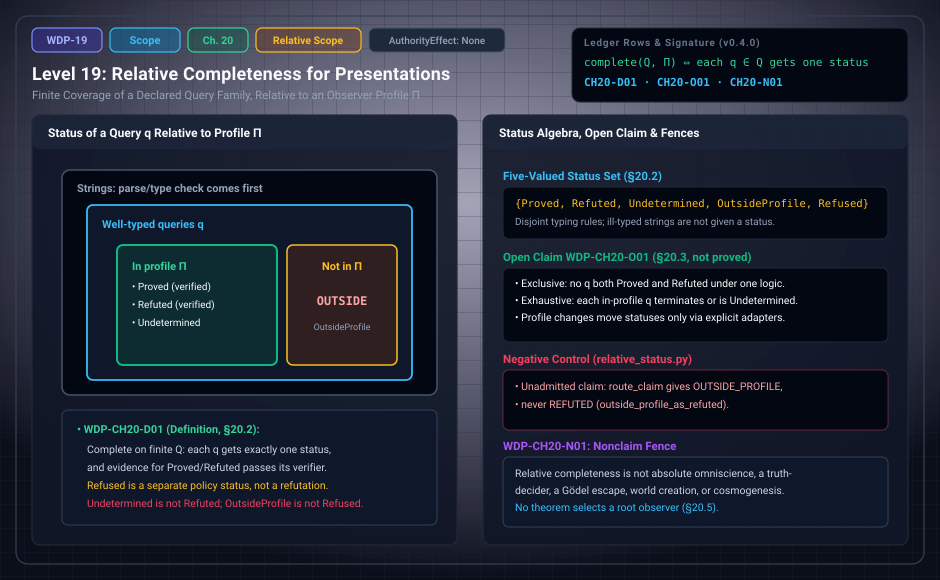

# WDP Level 19: Relative Completeness for Observer-Indexed Presentations

**AuthorityEffect:** None.  
**Level:** Level 19 (Chapter 20: Relative Completeness for Observer-Indexed Presentations)  
**Monograph Chapter:** Chapter 20, §20.1–§20.5 (Part V: Relative scope and the open programme), *The Witnessed Difference Programme* v0.5.0.  
**Part:** Part V: Relative Scope and the Open Programme  
**Ledger Rows:** `WDP-CH20-D01` (definition), `WDP-CH20-O01` (finite proposition), `WDP-CH20-N01` (nonclaim).  

---

## 1. What this level does

An earlier source paper was titled "witness-relative cosmogenesis". Its formal
content did not match the title: it concerned the status of a query relative to
a finite observer profile. Chapter 20 keeps that content and drops the title
(Appendix C records the source as "retitled and narrowed into Chapter 20").

The chapter does four things. It fixes what an observer profile $\Pi$ contains.
It gives a five-element status set with disjoint typing rules. It defines
completeness relative to $\Pi$ as a finite coverage property. And it records
what is still missing: a proof that some evaluator's rules are exclusive and
exhaustive, transport of statuses between profiles, and any theorem selecting a
root observer.

---

## 2. Definitions and results

### 2.1 From "cosmogenesis" to a defensible target (§20.1)

An observer profile $\Pi$ contains:

1. a grammar of admissible queries;
2. an input domain;
3. a presentation map;
4. an evaluator;
5. a resource bound;
6. a policy.

For a query $q$, a status is defined only after two checks: $q$ is well typed,
and $q$ is within the profile.

### 2.2 The status algebra (§20.2)

The monograph proposes a finite status set with **five** values:

$$
\mathsf{Status}_{\Pi}=
\{\mathsf{Proved},\mathsf{Refuted},\mathsf{Undetermined},
\mathsf{OutsideProfile},\mathsf{Refused}\}.
$$

| Status | Typing rule |
| :--- | :--- |
| `Proved` | a declared proof/evidence predicate is satisfied |
| `Refuted` | a declared counterevidence predicate is satisfied |
| `Undetermined` | the query is in profile and well typed, but neither terminal predicate is established within the declared resources |
| `OutsideProfile` | the query is meaningful in the ambient language but is not represented by this profile |
| `Refused` | processing is prohibited or unsafe under a separate policy, although the query is syntactically processable |

An ill-typed string is not given any of these statuses. It is handled by a
parse/type error *before* the status set, so that it is never simultaneously
`OutsideProfile` and `Refused`.

> **`WDP-CH20-D01` — Definition (profile-relative completeness).** An evaluator
> is complete for a finite query family $Q$ relative to profile $\Pi$ when every
> $q\in Q$ receives exactly one terminal status according to the declared status
> rules, and the evidence attached to `Proved` and `Refuted` passes its
> verifier.

**Scope of this row.** It is a finite coverage property. It says nothing about
all mathematical truths, all meaningful questions, or reality independent of
the profile.

### 2.3 Exclusivity and coverage (§20.3)

Two properties must be *proved* for a given rule set, not assumed:

- **Exclusivity.** The rules must exclude overlap. In particular, consistency
  conditions should prevent both `Proved` and `Refuted` for one query under one
  fixed logic and evidence base.
- **Coverage.** Every in-profile query must either terminate or be assigned
  `Undetermined` under a bounded procedure.

> **`WDP-CH20-O01` — Finite proposition.** A declared finite Boolean semantic model with admission, policy and bounded independent evidence replay has five exclusive and exhaustive statuses; injective value-preserving profile adapters transport verified evidence and rerun target evaluation rather than assuming status invariance under changed policy or resources.
> See Appendix I and [the derivation guide](../derivation_review.md).

Appendix G.9 gives the finite check that such a formalization would have to
pass. For each query in $Q$: parsing and typing, profile membership, policy
refusal predicates, proof and refutation predicates, exclusivity of terminal
conditions, and evidence attachment with verifier success. If both the proof and
the refutation predicate hold, the evaluator is inconsistent on that query, or
the two predicates refer to different versions of the proposition. The verifier
should expose the conflict rather than pick a winner by priority.

### 2.4 Observer-relative does not mean arbitrary (§20.4)

Profiles can be compared. If $\Pi_1$ embeds faithfully into $\Pi_2$, one can
ask whether proofs transport, whether counterexamples stay valid, and whether an
`OutsideProfile` query becomes expressible. A status is relative to a profile,
but it is constrained by its evidence and by these transport laws.

The chapter specifies what a transport contract from a target theory $T$ to a
host substrate $G$ must satisfy, for an encoder/decoder pair $(E_T,D_T)$:

1. **invertible round trip:** $D_T(E_T(s))=s$ for all $s\in\operatorname{State}_T$;
2. **checker fidelity:** $\operatorname{Check}_T(\pi,\varphi)\iff\operatorname{Check}_{G,T}(E_T\pi,E_T\varphi)$;
3. **operational step commutation:** $E_T(\operatorname{step}_T(s,a))\simeq\operatorname{step}_{G,T}(E_Ts,E_Ta)$;
4. **observational commutation:** $\operatorname{Obs}_G(E_T(s))=E_O(\operatorname{Obs}_T(s))$.

Transport claims are then ordered on an eight-rung evidential ladder:
syntactic, judgmental, operational, observational, probabilistic, causal,
higher coherence, semantic adequacy. Each rung demands stronger commutation and
exposes its own falsifiers. A round-trip syntactic encoding (rung 1) does not
imply operational step commutation (rung 3) or semantic truth transport
(rung 8). (The monograph calls the rungs "Level 1" to "Level 8"; they are not
curriculum levels.)

This section is a specification. It carries no ledger row, and the chapter
proves none of the four properties for any particular $T$ and $G$.

### 2.5 No root observer (§20.5)

The calculus contains no theorem selecting a privileged observer whose profile
captures every other profile. A candidate root observer would need two things:
a universal property in a specified category, and a proof that the
necessary morphisms exist uniquely in the relevant sense. Neither is present.

This is a statement about what the monograph contains. It is not a theorem that
no root observer can exist.

---

## 3. Worked example: routing two ledger rows through one profile

Chapter 20 has no numeric example of its own. The package's worked example for
these rows is notebook `080_claim_status_and_receipts.ipynb`, which runs the
executable router. The statuses and detail strings below are the ones that
`code/witnessed_difference/relative_status.py` returns for these inputs.

1. Declare a profile `finite-review` whose admitted claims are exactly
   $\{\texttt{WDP-CH20-O01}\}$.
2. Route `Claim('WDP-CH20-O01', FINITE_PROPOSITION)`. The result has
   `relative_status = FINITE_PROPOSITION` and detail "claim is admitted without status
   promotion".
3. Attach a finite witness `loop-1`. The status is still `FINITE_PROPOSITION`; the
   detail reads "finite witness loop-1 attached; source status preserved".
4. Route `Claim('WDP-CH20-N01', NONCLAIM)` through the same profile. It is not
   admitted, so `relative_status = OUTSIDE_PROFILE` with detail "claim is
   outside evaluator profile finite-review".
5. Attaching a witness to that routed claim leaves it `OUTSIDE_PROFILE`, with
   detail "... recorded outside profile; no refutation or promotion".

**Reading.** Step 4 is the §20.2 distinction between `OutsideProfile` and
`Refuted`: a query the profile does not represent has not been refuted. Steps 2
and 3 show that attaching a finite witness preserves the source status and does
not promote or alter it.

The example is narrower than §20.2. The router returns the source ledger status
unchanged for admitted claims. It never assigns `Proved`, `Refuted`,
`Undetermined`, or the policy status `Refused`.

---

## 4. Evidence bindings

Paths are relative to the monograph package
[`000_witnessed_difference_programme/`](../../../../omega_engine_atlas/coda_atlas/F004_papers/001_finite_obstruction_calculus/000_witnessed_difference_programme/).

| Row | Status | Ledger evidence | Lean | Executable binding | Notebook |
| :--- | :--- | :--- | :--- | :--- | :--- |
| `WDP-CH20-D01` | Definition | P; C | none; `CLAIM_MAP.md` lists it among definition rows without an exact declaration | `code/witnessed_difference/relative_status.py`, tested by `code/unit_tests/test_quantum_status_receipts.py` | `080_claim_status_and_receipts.ipynb` |
| `WDP-CH20-O01` | Finite proposition | P; C; N | no full-row Lean proof | code/finite_profile_evaluator.py; omega_wdp::profile_evaluator; tests/profile_evaluator.rs | Appendix I; current supplement |
| `WDP-CH20-N01` | Nonclaim | P; C | none | `relative_status.py`, tested by `test_quantum_status_receipts.py` | `080_claim_status_and_receipts.ipynb`, `090_mutation_recovery_and_scope.ipynb` |

**What the executable binding checks.** `route_claim(claim, profile)` returns a
`RoutedClaim`. Its `relative_status` is `ClaimStatus.OUTSIDE_PROFILE` when the
claim ID is not in `profile.admitted_claims`, and the source status unchanged
otherwise. `attach_finite_witness` raises `ValueError` on an empty witness ID,
keeps `OUTSIDE_PROFILE` as it is, and otherwise preserves the source status.
The unit test `test_relative_status_routing_preserves_open_and_outside_profile`
checks these cases. The negative control `outside_profile_as_refuted` in
`test_mutation_recovery.py` checks that an unadmitted claim routes to
`OUTSIDE_PROFILE` and not to `REFUTED`.

The module returns no `RefusalCode`. (`RefusalCode.OUTSIDE_PROFILE` exists in
`outcomes.py`, but `relative_status.py` does not use it.) Its `ClaimStatus`
enumeration mixes ledger statuses with other labels. As `claim_code_map.json`
records for `WDP-CH20-D01`, the module routes claims by profile and does not
implement the five-status algebra of §20.2; it has no exclusivity or coverage
proof either. Appendix H supplies the separate Boolean-table evaluator;
Appendix I integrates its checked evidence replay and profile transport in Rust,
resolving `WDP-CH20-O01` for that declared finite model.

---

## 5. Misreadings the chapter rules out

- **Collapsing the status set to fewer values.** §20.2 has five statuses:
  `Proved`, `Refuted`, `Undetermined`, `OutsideProfile`, `Refused`. Each has
  its own typing rule, and none of the last three is a refutation.
- **Reading `Undetermined` as a refutation or an obstruction.** `Undetermined`
  means only that neither terminal predicate was established within the
  declared resources. Adding evidence may later move it to `Proved` or
  `Refuted` ([Level 20](level_20_finite_adequacy_continuum_limits.md), §21.9).
- **Merging `OutsideProfile`, `Refused`, and type errors.** `OutsideProfile` is
  about representation, `Refused` about policy, and an ill-typed string fails
  before either applies (§20.2).
- **Reading observer-relative as arbitrary.** Statuses are constrained by
  evidence and by transport laws between profiles (§20.4).
- **Treating a round-trip encoding as semantic transport.** On the §20.4
  ladder, syntactic encoding does not imply operational, observational, or
  semantic transport.
- **Reading §20.5 as an impossibility theorem.** The chapter reports that no
  theorem selecting a root observer is present, and names the missing data. It
  does not prove that none can exist.
- **Calling relative completeness cosmogenesis.** §21.12 migrates the phrase
  "cosmogenesis" to "profile-relative completeness" because that matches the
  actual content.

---

## 6. Nonclaims

- **`WDP-CH20-N01`.** Relative completeness is not absolute omniscience, a
  truth-decider, a Gödel escape, world creation, or cosmogenesis.

The consolidated list of §21.7 repeats this fence as items 16 and 17: the
monograph does not claim that profile-relative completeness is absolute
completeness, or that any chapter creates worlds or proves cosmogenesis.

**Current statuses.**

- **`WDP-CH20-O01`** (finite proposition): A declared finite Boolean semantic model with admission, policy and bounded independent evidence replay has five exclusive and exhaustive statuses; injective value-preserving profile adapters transport verified evidence and rerun target evaluation rather than assuming status invariance under changed policy or resources.

---

## 7. Claim discipline

1. **What this level supports:** a profile-indexed status vocabulary with five
   values and disjoint typing rules, and the definition `WDP-CH20-D01` of
   completeness as finite coverage of a declared query family.
2. **What it does not support:** that arbitrary evaluator rules are exclusive
   and exhaustive, that arbitrary profile changes preserve statuses, that a root observer
   exists or is impossible, or any statement about all truths, all questions,
   or the origin of anything.
3. **Narrowest defensible claim:** relative to a declared finite profile, a
   well-typed query can be classified into five statuses whose typing rules
   are meant to be disjoint, and an evaluator is complete for a finite family
   when every member receives exactly one, with verified evidence behind
   `Proved` and `Refuted`. The specified Boolean-table rules achieve this;
   target policy, admission and budget changes can still change the status.
4. **Next exercise:** replay the declared finite result and its negative
   controls listed in [the derivation guide](../derivation_review.md), then change
   one hypothesis and identify which conclusion still follows.

---

---

## Current finite derivation and Rust integration

The checked finite table evaluator has five exclusive/exhaustive statuses and validates bounded ordered evidence. Its injective table-preserving transport reevaluates evidence under the target admission, policy and budget. Rehashed false receipts and lossy maps fail replay. See omega_wdp::profile_evaluator and tests/profile_evaluator.rs.

See Appendix I and [the derivation guide](../derivation_review.md) for exact
claim statuses, test results and the runnable Rust example.

---

## Navigation

- **Previous:** [Level 18: The Unpaid Quantum Interfaces](level_18_exact_rational_bounds.md)
- **Next:** [Level 20: Falsifiers, Nonclaims, and Open Obligations](level_20_finite_adequacy_continuum_limits.md)
- **Levels Index:** [README.md](README.md)
