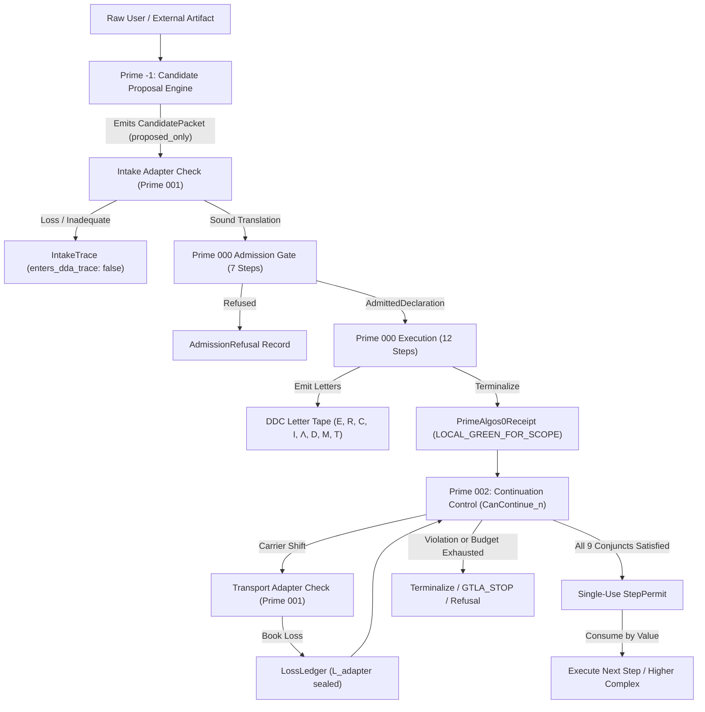

# Algorithm Prime Triad Levels: Intake, Declaration, Transport & Continuation Control

**AuthorityEffect:** None. Complete educational level curriculum for the Algorithm Prime Triad (Prime -1, Prime 000, Prime 001, Prime 002) and CODA $C^n$ ascent; no operational authorization is conferred.

---

## 1. Overview of the 8 Curriculum Levels

The **Algorithm Prime Triad** forms the foundational operational control law of the Omega Engine. It governs how raw external proposals are admitted onto discrete carriers, how primitive differences are declared without authority laundering, how inter-carrier transport accounts for discarded data via loss ledgers, and how higher-order continuation is bounded by anti-cheat halting laws:

| Level | Document | Primary Scope & Focus | Canonical Claims & Invariants | Reference Implementations |
| :---: | :--- | :--- | :--- | :--- |
| [**Level 00**](../level_00_prime_triad_architecture.md) | **Prime Triad Architecture** | Protocol stages vs pure domain data types | Separation of `omega_types::prime` from behavioral runtime | [`prime_scope.rs`](../../../../../omega_engine/crates_rs/omega_wdp/src/prime_algos/prime_scope.rs) |
| [**Level 01**](../level_01_prime_minus_one_candidate_proposal.md) | **Prime -1: Candidate Proposal** | Intake compilation & pre-admission trace isolation | `OE001-01`, `CandidatePacket`, `IntakeTrace` (`enters_dda_trace: false`) | [`prime_candidate.rs`](../../../../../omega_engine/crates_rs/omega_wdp/src/prime_algos/prime_candidate.rs) |
| [**Level 02**](../level_02_prime_000_seven_step_declaration.md) | **Prime 000: 7-Step Declaration** | Strict local runtime declaration order | `OE001-02`, Steps 0–6 ($G \to C \to J \to \Delta \to Z \to \chi \to Q$), $L \neq C_L$ | [`prime_algorithm_0_admission.rs`](../../../../../omega_engine/crates_rs/omega_wdp/src/prime_algos/prime_algorithm_0_admission.rs) |
| [**Level 03**](../level_03_prime_000_twelve_step_fill_execution.md) | **Prime 000: 12-Step Fill Order** | Cochain packet fill, residual projection & receipts | `OE001-04`, `PrimeAlgorithm0Receipt`, $(\Phi_1, \Gamma_2)$ measurement, `LOCAL_GREEN_FOR_SCOPE` | [`prime_algorithm_0.rs`](../../../../../omega_engine/crates_rs/omega_wdp/src/prime_algos/prime_algorithm_0.rs) |
| [**Level 04**](../level_04_prime_001_intake_transport_soundness.md) | **Prime 001: Transport Soundness** | Dual boundary checks & explicit loss ledgers | `OE002-01`, `OE002-02`, "Translation does not confer validity", `LossLedger` $L_{\mathrm{adapter}}$ | [`prime_algorithm_1.rs`](../../../../../omega_engine/crates_rs/omega_wdp/src/prime_algos/prime_algorithm_1.rs) |
| [**Level 05**](../level_05_prime_002_continuation_and_can_continue.md) | **Prime 002: Master Continuation** | The 9-conjunct master predicate $\mathsf{CanContinue}_n$ | `OE003-01`, single-use `StepPermit`, $\Delta \Phi_{\mathrm{net}} \le 0$ residual check | [`prime_algorithm_2.rs`](../../../../../omega_engine/crates_rs/omega_wdp/src/prime_algos/prime_algorithm_2.rs#L1472-L1620) |
| [**Level 06**](../level_06_prime_002_six_anti_cheat_halting_laws.md) | **Prime 002: Anti-Cheat Laws** | The six halting laws & bounded stopping | `OE003-02`, `OE003-03`, $\#\mathrm{ops} \le \lfloor B_{\mathrm{tot}} / \delta_{\mathrm{control}} \rfloor$, `TerminalPermit` | [`prime_algorithm_2.rs`](../../../../../omega_engine/crates_rs/omega_wdp/src/prime_algos/prime_algorithm_2.rs#L853-L1050) |
| [**Level 07**](../level_07_coda_cn_ascent_and_recursive_reentry.md) | **CODA $C^n$ Ascent & Re-Entry** | Recursive re-entry $\Omega_{000}(L)$ & degree ascent | `OE004-01`, `OE004-02`, `GTLA_STOP` vs `GTTA_GLOBAL_RESIDUAL`, Defect Linearity | [`descent_engine.rs`](../../../../../omega_engine/crates_rs/omega_wdp/src/prime_algos/descent_engine.rs) |

---

## 2. Finite State Machine: The Prime Protocol Pipeline

The execution flow across the Prime Triad is governed by a strict, unidirectional pipeline:

---

## 3. Four-Axis Separation Guard

Across all 8 curriculum levels, the runtime maintains an immutable separation firewall:

$$\boxed{\text{DiagnosticClass} \neq \text{RoutingTerminal} \neq \text{ExtensionStatus} \neq \text{AuthorityStatus}}$$

1. **DiagnosticClass:** The mathematical state of the cochain defect (`RemovableGauge`, `ClosedObstruction`, `NonClosedRupture` via $\Phi_1, \Gamma_2$).
2. **RoutingTerminal:** The finite state machine stopping condition (`Certificate`, `Repair`, `OracleNeeded`, `OpenResidual`, `Refusal`).
3. **ExtensionStatus:** The carrier licensing state (`Unextended`, `LicensedLiftAdmission` under 9-bit gate).
4. **AuthorityStatus:** Sovereign authority effect, which remains unconditionally:
   $$\text{AuthorityEffect} = \textbf{None}$$

---

## 4. Key References & Source Documents

- [**`oe_prime_algorithms.md`**](../../../../../omega_engine_atlas/coda_atlas/F004_papers/001_finite_obstruction_calculus/000_witnessed_difference_programme/docs/source_archive/prime_algorithm_package/oe_prime_algorithms.md): Master monograph defining claims `OE001-01` through `OE004-08`.
- [**`oe_prime_algorithms.py`**](../../../../../omega_engine_atlas/coda_atlas/F004_papers/001_finite_obstruction_calculus/000_witnessed_difference_programme/docs/source_archive/prime_algorithm_package/code/oe_prime_algorithms.py): Python reference implementation featuring exact rational simplex L1 solver and cochain engines.
- [**`prime_algorithm_0.rs`**](../../../../../omega_engine/crates_rs/omega_wdp/src/prime_algos/prime_algorithm_0.rs): 12-step obstruction packet fill order, `PrimeAlgorithm0Receipt`, and domain adapters.
- [**`prime_algorithm_1.rs`**](../../../../../omega_engine/crates_rs/omega_wdp/src/prime_algos/prime_algorithm_1.rs): Intake and inter-carrier transport soundness, `LossLedger`, and `TransportedPacket`.
- [**`prime_algorithm_2.rs`**](../../../../../omega_engine/crates_rs/omega_wdp/src/prime_algos/prime_algorithm_2.rs): $\mathsf{CanContinue}_n$ 9-conjunct master predicate, single-use `StepPermit`, and six anti-cheat halting laws.
- [**`descent_engine.rs`**](../../../../../omega_engine/crates_rs/omega_wdp/src/prime_algos/descent_engine.rs): Sovereign coordinator connecting Prime Triad to `omega_coda` and `omega_solvers`.
