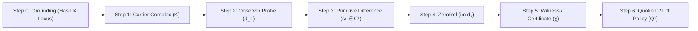

# Prime Triad Level 02: Prime 000 Phase 1 — The 7-Step Local Runtime Declaration Order

**AuthorityEffect:** None. Complete mathematical and runtime specification for the 7-step local runtime declaration order and multi-carrier lens spans; no operational authorization is conferred.

---

## 1. Executive Context: The Local Declaration Invariant

In classical formal evaluations, systems frequently begin by computing differentials or verifying metrics before establishing where those quantities live, who observes them, or under what gauge equivalence relation they vanish.

**Algorithm Prime 000 Phase 1** establishes the local runtime declaration order under monograph claim `OE001-02`:

$$\boxed{0.\ \text{Grounding} \longrightarrow 1.\ \text{Carrier } C^0 \longrightarrow 2.\ \text{Observer } J_L \longrightarrow 3.\ \text{Primitive Difference } \omega \longrightarrow 4.\ \text{ZeroRel} \longrightarrow 5.\ \text{Witness } \chi \longrightarrow 6.\ \text{Quotient / Lift}}$$

Every admitted packet must execute this sequence without reordering or step omissions.

---

## 2. Mathematical Definition of the 7 Declaration Steps



### Step 0: Grounding Anchor & Non-Conflation ($L \neq C_L$)
- **Obligation:** Binds a cryptographic raw hash (e.g. SHA-256 of AST, source text, or commit) and locus identifier.
- **Governing Invariant:** Locus $L$ is the entity under study; carrier $C_L$ is the mathematical substrate. In general:
  $$L \neq C_L$$
  Identifying them without an explicit typing witness silently promotes an arbitrary locus into a carrier, bypassing topological validation.

### Step 1: Candidate Carrier ($C^0$)
- **Obligation:** Declares a finite simplicial complex $K = (V, E, F)$ or discrete chain module.
- **Structural Integrity:**
  - $V \neq \varnothing$: Non-empty vertex set.
  - $u \neq v$ for all $(u, v) \in E$: Strictly no 1-point self-loops.
  - Faces $(u, v, w) \in F$ must have boundary edges $(u, v), (v, w), (u, w) \in E$.

### Step 2: Observer Probe ($J_L$)
- **Obligation:** Binds an explicit, finite measurement envelope $J_L$ with defined resolution $\varepsilon > 0$.
- **Anti-Cheat Guard:** Forbids unindexed cosmic observers ("a view from nowhere"). All measurements are relative to declared report maps. An observer is adequate for defect mass $m$ if and only if $\varepsilon \le m$.

### Step 3: Primitive Difference ($\omega \in C^1$)
- **Obligation:** Declares the concrete difference cochain between competing representations or steps:
  $$\omega: E \to \mathbb{Q}$$
- **Foundational Honesty:**
  - *Genesis-Bias Rejection:* Difference does not presuppose antecedent objects. The cut admits non-sameness directly.
  - *Strict Irreflexivity:* Difference forces metatheoretic inequality ($a \neq b$).

### Step 4: ZeroRel Rule ($\Delta(s) = 0$)
- **Obligation:** Specifies the exact triviality condition and gauge equivalence kernel. In discrete Hodge theory, triviality corresponds to the coboundary subspace:
  $$\operatorname{ZeroRel} := \operatorname{im}(d_0) \subset C^1$$
  Two cochains are equivalent ($h \sim h'$) if and only if $h - h' = d_0 \phi$ for some 0-cochain $\phi \in C^0$.

### Step 5: Witness or Refusal Route ($\chi$)
- **Obligation:** Emits an explicit dual witness certificate bounding the duality gap or confirms a typed refusal code.
- **Zero Duality Gap:** For exact L1 gauge minimization, $\chi$ provides the dual vector $z \in [-1, 1]^{|E|}$ satisfying $d_0^* z = 0$ such that $\Phi_1(h) = \langle z, h \rangle$.

### Step 6: Quotient / Lift Policy
- **Obligation:** Defines the projection to the first cohomology quotient $Q^1 = C^1 / \operatorname{im}(d_0)$ or establishes the lift boundary $\Lambda$ for representation extension.

---

## 3. Multi-Carrier Lenses & the LensSpan Model (`OE001-03`)

A complex artifact (such as a research monograph, compiler pipeline, or distributed protocol) is **not** a single monolithic cochain complex. It is a bundle of carriers extracted via layered partial spans:

$$A \xleftarrow{s_L} S_L \xrightarrow{p_L} K_L$$

where $S_L$ is the source span, $K_L$ is the extracted carrier, and span composition proceeds by categorical pullback in $\mathbf{LensSpan}(A)$:

```
           A (Artifact)
          / \
         /   \
        v     v
       S_1   S_2   (Source Spans)
        |     |
        v     v
       K_1   K_2   (Extracted Simplicial Carriers)
        \     /
         v   v
        Pullback K_12 = K_1 ×_A K_2
```

The canonical six-layer lens hierarchy structures multi-carrier artifacts:
$$L_0\ (\text{lexical}) \longrightarrow L_1\ (\text{syntactic}) \longrightarrow L_2\ (\text{semantic}) \longrightarrow L_3\ (\text{proof}) \longrightarrow L_4\ (\text{rhetoric}) \longrightarrow L_5\ (\text{strategic})$$

---

## 4. Code Implementation: Rust Admission Gate

In [`prime_algorithm_0_admission.rs`](../../../../../omega_engine/crates_rs/omega_wdp/src/prime_algos/prime_algorithm_0_admission.rs), admission is evaluated by `admit`:

```rust
pub fn admit(
    fill: &DeclarationFill,
    adapter: &dyn DomainAdapter,
) -> Result<AdmittedDeclaration, AdmissionRefusal> {
    let carrier = fill
        .carrier
        .as_deref()
        .ok_or(AdmissionRefusal::MissingCarrier)?;
    let primitive_difference = fill
        .primitive_difference
        .as_deref()
        .ok_or(AdmissionRefusal::MissingPrimitiveDifference)?;
    let zero_rel = fill
        .zero_rel
        .as_deref()
        .ok_or(AdmissionRefusal::MissingZeroRel)?;
    let observer = fill
        .observer
        .as_deref()
        .ok_or(AdmissionRefusal::MissingObserver)?;
    if fill.witnesses.is_empty() {
        return Err(AdmissionRefusal::MissingWitness);
    }

    // Cochain window validation
    let cochain = if adapter.justify_cochain() {
        match adapter.cochain_window() {
            Some(win) if win.square_zero => CochainSlot::Constructed {
                dim_c0: win.dim_c0,
                dim_c1: win.dim_c1,
                dim_c2: win.dim_c2,
                square_zero: true,
            },
            Some(win) => CochainSlot::RefusedNotSquareZero {
                l1_defect_mass: win.l1_defect_mass,
            },
            None => CochainSlot::MissingUnjustified,
        }
    } else {
        CochainSlot::MissingUnjustified
    };

    Ok(AdmittedDeclaration {
        carrier: carrier.to_string(),
        primitive_difference: primitive_difference.to_string(),
        zero_rel: zero_rel.to_string(),
        observer: observer.to_string(),
        witnesses: fill.witnesses.clone(),
        cochain,
    })
}
```

The resulting [`AdmittedDeclaration`](../../../../../omega_engine/crates_rs/omega_wdp/src/prime_algos/prime_algorithm_0_admission.rs#L32) has private fields and no public constructor, guaranteeing that only declarations passing all gates can reach the execution runner.

---

## 5. Anti-Cheat & Refusal Taxonomy

The admission gate emits strongly typed refusal variants upon any contract violation:

| Refusal Variant | Trigger Condition | Anti-Cheat Law Enforced |
| :--- | :--- | :--- |
| `MissingCarrier` | `carrier` field is `None` or empty | Forbids floating cochains without combinatorial carrier |
| `MissingPrimitiveDifference` | `primitive_difference` is `None` | Forbids evaluation without an identified defect cut |
| `MissingZeroRel` | `zero_rel` equivalence rule missing | Prevents evaluation without a gauge equivalence kernel |
| `MissingObserver` | `observer` field is `None` | Rejects cosmic unindexed observers |
| `MissingWitness` | `witnesses` array is empty | Rejects un-witnessed assertions |
| `RefusedNotSquareZero` | $d_1 \circ d_0 \neq 0$ ($L^1$ defect mass $> 0$) | Enforces boundary nilpotency |

---

## 6. Self-Assessment Micro-Checks

1. **Why is the ZeroRel rule declared before evaluating the quotient residual?**  
   *Answer:* The quotient space $Q^1 = C^1 / \operatorname{im}(d_0)$ is defined entirely by the ZeroRel gauge kernel $\operatorname{im}(d_0)$. Without specifying what vanishes, residual distance cannot be measured.
2. **What does a non-zero $L^1$ defect mass in `RefusedNotSquareZero` signify?**  
   *Answer:* It means the declared coboundary operators fail nilpotency ($d_1 \circ d_0 \neq 0$), violating the topological chain complex requirement.
3. **How does the `LensSpan` model handle heterogeneous carrier layers?**  
   *Answer:* Rather than flattening layers into an artificial single complex, it constructs span pullbacks $K_1 \times_A K_2$, tracking discarded dimensions in an audited loss ledger.

---

## 7. Claim Hygiene Quadrant

1. **What this supports:**
   - Strict 7-step ordering guarantees that cochains are never evaluated on undefined topologies or unindexed observers.
   - Exact mathematical formulation of nilpotency and gauge equivalence over $\mathbb{Q}$.
2. **What this does not support:**
   - Does not establish that any declared carrier represents the complete physical or real-world system.
   - Does not license skipping steps when working with familiar or standard domains.
3. **The narrowest defensible claim:**
   - A declaration packet passing `prime_algorithm_0_admission::admit` satisfies the minimal topological and observer prerequisites for 12-step cochain fill execution.
4. **Next test needed:**
   - Verify all refusal variants by running `cargo test --manifest-path omega_engine/crates_rs/omega_wdp/src/prime_algos/Cargo.toml --lib prime_algorithm_0_admission`.
