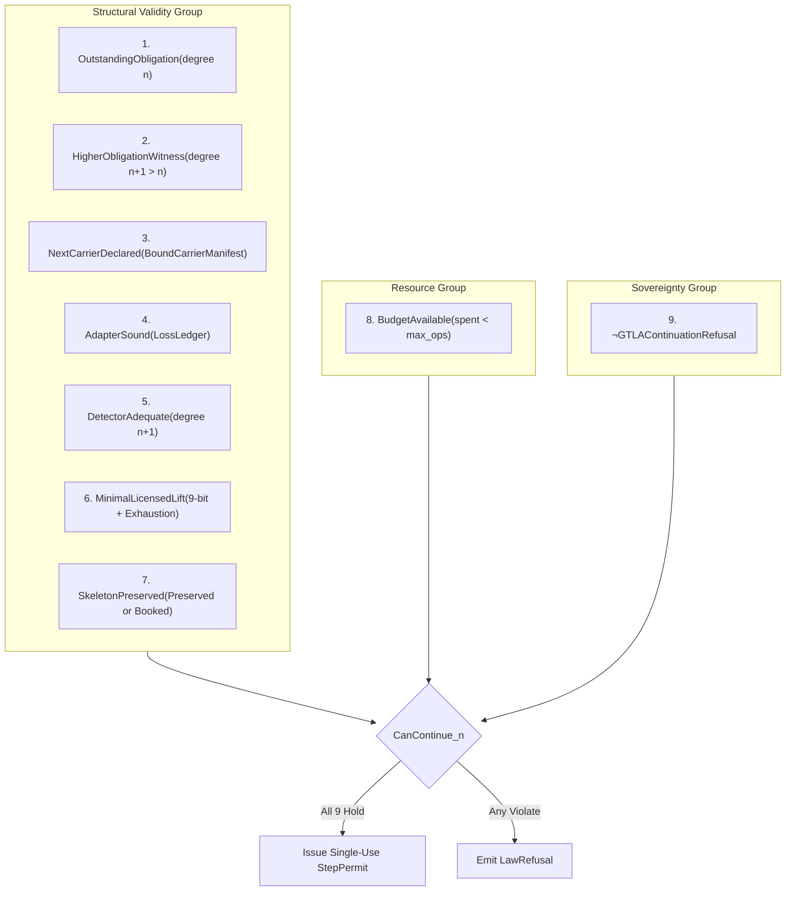

# Prime Triad Level 05: Prime 002 — Master Continuation Control & The CanContinue Predicate

**AuthorityEffect:** None. Complete mathematical and runtime specification for Prime 002 master continuation control, the 9-conjunct $\mathsf{CanContinue}_n$ predicate, and linear execution permits; no operational authorization is conferred.

---

## 1. Executive Context: Halting Control vs. Endless Retries

Autonomous evaluation swarms and recursive agents suffer from a well-known vulnerability: when encountering an unresolved obstruction, they can endlessly rephrase prompts, add arbitrary dimensions, or switch representations, creating the illusion of progress without ever discharging obligations.

**Algorithm Prime 002** terminates this failure mode through the master continuation predicate $\mathsf{CanContinue}_n$ under monograph claim `OE003-01`:

$$\boxed{\begin{aligned}
\text{Continuation from stage } n \text{ to } n+1 &\text{ is lawful if and only if} \\
\mathsf{CanContinue}_n &\text{ evaluates to \textbf{True} under sealed evidence.}
\end{aligned}}$$

---

## 2. The Nine Canonical Conjuncts of $\mathsf{CanContinue}_n$ (`OE003-01`)

The formal definition of $\mathsf{CanContinue}_n$ conjoins nine machine-checked invariants:

$$\begin{aligned}
\mathsf{CanContinue}_n :\iff &\mathsf{OutstandingObligation}(r_n) \ \wedge \\
&\mathsf{HigherObligationWitness}(r_n) \ \wedge \\
&\mathsf{NextCarrierDeclared}(r_n) \ \wedge \\
&\mathsf{AdapterSound}_{n\to n+1} \ \wedge \\
&\mathsf{DetectorAdequate}_{n+1} \ \wedge \\
&\mathsf{MinimalLicensedLift}_{n\to n+1} \ \wedge \\
&\mathsf{SkeletonPreserved}_{n\to n+1} \ \wedge \\
&\mathsf{BudgetAvailable}_n \ \wedge \\
&\neg\mathsf{GTLAContinuationRefusal}_n
\end{aligned}$$



### Detailed Breakdown of the 9 Conjuncts:

| # | Conjunct | Sealed Evidence Type | Verification Requirement |
|---|---|---|---|
| **1** | `OutstandingObligation` | [`ObligationWitness`](../../../../../omega_engine/crates_rs/omega_wdp/src/prime_algos/prime_algorithm_2.rs#L423) | Unresolved defect obligation at current degree $n$. |
| **2** | `HigherObligationWitness` | [`ObligationWitness`](../../../../../omega_engine/crates_rs/omega_wdp/src/prime_algos/prime_algorithm_2.rs#L423) | Exhibited obligation at degree $n+1 > n$ (Law 1: No Degree Laundering). |
| **3** | `NextCarrierDeclared` | [`BoundCarrierManifest`](../../../../../omega_engine/crates_rs/omega_wdp/src/prime_algos/prime_scope.rs) | Carrier digest and $d_0$ boundary operator declared for target complex. |
| **4** | `AdapterSound` | [`LossLedger`](../../../../../omega_engine/crates_rs/omega_wdp/src/prime_algos/prime_algorithm_1.rs#L49) | Sound inter-carrier adapter with booked dimension reductions. |
| **5** | `DetectorAdequate` | [`DetectorAdequacy`](../../../../../omega_engine/crates_rs/omega_wdp/src/prime_algos/prime_algorithm_2.rs#L281) | Detector configured for target carrier separating claim from counterclaim. |
| **6** | `MinimalLicensedLift` | [`BoundLiftAdmission`](../../../../../omega_engine/crates_rs/omega_wdp/src/prime_algos/prime_algorithm_2.rs#L547) | 9 up-lift bits hold AND same-carrier repair search exhausted (`SameCarrierExhaustion`). |
| **7** | `SkeletonPreserved` | `bool` + `LossLedger` | Certified lower data preserved; if `false`, `LossLedger` must be non-empty. |
| **8** | `BudgetAvailable` | [`Budget`](../../../../../omega_engine/crates_rs/omega_wdp/src/prime_algos/prime_algorithm_2.rs#L883) | Operational budget remaining: $\mathrm{spent} < \lfloor B_{\mathrm{tot}} / \delta_{\mathrm{control}} \rfloor$. |
| **9** | $\neg\mathsf{GTLARefusal}$ | `Option<GtlaRefusal>` | Must be `None`. Presence of any issued refusal halts continuation. |

---

## 3. Tripartite Form & Lean 4 Equivalence

Monograph §3.1 groups the nine conjuncts into three natural macro-conditions:
1. **Structural Validity:** Conjuncts 1–7.
2. **Resource Availability:** Conjunct 8.
3. **Absence of Terminal Stop:** Conjunct 9.

This tripartite regrouping is formalized as an exact equivalence in Lean 4:
```lean
theorem Prime.cc9_implies_cc3 (c : CanContinueInput) :
  c.evaluate = (c.structural_validity ∧ c.budget_remains ∧ c.not_gtla_refusal)
```
In Python (`oe_prime_algorithms.py#L1220`):
```python
def to_three_condition_summary(self) -> Tuple[bool, bool, bool]:
    structural = (
        self.has_obligation and self.has_witness and self.next_carrier_declared
        and self.adapter_sound and self.detector_adequate and self.minimal_lift
        and self.skeleton_preserved
    )
    return structural, self.budget_remains, self.not_gtla_refusal
```

---

## 4. Linear Type Discipline: Single-Use StepPermit

To eliminate double-execution bugs and token replays, authorization in [`prime_algorithm_2.rs`](../../../../../omega_engine/crates_rs/omega_wdp/src/prime_algos/prime_algorithm_2.rs#L1102) is issued as a linear type:

```rust
/// A single-use licence to write one step.
///
/// Not Clone, not Deserialize. Both writers take it by value, so the
/// move checker enforces single use.
# [derive(Debug, PartialEq, Eq)]
pub struct StepPermit {
    scope: ScopeBinding,
    claim: StepClaim,
    evidence_digest: Hash256,
}
```

When [`write_step`](../../../../../omega_engine/crates_rs/omega_wdp/src/prime_algos/prime_algorithm_2.rs#L1849) is invoked:
```rust
pub fn write_step(
    state: &mut ControlState,
    permit: StepPermit, // Consumed by value!
    op: StepOp,
) -> Result<DdaStep, LawRefusal>;
```
The permit is **consumed by value**. Any attempt to reuse a permit across two steps fails at compile time via the Rust borrow checker.

---

## 5. Residual-Aware Continuation: ResidualDelta & $\Delta \Phi \le 0$

Under `residual_aware_can_continue.md`, $\mathsf{CanContinue}_n$ enforces quantitative potential non-increase:

$$\Delta \Phi_{\mathrm{net}} := \Phi_{1, \mathrm{after}} - \Phi_{1, \mathrm{before}} \le 0$$

In [`ResidualDelta`](../../../../../omega_engine/crates_rs/omega_wdp/src/prime_algos/prime_algorithm_2.rs#L649):
```rust
pub struct ResidualDelta {
    scope: ScopeBinding,
    before: BigRational,
    after: BigRational,
    measured_on: Hash256,
}
```

### Why $d_0$ Must Match Exactly
$\Phi_1$ is a distance to $\operatorname{im}(d_0)$. Two $\Phi_1$ values computed against different $d_0$ boundary operators live in entirely different quotient spaces; comparing them is mathematically meaningless.

Therefore, `ResidualDelta::from_verified` asserts:
```rust
if before.d0() != after.d0() {
    return Err(LawRefusal::Violations(vec![Violation {
        law: AntiCheatLaw::ResidualNonIncrease,
        detail: "Phi_1 endpoints are over different d0; values in different quotients are not comparable".into(),
    }]));
}
```
If an operation repacketizes onto a new carrier, it **cannot** assert residual non-increase via `ResidualDelta`; it must book its dropped dimensions through an audited `LossLedger`.

---

## 6. Self-Assessment Micro-Checks

1. **Why does `can_continue_n` demand that `higher_obligation_witness.degree() > outstanding_obligation.degree()`?**  
   *Answer:* To enforce Law 1 (No Degree Laundering). Elevating carrier representation to degree $n+1$ requires witnessing an actual obligation that cannot even be expressed at degree $n$.
2. **What occurs if `residual.increases()` evaluates to `true` while `adapter_ledger.is_empty()`?**  
   *Answer:* `can_continue_n` immediately emits a typed refusal for `AntiCheatLaw::ResidualNonIncrease`. A step is strictly forbidden from raising residual mass without booking lost data.
3. **Why is `StepPermit` non-serializable?**  
   *Answer:* If a permit could be deserialized from JSON, an adversary or subagent could synthesize execution licenses without presenting verified evidence to `can_continue_n`.

---

## 7. Claim Hygiene Quadrant

1. **What this supports:**
   - Evaluates the 9-conjunct master continuation condition under exact rational arithmetic.
   - Prevents unauthorized step execution via single-use linear move semantics.
2. **What this does not support:**
   - Does not establish that any arbitrary heuristic search will discover a valid permit.
   - Does not guarantee that a bounded sequence of steps resolves all higher-degree topological defects.
3. **The narrowest defensible claim:**
   - A step executed with a valid `StepPermit` has been checked against all 9 continuation conjuncts and has debited the finite operational budget by at least $\delta_{\mathrm{control}}$.
4. **Next test needed:**
   - Run continuation predicate tests via `cargo test --manifest-path omega_engine/crates_rs/omega_wdp/src/prime_algos/Cargo.toml --lib prime_algorithm_2`.
