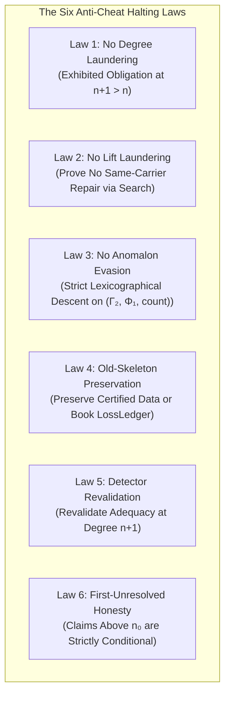

# Prime Triad Level 06: Prime 002 — The Six Anti-Cheat Halting Laws & Bounded Stopping

**AuthorityEffect:** None. Complete mathematical and runtime specification for the six anti-cheat halting laws, the bounded stopping theorem, and obligation registry closure; no operational authorization is conferred.

---

## 1. Executive Context: Preventing Evaluation Laundering

Every iterative or multi-agent evaluation framework is vulnerable to six canonical forms of **evaluation cheating**:
1. Laundering an un-repairable lower-degree defect by jumping to a higher degree.
2. Extending representation space without searching for same-level repairs.
3. Renaming stable topological obstructions to evade terminal failure.
4. Dropping certified historical constraints without auditing.
5. Evaluating transformed packets using uncalibrated, blind detectors.
6. Hiding low-degree failures beneath unverified high-degree theorems.

Under monograph claims `OE003-02` and `OE003-03`, **Prime 002** enforces **The Six Anti-Cheat Halting Laws** and **Bounded Stopping**, making these failure modes detectable and refusable at runtime.

---

## 2. The Six Anti-Cheat Halting Laws (`OE003-02`)



### Law 1: No Degree Laundering (`NoDegreeLaundering`)
- **Rule:** Adding a higher complex $C^{n+1}$ requires an **exhibited $(n+1)$-dimensional obligation** on $C^n$, not merely the absence of a resolution below.
- **Enforcement:** In [`can_continue_n`](../../../../../omega_engine/crates_rs/omega_wdp/src/prime_algos/prime_algorithm_2.rs#L1472):
  ```rust
  if ev.higher_obligation_witness.degree() <= ev.outstanding_obligation.degree() {
      v.push(Violation {
          law: AntiCheatLaw::NoDegreeLaundering,
          detail: format!(
              "higher obligation at degree {} does not exceed current {}",
              ev.higher_obligation_witness.degree(),
              ev.outstanding_obligation.degree()
          ),
      });
  }
  ```

### Law 2: No Lift Laundering (`NoLiftLaundering`)
- **Rule:** A representation extension ($C^n \hookrightarrow C^{n+k}$) must **prove that no same-carrier repair exists**. Absence of an attempt is not proof.
- **Enforcement:** Requires a [`SameCarrierExhaustion`](../../../../../omega_engine/crates_rs/omega_wdp/src/prime_algos/prime_algorithm_2.rs#L463) constructed by *running the search to exhaustion*:
  ```rust
  pub fn by_searching<I, F>(
      candidates: I,
      mut repairs: F,
      scope: ScopeBinding,
  ) -> Result<Self, LiftRefusal>
  ```
  If any candidate repairs on the same carrier, `SameCarrierRepairExists` is emitted and no lift is licensed.

### Law 3: No Anomalon Evasion (`NoAnomalonEvasion`)
- **Rule:** A stable topological residual ($\Phi_1 > 0, \Gamma_2 = 0$) cannot be perpetually renamed, repacketized, or retried to avoid terminalization.
- **Enforcement:** On a fixed carrier, every step must exhibit strict lexicographical descent on the diagnostic tuple:
  $$(\Gamma_{2, n+1}, \Phi_{1, n+1}, \text{defect\_count}_{n+1}) <_{\mathrm{lex}} (\Gamma_{2, n}, \Phi_{1, n}, \text{defect\_count}_n)$$
  Steps that merely permute residual coordinates without strictly reducing potential mass are rejected.

### Law 4: Old-Skeleton Preservation (`OldSkeletonPreservation`)
- **Rule:** Higher-order continuation must preserve certified lower-degree data or emit an explicit loss ledger.
- **Enforcement:**
  ```rust
  if !ev.skeleton_preserved && ev.adapter_ledger.is_empty() {
      v.push(Violation {
          law: AntiCheatLaw::OldSkeletonPreservation,
          detail: "skeleton not preserved and no loss booked".into(),
      });
  }
  ```

### Law 5: Detector Revalidation (`DetectorRevalidation`)
- **Rule:** Repacketization onto a new carrier must revalidate detector adequacy at degree $n+1$ on the new carrier.
- **Enforcement:** [`DetectorAdequacy`](../../../../../omega_engine/crates_rs/omega_wdp/src/prime_algos/prime_algorithm_2.rs#L281) does not travel across carriers. It binds the carrier digest and degree, asserting separation between claim and counterclaim instances.

### Law 6: First-Unresolved-Degree Honesty (`FirstUnresolvedDegreeHonesty`)
- **Rule:** If degree $n_0$ is unresolved, all claims above $n_0$ are strictly conditional:
  $$\mathsf{CoherentUpTo}(n_0 - 1) \quad \land \quad \mathsf{ResidualAt}(n_0)$$
- **Enforcement:** Terminalization demands an [`ObligationClosure`](../../../../../omega_engine/crates_rs/omega_wdp/src/prime_algos/prime_algorithm_2.rs#L747) certifying that no open obligations remain at or below the highest discharged degree.

---

## 3. Bounded Operational Termination (`OE003-03`)

A recursive evaluator with infinite loops or fractional steps that approach zero without terminating produces unbounded traces.

**Theorem (`OE003-03` / `Prime.ops_le_floor_div`):**
Given a finite non-replenished budget $B_{\mathrm{tot}} \in \mathbb{Q}_{\ge 0}$ where every counted operation debits the budget by at least a strictly positive cost floor $\delta_{\mathrm{control}} > 0$, the maximum number of executed operations is strictly bounded:

$$\boxed{\#\mathrm{ops} \le \left\lfloor \frac{B_{\mathrm{tot}}}{\delta_{\mathrm{control}}} \right\rfloor}$$

In [`Budget`](../../../../../omega_engine/crates_rs/omega_wdp/src/prime_algos/prime_algorithm_2.rs#L883):
```rust
pub struct Budget {
    total: String,
    floor: String,
    max_ops: usize,
    spent: usize,
}
```
The constructor rejects non-positive cost floors ($\delta \le 0$), as they would render the bound infinite. Every written step invokes `spend()`; when $\mathrm{spent} \ge \mathrm{max\_ops}$, the engine halts with `AntiCheatLaw::BoundedStopping`.

---

## 4. The Terminalizer Architecture: `terminalize`

In classical systems, any module can print a success status. In `prime_algorithm_2.rs`, **terminals are unrepresentable on the ordinary execution path**:

1. [`StepOp`](../../../../../omega_engine/crates_rs/omega_wdp/src/prime_algos/prime_algorithm_2.rs#L1070) has **no `Terminalize` variant**. `write_step` cannot emit letter `T`.
2. Letter `T` exists exclusively as the return of [`terminalize`](../../../../../omega_engine/crates_rs/omega_wdp/src/prime_algos/prime_algorithm_2.rs#L1973):
   ```rust
   pub fn terminalize(
       state: &mut ControlState,
       permit: TerminalPermit, // Consumed by value!
   ) -> Result<TerminalControlState, TerminalRefusal>;
   ```
3. A [`TerminalPermit`](../../../../../omega_engine/crates_rs/omega_wdp/src/prime_algos/prime_algorithm_2.rs#L853) can only be minted by [`ObligationRegistry::issue_terminal_permit`](../../../../../omega_engine/crates_rs/omega_wdp/src/prime_algos/prime_algorithm_2.rs#L817), which simultaneously requires:
   - A [`Gamma2Zero`](../../../../../omega_engine/crates_rs/omega_wdp/src/prime_algos/prime_algorithm_2.rs#L84) receipt (verified exactly over $\mathbb{Q}$).
   - An empty `open_obligations` set in [`ObligationRegistry`](../../../../../omega_engine/crates_rs/omega_wdp/src/prime_algos/prime_algorithm_2.rs#L781).
   - An exact scope match with the active run.

---

## 5. Self-Assessment Micro-Checks

1. **Why does `terminalize` demand both `Gamma2Zero` and `ObligationClosure`?**  
   *Answer:* $\Gamma_2 = 0$ certifies that the 2-obstruction vanishes on the active carrier, but does not indicate whether higher-degree obligations registered earlier remain unresolved. `ObligationClosure` asserts that all registered obligations have been discharged.
2. **How does `SameCarrierExhaustion` prevent lift laundering?**  
   *Answer:* It executes a search closure across all declared same-carrier candidates. If any candidate repairs the defect, the lift is refused; representation extension is licensed only when same-carrier repair is mathematically exhausted.
3. **What happens if a caller declares a budget with $\delta_{\mathrm{control}} = 0$?**  
   *Answer:* `Budget::declare` immediately returns a `LawRefusal::Violations` for `BoundedStopping` because a zero cost floor does not bound operation counts.

---

## 6. Claim Hygiene Quadrant

1. **What this supports:**
   - Operational enforcement of the six anti-cheat halting laws against evaluation evasion and degree laundering.
   - Exact mathematical bound on operational termination ($\#\mathrm{ops} \le \lfloor B_{\mathrm{tot}} / \delta_{\mathrm{control}} \rfloor$) under declared budgets.
2. **What this does not support:**
   - Does not establish that every valid mathematical theorem terminates within an arbitrary small budget.
   - Does not prove that heuristic same-carrier search spaces contain all possible repairs unless the candidate set is provably exhaustive.
3. **The narrowest defensible claim:**
   - Under the declared budget and candidate search space, execution halts in at most $\lfloor B_{\mathrm{tot}} / \delta_{\mathrm{control}} \rfloor$ steps, and terminalization requires exact rational proof of $\Gamma_2 = 0$ and complete obligation closure under `AuthorityEffect: None`.
4. **Next test needed:**
   - Run anti-cheat law tests via `cargo test --manifest-path omega_engine/crates_rs/omega_wdp/src/prime_algos/Cargo.toml --lib prime_algorithm_2`.
