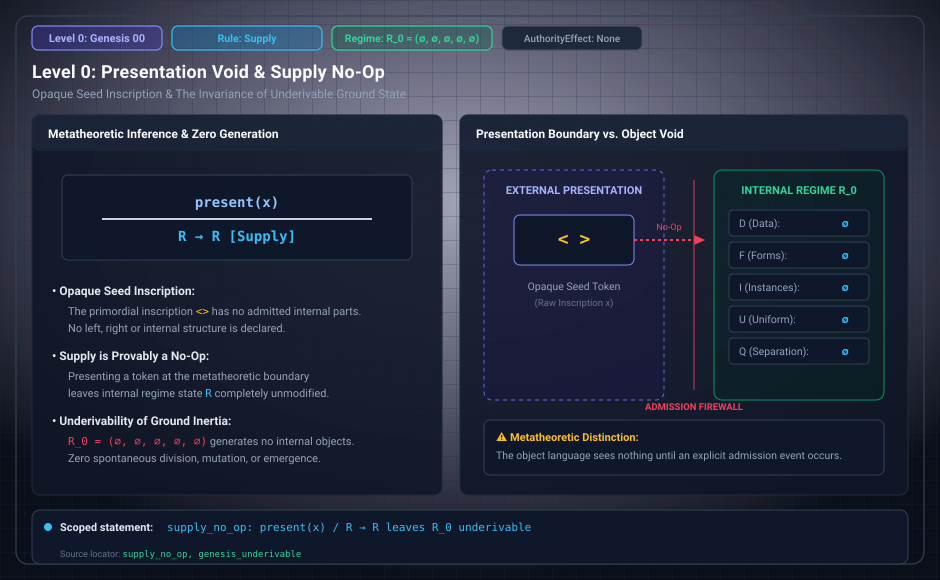

# Level 00: Opaque supply

AuthorityEffect: None. Teaching milestone; no identity with an S(n) stage or MSS index.

**Carrier:** Token-aware and erased admission regimes.

**Supplied assumptions:** The six-event admission grammar is declared.

**Statement:** `stepE r (.supply t) = some r`: supplying an opaque token leaves the regime unchanged. The printed glyphs in `<>` do not admit two data. The implementation host is not itself structure admitted by that inscription.

**Evidence:** SEALED THEOREM. [Pinned source](https://github.com/dbccpage/19L57G1/blob/f1d56c010e6ba10a3b9418bd7cc5953c067250f2/lean4/Derivation/Erasure.lean). Source statements and recorded compilation are distinguished from fresh companion tests.

**Implementation or open obligation:** Connect an implementation to this event semantics before transferring the theorem.

See the [current Genesis account](../genesis.md), [all-source crosswalk](../source_crosswalk.md), [selected families](../primitives/README.md) and [actual source adapters](../research_extension/docs/source_fidelity.md).

