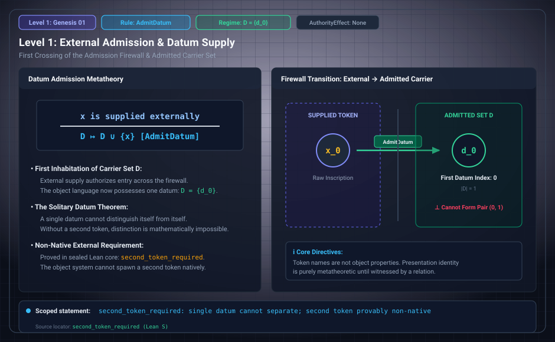

# Level 01: Datum admission

AuthorityEffect: None. Teaching milestone; no identity with an S(n) stage or MSS index.

**Carrier:** Opaque tokens and their erased natural-number indices.

**Supplied assumptions:** Reading and duplicate-token convention are explicit.

**Statement:** Admitting a datum extends the token store when its token is fresh; erasure retains its index. Supply and admission are distinct. A different spelling can be merely a renaming only after the relevant renaming correspondence is supplied.

**Evidence:** SEALED DEFINITION AND THEOREMS. [Pinned source](https://github.com/dbccpage/19L57G1/blob/f1d56c010e6ba10a3b9418bd7cc5953c067250f2/lean4/Derivation/Erasure.lean). Source statements and recorded compilation are distinguished from fresh companion tests.

**Implementation or open obligation:** Preserve refusal and duplicate behavior in a source adapter.

See the [current Genesis account](../genesis.md), [all-source crosswalk](../source_crosswalk.md), [selected families](../primitives/README.md) and [actual source adapters](../research_extension/docs/source_fidelity.md).

