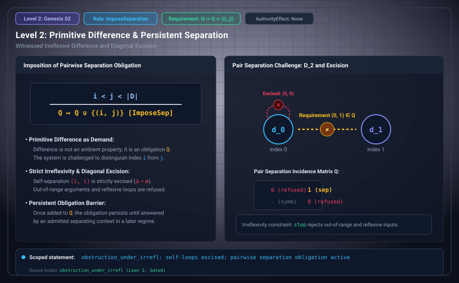

# Level 02: Difference and a demand for separation

AuthorityEffect: None. Teaching milestone; no identity with an S(n) stage or MSS index.

**Carrier:** A declared relation with a witness, or an admission regime with a protected pair.

**Supplied assumptions:** For relational difference, require both R(a,b) and universal irreflexivity of R.

**Statement:** Substitution proves a≠b from the witness and irreflexivity. A singleton self-loop shows why the law is needed. In the admission model, imposing Q(i,j) records a demand; it does not itself supply a distinguishing context. These are separate constructions.

**Evidence:** SEALED CONDITIONAL THEOREM. [Pinned source](https://github.com/dbccpage/19L57G1/blob/f1d56c010e6ba10a3b9418bd7cc5953c067250f2/paper/primitive_difference.md). Source statements and recorded compilation are distinguished from fresh companion tests.

**Implementation or open obligation:** Name which of relation, witness, law and observation is admitted in the proposed application.

See the [current Genesis account](../genesis.md), [all-source crosswalk](../source_crosswalk.md), [selected families](../primitives/README.md) and [actual source adapters](../research_extension/docs/source_fidelity.md).

