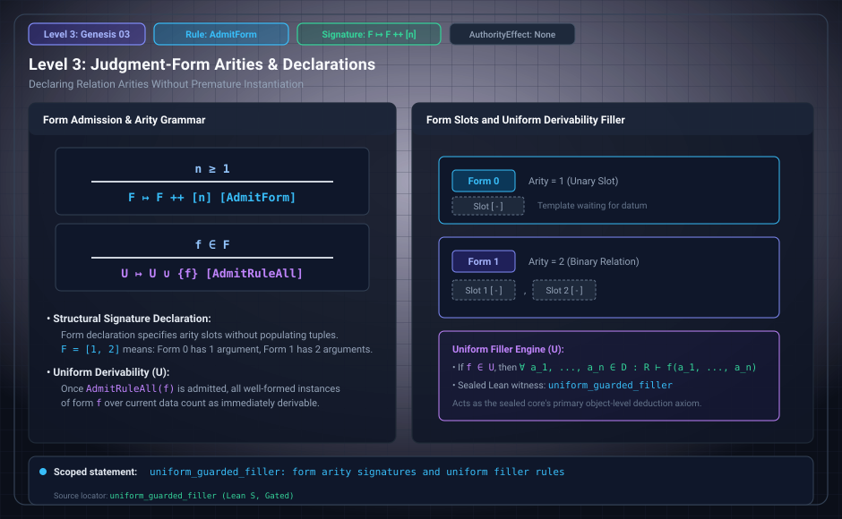

# Level 03: Form signatures

AuthorityEffect: None. Teaching milestone; no identity with an S(n) stage or MSS index.

**Carrier:** A regime with admitted positive form arities.

**Supplied assumptions:** The arity and the declaration event are supplied.

**Statement:** A form contributes a slot count, not its instances. Declaring a binary form alone supplies no asserted edge. A simplex interpretation requires a separate construction with faces and orientations.

**Evidence:** SEALED DEFINITION. [Pinned source](https://github.com/dbccpage/19L57G1/blob/f1d56c010e6ba10a3b9418bd7cc5953c067250f2/lean4/Derivation/Basic.lean). Source statements and recorded compilation are distinguished from fresh companion tests.

**Implementation or open obligation:** Specify the interpretation of an instance before treating an arity as a cell dimension.

See the [current Genesis account](../genesis.md), [all-source crosswalk](../source_crosswalk.md), [selected families](../primitives/README.md) and [actual source adapters](../research_extension/docs/source_fidelity.md).

