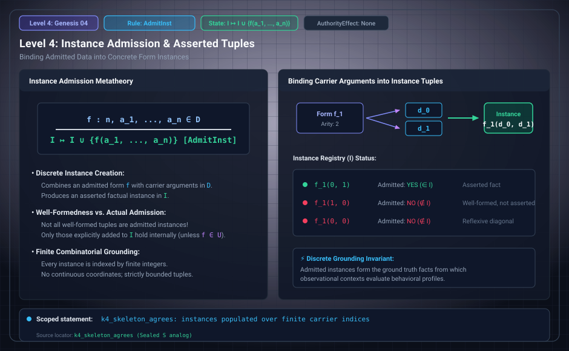

# Level 04: Instance admission

AuthorityEffect: None. Teaching milestone; no identity with an S(n) stage or MSS index.

**Carrier:** Form index f, argument tuple and existing datum indices.

**Supplied assumptions:** The form exists, tuple length equals its arity, and every argument is admitted.

**Statement:** Valid instance admission adds the instance under the declared duplicate convention. Invalid indices or arities are refused by the source optional transition. The educational total Lean model and Python exceptions do not become equivalent merely by sharing constructor names.

**Evidence:** SEALED DEFINITION AND COMPANION BOUNDARY. [Pinned source](https://github.com/dbccpage/19L57G1/blob/f1d56c010e6ba10a3b9418bd7cc5953c067250f2/lean4/Derivation/Erasure.lean). Source statements and recorded compilation are distinguished from fresh companion tests.

**Implementation or open obligation:** The research extension proves its stated successful-step implication; it is not a full source-driver refinement.

See the [current Genesis account](../genesis.md), [all-source crosswalk](../source_crosswalk.md), [selected families](../primitives/README.md) and [actual source adapters](../research_extension/docs/source_fidelity.md).

