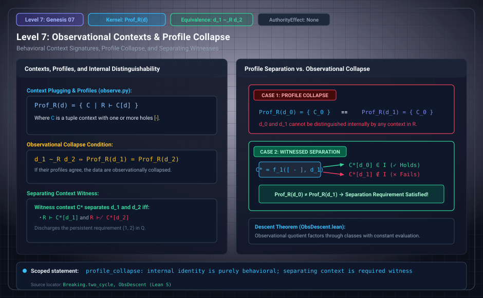

# Level 07: Context profiles

AuthorityEffect: None. Teaching milestone; no identity with an S(n) stage or MSS index.

**Carrier:** Well-formed contexts on an admission regime.

**Supplied assumptions:** Plugging replaces every hole with the same datum; derivability is admitted membership or a uniform rule.

**Statement:** Two data collapse exactly when all these context readouts agree; a separating context is a witness of disagreement. Metadata identifying an observer or claimant is not this profile. Without instances or uniform rules there is no positive readout.

**Evidence:** SEALED DEFINITION AND THEOREM. [Pinned source](https://github.com/dbccpage/19L57G1/blob/f1d56c010e6ba10a3b9418bd7cc5953c067250f2/lean4/Derivation/Basic.lean). Source statements and recorded compilation are distinguished from fresh companion tests.

**Implementation or open obligation:** A transported observation must preserve the specific context question.

See the [current Genesis account](../genesis.md), [all-source crosswalk](../source_crosswalk.md), [selected families](../primitives/README.md) and [actual source adapters](../research_extension/docs/source_fidelity.md).

