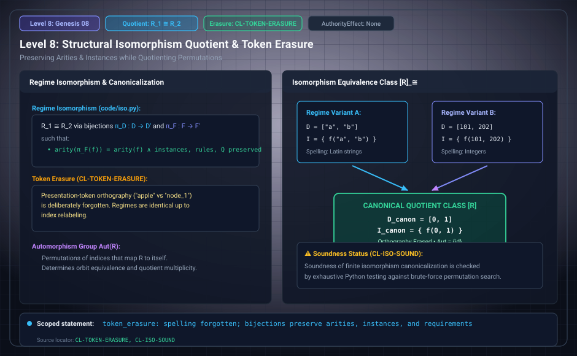

# Level 08: Isomorphism and search

AuthorityEffect: None. Teaching milestone; no identity with an S(n) stage or MSS index.

**Carrier:** A declared finite relation or full token-erased regime.

**Supplied assumptions:** Specify all transported fields and whether canonicalization is exact or resource-bounded.

**Statement:** Exhaustive minimization over permutations gives a canonical key for the declared finite relation. The simple companion relation helper is not a proof of the full native regime canonicalizer. Equal state keys do not establish equivariance of a generator that selects token names. Preserve UNREADABLE and budget outcomes.

**Evidence:** DECLARED QUOTIENT AND BOUNDED COMPUTATION. [Pinned source](https://github.com/dbccpage/19L57G1/blob/f1d56c010e6ba10a3b9418bd7cc5953c067250f2/research/second/paper.md). Source statements and recorded compilation are distinguished from fresh companion tests.

**Implementation or open obligation:** The 482 cases above the brute-force comparison limit and augmentation freshness remain separate obligations.

See the [current Genesis account](../genesis.md), [all-source crosswalk](../source_crosswalk.md), [selected families](../primitives/README.md) and [actual source adapters](../research_extension/docs/source_fidelity.md).

