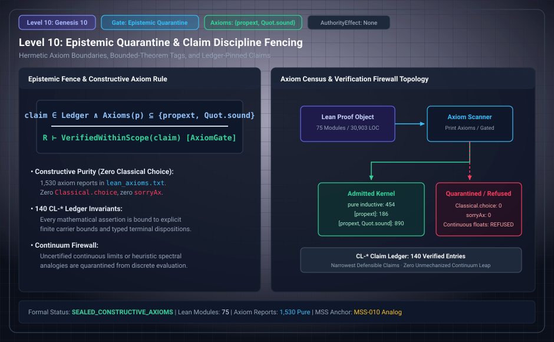

# Level 10: Axiom evidence

AuthorityEffect: None. Teaching milestone; no identity with an S(n) stage or MSS index.

**Carrier:** Named Lean declarations and their dependency reports.

**Supplied assumptions:** An axiom policy and a per-declaration report have different roles.

**Statement:** The historical seal census has 1,314 reports; the final source census has 1,530. Allowed dependencies {propext, Quot.sound} do not mean every theorem is axiom-free. Absence of Classical.choice or sorryAx applies to the printed population and its recorded build, not all imaginable results.

**Evidence:** RECORDED AXIOM CENSUS. [Pinned source](https://github.com/dbccpage/19L57G1/blob/f1d56c010e6ba10a3b9418bd7cc5953c067250f2/docs/GENESIS_CLOSEOUT.md). Source statements and recorded compilation are distinguished from fresh companion tests.

**Implementation or open obligation:** A fresh companion compilation is not a rerun of the complete frozen source census.

See the [current Genesis account](../genesis.md), [all-source crosswalk](../source_crosswalk.md), [selected families](../primitives/README.md) and [actual source adapters](../research_extension/docs/source_fidelity.md).

