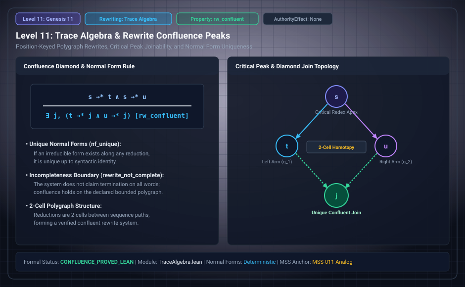

# Level 11: Traces and native swaps

AuthorityEffect: None. Teaching milestone; no identity with an S(n) stage or MSS index.

**Carrier:** Accepted typed Passage traces and a declared independence relation.

**Supplied assumptions:** Both orders must be accepted at each applicable state and their endpoints must agree.

**Statement:** A symmetric irreflexive independence relation supports static trace equivalence; native swap cells additionally carry actual replay evidence. Disjoint write sets alone do not discharge guards that read another field. A canonical trace retains occurrences and dependency order, not a unique original interleaving.

**Evidence:** SEALED CONDITIONAL THEOREMS. [Pinned source](https://github.com/dbccpage/19L57G1/blob/f1d56c010e6ba10a3b9418bd7cc5953c067250f2/lean4/Derivation/TraceAlgebra.lean). Source statements and recorded compilation are distinguished from fresh companion tests.

**Implementation or open obligation:** Native interchange is modulo the specified FarRel, not a strict higher-category claim.

See the [current Genesis account](../genesis.md), [all-source crosswalk](../source_crosswalk.md), [selected families](../primitives/README.md) and [actual source adapters](../research_extension/docs/source_fidelity.md).

